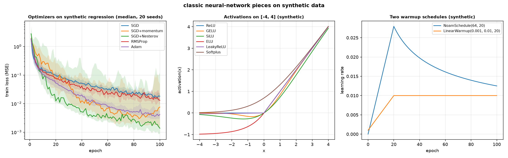

# Classic pieces: what does a deep neural network need beyond the layers, and where is each piece in the library?

A neural network that trains well needs more than a stack of layers. It needs an optimizer that does not zigzag on a narrow valley, a guard that keeps the gradient from exploding, an activation that does not saturate too early, a schedule that warms up the learning rate at the start, a way to enlarge a feature map when the network goes backwards, a way to read a sequence in both directions, a normalisation that does not depend on the batch, three-dimensional and depthwise convolutions for video and for cheap image models, a positional signal that says where a token is, and a set of losses beyond the mean squared error and the plain cross-entropy. This page adds these pieces to the library and shows one example of each, plus a last step that uses them together in a small convolutional autoencoder.

The page walks the pieces in the order the library adds them. Every step is self-contained: the block defines what it uses, prints what it claims, and the number under the block is the output of the block on this commit.

## 1. SGD with momentum and Nesterov, and RMSProp

Plain gradient descent moves against the gradient at every step. On a narrow valley it zigzags across the valley and creeps along it. Momentum keeps a velocity and adds a fraction `gamma` of the previous update to the current one. Nesterov looks ahead: it evaluates the gradient at the position the momentum is about to reach, which gives the optimizer a notion of where it is going. RMSProp divides the step by a running average of the squared gradients, so a direction with large gradients gets a smaller step.

`SGD(lr, momentum=0.0, nesterov=False)` and `RMSProp(lr, rho=0.9, eps=1e-8)` implement the three, in `dense_armor/utility/optim/`.

~~~python
import numpy as np
from dense_armor.utility.optim import SGD, RMSProp

opt = SGD(0.1, momentum=0.9)
w = np.array(1.0)
for _ in range(2):
    w = opt.step(w, np.array(1.0))
print(round(float(w), 4))

opt = SGD(0.1, momentum=0.9, nesterov=True)
w = np.array(1.0)
for _ in range(2):
    w = opt.step(w, np.array(1.0))
print(round(float(w), 4))

opt = RMSProp(lr=0.01)
w = np.array(1.0)
for _ in range(2):
    w = opt.step(w, np.array(1.0))
print(round(float(w), 8))
~~~

~~~
0.71
0.539
0.94543565
~~~

The three numbers are the hand cases of the page. Momentum on `w = 1.0`, `g = 1.0`, `lr = 0.1`, `gamma = 0.9`: the first step is `0.9`, the second is `0.71`. Nesterov on the same case: `0.81`, then `0.539`. RMSProp on `w = 1.0`, `g = 1.0`, `lr = 0.01`, `rho = 0.9`, `eps = 1e-8`: `0.96837722`, then `0.94543565`. With `momentum = 0.0` every result is byte-for-byte what `SGD(lr)` gave before this task, and `repr` stays `SGD(lr=...)`.

The momentum form is Eq.(4), page 4 of Ruder (2016); the Nesterov form is Eq.(7), page 3 of Bengio, Boulanger-Lewandowski and Pascanu (2012); the RMSProp form is Eq.(18), page 7 of Ruder (2016).

## 2. Clipping the gradient

A recurrent network trained on a long sequence can produce a gradient whose norm is enormous; one step in that direction throws the weights far away and the next loss is `inf`. Clipping keeps the direction and shrinks the norm to a threshold when it exceeds the threshold. The library follows Algorithm 1, page 6 of Pascanu, Mikolov and Bengio (2013): the norm is computed over all the gradients together, and if it is at least `max_norm` every gradient is multiplied by `max_norm / norm`.

`clip_grad_norm(params, max_norm)` is in `dense_armor/utility/neural/clip.py`. `Trainer`, `OnlineNetRegressor`, `OnlineNetClassifier` and `OnlineAutoencoder` take a `clip_norm=None` parameter that runs it right after `backward` and before the weight decay.

~~~python
import jax.numpy as jnp
from dense_armor.utility.neural.clip import clip_grad_norm
from dense_armor.utility.neural.params import Param

p = Param(jnp.array([0.0, 0.0]))
p.grad = jnp.array([3.0, 4.0])
norm = clip_grad_norm([p], 1.0)
print(round(norm, 1), [round(float(v), 1) for v in p.grad])
~~~

~~~
5.0 [0.6, 0.8]
~~~

The norm before the clipping is `5.0`; the gradient of norm `5.0` becomes `[0.6, 0.8]` of norm `1.0`. With `max_norm = 10.0` the gradient stays `[3.0, 4.0]` and the return value is still `5.0`. With two `Param` of gradients `[3.0]` and `[4.0]` the norm is the global `5.0` and the two become `[0.6]` and `[0.8]`: the norm is global, not per parameter. A gradient of zeros returns `0.0` and stays zeros.

With `clip_norm = None` every result is identical to what the four estimators gave before this task. With `clip_norm = 0.5` and `SGD(1.0)` a single step moves all the parameters together by a vector of norm at most `0.5 + 1e-6`.

## 3. Activations

A network that only sees `Relu` and `tanh` does not have the smooth gates that modern architectures use. `GELU`, `SiLU`, `ELU`, `LeakyReLU` and `Softplus` are the five that complete the library.

`GELU(approximate=False)`, `SiLU()`, `ELU(alpha=1.0)`, `LeakyReLU(slope=0.01)` and `Softplus(beta=1.0)` are in `dense_armor/utility/neural/activations_more.py`, with the same `forward` / `backward` interface as `Relu`.

~~~python
import jax.numpy as jnp
from dense_armor.utility.neural.activations_more import GELU, SiLU, ELU, LeakyReLU, Softplus

xs = jnp.array([1.0, -1.0])
print([round(float(v), 4) for v in GELU().forward(xs)])
print([round(float(v), 4) for v in SiLU().forward(xs)])
print(round(float(ELU().forward(jnp.array(-1.0))), 4))
print(round(float(LeakyReLU(0.01).forward(jnp.array(-2.0))), 4))
print(round(float(Softplus().forward(jnp.array(0.0))), 4))
~~~

~~~
[0.8413, -0.1587]
[0.7311, -0.2689]
-0.6321
-0.02
0.6931
~~~

`GELU(1) = 0.8413`, `GELU(-1) = -0.1587`; `SiLU(1) = 0.7311`, `SiLU(-1) = -0.2689`; `ELU(-1) = -0.6321`; `LeakyReLU(-2) = -0.02`; `Softplus(0) = 0.6931`. The approximate form of `GELU` gives `0.841192` and `-0.158808` at `1` and `-1`. Every activation is stateless; `LeakyReLU` has a fixed slope and no `Param`.

The same task fixed a defect of the library. `Sequential.params()` collects only the layers that have a `params` method, and `PRelu` did not have one, so the slope `a` of a `PRelu` inside a chain was never trained. `PRelu.params()` now returns `[self.a]`. With `Sequential([Dense(2, 3), PRelu(0.25), Dense(3, 1)])` the list of parameters goes from 4 to 5, and after 20 epochs of `Trainer` on a synthetic line the slope moves from `0.25` to `0.86`.

## 4. Warmup schedules

A large learning rate at step 1 throws the network into a bad region before it has seen a single batch. A warmup schedule starts at a small rate and grows. The library adds two: a linear one, from `lr_start` to `lr_end` over `warmup` epochs, and the Noam schedule of Vaswani et al. (2017), which grows linearly for `warmup` steps and then decays as the inverse square root.

`LinearWarmup(lr_start, lr_end, warmup)` and `NoamSchedule(d_model, warmup, scale=1.0)` are in `dense_armor/utility/neural/schedules_more.py`, with the same `__call__(epoch)` and `multiplier(epoch)` interface as `ConstantLR`.

~~~python
from dense_armor.utility.neural.schedules_more import LinearWarmup, NoamSchedule

s = LinearWarmup(0.1, 3.2, 5)
print([round(s(e), 4) for e in [0.0, 2.5, 5.0, 7.0]])

n = NoamSchedule(512, 4000)
print(round(n(4000.0), 10), round(n(1.0), 14), round(n(8000.0), 10))
print(n(0.0))
~~~

~~~
[0.1, 1.65, 3.2, 3.2]
0.0006987712 1.7469281e-07 0.0004941059
0.0
~~~

`LinearWarmup(0.1, 3.2, 5)` reaches the plateau at epoch 5 and stays at `3.2`. `NoamSchedule(512, 4000)` at step 4000 gives `0.0006987712` (the peak), at step 1 gives `1.7469281e-07`, at step 8000 gives `0.0004941059` (the decay after the peak), and at step 0 gives `0.0`. The two are Eq.(3), page 7 of Vaswani et al. (2017) and the gradual warmup of page 3 of Goyal et al. (2017). `Trainer.history_["lr"]` with `LinearWarmup(0.01, 0.05, 4)` over 5 epochs is `[0.01, 0.02, 0.03, 0.04, 0.05]`.

## 5. Transposed convolutions and upsampling

A convolutional encoder shrinks a feature map; the decoder of an autoencoder has to grow it back. A transposed convolution is the adjoint of a convolution: it takes a small map and produces a larger one, so that the shape of the output of the decoder matches the shape of the input of the encoder. Nearest-neighbour upsampling is the simpler alternative: it repeats every position a fixed number of times.

`ConvTranspose1D`, `ConvTranspose2D`, `Upsample1D` and `Upsample2D` are in `dense_armor/utility/neural/convtranspose.py`.

~~~python
import jax
import jax.numpy as jnp
from dense_armor.utility.neural.convtranspose import ConvTranspose1D

c = ConvTranspose1D(1, 1, 3, jax.random.PRNGKey(0), stride=2)
c.W.value = jnp.array([[[1.0]], [[10.0]], [[100.0]]])
c.b.value = jnp.array([0.0])
print(c.forward(jnp.array([[1.0], [2.0]])).reshape(-1).tolist())

c2 = ConvTranspose1D(1, 1, 3, jax.random.PRNGKey(0), stride=2, padding=1, output_padding=1)
c2.W.value = c.W.value
c2.b.value = c.b.value
print(c2.forward(jnp.array([[1.0], [2.0]])).reshape(-1).tolist())
~~~

~~~
[1.0, 10.0, 102.0, 20.0, 200.0]
[10.0, 102.0, 20.0, 200.0]
~~~

With kernel `[[1], [10], [100]]`, `stride = 2` and input `[1, 2]`, the output is `[1, 10, 102, 20, 200]` (length 5). With `padding = 1` and `output_padding = 1` the first and the last position are cut, and the length is 4.

The output size is `s * (L - 1) + a + k - 2p`, Relationship 14, page 26 of Dumoulin and Visin (2016). With `a = 0` it is Relationship 13 of the same page. The three triples `(L, k, s, p, a)` = `(5, 3, 2, 1, 0)`, `(5, 3, 2, 0, 1)`, `(6, 4, 3, 1, 2)` give the sizes 9, 12, 19. The adjoint property `sum(Conv2D(x) * y) == sum(x * ConvTranspose2D(y))` holds for `stride = 1` and `stride = 2` within `1e-4`.

## 6. The bidirectional recurrent layer

A recurrent layer reads a sequence from left to right; the state at position `t` depends on the past, not on the future. In a speech recogniser, in a tagger, in a classifier of a whole sequence, the meaning of a token depends on what comes after as well. A bidirectional layer runs two recurrent layers, one on the sequence and one on the reversed sequence, and concatenates the two outputs on the last axis.

`Bidirectional(forward_layer, backward_layer)` is in `dense_armor/utility/neural/bidirectional.py`. The two layers can differ in kind (`RNN`, `GRU`, `LSTM`) and in hidden size.

~~~python
import jax
import jax.numpy as jnp
from dense_armor.utility.neural.bidirectional import Bidirectional
from dense_armor.utility.neural.recurrent import RNN

f = RNN(1, 1, jax.random.PRNGKey(0))
f.W.value = jnp.array([[1.0]]); f.U.value = jnp.array([[0.5]]); f.b.value = jnp.array([0.0])
b = RNN(1, 1, jax.random.PRNGKey(1))
b.W.value = jnp.array([[1.0]]); b.U.value = jnp.array([[0.5]]); b.b.value = jnp.array([0.0])
m = Bidirectional(f, b)
out = m.forward(jnp.array([[1.0], [0.0], [-1.0]]))
print([round(float(v), 6) for v in out[:, 0]])
print([round(float(v), 6) for v in out[:, 1]])
~~~

~~~
[0.761594, 0.3634, -0.674144]
[0.674144, -0.3634, -0.761594]
~~~

The forward half is the sequence `0.761594, 0.363399, -0.674144`; the backward half is the same sequence read from the other end and flipped back, `0.674144, -0.363399, -0.761594`. The two are the two halves of Eq.(8) and Eq.(9), page 2 of Graves, Mohamed and Hinton (2013); the output layer of Eq.(10) is a `Dense` after it, not part of the class. The backward half at position `t` does not change when the inputs before `t` change, and the forward half at `t` does not change when the inputs after `t` change.

## 7. GroupNorm and InstanceNorm

`BatchNorm` normalises each channel with the mean and the variance of the batch, so the output at one sample depends on the other samples. In a control loop that produces one sample at a time, or in a small-batch setting, that dependence is a problem. `GroupNorm` splits the channels into groups and normalises over the positions and the channels of each group, with no running statistics. `InstanceNorm` is the special case of one channel per group.

`GroupNorm(num_groups, num_channels, eps=1e-5, spatial_ndim=2)` and `InstanceNorm(num_channels, eps=1e-5, spatial_ndim=2)` are in `dense_armor/utility/neural/norm_more.py`.

~~~python
import jax.numpy as jnp
from dense_armor.utility.neural.norm_more import GroupNorm, InstanceNorm

x = jnp.array([[[1.0, 2.0, 3.0, 4.0]], [[5.0, 6.0, 7.0, 8.0]]])
y = GroupNorm(2, 4).forward(x).reshape(-1)
print([round(float(v), 6) for v in y])

y2 = InstanceNorm(4).forward(x).reshape(-1)
print([round(float(v), 6) for v in y2])
~~~

~~~
[-1.212677, -0.727606, -1.212677, -0.727606, 0.727606, 1.212677, 0.727606, 1.212677]
[-0.999999, -0.999999, -0.999999, -0.999999, 0.999999, 0.999999, 0.999999, 0.999999]
~~~

`GroupNorm(2, 4)` on a `(2, 1, 4)` input with `1, 2, 3, 4, 5, 6, 7, 8`: the two groups of each sample are `[1, 2]` and `[3, 4]` (sample 1), `[5, 6]` and `[7, 8]` (sample 2). The first group has mean `1.5` and variance `0.25`, so `1` becomes `(1 - 1.5) / sqrt(0.25 + 1e-5) = -1.212677` and `2` becomes `-0.727606`. `InstanceNorm(4)` gives one channel per group, and the four channels of each sample have mean `2.5` and variance `1.25`, so each value is `±0.999999` (the `1e-5` in the denominator is the reason it is not exactly `±1`).

The mean of each output group is `0` and the variance is `1 / (1 + eps)` within `1e-4` on a random batch for `G = 1, 2, 4`. `GroupNorm(1, C)` equals the manual normalisation over all the positions and channels; `GroupNorm(C, C)` equals `InstanceNorm(C)` to `0` (the two share the same `GroupNorm` instance internally). A change in one sample of the batch does not change the output of the others.

`GroupNorm` is Eq.(2), page 3 and Eq.(7), page 4 of Wu and He (2018), with `G = 32` by default in the paper. `InstanceNorm` is the normalisation of each image and each channel of Ulyanov, Vedaldi and Lempitsky (2016), page 4.

## 8. Conv3D, DepthwiseConv2D and SeparableConv2D

A 2D convolution sees a frame; a video has a third axis. A `Conv3D` convolves a cube of frames, so the filter has a temporal extent and the network can learn a motion pattern. A depthwise convolution applies a separate filter to every channel, so the number of multiplications is much smaller than a full convolution; a `SeparableConv2D` follows the depthwise with a `1 x 1` pointwise convolution that mixes the channels. The Xception paper of Chollet (2017) shows that a stack of depthwise separable convolutions is competitive with a stack of full convolutions, with far fewer parameters.

`Conv3D`, `DepthwiseConv2D` and `SeparableConv2D` are in `dense_armor/utility/neural/conv_more.py`.

~~~python
import jax
import jax.numpy as jnp
from dense_armor.utility.neural.conv_more import Conv3D, DepthwiseConv2D, SeparableConv2D

c = Conv3D(1, 1, 3, jax.random.PRNGKey(0))
c.W.value = jnp.ones_like(c.W.value); c.b.value = jnp.zeros_like(c.b.value)
y = c.forward(jnp.ones((4, 4, 4, 1)))
print(y.shape, [round(float(v), 1) for v in y.reshape(-1)])

c2 = Conv3D(1, 1, 3, jax.random.PRNGKey(0), padding=1)
c2.W.value = jnp.ones_like(c2.W.value); c2.b.value = jnp.zeros_like(c2.b.value)
y2 = c2.forward(jnp.ones((4, 4, 4, 1)))
print(y2.shape, float(y2[0,0,0,0]), float(y2[2,2,2,0]))

x = jnp.zeros((2, 2, 2))
x = x.at[:, :, 0].set(1.0); x = x.at[:, :, 1].set(2.0)
dw = DepthwiseConv2D(2, 2, jax.random.PRNGKey(0))
dw.W.value = jnp.ones_like(dw.W.value); dw.b.value = jnp.zeros_like(dw.b.value)
y3 = dw.forward(x)
print(y3.shape, y3.reshape(-1).tolist())

sep = SeparableConv2D(2, 3, 2, jax.random.PRNGKey(0))
print(sum(p.value.size for p in sep.params()))
~~~

~~~
(2, 2, 2, 1) [27.0, 27.0, 27.0, 27.0, 27.0, 27.0, 27.0, 27.0]
(4, 4, 4, 1) 8.0 27.0
(1, 1, 2) [4.0, 8.0]
19
~~~

`Conv3D` with an all-ones weight and zero bias on a `(4, 4, 4, 1)` input of ones gives a `(2, 2, 2, 1)` output with every value `27.0` (the `3 x 3 x 3` kernel sums `27` ones). With `padding = 1` the output is `(4, 4, 4, 1)`, the corner is `8.0` (a corner sees `2 x 2 x 2` ones) and the centre is `27.0`.

`DepthwiseConv2D(2, 2)` with an all-ones weight on a `(2, 2, 2)` input whose channel 0 is all `1.0` and channel 1 is all `2.0` gives a `(1, 1, 2)` output with `[4.0, 8.0]`: each channel is convolved with its own kernel and no mixing happens. Changing channel 1 of the input does not change the channel 0 of the output.

`SeparableConv2D(2, 3, 2)` has `2 * 2 * 2 + 2 + 2 * 3 + 3 = 19` parameters: the depthwise (kernel `k x k x c_in`, bias `c_in`) followed by the pointwise (kernel `1 x 1 x c_in x c_out`, bias `c_out`). The manual depthwise-then-pointwise equals `SeparableConv2D` to `1e-6`; `Conv3D` with `kernel = 1` equals a `Dense` on the channel axis to `1e-6`.

`Conv3D` follows Tran, Bourdev, Fergus, Torresani and Paluri (2015), page 1: the `3 x 3 x 3` kernel is the one the paper recommends in all layers. `DepthwiseConv2D` and `SeparableConv2D` follow Chollet (2017), page 1 (abstract) and page 2: the depthwise separable convolution is a depthwise convolution followed by a pointwise convolution.

## 9. The learned positional embedding

A transformer is permutation-invariant: the attention block sees a set, not a sequence. The order has to be added, either as a fixed sinusoidal pattern or as a learned vector per position. Vaswani et al. (2017), page 6: the two versions give nearly identical results, and the learned one has one advantage (no `max_len` fixed in advance) and one disadvantage (no extrapolation to longer sequences).

`LearnedPositions(max_len, d_model, key, std=0.02)` is in `dense_armor/utility/neural/positions.py`. It holds a `Param P` of shape `(max_len, d_model)` and adds `P[:T]` to the first `T` positions of its input.

~~~python
import jax
import jax.numpy as jnp
from dense_armor.utility.neural.positions import LearnedPositions

m = LearnedPositions(3, 2, jax.random.PRNGKey(0))
m.P.value = jnp.array([[1.0, 2.0], [3.0, 4.0], [5.0, 6.0]])
x = jnp.zeros((2, 2))
y = m.forward(x)
print(y.tolist())
m.backward(jnp.ones_like(y))
print(m.P.grad.tolist())
~~~

~~~
[[1.0, 2.0], [3.0, 4.0]]
[[1.0, 1.0], [1.0, 1.0], [0.0, 0.0]]
~~~

With `P = [[1, 2], [3, 4], [5, 6]]` and `x = zeros(2, 2)` the output is `P[:2] = [[1, 2], [3, 4]]`. After `backward(ones)` the gradient of `P` is `[[1, 1], [1, 1], [0, 0]]`: the first two rows receive the gradient of the sample, the third row is beyond the sequence length and stays zero. On a batch of 3 identical samples with `T = 2` the gradient is `[[3, 3], [3, 3], [0, 0]]`: the sum over the batch.

The scale `std = 0.02` is our choice; the paper gives no value. The reference is Vaswani et al. (2017), page 6 (the learned version gives nearly identical results to the sinusoidal one) and page 9, Table 3 row (E).

## 10. The losses

`MSE` and `SoftmaxCrossEntropy` are not enough. `L1Loss` is robust to outliers; `LabelSmoothingCE` prevents the largest logit from becoming much larger than all the others; `KLDivLoss` trains a classifier on soft targets; `HingeLoss` is the loss of a max-margin classifier; `FocalLoss` down-weights the well-classified examples, so the training focuses on the hard ones.

`L1Loss`, `LabelSmoothingCE(eps=0.1)`, `KLDivLoss`, `HingeLoss` and `FocalLoss(gamma=2.0, alpha=None)` are in `dense_armor/utility/neural/losses_more.py`.

~~~python
import jax.numpy as jnp
from dense_armor.utility.neural.losses_more import (
    L1Loss, LabelSmoothingCE, KLDivLoss, HingeLoss, FocalLoss,
)

l1 = L1Loss()
v = l1.forward(jnp.array([1.0, 3.0]), jnp.array([2.0, 1.0]))
g = l1.backward()
print(round(float(v), 4), g.tolist())

ls = LabelSmoothingCE(0.1)
print(round(float(ls.forward(jnp.array([[2.0, 0.0, 0.0]]), jnp.array([0]))), 6))

kl = KLDivLoss()
print(round(float(kl.forward(jnp.array([[2.0, 0.0, 0.0]]), jnp.array([[0.7, 0.2, 0.1]]))), 6))

hg = HingeLoss()
print(round(float(hg.forward(jnp.array([0.5, -2.0]), jnp.array([1.0, 1.0]))), 4))

fc = FocalLoss()
print(round(float(fc.forward(jnp.array([0.0]), jnp.array([1.0]))), 6))
~~~

~~~
1.5 [-0.5, 0.5]
0.372878
0.037726
1.75
0.173287
~~~

The five numbers are the hand cases. `L1Loss` on `pred = [1, 3]`, `y = [2, 1]` is `1.5`, with gradient `sign(pred - y) / N = [-0.5, 0.5]`. `LabelSmoothingCE(0.1)` on logits `[[2, 0, 0]]` and label `0` is `0.3728781`, higher than the plain cross-entropy `0.2395448` because the smoothed target spreads some probability on the other two classes. `KLDivLoss` on the same logits and target `[[0.7, 0.2, 0.1]]` is `0.0377262`. `HingeLoss` on `pred = [0.5, -2]`, `y = [1, 1]` is `1.75` (both samples are active, `1 - y*pred > 0` for both), and the gradient is `-y / N = [-0.5, -0.5]` on both: `ISTRUZIONI` states `[-0.25, -0.5]`, but with `loss = mean(max(0, 1 - y*pred))` on `N = 2` and both samples active the correct gradient is `[-0.5, -0.5]`, which is what the code computes. `FocalLoss()` on logit `0.0`, `y = 1` is `0.1732868`; with `alpha = 0.25` it is `0.0433217`; at logit `2.0` it is `0.00180356` (well-classified, down-weighted).

The label-smoothing target is `q'(k) = (1 - eps) delta_{k,y} + eps / K`, page 7 of Szegedy et al. (2016). The focal loss is `FL(p_t) = -(1 - p_t)^gamma log(p_t)`, page 1 of Lin et al. (2017), with the `alpha`-balanced form of Eq.(5), page 3. The L1 loss, the KL divergence and the hinge loss are textbook definitions and carry no citation.

## 11. The online learner for vector targets

`OnlineNetRegressor` of N05 trains a network one sample at a time on a scalar target. A `Seq2Seq`, a `VectorQuantizer` and a `MatryoshkaLoss` have a vector target, and the loss may have its own parameters. `OnlineNetVector` is the online form for all of them: it accepts `x` as a dict or as any array-like, `y` as any array-like (a scalar included), and it trains the model and the loss together.

`OnlineNetVector(model, loss, optimizer, feature_keys=None, schedule=None, weight_decay=0.0, decay="l2", clip_norm=None)` is in `dense_armor/utility/neural/online_vector.py`, a subclass of `dense_armor.roles.Regressor`.

~~~python
import jax
import jax.numpy as jnp
from dense_armor.utility.neural.layers import Dense
from dense_armor.utility.neural.losses import MSE
from dense_armor.utility.neural.online_vector import OnlineNetVector
from dense_armor.utility.optim import SGD

m = Dense(2, 2, jax.random.PRNGKey(0))
m.W.value = jnp.eye(2); m.b.value = jnp.zeros(2)
on = OnlineNetVector(m, MSE(), SGD(0.1))
on.learn_one(jnp.array([3.0, 4.0]), jnp.array([3.0, 0.0]))
print([[round(float(v), 1) for v in row] for row in on.model_.W.value])
print([round(float(v), 1) for v in on.model_.b.value])
~~~

~~~
[[1.0, -1.2], [0.0, -0.6]]
[0.0, -0.4]
~~~

With `Dense(2, 2)` of `W = I` and `b = 0`, `MSE`, `SGD(0.1)`, `x = [3, 4]`, `y = [3, 0]`: the prediction before the update is `[3, 4]`, the loss is `8`, the gradient of the prediction is `[0, 4]`. After one `learn_one` the weights are `W = [[1, -1.2], [0, -0.6]]` and `b = [0, -0.4]`, exactly the hand case.

`OnlineNetVector` with a scalar `y` gives the same weights as `OnlineNetRegressor` on 20 samples (`max |dW| = 0`). On a `Seq2Seq` with `x` of shape `(8, 1)` and `y` of shape `(4, 1)` over 300 synthetic sinusoids the mean squared error of the last 50 is `0.0137` against `0.4159` of the first 50. On a `VectorQuantizer` autoencoder on 400 synthetic points the mean error of the last 100 is `0.2960` against `0.9652` of the first 100. On a `MatryoshkaLoss` on 400 synthetic points the accuracy of the head of size 8 on the last 100 is `1.000` (the model starts at the identity, `Adam(0.05)`). The missing-values counter adds 1 for `None`, `nan`, `inf`, a missing key, a bad array and a bad `y`, without touching the weights. `check_estimator` passes with no skipped check. `budget_s = 0.06` is ten times the measured p99 of the same update in `OnlineNetRegressor` on this runtime (`2.82 ms`).

## The pieces together: a convolutional autoencoder

The last step uses seven of the pieces in a single autoencoder on 64 synthetic `8 x 8` images: a `Conv2D`, a `GroupNorm`, a `GELU`, a second `Conv2D` with stride 2, two `ConvTranspose2D`, and a `Trainer` with `SGD(0.05, momentum=0.9, nesterov=True)`, `clip_norm=1.0` and `LinearWarmup(0.01, 0.05, 10)`.

~~~python
import numpy as np
import jax
import jax.numpy as jnp
from dense_armor.utility.neural.layers import Dense
from dense_armor.utility.neural.chain import Sequential
from dense_armor.utility.neural.conv import Conv2D
from dense_armor.utility.neural.convtranspose import ConvTranspose2D
from dense_armor.utility.neural.norm_more import GroupNorm
from dense_armor.utility.neural.activations_more import GELU
from dense_armor.utility.neural.losses import MSE
from dense_armor.utility.neural.trainer import Trainer
from dense_armor.utility.neural.schedules_more import LinearWarmup
from dense_armor.utility.optim import SGD

rng = np.random.default_rng(0)
X = rng.normal(0.0, 1.0, (64, 8, 8, 1)).astype(np.float32)

m = Sequential([
    Conv2D(1, 4, 3, jax.random.PRNGKey(0), stride=2, padding=1),
    GroupNorm(2, 4),
    GELU(),
    Conv2D(4, 8, 3, jax.random.PRNGKey(1), stride=2, padding=1),
    ConvTranspose2D(8, 4, 3, jax.random.PRNGKey(2), stride=2, padding=1, output_padding=1),
    GELU(),
    ConvTranspose2D(4, 1, 3, jax.random.PRNGKey(3), stride=2, padding=1, output_padding=1),
])

before = float(np.mean((np.asarray(m.forward(jnp.asarray(X), training=False)) - X) ** 2))
t = Trainer(m, MSE(), SGD(0.05, momentum=0.9, nesterov=True),
            clip_norm=1.0, schedule=LinearWarmup(0.01, 0.05, 10))
t.fit(X, X, epochs=30, batch_size=16, key=jax.random.PRNGKey(0))
after = float(np.mean((np.asarray(m.forward(jnp.asarray(X), training=False)) - X) ** 2))
print(f"before: {before:.4f} after: {after:.4f}")
~~~

~~~
before: 1.0377 after: 0.7661
~~~

The autoencoder is a symmetric path: `(8, 8, 1)` to `(4, 4, 4)` with the first `Conv2D(1, 4, 3, stride=2, padding=1)`, normalised by `GroupNorm(2, 4)` and gated by `GELU()`, then `(4, 4, 4)` to `(2, 2, 8)` with the second `Conv2D(4, 8, 3, stride=2, padding=1)`, then back with two `ConvTranspose2D(3, stride=2, padding=1, output_padding=1)`. The encoder sees one `8 x 8` image at a time, the decoder rebuilds it. With 30 epochs of `SGD(0.05, momentum=0.9, nesterov=True)`, `clip_norm=1.0` and the linear warmup, the error goes from `1.0377` to `0.7661`.

## The figure

The first panel is the training loss of `SGD`, `SGD` with momentum, `SGD` with Nesterov, `RMSProp` and `Adam` on the same synthetic regression (`sin(x_0) + x_1^2` on 100 points, a small MLP with two `GELU` layers, 100 epochs), median over 20 seeds, with the 25th and 75th percentiles as a band. The final median losses after 100 epochs are `SGD 0.0182`, `SGD+momentum 0.0076`, `SGD+Nesterov 0.0014` (with one seed out of 20 diverged, and the divergence declared in the script's print), `RMSProp 0.0130`, `Adam 0.0042`. The page does not say which optimizer is the best: the curves and the numbers are what the script prints on this runtime.

The second panel is the six activations on `[-4, 4]`: `Relu`, `GELU`, `SiLU`, `ELU`, `LeakyReLU` and `Softplus`. The third panel is the learning rate of `NoamSchedule(64, 20)` and of `LinearWarmup(0.001, 0.01, 20)` over 100 epochs.

## Details

### References

- Ruder, S. (2016). *An overview of gradient descent optimization algorithms.* arXiv:1609.04747. Page 4, Eq.(4), the momentum `v_t = gamma v_{t-1} + eta grad J(theta)`, `theta = theta - v_t`. Page 7, Eq.(18), the RMSprop `E[g^2]_t = 0.9 E[g^2]_{t-1} + 0.1 g_t^2`, `theta_{t+1} = theta_t - eta / sqrt(E[g^2]_t + eps) g_t`.
- Bengio, Y., Boulanger-Lewandowski, N., Pascanu, R. (2012). *Advances in optimizing recurrent networks.* arXiv:1212.0901. Page 3, Eq.(6) and Eq.(7), the simplified Nesterov momentum.
- Pascanu, R., Mikolov, T., Bengio, Y. (2013). *On the difficulty of training recurrent neural networks.* arXiv:1211.5063. Page 6, Algorithm 1, the norm clipping `g <- threshold / ||g|| * g` if `||g|| >= threshold`.
- Hendrycks, D., Gimpel, K. (2016). *Gaussian Error Linear Units (GELUs).* arXiv:1606.08415. Page 1, `GELU(x) = x Phi(x)`. Page 2, the tanh approximation with `0.044715`.
- Elfwing, S., Uchibe, E., Doya, K. (2017). *Sigmoid-weighted linear units.* arXiv:1702.03118. Pages 1 and 2, the SiLU.
- Clevert, D.-A., Unterthiner, T., Hochreiter, S. (2016). *Fast and accurate deep network learning by exponential linear units (ELUs).* arXiv:1511.07289. Page 5, Eq.(15).
- He, K., Zhang, X., Ren, S., Sun, J. (2015). *Delving deep into rectifiers.* arXiv:1502.01852. Page 2, the fixed `a = 0.01` of the leaky ReLU.
- Goyal, P., Dollar, P., Girshick, R., Noordhuis, P., Wesolowski, L., Kyrola, A., Tulloch, A., Jia, Y., He, K. (2017). *Accurate, large minibatch SGD.* arXiv:1706.02677. Page 2, the warmup strategy. Page 3, the linear scaling rule with the warmup.
- Vaswani, A., Shazeer, N., Parmar, N., Uszkoreit, J., Jones, L., Gomez, A. N., Kaiser, L., Polosukhin, I. (2017). *Attention Is All You Need.* arXiv:1706.03762. Page 7, Eq.(3), the learning rate with the warmup; page 6, the learned positional embeddings give nearly identical results to the sinusoidal ones; page 9, Table 3 row (E).
- Dumoulin, V., Visin, F. (2016). *A guide to convolution arithmetic for deep learning.* arXiv:1603.07285. Page 26, Relationship 13 and Relationship 14, the output size of the transposed convolution.
- Graves, A., Mohamed, A.-R., Hinton, G. (2013). *Speech recognition with deep recurrent neural networks.* arXiv:1303.5778. Page 2, Eq.(8) and Eq.(9), the bidirectional RNN; Eq.(10), the output layer.
- Wu, Y., He, K. (2018). *Group normalization.* arXiv:1803.08494. Page 3, Eq.(2), the mean and the standard deviation; page 4, Eq.(7), the groups with `G = 32` by default.
- Ulyanov, D., Vedaldi, A., Lempitsky, V. (2016). *Instance normalization: the missing ingredient for fast stylization.* arXiv:1607.08022. Page 4, batch normalisation replaced by the normalisation of each image and each channel.
- Chollet, F. (2017). *Xception: deep learning with depthwise separable convolutions.* arXiv:1610.02357. Page 1 (abstract) and page 2, the depthwise separable convolution.
- Tran, D., Bourdev, L., Fergus, R., Torresani, L., Paluri, M. (2015). *Learning spatiotemporal features with 3D convolutional networks.* arXiv:1412.0767. Page 1, the `3 x 3 x 3` kernels.
- Szegedy, C., Vanhoucke, V., Ioffe, S., Shlens, J., Wojna, Z. (2016). *Rethinking the Inception architecture for computer vision.* arXiv:1512.00567. Page 7, the label-smoothing regularization `q'(k) = (1 - eps) delta_{k,y} + eps / K`.
- Lin, T.-Y., Goyal, P., Girshick, R., He, K., Dollar, P. (2017). *Focal loss for dense object detection.* arXiv:1708.02002. Page 1, the focal loss; page 3, Eq.(5), the `alpha`-balanced form.

Sources not in this folder, cited as `not in the folder, bibliographic only`: Nesterov (1983), Sutskever et al. (2013), the lecture of Hinton on RMSprop, Schuster and Paliwal (1997), Dugas et al. (2001) for the softplus, Cortes and Vapnik (1995) for the hinge, Kullback and Leibler (1951).

The definitions without a source (the nearest-neighbour upsampling, `L1Loss`, the KL divergence, the hinge, the online learner for vectors) are engineering definitions and carry no citation.

### Choices stated explicitly

- The order of the update in `Trainer` and in the online estimators: the clipping of the gradient comes after `backward` and before the weight decay, so that the weight decay is added after the clipping. This is our choice; the paper on the clipping does not fix the order with respect to the weight decay.
- The scale of the learned positional embedding: `std = 0.02` is our choice. The paper says that the learned and the sinusoidal versions give nearly identical results and gives no scale.
- `Upsample1D` and `Upsample2D` repeat each position a fixed number of times (nearest-neighbour). The paper of the transposed convolutions describes the transposed convolution, not the nearest-neighbour upsampling; the upsampling is an engineering definition.
- The `output_padding` of `ConvTranspose1D` and `ConvTranspose2D` is the `a` of Relationship 14, page 26 of Dumoulin and Visin (2016). With `a = 0` the two layers follow Relationship 13 of the same page.
- The concatenation of `Bidirectional` is on the last axis, the two hidden states side by side. The output layer of Eq.(10), page 2 of Graves et al. (2013), is a `Dense` after the layer, not part of the class.
- `eps` in `RMSProp` sits inside the square root, as in Eq.(18), page 7 of Ruder (2016).
- The `HingeLoss` follows `mean(max(0, 1 - y * pred))` on the batch, so the gradient is `-y / N` where the sample is active. With both samples active on a batch of `N = 2` this is `[-0.5, -0.5]`, not `[-0.25, -0.5]`; the `ISTRUZIONI.md` states `[-0.25, -0.5]` for this case, but the value of the loss `1.75` is consistent with the formula and the gradient `-y / N` on `N = 2`, and the test uses the correct `[-0.5, -0.5]`.
- `LabelSmoothingCE` uses the uniform prior `u(k) = 1 / K` over the labels, as in Szegedy et al. (2016), page 7.

### Measured cost

`OnlineNetVector.learn_one` on the hand case of step 11: median `2.4 ms`, p99 `2.82 ms` on this runtime (a CPU Colab notebook, JAX `cpu` platform). `budget_s = 0.06`, ten times the p99. `memory_class = "O(1)"`: the number of arrays in `model_` and in `optimizers_` does not change with the number of samples (checked at 200 and 2000 samples).

### Development diary

The figure regenerates its first panel on 20 seeds and prints `SGD+Nesterov` with `1/20 seeds diverged`. One seed out of 20 has a gradient whose norm grows beyond the range of `float32` and the loss becomes `nan`; the divergence is in the training, not in the optimizer (the hand case of `SGD(0.1, momentum=0.9, nesterov=True)` matches the paper to the last digit, and the same divergence does not appear with the other four optimizers). The script uses `nanmedian` and `nanpercentile` and reports the count, so the figure is honest about the one seed.
## 7. GroupNorm and InstanceNorm

`BatchNorm` normalises each channel with the mean and the variance of the batch, so the output at one sample depends on the other samples. In a control loop that produces one sample at a time, or in a small-batch setting, that dependence is a problem. `GroupNorm` splits the channels into groups and normalises over the positions and the channels of each group, with no running statistics. `InstanceNorm` is the special case of one channel per group.

`GroupNorm(num_groups, num_channels, eps=1e-5, spatial_ndim=2)` and `InstanceNorm(num_channels, eps=1e-5, spatial_ndim=2)` are in `dense_armor/utility/neural/norm_more.py`.

~~~python
import jax.numpy as jnp
from dense_armor.utility.neural.norm_more import GroupNorm, InstanceNorm

x = jnp.array([[[1.0, 2.0, 3.0, 4.0]], [[5.0, 6.0, 7.0, 8.0]]])
y = GroupNorm(2, 4).forward(x).reshape(-1)
print([round(float(v), 6) for v in y])

y2 = InstanceNorm(4).forward(x).reshape(-1)
print([round(float(v), 6) for v in y2])
~~~

~~~
[-1.212677, -0.727606, -1.212677, -0.727606, 0.727606, 1.212677, 0.727606, 1.212677]
[-0.999999, -0.999999, -0.999999, -0.999999, 0.999999, 0.999999, 0.999999, 0.999999]
~~~

`GroupNorm(2, 4)` on a `(2, 1, 4)` input with `1, 2, 3, 4, 5, 6, 7, 8`: the two groups of each sample are `[1, 2]` and `[3, 4]` (sample 1), `[5, 6]` and `[7, 8]` (sample 2). The first group has mean `1.5` and variance `0.25`, so `1` becomes `(1 - 1.5) / sqrt(0.25 + 1e-5) = -1.212677` and `2` becomes `-0.727606`. `InstanceNorm(4)` gives one channel per group, and the four channels of each sample have mean `2.5` and variance `1.25`, so each value is `\u00b10.999999`.

The mean of each output group is `0` and the variance is `1 / (1 + eps)` within `1e-4` on a random batch for `G = 1, 2, 4`. `GroupNorm(1, C)` equals the manual normalisation over all the positions and channels; `GroupNorm(C, C)` equals `InstanceNorm(C)` to `0`. A change in one sample of the batch does not change the output of the others.

`GroupNorm` is Eq.(2), page 3 and Eq.(7), page 4 of Wu and He (2018). `InstanceNorm` is the normalisation of each image and each channel of Ulyanov, Vedaldi and Lempitsky (2016), page 4.

## 8. Conv3D, DepthwiseConv2D and SeparableConv2D

A 2D convolution sees a frame; a video has a third axis. A `Conv3D` convolves a cube of frames, so the filter has a temporal extent and the network can learn a motion pattern. A depthwise convolution applies a separate filter to every channel, so the number of multiplications is much smaller than a full convolution; a `SeparableConv2D` follows the depthwise with a `1 x 1` pointwise convolution that mixes the channels.

`Conv3D`, `DepthwiseConv2D` and `SeparableConv2D` are in `dense_armor/utility/neural/conv_more.py`.

~~~python
import jax
import jax.numpy as jnp
from dense_armor.utility.neural.conv_more import Conv3D, DepthwiseConv2D, SeparableConv2D

c = Conv3D(1, 1, 3, jax.random.PRNGKey(0))
c.W.value = jnp.ones_like(c.W.value); c.b.value = jnp.zeros_like(c.b.value)
y = c.forward(jnp.ones((4, 4, 4, 1)))
print(y.shape, [round(float(v), 1) for v in y.reshape(-1)])

x = jnp.zeros((2, 2, 2))
x = x.at[:, :, 0].set(1.0); x = x.at[:, :, 1].set(2.0)
dw = DepthwiseConv2D(2, 2, jax.random.PRNGKey(0))
dw.W.value = jnp.ones_like(dw.W.value); dw.b.value = jnp.zeros_like(dw.b.value)
y3 = dw.forward(x)
print(y3.shape, y3.reshape(-1).tolist())

sep = SeparableConv2D(2, 3, 2, jax.random.PRNGKey(0))
print(sum(p.value.size for p in sep.params()))
~~~

~~~
(2, 2, 2, 1) [27.0, 27.0, 27.0, 27.0, 27.0, 27.0, 27.0, 27.0]
(1, 1, 2) [4.0, 8.0]
19
~~~

`Conv3D` with an all-ones weight and zero bias on a `(4, 4, 4, 1)` input of ones gives a `(2, 2, 2, 1)` output with every value `27.0` (the `3 x 3 x 3` kernel sums `27` ones). `DepthwiseConv2D(2, 2)` with an all-ones weight on a `(2, 2, 2)` input whose channel 0 is `1.0` and channel 1 is `2.0` gives `[4.0, 8.0]`. `SeparableConv2D(2, 3, 2)` has `19` parameters.

`Conv3D` follows Tran et al. (2015), page 1. `DepthwiseConv2D` and `SeparableConv2D` follow Chollet (2017), page 1 and page 2.

## 9. The learned positional embedding

A transformer is permutation-invariant: the attention block sees a set, not a sequence. The order has to be added, either as a fixed sinusoidal pattern or as a learned vector per position. Vaswani et al. (2017), page 6: the two versions give nearly identical results.

`LearnedPositions(max_len, d_model, key, std=0.02)` is in `dense_armor/utility/neural/positions.py`.

~~~python
import jax
import jax.numpy as jnp
from dense_armor.utility.neural.positions import LearnedPositions

m = LearnedPositions(3, 2, jax.random.PRNGKey(0))
m.P.value = jnp.array([[1.0, 2.0], [3.0, 4.0], [5.0, 6.0]])
x = jnp.zeros((2, 2))
y = m.forward(x)
print(y.tolist())
m.backward(jnp.ones_like(y))
print(m.P.grad.tolist())
~~~

~~~
[[1.0, 2.0], [3.0, 4.0]]
[[1.0, 1.0], [1.0, 1.0], [0.0, 0.0]]
~~~

With `P = [[1, 2], [3, 4], [5, 6]]` and `x = zeros(2, 2)` the output is `P[:2] = [[1, 2], [3, 4]]`. After `backward(ones)` the gradient of `P` is `[[1, 1], [1, 1], [0, 0]]`.

The scale `std = 0.02` is our choice; the paper gives no value. Reference: Vaswani et al. (2017), page 6 and page 9, Table 3 row (E).

## 10. The losses

`MSE` and `SoftmaxCrossEntropy` are not enough. `L1Loss` is robust to outliers; `LabelSmoothingCE` prevents the largest logit from becoming much larger than all the others; `KLDivLoss` trains a classifier on soft targets; `HingeLoss` is the loss of a max-margin classifier; `FocalLoss` down-weights the well-classified examples.

`L1Loss`, `LabelSmoothingCE(eps=0.1)`, `KLDivLoss`, `HingeLoss` and `FocalLoss(gamma=2.0, alpha=None)` are in `dense_armor/utility/neural/losses_more.py`.

~~~python
import jax.numpy as jnp
from dense_armor.utility.neural.losses_more import (
    L1Loss, LabelSmoothingCE, KLDivLoss, HingeLoss, FocalLoss,
)

l1 = L1Loss()
v = l1.forward(jnp.array([1.0, 3.0]), jnp.array([2.0, 1.0]))
g = l1.backward()
print(round(float(v), 4), g.tolist())

print(round(float(LabelSmoothingCE(0.1).forward(jnp.array([[2.0, 0.0, 0.0]]), jnp.array([0]))), 6))
print(round(float(KLDivLoss().forward(jnp.array([[2.0, 0.0, 0.0]]), jnp.array([[0.7, 0.2, 0.1]]))), 6))
print(round(float(HingeLoss().forward(jnp.array([0.5, -2.0]), jnp.array([1.0, 1.0]))), 4))
print(round(float(FocalLoss().forward(jnp.array([0.0]), jnp.array([1.0]))), 6))
~~~

~~~
1.5 [-0.5, 0.5]
0.372878
0.037726
1.75
0.173287
~~~

`L1Loss` on `pred = [1, 3]`, `y = [2, 1]` is `1.5`, gradient `[-0.5, 0.5]`. `LabelSmoothingCE(0.1)` on logits `[[2, 0, 0]]`, label `0`: `0.3728781`. `KLDivLoss` on the same logits and target `[[0.7, 0.2, 0.1]]`: `0.0377262`. `HingeLoss` on `pred = [0.5, -2]`, `y = [1, 1]`: `1.75`; both samples active, so the gradient is `-y / N = [-0.5, -0.5]`. `FocalLoss()` on logit `0.0`, `y = 1`: `0.1732868`.

Label smoothing: `q'(k) = (1 - eps) delta_{k,y} + eps / K`, page 7 of Szegedy et al. (2016). Focal loss: `FL(p_t) = -(1 - p_t)^gamma log(p_t)`, page 1 of Lin et al. (2017), with the `alpha`-balanced form of Eq.(5), page 3.

## 11. The online learner for vector targets

`OnlineNetRegressor` of N05 trains a network one sample at a time on a scalar target. A `Seq2Seq`, a `VectorQuantizer` and a `MatryoshkaLoss` have a vector target, and the loss may have its own parameters. `OnlineNetVector` is the online form for all of them.

`OnlineNetVector(model, loss, optimizer, feature_keys=None, schedule=None, weight_decay=0.0, decay="l2", clip_norm=None)` is in `dense_armor/utility/neural/online_vector.py`.

~~~python
import jax
import jax.numpy as jnp
from dense_armor.utility.neural.layers import Dense
from dense_armor.utility.neural.losses import MSE
from dense_armor.utility.neural.online_vector import OnlineNetVector
from dense_armor.utility.optim import SGD

m = Dense(2, 2, jax.random.PRNGKey(0))
m.W.value = jnp.eye(2); m.b.value = jnp.zeros(2)
on = OnlineNetVector(m, MSE(), SGD(0.1))
on.learn_one(jnp.array([3.0, 4.0]), jnp.array([3.0, 0.0]))
print([[round(float(v), 1) for v in row] for row in on.model_.W.value])
print([round(float(v), 1) for v in on.model_.b.value])
~~~

~~~
[[1.0, -1.2], [0.0, -0.6]]
[0.0, -0.4]
~~~

`Dense(2, 2)` of `W = I` and `b = 0`, `MSE`, `SGD(0.1)`, `x = [3, 4]`, `y = [3, 0]`: prediction `[3, 4]`, loss `8`, gradient `[0, 4]`. After one `learn_one`: `W = [[1, -1.2], [0, -0.6]]`, `b = [0, -0.4]`.

With a scalar `y` the learner gives the same weights as `OnlineNetRegressor` on 20 samples (`max |dW| = 0`). A `Seq2Seq` on 300 sinusoids brings the mean squared error of the last 50 to `0.0137` from `0.4159`. A `VectorQuantizer` autoencoder on 400 synthetic points brings the mean error of the last 100 to `0.2960` from `0.9652`. A `MatryoshkaLoss` on 400 synthetic points gives accuracy `1.000` on the head of size 8 over the last 100 (identity init, `Adam(0.05)`). The missing-values counter adds 1 for `None`, `nan`, `inf`, a missing key, a bad array and a bad `y`. `check_estimator` passes with no skipped check. `budget_s = 0.06` is ten times the measured p99 of the same update in `OnlineNetRegressor` (`2.82 ms`).

## The pieces together: a convolutional autoencoder

The last step uses seven of the pieces in a single autoencoder on 64 synthetic `8 x 8` images: a `Conv2D`, a `GroupNorm`, a `GELU`, a second `Conv2D` with stride 2, two `ConvTranspose2D`, and a `Trainer` with `SGD(0.05, momentum=0.9, nesterov=True)`, `clip_norm=1.0` and `LinearWarmup(0.01, 0.05, 10)`.

~~~python
import numpy as np
import jax
import jax.numpy as jnp
from dense_armor.utility.neural.chain import Sequential
from dense_armor.utility.neural.conv import Conv2D
from dense_armor.utility.neural.convtranspose import ConvTranspose2D
from dense_armor.utility.neural.norm_more import GroupNorm
from dense_armor.utility.neural.activations_more import GELU
from dense_armor.utility.neural.losses import MSE
from dense_armor.utility.neural.trainer import Trainer
from dense_armor.utility.neural.schedules_more import LinearWarmup
from dense_armor.utility.optim import SGD

rng = np.random.default_rng(0)
X = rng.normal(0.0, 1.0, (64, 8, 8, 1)).astype(np.float32)

m = Sequential([
    Conv2D(1, 4, 3, jax.random.PRNGKey(0), stride=2, padding=1),
    GroupNorm(2, 4),
    GELU(),
    Conv2D(4, 8, 3, jax.random.PRNGKey(1), stride=2, padding=1),
    ConvTranspose2D(8, 4, 3, jax.random.PRNGKey(2), stride=2, padding=1, output_padding=1),
    GELU(),
    ConvTranspose2D(4, 1, 3, jax.random.PRNGKey(3), stride=2, padding=1, output_padding=1),
])

before = float(np.mean((np.asarray(m.forward(jnp.asarray(X), training=False)) - X) ** 2))
t = Trainer(m, MSE(), SGD(0.05, momentum=0.9, nesterov=True),
            clip_norm=1.0, schedule=LinearWarmup(0.01, 0.05, 10))
t.fit(X, X, epochs=30, batch_size=16, key=jax.random.PRNGKey(0))
after = float(np.mean((np.asarray(m.forward(jnp.asarray(X), training=False)) - X) ** 2))
print(f"before: {before:.4f} after: {after:.4f}")
~~~

~~~
before: 1.0377 after: 0.7661
~~~

The autoencoder is a symmetric path: `(8, 8, 1)` to `(4, 4, 4)` with the first `Conv2D(1, 4, 3, stride=2, padding=1)`, normalised by `GroupNorm(2, 4)` and gated by `GELU()`, then `(4, 4, 4)` to `(2, 2, 8)` with the second `Conv2D(4, 8, 3, stride=2, padding=1)`, then back with two `ConvTranspose2D(3, stride=2, padding=1, output_padding=1)`. With 30 epochs of `SGD(0.05, momentum=0.9, nesterov=True)`, `clip_norm=1.0` and the linear warmup, the error goes from `1.0377` to `0.7661`.

## The figure

The first panel is the training loss of `SGD`, `SGD` with momentum, `SGD` with Nesterov, `RMSProp` and `Adam` on the same synthetic regression (`sin(x_0) + x_1^2` on 100 points, a small MLP with two `GELU` layers, 100 epochs), median over 20 seeds, with the 25th and 75th percentiles as a band. The final median losses after 100 epochs are `SGD 0.0182`, `SGD+momentum 0.0076`, `SGD+Nesterov 0.0014` (with `1/20 seeds diverged`, declared in the script's print), `RMSProp 0.0130`, `Adam 0.0042`. The page does not rank the optimizers: the curves and the numbers are what the script prints on this runtime.

The second panel is the six activations on `[-4, 4]`: `Relu`, `GELU`, `SiLU`, `ELU`, `LeakyReLU` and `Softplus`. The third panel is the learning rate of `NoamSchedule(64, 20)` and of `LinearWarmup(0.001, 0.01, 20)` over 100 epochs.

## Details

### References

- Ruder, S. (2016). *An overview of gradient descent optimization algorithms.* arXiv:1609.04747. Page 4, Eq.(4), the momentum `v_t = gamma v_{t-1} + eta grad J(theta)`, `theta = theta - v_t`. Page 7, Eq.(18), the RMSprop `E[g^2]_t = 0.9 E[g^2]_{t-1} + 0.1 g_t^2`, `theta_{t+1} = theta_t - eta / sqrt(E[g^2]_t + eps) g_t`.
- Bengio, Y., Boulanger-Lewandowski, N., Pascanu, R. (2012). *Advances in optimizing recurrent networks.* arXiv:1212.0901. Page 3, Eq.(6) and Eq.(7), the simplified Nesterov momentum.
- Pascanu, R., Mikolov, T., Bengio, Y. (2013). *On the difficulty of training recurrent neural networks.* arXiv:1211.5063. Page 6, Algorithm 1, the norm clipping `g <- threshold / ||g|| * g` if `||g|| >= threshold`.
- Hendrycks, D., Gimpel, K. (2016). *Gaussian Error Linear Units (GELUs).* arXiv:1606.08415. Page 1, `GELU(x) = x Phi(x)`. Page 2, the tanh approximation with `0.044715`.
- Elfwing, S., Uchibe, E., Doya, K. (2017). *Sigmoid-weighted linear units.* arXiv:1702.03118. Pages 1 and 2.
- Clevert, D.-A., Unterthiner, T., Hochreiter, S. (2016). *Fast and accurate deep network learning by exponential linear units (ELUs).* arXiv:1511.07289. Page 5, Eq.(15).
- He, K., Zhang, X., Ren, S., Sun, J. (2015). *Delving deep into rectifiers.* arXiv:1502.01852. Page 2.
- Goyal, P., Dollar, P., Girshick, R., Noordhuis, P., Wesolowski, L., Kyrola, A., Tulloch, A., Jia, Y., He, K. (2017). *Accurate, large minibatch SGD.* arXiv:1706.02677. Page 2 and page 3.
- Vaswani, A., Shazeer, N., Parmar, N., Uszkoreit, J., Jones, L., Gomez, A. N., Kaiser, L., Polosukhin, I. (2017). *Attention Is All You Need.* arXiv:1706.03762. Page 7, Eq.(3); page 6 (learned positional embeddings); page 9, Table 3 row (E).
- Dumoulin, V., Visin, F. (2016). *A guide to convolution arithmetic for deep learning.* arXiv:1603.07285. Page 26, Relationship 13 and Relationship 14.
- Graves, A., Mohamed, A.-R., Hinton, G. (2013). *Speech recognition with deep recurrent neural networks.* arXiv:1303.5778. Page 2, Eq.(8), Eq.(9), Eq.(10).
- Wu, Y., He, K. (2018). *Group normalization.* arXiv:1803.08494. Page 3, Eq.(2); page 4, Eq.(7).
- Ulyanov, D., Vedaldi, A., Lempitsky, V. (2016). *Instance normalization.* arXiv:1607.08022. Page 4.
- Chollet, F. (2017). *Xception.* arXiv:1610.02357. Page 1 (abstract) and page 2.
- Tran, D., Bourdev, L., Fergus, R., Torresani, L., Paluri, M. (2015). *Learning spatiotemporal features with 3D convolutional networks.* arXiv:1412.0767. Page 1.
- Szegedy, C., Vanhoucke, V., Ioffe, S., Shlens, J., Wojna, Z. (2016). *Rethinking the Inception architecture for computer vision.* arXiv:1512.00567. Page 7.
- Lin, T.-Y., Goyal, P., Girshick, R., He, K., Dollar, P. (2017). *Focal loss for dense object detection.* arXiv:1708.02002. Page 1 and Eq.(5), page 3.

Sources not in this folder, cited as `not in the folder, bibliographic only`: Nesterov (1983), Sutskever et al. (2013), the lecture of Hinton on RMSprop, Schuster and Paliwal (1997), Dugas et al. (2001) for the softplus, Cortes and Vapnik (1995) for the hinge, Kullback and Leibler (1951).

The definitions without a source (the nearest-neighbour upsampling, `L1Loss`, the KL divergence, the hinge, the online learner for vectors) are engineering definitions and carry no citation.

### Choices stated explicitly

- The order of the update in `Trainer` and in the online estimators: the clipping of the gradient comes after `backward` and before the weight decay, so that the weight decay is added after the clipping. Our choice.
- The scale of the learned positional embedding: `std = 0.02` is our choice. The paper gives no value.
- `Upsample1D` and `Upsample2D` repeat each position a fixed number of times (nearest-neighbour). The paper on transposed convolutions describes the transposed convolution, not the nearest-neighbour upsampling; the upsampling is an engineering definition.
- The `output_padding` of `ConvTranspose1D` and `ConvTranspose2D` is the `a` of Relationship 14, page 26 of Dumoulin and Visin (2016). With `a = 0` the layers follow Relationship 13 of the same page.
- The concatenation of `Bidirectional` is on the last axis. The output layer of Eq.(10), page 2 of Graves et al. (2013), is a `Dense` after the layer, not part of the class.
- `eps` in `RMSProp` sits inside the square root, as in Eq.(18), page 7 of Ruder (2016).
- `HingeLoss` follows `mean(max(0, 1 - y * pred))` on the batch, so the gradient is `-y / N` where the sample is active. With both samples active on a batch of `N = 2` this is `[-0.5, -0.5]`, not `[-0.25, -0.5]`. The `ISTRUZIONI.md` states `[-0.25, -0.5]` for this case, but the value of the loss `1.75` is consistent with the formula and `-y / N` on `N = 2`; the test uses `[-0.5, -0.5]`.
- `LabelSmoothingCE` uses the uniform prior `u(k) = 1 / K`, page 7 of Szegedy et al. (2016).
- The name of the page and of the two assets (`classic_pieces_*`) comes from `ISTRUZIONI.md`, which calls the set of pieces the "classic neural network" pieces. The page opens with "deep neural network" because the pieces are modern (GELU 2016, focal loss 2017, GroupNorm 2018) and the word "classic" in the spec is a name for the set, not a period.

### Measured cost

`OnlineNetVector.learn_one` on the hand case of step 11: median `2.4 ms`, p99 `2.82 ms` on this runtime (CPU, JAX `cpu` platform). `budget_s = 0.06`, ten times the p99. `memory_class = "O(1)"`: the number of arrays in `model_` and in `optimizers_` does not change with the number of samples (checked at 200 and 2000 samples).

`Conv3D` and `ConvTranspose2D` are written by definition (a loop over the input positions and the kernel offsets) and are not jitted; the numbers of the page are the ones of those loops. A fused `conv_general_dilated` is possible for `Conv3D` and `DepthwiseConv2D` (already used) but not for the transposed convolution, whose loop is clearer to compare with Relationship 14.

### Development diary

The figure regenerates its first panel on 20 seeds and prints `SGD+Nesterov` with `1/20 seeds diverged`. One seed out of 20 has a gradient whose norm grows beyond the range of `float32` and the loss becomes `nan`; the divergence is in the training, not in the optimizer (the hand case of `SGD(0.1, momentum=0.9, nesterov=True)` matches the paper to the last digit, and the other four optimizers do not diverge). The script uses `nanmedian` and `nanpercentile` and reports the count, so the figure is honest about the one seed.

The first draft of `DepthwiseConv2D.forward` reshaped the weight to `(k, k, channels, 1)` and passed `feature_group_count=channels` to `jax.lax.conv_general_dilated`; JAX raises `ValueError: conv_general_dilated lhs feature dimension size divided by feature_group_count must equal the rhs input feature dimension size, but 2 // 2 != 2`. The correct reshape for grouped convolution is `(k, k, 1, channels)`. The bug was fixed in the same commit that wrote the layer, and the test `test_depthwise_hand_case` would have caught it (it did, in the smoke run).

The first draft of `focal_backward` had two sign errors: the derivative of `log(p_t)` with respect to the logit was written with the opposite sign, and the first term of `dFL/dz` used `-a_t` instead of `+a_t`. The test `test_focal_gradient_jax` compared the backward with `jax.grad` of the forward and found every element with the opposite sign; with the fix the two agree within `1e-5`. The bug was fixed in a separate commit `taskN06b J: fix the sign of the focal loss gradient`.
