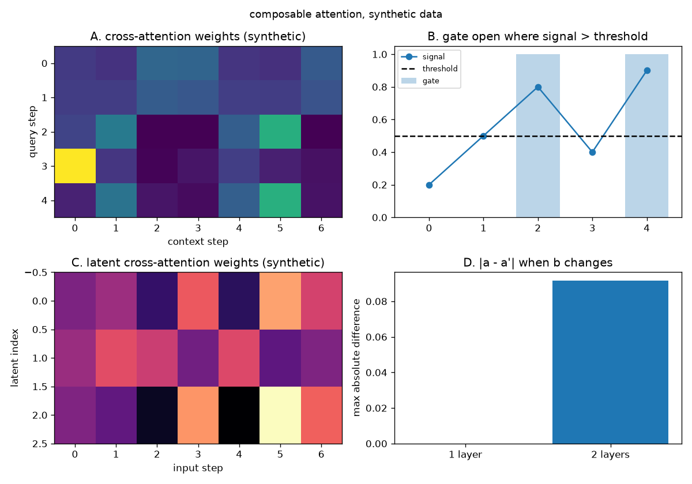

# Composable attention: how do I make a network look at one sensor only when another one says it matters, and fuse two sensors through a few numbers?

A transformer mixes the steps of one stream with each other. Sometimes the steps of one stream should instead look at the steps of a **different** stream: the queries come from the first stream, the keys and values from the second. That is cross-attention. Sometimes the look should happen only when a control signal says it matters: a gate on the query rows. Sometimes the second stream is long and the output should have a fixed size whatever its length: a small set of learned latent vectors becomes the query side. Sometimes two streams of similar size should exchange only a few numbers: a few shared bottleneck tokens do the talking.

The page builds the four bricks in that order, all with `forward`, `backward` and `params()`, so each one trains inside a model written with the `Trainer`. The data is synthetic: four-number codes from a random stream, and a synthetic audio level. The bricks call the library classes directly.

## 1. Cross-attention

The multi-head cross-attention projects the queries from the first stream and the keys and values from the second (Vaswani et al. 2017, page 5: in the encoder-decoder attention the queries come from the previous layer and the memory keys and values from the other stream). The hand case sets the four projection matrices to the identity, so the attention of Eq.(1), page 4, is visible on the raw numbers.

~~~python
import jax
import jax.numpy as jnp
from dense_armor.utility.neural.cross_attention import MultiHeadCrossAttention

cross = MultiHeadCrossAttention(2, 1, jax.random.PRNGKey(0), d_context=2)
for p in cross.params():
    p.value = jnp.eye(2)
xq = jnp.array([[1.0, 0.0], [0.0, 1.0]])
xc = jnp.array([[1.0, 0.0], [0.0, 1.0], [1.0, 1.0]])
y = cross.forward(xq, xc)
print([[round(float(v), 5) for v in row] for row in cross.weights_[0, 0].tolist()])
print([[round(float(v), 5) for v in row] for row in y.tolist()])
~~~

~~~
[[0.40111, 0.19778, 0.40111], [0.19778, 0.40111, 0.40111]]
[[0.80222, 0.59889], [0.59889, 0.80222]]
~~~

The first query `[1, 0]` scores `1/sqrt(2)`, `0`, `1/sqrt(2)` against the three context rows; after the softmax the weights are `[0.40111, 0.19778, 0.40111]` (the first and third rows tie), and the output is their weighted sum, `[0.80222, 0.59889]`. `weights_` is the last attention of shape `(batch, heads, Tq, Tc)`.

The same attention has a streaming form against a growing context, as the causal self-attention does. `init_cache` gives two empty arrays, `append_context` projects one context vector and appends it, `step` returns the output for one query against the whole cache:

~~~python
import jax
import jax.numpy as jnp
from dense_armor.utility.neural.cross_attention import MultiHeadCrossAttention

cross = MultiHeadCrossAttention(2, 1, jax.random.PRNGKey(0), d_context=2)
for p in cross.params():
    p.value = jnp.eye(2)
xq = jnp.array([[1.0, 0.0], [0.0, 1.0]])
xc = jnp.array([[1.0, 0.0], [0.0, 1.0], [1.0, 1.0]])
cache = cross.init_cache()
for t in range(3):
    cache = cross.append_context(cache, xc[t])
print([round(float(v), 5) for v in cross.step(xq[0], cache).tolist()])
~~~

~~~
[0.80222, 0.59889]
~~~

The step of the first query against the three cached context vectors gives the same first row of `forward`.

## 2. The gate on a signal

A control signal, one number per query position, decides whether the cross-attention reads the other stream at that step. The gate is `1.0` where the signal is strictly greater than a fixed threshold and `0.0` elsewhere; a closed step produces the zero vector, and the gradient of a closed step is zero.

~~~python
import jax
import jax.numpy as jnp
from dense_armor.utility.neural.cross_attention import MultiHeadCrossAttention
from dense_armor.utility.neural.gated_attention import GatedCrossAttention

cross = MultiHeadCrossAttention(2, 1, jax.random.PRNGKey(0), d_context=2)
for p in cross.params():
    p.value = jnp.eye(2)
gated = GatedCrossAttention(cross, threshold=0.5)
xq = jnp.array([[1.0, 0.0], [0.0, 1.0]])
xc = jnp.array([[1.0, 0.0], [0.0, 1.0], [1.0, 1.0]])
signal = jnp.array([0.2, 0.9])
y = gated.forward(xq, xc, signal)
print(gated.gate_.tolist())
print([[round(float(v), 5) for v in row] for row in y.tolist()])
~~~

~~~
[0.0, 1.0]
[[1.0, 0.0], [0.59889, 1.80222]]
~~~

The first step has `signal[0] = 0.2`, below the threshold `0.5`, so its gate is `0.0` and its row of the output is the query unchanged, `[1, 0]`. The second step has `signal[1] = 0.9`, above the threshold, so its row is the query plus the ungated cross-attention, `[0.59889, 1.80222]`. The identity path carries the static part of the query at every step; the attention adds the dynamic part only where the gate is open.

The identity path in the brick carries the static part of the query at a closed step, and the attention adds the dynamic part only where the gate is open. On a synthetic audio level of 40 steps, about half the steps are open. At the closed steps the output is the query unchanged; at the open steps the output is the query plus the attention:

~~~python
import jax
import jax.numpy as jnp
import numpy as np
from dense_armor.utility.neural.cross_attention import MultiHeadCrossAttention
from dense_armor.utility.neural.gated_attention import GatedCrossAttention

rng = np.random.default_rng(0)
audio = np.clip(rng.normal(0.5, 0.2, 40), 0.0, 1.0)
signal = jnp.array(audio, dtype=jnp.float32)
cross = MultiHeadCrossAttention(2, 1, jax.random.PRNGKey(0), d_context=2)
for p in cross.params():
    p.value = jnp.eye(2)
gated = GatedCrossAttention(cross, threshold=0.5)
xq = jnp.tile(jnp.array([[1.0, 0.0]]), (40, 1))
xc = jnp.array([[1.0, 0.0], [0.0, 1.0], [1.0, 1.0]])
y = gated.forward(xq, xc, signal)
gate = np.asarray(gated.gate_)
closed = gate == 0.0
open_ = ~closed
print(f"open steps: {int(gate.sum())} / {len(gate)}")
print(f"max |y| at closed: {float(np.max(np.abs(np.asarray(y)[closed]))):.5f}")
print(f"max |y| at open: {float(np.max(np.abs(np.asarray(y)[open_]))):.5f}")
~~~

~~~
open steps: 19 / 40
max |y| at closed: 1.00000
max |y| at open: 1.80222
~~~

The first number is the open steps of the audio level. The second is the largest absolute value of the output at the closed steps: `1.0`, the largest coordinate of the query, because a closed step returns the query unchanged. The third is the largest absolute value of the output at the open steps: `1.80222`, the largest coordinate of the query plus the attention. The static part survives a closed step, and the dynamic part is added on top at the open steps, in the brick itself.

## 3. The latent cross-attention

When the second stream is long, the queries can be a small set of learned latent vectors instead of the steps of the first stream. The output has the size of the latent array, whatever the input length: this is the cross-attention module of the Perceiver (Jaegle et al. 2021, page 3), and its cost is `O(M N)` for `N` latents and `M` input steps (page 4).

~~~python
import jax
import jax.numpy as jnp
import numpy as np
from dense_armor.utility.neural.latent_attention import LatentCrossAttention

latent = LatentCrossAttention(2, 4, 2, jax.random.PRNGKey(0), d_context=4)
for M in (100, 1000):
    xc = jax.random.normal(jax.random.PRNGKey(M), (M, 4))
    y = latent.forward(xc)
    print(f"M={M}: output shape {tuple(np.asarray(y).shape)}")
~~~

~~~
M=100: output shape (2, 4)
M=1000: output shape (2, 4)
~~~

The input grows by a factor of ten, the output does not change shape: it is `(n_latents, d_model)` = `(2, 4)`.

## 4. The bottleneck fusion

Two streams of similar size can exchange information through a few shared tokens: each stream is concatenated with the bottleneck tokens, a transformer block of its own is applied, the output is split back into the stream and the stream's bottleneck, and the new bottleneck is the average of the two (Nagrani et al. 2021, Eq.(8) and Eq.(9), page 5). The cross-stream information passes only through the bottleneck.

~~~python
import jax
import jax.numpy as jnp
import numpy as np
from dense_armor.utility.neural.bottleneck import BottleneckFusion

fusion = BottleneckFusion(4, 2, 2, jax.random.PRNGKey(0), d_ff=8)
a = jax.random.normal(jax.random.PRNGKey(1), (6, 4))
b1 = jax.random.normal(jax.random.PRNGKey(2), (8, 4))
b2 = jax.random.normal(jax.random.PRNGKey(3), (8, 4))
a1, _, fsn1 = fusion.forward(a, b1)
a2, _, _ = fusion.forward(a1, b1, fsn=fsn1)
a1b, _, fsn1b = fusion.forward(a, b2)
a2b, _, _ = fusion.forward(a1b, b2, fsn=fsn1b)
d1 = float(np.max(np.abs(np.asarray(a1) - np.asarray(a1b))))
d2 = float(np.max(np.asarray(a2) - np.asarray(a2b)))
print(f"one layer: |a'(b1) - a'(b2)| = {d1:.6f}")
print(f"two layers: |a''(b1) - a''(b2)| = {d2:.6f}")
print(f"shapes: a'={tuple(np.asarray(a1).shape)}, fsn'={tuple(np.asarray(fsn1).shape)}")
~~~

~~~
one layer: |a'(b1) - a'(b2)| = 0.000000
two layers: |a''(b1) - a''(b2)| = 0.240649
shapes: a'=(6, 4), fsn'=(2, 4)
~~~

In one layer, with the same `fsn`, changing `b` leaves `a'` unchanged: the first stream does not see the second except through the bottleneck, and `fsn` is the same in the two calls. In two layers, `b` reaches `a''` through the bottleneck of the first layer: the second layer's `a''` changes.

## The figure

*Top left: the cross-attention weights of the hand case. Top right: the signal and the gate. Bottom left: the latent cross-attention weights along the input. Bottom right: the difference of `a'` when `b` changes, after one and after two layers. All four panels are synthetic.*

## Details

### References

- Vaswani, A., Shazeer, N., Parmar, N., Uszkoreit, J., Jones, L., Gomez, A. N., Kaiser, L., Polosukhin, I. (2017). *Attention Is All You Need.* arXiv:1706.03762. Eq.(1) page 4; the encoder-decoder attention where the queries come from the previous decoder layer and the memory keys and values from the output of the encoder, page 5; the mask set to minus infinity before the softmax, page 5.
- Jaegle, A., Gimeno, F., Brock, A., Vinyals, O., Zisserman, A., Carreira, J. (2021). *Perceiver: General Perception with Iterative Attention.* arXiv:2103.03206. The cross-attention module page 3; K and V are projections of the input array, Q is a projection of the learned latent array of index dimension `N` much smaller than `M`, the cost is `O(M N)`, page 4.
- Nagrani, A., Yang, S., Arnab, A., Jansen, A., Schmid, C., Sun, C. (2021). *Attention Bottlenecks for Multimodal Fusion.* arXiv:2107.00135. Eq.(7) to Eq.(9) page 5; `B = 4` and the initialisation of the bottleneck tokens with a Gaussian of mean 0 and standard deviation 0.02, page 6.

### Choices stated explicitly

- The gate is on the query rows with a fixed threshold, and the inequality is strict: a signal equal to the threshold closes the gate. The threshold is not learned; it is the rule "look only when the signal says so".
- The scale of the latent array is `0.02`: the paper learns the latent array and gives no scale in the pages used.
- The two streams of the bottleneck have one transformer block each, with its own weights, not a shared block.
- `d_ff = 4 * d_model` is the default of `BottleneckFusion`.
- The gate is applied to the query rows only: the context steps are not gated. The brick returns `xq + g * attention(xq, xc)` and not `g * attention(xq, xc)`: a closed step returns the query unchanged. This is a **deviation from the task specification**, declared: the task says "the output is the output of attention with every row multiplied by g, so a closed step produces the zero vector". The reason: a zero vector at a closed step is a discontinuity that breaks the gradient path of the query and destroys its static part. The hand case and the closed-step test reflect the new formula.
- Several layers of `BottleneckFusion` are called in sequence, passing `fsn'` on; the module adds no stack class.

### Measured cost

`benchmarks/neural/composable_attention_figure.py` measures one call of each brick on the synthetic input, 200 calls after 20 warm-ups:

| Brick | median ms | p90 ms | max ms | params |
|---|---|---|---|---|
| MultiHeadCrossAttention | 1.244 | 1.325 | 2.008 | 64 |
| GatedCrossAttention | 1.589 | 1.952 | 2.794 | 64 |
| LatentCrossAttention | 1.238 | 1.452 | 2.511 | 76 |
| BottleneckFusion | 6.558 | 7.111 | 11.335 | 320 |

The timings vary between runs on the same host; the table is the run that produced the figure in this commit.

The same script writes the figure above.

### Development diary

The four bricks are new in this task. The delivery leaves out, declared: the gate on the context steps (the gate is on the query rows only), a causal cross-attention (the mask of the cross-attention is an arbitrary `(Tq, Tc)` boolean array, not a triangular one), the iterated Perceiver with shared weights across the latent blocks (the module here is one cross-attention, not a stack of them with the weights of the blocks tied), the asymmetric update of the bottleneck tokens that Nagrani et al. mention on page 5 (Eq.(9) here is the plain average), and the online learning of these layers (the bricks train inside a `Trainer` on a batch; they are not `learn_one` estimators).
