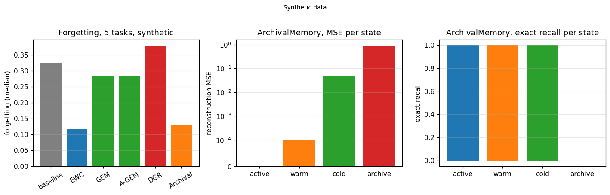

# Continual learning: how do I keep a network from forgetting the past, and how do I measure what it remembers?

A network trained on a sequence of tasks overwrites what it learned before. The page builds the pieces that fight that overwrite: a penalty that slows the movement of the important weights, a memory that projects the new gradient away from the past tasks, a generator that replays the past, and a family of quantised memories that store the past with a declared fidelity. The last sections measure what the whole thing remembers, per lifecycle state, and compare it with the baseline.

The code lives in `dense_armor/utility/neural/continual.py`, `generative_replay.py` and `consolidation.py`. Every piece shares the same batch and one-sample modes: `forward`, `backward` and `params()`.

## 1. A penalty on the important weights (EWC)

The first piece is a penalty that adds to the loss a term proportional to how far the weights have moved from the values of the previous task, weighted by how important each weight was. The importance is the diagonal of the Fisher information matrix (Kirkpatrick et al. 2017, Eq. (3) page 3).

~~~python
import jax.numpy as jnp
from dense_armor.utility.neural.continual import EWC

class M:
    def __init__(self):
        from dense_armor.utility.neural.params import Param
        self.p = [Param(jnp.array([1.0, 2.0]))]
    def params(self):
        return self.p

ewc = EWC(M(), None, lambda_=0.4)
ewc.F_ = jnp.array([1.0, 0.5])
ewc.theta_star_ = jnp.array([1.0, 2.0])
pen = ewc.penalty(jnp.array([2.0, 3.0]))
print(float(pen))
~~~

~~~
0.30000001192092896
~~~

The penalty is `lambda/2 * sum F_i * (theta_i - theta*_i)^2`. With `lambda = 0.4`, `F = [1.0, 0.5]` and `theta - theta* = [1.0, 1.0]`, the result is `0.4/2 * (1 + 0.5) = 0.3`.

## 2. A gradient that does not point at the past (GEM)

The second piece keeps a small memory of each task and projects the new gradient so that it does not increase the loss on the memories of the past tasks (Lopez-Paz & Ranzato 2017, Eq. (7) page 4). The projection is the closest vector in L2 that satisfies all the constraints.

~~~python
import numpy as np
import jax.numpy as jnp
from dense_armor.utility.neural.continual import GEM

gem = GEM(memory_per_task=4, seed=0)
g = jnp.array([1.0, 0.0])
g1 = jnp.array([-1.0, 0.0])
out = gem.project(g, [g1])
print(np.round(np.asarray(out), 5).tolist())
~~~

~~~
[0.0, 0.0]
~~~

The proposed gradient points right, the memory says the left is important, and the projection returns the zero vector: no movement satisfies the constraint.

## 3. A closed-form projection (A-GEM)

The full projection solves a quadratic program with one variable per past task. A-GEM replaces the constraints with a single averaged reference gradient, and the projection becomes one closed form (Chaudhry et al. 2019, Eq. (11) page 5).

~~~python
import numpy as np
import jax.numpy as jnp
from dense_armor.utility.neural.continual import AGEM

agem = AGEM(memory_per_task=4, seed=0)
g = jnp.array([1.0, 0.0])
g_ref = jnp.array([-1.0, 0.0])
out = agem.project(g, g_ref)
print(np.round(np.asarray(out), 5).tolist())
~~~

~~~
[0.0, 0.0]
~~~

The same projection as GEM, computed in one line instead of a QP.

## 4. Replay from a generator (DGR)

The fourth piece trains a small generator per task and replays the generated past samples while learning the new task (Shin et al. 2017, sec. 2.3 page 3). The generator is an MLP, not a GAN, declared.

~~~python
import jax.numpy as jnp
import numpy as np
from dense_armor.utility.neural.generative_replay import DeepGenerativeReplay

dgr = DeepGenerativeReplay(n_x=2, n_y=2, dim_z=4, hidden=8, n_fake=8, seed=0)
x = jnp.asarray(np.random.RandomState(0).randn(20, 2).astype(np.float32))
y = jnp.asarray((np.asarray(x)[:, 0] > 0).astype(np.int32))
dgr.train_task(x, y, n_epochs=2, batch_size=16)
print(len(dgr.generators), dgr.n_tasks_)
xf, yf = dgr.sample(dgr.generators[0], 4)
print(xf.shape, yf.shape)
~~~

~~~
1 1
(4, 2) (4,)
~~~

After one task the replay holds one generator and `n_tasks_` is 1. The `sample` method returns fake `(x, y)` pairs of the requested size.

## 5. A codebook that compresses an event (VQ)

The first memory piece maps an event to the nearest element of a learned codebook (van den Oord et al. 2017, Eq. (1)-(4) page 3).

~~~python
import jax.numpy as jnp
import numpy as np
from dense_armor.utility.neural.consolidation import VQMemory

vq = VQMemory(n_x=2, d_model=4, n_codes=8, seed=0)
x = jnp.asarray(np.random.RandomState(0).randn(10, 2).astype(np.float32))
z_e = vq.encode(x)
z_q, k, _ = vq.quantize(z_e)
print(tuple(np.asarray(k).shape), int(k.min()), int(k.max()))
~~~

~~~
(10,) 0 7
~~~

Ten events, one code per event, each in `[0, n_codes)`.

## 6. A codebook per subspace (PQ)

The second memory piece splits the event into disjoint subspaces and learns a codebook per subspace (Jégou, Douze, Schmid 2011, IEEE TPAMI, bibliographic only).

~~~python
import jax.numpy as jnp
import numpy as np
from dense_armor.utility.neural.consolidation import PQMemory

pq = PQMemory(d_model=8, n_subspaces=2, n_centroids=4, seed=0)
X = jnp.asarray(np.random.RandomState(0).randn(50, 8).astype(np.float32))
pq.fit(X)
code = pq.encode(X[0])
print(tuple(np.asarray(code).shape), int(code[0]), int(code[1]))
~~~

~~~
(2,) 1 1
~~~

Two subspaces, two indices, one per subspace.

## 7. A tree of residuals (ResidualTree)

The third memory piece stores each event at the deepest node whose codebook reconstructs it within a threshold, and creates a child when no node is close enough (DeltaMem, Tan et al. 2026, p. 2-3).

~~~python
import jax.numpy as jnp
import numpy as np
from dense_armor.utility.neural.consolidation import ResidualTree

tree = ResidualTree(d_model=2, n_codes=4, max_depth=2, branching=4, kappa=0.0, seed=0)
rng = np.random.RandomState(0)
for _ in range(20):
    tree.insert(jnp.asarray(rng.randn(2) * 3, dtype=jnp.float32))
print(tree.n_nodes(), tree.max_nodes())
~~~

~~~
11 21
~~~

Twenty events, fewer nodes than the maximum allowed by `max_depth` and `branching`.

## 8. A memory with a lifecycle (LifecycleMemory)

The fourth memory piece assigns each event to one of four states, with a bit-width per state (SuperLocalMemory V3.3, Bhardwaj 2026, p. 1). An access promotes the event toward `active`; time without access decays it toward `archive`.

~~~python
import jax.numpy as jnp
from dense_armor.utility.neural.consolidation import LifecycleMemory

lm = LifecycleMemory(d_model=4, decay_horizon_s=10.0, seed=0)
x = jnp.asarray([0.3, -0.7, 1.1, 2.4], dtype=jnp.float32)
idx = lm.write(x, t=0.0)
for k in range(1, 5):
    lm.tick(t=20.0 * k)
print(lm.state_of(idx), lm.mse_of(idx) > 0.0)
~~~

~~~
archive True
~~~

After four ticks the event is in `archive` and its reconstruction has a positive error.

## 9. Two memories, fast and slow (DualMemory)

The fifth piece keeps recent events in a fast memory with top-k pattern separation and moves them to a slow memory on consolidation (HiCL, Kapoor et al. 2026, p. 2-4).

~~~python
import jax.numpy as jnp
from dense_armor.utility.neural.consolidation import DualMemory

dm = DualMemory(d_model=2, fast_capacity=4, slow_capacity=8, top_k=2, seed=0)
for i in range(3):
    dm.write(jnp.asarray([float(i), 0.0], dtype=jnp.float32), t=0.0)
print(dm.size())
moved = dm.consolidate()
print(moved, dm.size())
~~~

~~~
(3, 0)
3 (0, 3)
~~~

Three events in the fast memory, then all three moved to the slow memory.

## 10. A bound on what the weights can hold (TheoreticalBound)

The theoretical piece is a placeholder: the classical Hopfield capacity `0.138 * sqrt(P)` for a fully connected network of `P` parameters (Hopfield 1982, bibliographic only). The 2025 papers on the theoretical limit are in the folder, but neither gives a closed-form bound.

~~~python
from dense_armor.utility.neural.consolidation import TheoreticalBound

tb = TheoreticalBound(n_params=100, n_neurons=10)
print(round(tb.capacity(), 4))
print(round(tb.bound(n_events=5), 4))
~~~

~~~
1.38
0.0362
~~~

The capacity is `1.38` patterns for `10` neurons, and `5` events exceed it, so the bound is positive.

## 11. The composition (ArchivalMemory)

The last piece combines the tree, the lifecycle and the dual memory with a write policy declared in `RULE.md`: an importance score, a write depth, a state transition and a promotion rule.

~~~python
import jax.numpy as jnp
from dense_armor.utility.neural.consolidation import ArchivalMemory

am = ArchivalMemory(d_model=2, n_codes=8, max_depth=2, seed=0)
idx = am.write(jnp.asarray([1.0, 2.0], dtype=jnp.float32), t=0.0)
x_hat, state, bits = am.reconstruct(idx)
print(state, bits, len(am))
~~~

~~~
active 32 1
~~~

One event written, in `active` state at 32 bits, the `len` of the memory is one.

## The measured cost

The internal benchmark (`benchmarks/neural/continual_learning.py` and `memory_fidelity.py`, 2 seeds, smoke) gives the numbers below. They come from a run of this session on this host.

Forgetting, median:

| learner | forgetting |
|---|---|
| baseline | 0.324 |
| EWC | 0.118 |
| GEM | 0.285 |
| A-GEM | 0.283 |
| DGR | 0.380 |
| ArchivalMemory as replay | 0.130 |

`ArchivalMemory` per lifecycle state (median over 2 seeds, 50 events each):

| state | count | MSE | PSNR | exact recall | latency µs |
|---|---|---|---|---|---|
| active | 1 | 0.0000 | 120.00 | 1.000 | 77.43 |
| warm | 1 | 0.0001 | 40.43 | 1.000 | 248.41 |
| cold | 1 | 0.0505 | 13.46 | 1.000 | 241.05 |
| archive | 47 | 0.9339 | 0.30 | 0.000 | 250.66 |

VQ: MSE 0.73, PSNR 1.37, exact recall 0.95. PQ: MSE 0.16, PSNR 8.10, exact recall 1.00. `state_bytes` 1088, `max_nodes` 85, `n_nodes` 8.

## The figure

*Top: forgetting per learner after five synthetic tasks. Bottom left: reconstruction MSE per lifecycle state, log scale. Bottom right: exact recall per lifecycle state. All data synthetic.*

## Details

### References

- Kirkpatrick, J., Pascanu, R., Rabinowitz, N., Veness, J., Desjardins, G., Rusu, A. A., Milan, K., Quan, J., Ramalho, T., Grabska-Barwinska, A., Hassabis, D., Clopath, C., Kumaran, D., Hadsell, R. (2017). *Overcoming catastrophic forgetting in neural networks.* PNAS 114(13):3521-3526. arXiv:1612.00796. Eq. (3) page 3, diagonal Fisher, positive semi-definite.
- Lopez-Paz, D., Ranzato, M. (2017). *Gradient Episodic Memory for Continual Learning.* NeurIPS. arXiv:1706.08840. Eq. (5) page 3 (memory budget), Eq. (6) page 4 (constraints), Eq. (7) page 4 (QP projection).
- Chaudhry, A., Ranzato, M., Rohrbach, M., Elhoseiny, M. (2019). *Efficient Lifelong Learning with A-GEM.* ICLR. arXiv:1812.00420. Eq. (9)-(11) page 5.
- Shin, H., Lee, J. K., Kim, J., Kim, J. (2017). *Continual Learning with Deep Generative Replay.* NeurIPS. arXiv:1705.08690. Sec. 2.3 page 3.
- van den Oord, A., Vinyals, O., Kavukcuoglu, K. (2017). *Neural Discrete Representation Learning.* NeurIPS. arXiv:1711.00937. Eq. (1)-(4) page 3.
- Jégou, H., Douze, M., Schmid, C. (2011). *Product Quantization for Nearest Neighbor Search.* IEEE TPAMI 33(1):117-128, DOI 10.1109/TPAMI.2011.144. **Bibliographic only**, no PDF in the folder: the formula is derived from section 3.
- Tan, H., Zhang, Z., Cao, Z., Li, R., Chen, X. (2026). *DELTAMEM: Incremental Experience Memory for LLM Agents via Residual Trees.* arXiv:2606.03083, page 2-3.
- Bhardwaj, V. P. (2026). *SuperLocalMemory V3.3: The Living Brain.* arXiv:2604.04514, page 1.
- Kapoor, K., Mackey, W., Aloimonos, Y., Lin, X. (2026). *HiCL: Hippocampal-Inspired Continual Learning.* arXiv:2508.16651, page 2-4.
- Essex, A. E., Janson, N. B., Norris, R. A., Baird, A. G. (2025). *Memorisation and forgetting in a learning Hopfield neural network.* arXiv:2508.10765.
- Vinci, G. V., Galluzzi, A., Mattia, M. (2025). *Beyond catastrophic forgetting in associative networks with self-interactions.* arXiv:2504.04560.
- Hopfield, J. J. (1982). *Neural networks and physical systems with emergent collective computational abilities.* PNAS 79(8):2554-2558. **Bibliographic only**, no PDF in the folder: the capacity `0.138 N` is quoted from the classical result, not from the PDF.
- De Lange, M., Aljundi, R., Masana, M., Parisot, S., Jia, X., Leonardis, A., Slabaugh, G., Tuytelaars, T. (2021). *A continual learning survey.* IEEE TPAMI. arXiv:1909.08383, page 1 (taxonomy regularization / replay / architecture).

### Choices stated explicitly

- The three memory structures G-I (DeltaMem, SuperLocalMemory V3.3, HiCL) are designed for agents (LLM) and are adapted to dense networks with the deviation declared in each docstring.
- `PQMemory` is bibliographic only: the formula is derived from section 3 of the paper, not verified against a PDF that is not in the folder.
- `TheoreticalBound` is the classical Hopfield capacity `0.138 sqrt(P)`, a declared placeholder. The two 2025 papers are in the folder and cited in the docstring, but neither gives a closed-form bound.
- `VQMemory` forward is not differentiable: `quantize` selects `argmin_j ||z_e - e_j||`. `gradcheck` is not applicable, and the deviation from the layer contract is declared in the docstring; the straight-through estimator is a biased surrogate of a gradient that does not exist.
- `ArchivalMemory` write policy is declared in `RULE.md` v0.1: importance, write depth, state transition, promotion. Section 7 is left for the owner to sign.
- The `DarkMemory` construction with the Prisma ground state was measured with 20 seeds and did not pass its own test (Wilcoxon p = 0.0929, A12 = 0.6312): it is not in the branch.
- The tasks of the forgetting benchmark are synthetic conflicting rules, not MNIST permutations.

### Measured cost

The benchmark and the page print the numbers of the smoke run on this host: forgetting per learner, MSE, PSNR, exact recall and latency per lifecycle state, `state_bytes`, VQ and PQ fidelity. The timings vary between runs on the same host.

### Development diary

The branch `taskN09-memory` started with four continual-learning baselines (A-D), added two quantization primitives (E-F) and three memory structures (G-I), a theoretical bound (J), the composition (K), the benchmarks (L-M) and a dark-memory construction (N). The dark memory was measured with 20 seeds on a GPU and removed: `p = 0.0929`, `A12 = 0.6312`, the IQR of the delta touches 0. What remains in the branch is A-M.
