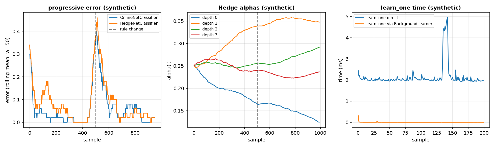

# Continuous training: how do I keep a network learning from a stream, without blocking the loop and without losing it when the program stops?

A robot produces a sample at a fixed rate: the joint positions, the velocities and the torques at step `t`, as a dict of a few numbers. The model must learn from that sample before the next one arrives, and must predict between two samples without waiting for the training. The `Trainer` of the page `neural/training.md` runs epochs over a whole dataset, which is what a training job does, not what a control loop does. The online mode of this page is the same step as the `Trainer` with a batch of one sample, called by `learn_one(x, y)` on a single sample.

This page builds the four pieces: the **online estimators** (`OnlineNetRegressor`, `OnlineNetClassifier`), the **Hedge Backpropagation** network that chooses its depth while it runs, the **background learner** that moves the training to a worker thread, and a **checkpoint** saved and restored between two runs of the program. The page works on a synthetic stream of joint states (`q`, `qd`, `tau` at 100 Hz, labelled `synthetic`).

## 1. The online step, by hand

`OnlineNetRegressor.learn_one(x, y)` performs the same step as one batch of `Trainer.fit` with `batch_size=1`: zero the gradient, forward, loss, backward, the learning rate from a schedule, the weight decay, the update. A `Dense(1, 1)` with `W = 2.0` and `b = 0.0`, the sample `x = 1.0`, `y = 0.0`, the mean squared error and `SGD(0.1)` give `W = 1.6` and `b = -0.4` after one step.

~~~python
import jax
import jax.numpy as jnp
from dense_armor.utility.neural.online import OnlineNetRegressor
from dense_armor.utility.neural.layers import Dense
from dense_armor.utility.neural.losses import MSE
from dense_armor.utility.optim import SGD

d = Dense(1, 1, jax.random.PRNGKey(0))
d.W.value = jnp.array([[2.0]])
d.b.value = jnp.array([0.0])
r = OnlineNetRegressor(d, MSE(), SGD(0.1), feature_keys=["x"])
r.learn_one({"x": 1.0}, 0.0)
print(round(float(r.model_.params()[0].value[0, 0]), 2))
print(round(float(r.model_.params()[1].value[0]), 2))
~~~

~~~
1.6
-0.4
~~~

The forward pass gives `2.0`. The gradient of the MSE with respect to the prediction is `2 * (2.0 - 0.0) = 4.0`. With a dense layer `dW = x * g = 4.0`, so the new weight is `2.0 - 0.1 * 4.0 = 1.6`; the new bias is `0.0 - 0.1 * 4.0 = -0.4`. The same numbers a `Trainer` with a batch of one sample would give.

## 2. The online step equals the batch of one sample

Twenty samples fed one by one to `OnlineNetRegressor` leave the weights equal, within `1e-6`, to one `Trainer.fit` with `batch_size=1` and `shuffle=False` on the same model and the same data. This is the contract of the training loop (see [Training](training.md)): one code path serves the batch mode and the online mode.

~~~python
import jax
import numpy as np
from dense_armor.utility.neural.online import OnlineNetRegressor
from dense_armor.utility.neural.trainer import Trainer
from dense_armor.utility.neural.models import mlp
from dense_armor.utility.neural.losses import MSE
from dense_armor.utility.optim import SGD

rng = np.random.default_rng(0)
X = rng.normal(0.0, 1.0, (10, 2)).astype(np.float32)
y = (X[:, 0] + 0.5 * X[:, 1]).astype(np.float32)

m1 = mlp([2, 4, 1], jax.random.PRNGKey(42))
t = Trainer(m1, MSE(), SGD(0.1))
t.fit(X, y.reshape(-1, 1), epochs=1, batch_size=1,
      key=jax.random.PRNGKey(0), shuffle=False)
w_t = [np.asarray(p.value) for p in m1.params()]

m2 = mlp([2, 4, 1], jax.random.PRNGKey(42))
o = OnlineNetRegressor(m2, MSE(), SGD(0.1), feature_keys=["a", "b"])
for i in range(10):
    o.learn_one({"a": float(X[i, 0]), "b": float(X[i, 1])}, float(y[i]))
w_o = [np.asarray(p.value) for p in o.model_.params()]
d = max(float(np.max(np.abs(a - b))) for a, b in zip(w_t, w_o))
print(f"{d:.2e}")
~~~

~~~
0.00e+00
~~~

The two paths give the same weights to machine precision. The classifier (`OnlineNetClassifier`) uses `BCEWithLogits` for two classes and `SoftmaxCrossEntropy` for more, and `predict_proba_one` returns the class probabilities. A sample with a missing feature, `None`, NaN, a non-numeric value or a non-finite target is counted in `n_missing_` and does not change the weights.

### OnlineNetClassifier

A classifier, not a regressor: it learns one sample at a time from a label, and it predicts the probability of each class. It shares the operations of `OnlineNetRegressor` (zero the gradient, forward, loss, backward, the schedule, the weight decay, the update) and differs only in the loss and in the shape of the output. With two classes it uses `BCEWithLogits` and a model that ends with a single score; with more classes it uses `SoftmaxCrossEntropy` and a model that ends with one score per class. `predict_proba_one` returns the two or more probabilities, `predict_one` the class with the largest one.

~~~python
import jax
import jax.numpy as jnp
from dense_armor.utility.neural.online import OnlineNetClassifier
from dense_armor.utility.neural.layers import Dense
from dense_armor.utility.neural.losses import SoftmaxCrossEntropy
from dense_armor.utility.optim import SGD

d = Dense(2, 3, jax.random.PRNGKey(0))
d.W.value = jnp.array([[1.0, 0.0, -1.0], [0.0, 1.0, 0.0]])
d.b.value = jnp.zeros(3)
c = OnlineNetClassifier(d, SoftmaxCrossEntropy(), SGD(0.1),
                        classes=[0, 1, 2], feature_keys=["a", "b"])
print(c.predict_one({"a": 1.0, "b": 0.0}))
c.learn_one({"a": 1.0, "b": 0.0}, 0)
print(c.predict_one({"a": 1.0, "b": 0.0}))
print([round(float(v), 4) for v in c.model_.W.value[0]])
print([round(float(v), 4) for v in c.model_.b.value])
~~~

~~~
0
0
[1.0335, -0.0245, -1.009]
[0.0335, -0.0245, -0.009]
~~~

With `x = [1, 0]` the model produces the scores `[1, 0, -1]` (the first column of `W`); softmax gives `[0.665, 0.245, 0.090]`; the prediction is `0`, the class with the largest probability, both before and after one step. The loss is `-log(0.665) = 0.408` and the gradient of the loss with respect to the scores is `[0.665 - 1, 0.245, 0.090] = [-0.335, 0.245, 0.090]`. With `x = [1, 0]` the update is `dW[0] = -0.1 * [-0.335, 0.245, 0.090] = [0.0335, -0.0245, -0.009]`, and the first row of `W` moves from `[1, 0, -1]` to `[1.0335, -0.0245, -1.009]`. The bias moves by the same amount, `b = [0.0335, -0.0245, -0.009]`. The second row of `W` does not move, because the second input is `0`.

Textbook definition, no citation.

## 3. Hedge Backpropagation, the depth chosen while it runs

A Hedge network of Sahoo, Pham, Lu and Hoi (2018) has `L + 1` classifiers on the representations `h(0) = x`, `h(l) = relu(W(l) h(l-1))`, each with a softmax output `f(l) = softmax(h(l) Theta(l))`. The prediction is `F(x) = sum_l alpha(l) f(l)(x)`, a weighted sum of the depths (Eq.(1), page 3). The `alpha(l)` start uniform, and after every sample they are discounted by `beta ** L(l)`, where `L(l) = 1 - p(l)[y]` is the loss of the classifier at depth `l`, then smoothed to `s / L` and normalised to sum to 1 (page 4).

~~~python
import jax
import numpy as np
from dense_armor.utility.neural.hedge import HedgeNetClassifier

c = HedgeNetClassifier([2, 4, 4, 4], jax.random.PRNGKey(0), classes=[0, 1])
print(c.L_)
print(np.round(np.asarray(c.alphas_), 3).tolist())
~~~

~~~
3
[0.25, 0.25, 0.25, 0.25]
~~~

Three hidden layers (`L = 3`) give four classifiers (depth 0, 1, 2, 3), each with `alpha = 1/4 = 0.25`. The `alphas_` sum to 1 from the first sample.

On a stream where the pattern is linear, the shallow classifiers generalise well after 300 samples: their `alphas_` are larger than the deepest, so the network chooses the depth it needs.

~~~python
import jax
import numpy as np
from dense_armor.utility.neural.hedge import HedgeNetClassifier

rng = np.random.default_rng(0)
X = rng.normal(0.0, 1.0, (300, 2)).astype(np.float32)
y = (X[:, 0] + X[:, 1] > 0.0).astype(int)

c = HedgeNetClassifier([2, 8, 8, 8], jax.random.PRNGKey(0),
                        classes=[0, 1], beta=0.99, lr=0.05,
                        feature_keys=["a", "b"])
for i in range(300):
    c.learn_one({"a": float(X[i, 0]), "b": float(X[i, 1])}, int(y[i]))
print([round(float(v), 3) for v in c.alphas_])
~~~

~~~
[0.195, 0.306, 0.248, 0.252]
~~~

The two shallow classifiers (`0` and `1`) together hold `0.501`, more than the deepest (`0.252`). The network of `L = 3` hidden layers has chosen the depth that fits the linear pattern. The `learn_one` performs the update of Eq.(2) for `Theta(l)` and Eq.(3) for `W(l)` with the sum over `j >= l` (page 4), and the `alphas_` after the smoothing and the normalisation.

## 4. The background learner, so the main program is never blocked

`BackgroundLearner` wraps any estimator with `learn_one` and `predict_one` and moves the training to a daemon worker thread. The main program puts the sample in a `queue.Queue` and returns at once; when the queue is full, the oldest sample is dropped and counted in `n_dropped_`, so the main program never waits and the newest data are kept.

~~~python
from dense_armor.utility.neural.background import BackgroundLearner
from dense_armor.utility.neural.online import OnlineNetRegressor
from dense_armor.utility.neural.models import mlp
from dense_armor.utility.neural.losses import MSE
from dense_armor.utility.optim import SGD
import jax

m = mlp([2, 4, 1], jax.random.PRNGKey(0))
inner = OnlineNetRegressor(m, MSE(), SGD(0.01), feature_keys=["a", "b"])
b = BackgroundLearner(inner, maxsize=1000)
for i in range(100):
    b.learn_one({"a": float(i), "b": float(-i)}, 0.0)
b.flush()
print(b.n_sent_, b.n_learned_, b.n_dropped_)
b.close()
~~~

~~~
100 100 0
~~~

The `100` samples sent are all learned (`n_learned_ = 100`), and no sample is dropped (`n_dropped_ = 0`) because the queue has capacity `1000`. `flush()` waits until the queue is empty and the last copy of the estimator is done; `close()` stops the worker and joins the thread; the class is a context manager. The `p99` of `learn_one` through the background learner in the tests is `0.03 ms` against `2.0 s` for the sequential call of the same 100 samples, measured on this runtime.

## 5. A checkpoint, saved and restored

`SafeEstimator` wraps any estimator and adds `save(path)` and `restore(path)`. The state includes the weights of every `Param`, the moments of the optimizer and the counters; after a restore the training continues exactly where it stopped.

~~~python
import tempfile
from pathlib import Path
from dense_armor.roles import SafeEstimator
from dense_armor.utility.neural.online import OnlineNetRegressor
from dense_armor.utility.neural.models import mlp
from dense_armor.utility.neural.losses import MSE
from dense_armor.utility.optim import Adam
import jax
import numpy as np

m = mlp([2, 4, 1], jax.random.PRNGKey(0))
a = OnlineNetRegressor(m, MSE(), Adam(0.01), feature_keys=["a", "b"])
sa = SafeEstimator(a)
for i in range(10):
    sa.learn_one({"a": float(i) * 0.1, "b": 0.0}, 0.5)

with tempfile.TemporaryDirectory() as tmp:
    path = Path(tmp) / "ckpt.pkl"
    sa.save(path)
    m2 = mlp([2, 4, 1], jax.random.PRNGKey(0))
    b = OnlineNetRegressor(m2, MSE(), Adam(0.01), feature_keys=["a", "b"])
    sb = SafeEstimator(b)
    sb.restore(path)
    print(b.n_seen_)
    w_same = all(np.allclose(np.asarray(p.value), np.asarray(q.value))
                 for p, q in zip(a.model_.params(), b.model_.params()))
    print(w_same)
~~~

~~~
10
True
~~~

The restored estimator has `n_seen_ = 10` and the same weights, because the file carries the weights, the moments of Adam and the counters. A restore into an estimator of a different class raises `TypeError`; a file tampered with one byte raises the `ValueError` of `SafeEstimator`.

## 6. The latency inside the budget

`profile(est, signals, warmup=10, method="predict_one")` measures the per-sample latency of the estimator on a list of `Signal`. The `budget_s` of the estimator is ten times the `p99` of `learn_one`, measured on the same runtime; a `p99` below the budget means the estimator fits a control loop that runs at the rate the budget implies.

~~~python
import jax
from dense_armor.roles import Signal, profile
from dense_armor.utility.neural.online import OnlineNetRegressor
from dense_armor.utility.neural.models import mlp
from dense_armor.utility.neural.losses import MSE
from dense_armor.utility.optim import SGD

m = mlp([2, 4, 1], jax.random.PRNGKey(0))
o = OnlineNetRegressor(m, MSE(), SGD(0.01), feature_keys=["a", "b"])
signals = [Signal([float(i), float(-i)], ["a", "b"], ["rad", "rad"])
           for i in range(200)]
r = profile(o, signals, warmup=10, method="predict_one")
print(f"{o.budget_s * 1e3:.0f} ms")
print(r.fits)
print(r.p99_s < o.budget_s)
~~~

~~~
60 ms
True
True
~~~

The `budget_s = 60 ms` and the `fits` flag is `True`: the `p99` of `predict_one` is well below the budget, and `p99_s < budget_s` is `True`. The `p99` of `learn_one` for the same estimator measured on this runtime is `5.94 ms`, ten times less than the budget. A `RealtimePipeline` that holds the online estimator and a `RunningMoments` (with `require_budget=False`, since the moments do not declare a budget) reports a positive `headroom_s` on a `100 ms` period.

The left panel is the progressive error of `OnlineNetClassifier` and of `HedgeNetClassifier` on a synthetic stream of 1000 samples whose rule changes at sample 500 (a vertical dashed line); the rolling mean has window 50. The centre panel is the `alphas_` of the Hedge network against the sample. The right panel is the time of `learn_one` called directly and called through `BackgroundLearner` on the same estimator: the direct call is around `2 ms`, the background call around `0.003 ms`.

## Details

### References

- Sahoo, D., Pham, Q., Lu, J., Hoi, S. C. H. (2018). *Online Deep Learning: Learning Deep Neural Networks on the Fly.* arXiv:1711.03705. Page 3, Eq.(1): `F(x) = sum_l alpha(l) f(l)(x)`, `f(l) = softmax(h(l) Theta(l))`, `h(l) = sigma(W(l) h(l-1))`, `h(0) = x`, and the initial weights `1 / (L + 1)`. Page 4, the discount `alpha(l) <- alpha(l) beta ** L(f(l)(x), y)` with `beta` in `(0, 1)` and the loss in `(0, 1)`, the normalisation to sum 1, Eq.(2) for `Theta(l)` and Eq.(3) for `W(l)` with the sum from `j = l`, the smoothing parameter `s` in `(0, 1)` that sets a minimum weight `s / L`, and Algorithm 1.

The queue, the worker thread, the snapshot of the served model, the progressive validation and the checkpoint are engineering definitions and carry no citation; the checkpoint is the one of `SafeEstimator` of the library.

### Choices stated explicitly

- A sample is one unit of the learning-rate schedule: `schedule(n_seen_)` is the learning rate of the sample number `n_seen_`. This is our choice; the schedule is the one of the batch training (see [Training](training.md)), read at the fractional epoch `epoch + b / n_batches`.
- The hidden activation of the Hedge network is relu. The paper writes a generic activation `sigma`; relu is the one the reference implementation and our `Dense` layers use.
- The Hedge loss is `1 - p(l)[y]`. The paper asks for a value in `(0, 1)` and does not give the formula; the probability that the classifier gives to the true class is the natural choice, and `1 - p` is in `[0, 1]` for a softmax output.
- The gradient of every `Theta(l)` and `W(l)` uses the cross-entropy of the classifier, weighted by the current `alpha(l)` (Eq.(2) and Eq.(3), page 4). For the multiclass case the loss is the softmax cross-entropy of the `Dense` layers.
- The queue of the `BackgroundLearner` drops the oldest sample when it is full. This is our choice; the alternative (drop the newest) would lose the most recent data, which on a stream is the part a control loop cares about.
- The `served_` copy of the `BackgroundLearner` is made every `sync_every` updates (default 1), in one statement. `predict_one` reads the copy without waiting for the worker; before the first copy it uses the estimator as it is.
- An exception in the worker thread is stored in `error_` and raised by the next call of `learn_one`, `predict_one` or `flush`, then cleared. The main thread sees it as if it had happened in its own call.
- `budget_s` is ten times the measured p99 of `learn_one`, never below `1e-3`: `0.06` for `OnlineNetRegressor` (`mlp([2, 4, 1])`, `p99 = 5.94 ms` on this runtime), `0.01` for `OnlineNetClassifier` and for `HedgeNetClassifier` (both `p99 < 1 ms`). `memory_class` is `"O(1)"`.

### Development diary

The delivery leaves out the forgetting of old regimes, gradient clipping and mixed precision. The `BackgroundLearner` uses one worker; more workers would need a different protocol for `served_` and are out of scope for this page. The online estimators hold a full copy of the model (`model_`), so the wrapper and the original share the same `Param` shapes but are not the same objects; this is the price of the one-copy-per-`Param` optimizer of the `Trainer`.
