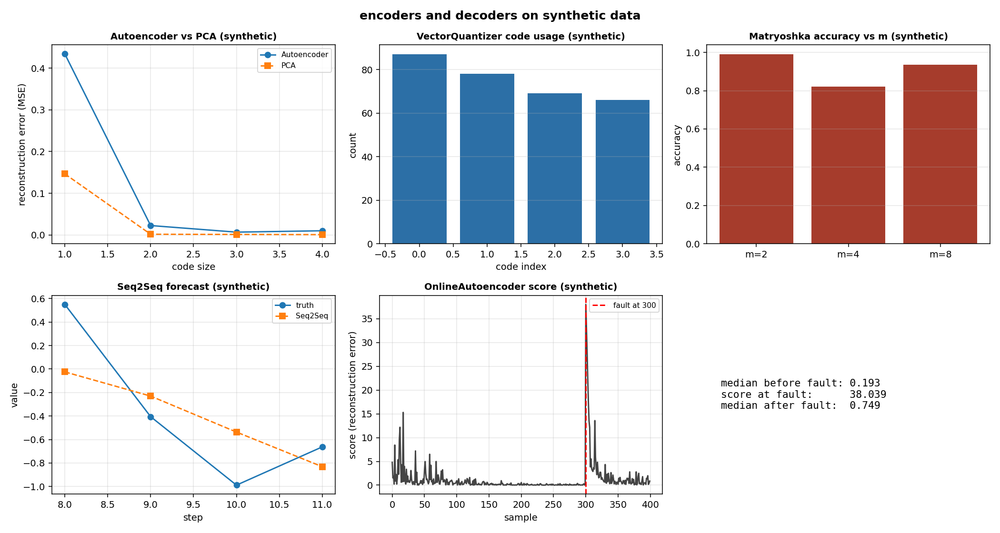

# Encoders and decoders: how do I squeeze a stream of joint states into a few numbers, or into a few integers, and expand it back or into a forecast?

An encoder takes a sample and compresses it into a few numbers, the code. A decoder takes the code and expands it back, close to the original. An autoencoder trains the two together so that the reconstruction error is small: a low error means the code kept enough information, a high error means the sample is far from what the network has seen. A vector quantizer rounds the code to the nearest of a fixed set of codes: the code becomes an integer, useful for indexing and compression. A Matryoshka representation trains one embedding so that its first few coordinates are themselves a usable code, and a long one is no worse than a short one. A sequence encoder summarises a whole sequence into one vector, and a decoder expands that vector into a fixed number of future steps. All of these are bricks: each has `forward`, `backward` and `params()`, the `Trainer` trains it on a batch, and `AsTransformer` places it in a pipeline of the library.

The page works on a synthetic stream of joint states: 6 numbers per sample (two positions, two velocities, two torques, labelled `synthetic`), a rate of 100 Hz, 300 samples in the training set. The same bricks work on a stream of joint states at a fixed rate.

## 1. The autoencoder

`Autoencoder(encoder, decoder)` joins two models. `forward(x, training=True)` is the decoder applied to the encoder applied to `x`; `backward(g)` is the encoder backward of the decoder backward; `params()` lists the parameters of the encoder then of the decoder.

~~~python
import jax
import jax.numpy as jnp
import numpy as np
from dense_armor.utility.neural.autoencoder import Autoencoder
from dense_armor.utility.neural.chain import Sequential
from dense_armor.utility.neural.layers import Dense

enc = Sequential([Dense(2, 1, jax.random.PRNGKey(0))])
enc.layers[0].W.value = jnp.array([[1.0], [0.0]])
enc.layers[0].b.value = jnp.array([0.0])
dec = Sequential([Dense(1, 2, jax.random.PRNGKey(1))])
dec.layers[0].W.value = jnp.array([[1.0, 0.0]])
dec.layers[0].b.value = jnp.array([0.0, 0.0])
a = Autoencoder(enc, dec)
x = jnp.array([3.0, 4.0])
print(np.asarray(a.forward(x, training=False)).tolist())
print(float(a.reconstruction_error(x)))
~~~

~~~
[3.0, 0.0]
8.0
~~~

The encoder reads `[3, 4]` and keeps only the first coordinate (`W = [[1], [0]]`), the decoder rebuilds `[3, 0]` from the code (`W = [[1, 0]]`). The reconstruction is `[3, 0]`; the reconstruction error is the mean over the last axis of `(x - forward(x)) ** 2`, `((3 - 3)**2 + (4 - 0)**2) / 2 = 8`. `encode(x)` returns the code alone, `decode(z)` the reconstruction; both with `training=False`.

The `Trainer` trains it on a batch with `y = X` and `MSE`:

~~~python
import jax
import numpy as np
from dense_armor.utility.neural.autoencoder import Autoencoder
from dense_armor.utility.neural.chain import Sequential
from dense_armor.utility.neural.layers import Dense
from dense_armor.utility.neural.losses import MSE
from dense_armor.utility.neural.trainer import Trainer
from dense_armor.utility.optim import Adam

rng = np.random.default_rng(0)
A = rng.normal(0.0, 1.0, (2, 6)).astype(np.float32)
Z = rng.normal(0.0, 1.0, (200, 2)).astype(np.float32)
X = Z @ A
enc = Sequential([Dense(6, 2, jax.random.PRNGKey(0))])
dec = Sequential([Dense(2, 6, jax.random.PRNGKey(1))])
a = Autoencoder(enc, dec)
before = float(np.mean(np.asarray(a.reconstruction_error(X))))
t = Trainer(a, MSE(), Adam(0.01))
t.fit(X, X, epochs=50, batch_size=20, key=jax.random.PRNGKey(0))
after = float(np.mean(np.asarray(a.reconstruction_error(X))))
print(f"before: {before:.4f} after: {after:.4f}")
~~~

~~~
before: 2.2641 after: 0.0041
~~~

The reconstruction error of the 200 points, from `2.26` to `0.004`: the code size 2 is enough for the 2-dimensional plane hidden in the 6-dimensional space of the sample. A larger code size is not always better; the error saturates at the dimension of the plane.

## 2. The vector quantizer

`VectorQuantizer(n_codes, dim, key, beta=0.25)` maps each vector to the nearest code of a codebook (Eq.(1) and Eq.(2), page 3 of van den Oord et al. 2017). The gradient of the code is copied to the input (the straight-through estimator, page 3), and the codebook and commitment terms of Eq.(3), page 4, are added to the loss.

~~~python
import jax
import jax.numpy as jnp
import numpy as np
from dense_armor.utility.neural.quantize import VectorQuantizer

vq = VectorQuantizer(2, 1, jax.random.PRNGKey(0), beta=0.25)
vq.codebook.value = jnp.array([[0.0], [1.0]])
z = jnp.array([[0.2], [0.9]])
zq = vq.forward(z)
print(vq.indices_.tolist())
print(np.asarray(zq).tolist())
print(round(float(vq.loss()), 5))
~~~

~~~
[0, 1]
[[0.0], [1.0]]
0.03125
~~~

The first vector `0.2` is nearer to `0.0` than to `1.0`, the second `0.9` is nearer to `1.0`. The codebook term is `(0.2^2 + 0.1^2) / 2 = 0.025`, the commitment term is `0.25 * 0.025 = 0.00625`, the loss is their sum `0.03125`. The gradient of `z_e` with `g = [1, 1]` is `[[1.05], [0.975]]` (the `g` plus the commitment term `2 * beta * (z_e - e_k) / N`); the codebook gradient is `[[-0.2], [0.1]]` (`-2 * (z_e - e_k) / N`). A tie goes to the smallest index: `z = 0.5` picks index 0.

## 3. The Matryoshka loss

`MatryoshkaLoss(dims, d, n_classes, key, weights=None)` trains one embedding `z` of size `d` so that its first `m` coordinates are a usable code for several sizes `m` (Eq.(1), page 4 of Kusupati et al. 2022). There is one linear head per size, `W(m)` of shape `(n_classes, m)` without bias; the loss is `sum_m c_m L(W(m) z[..., :m], y)` with `L` the softmax cross-entropy averaged over the batch and `c_m` the weight of size `m` (default 1).

~~~python
import jax
import jax.numpy as jnp
import numpy as np
from dense_armor.utility.neural.matryoshka import MatryoshkaLoss

ml = MatryoshkaLoss([1, 2], 2, 2, jax.random.PRNGKey(0))
ml.heads_[0].value = jnp.array([[1.0], [-1.0]])
ml.heads_[1].value = jnp.array([[1.0, 0.0], [0.0, 1.0]])
for h in ml.heads_:
    h.grad = jnp.zeros_like(h.value)
z = jnp.array([[1.0, 0.0]])
y = jnp.array([0])
print(round(float(ml.forward(z, y)), 5))
dz = ml.backward()
print([[round(float(v), 5) for v in row] for row in dz])
~~~

~~~
0.44019
[[-0.50735, 0.26894]]
~~~

The two heads have loss `0.12693` (size 1) and `0.31326` (size 2); their sum is `0.44019`. The gradient of `z` is `[[-0.50735, 0.26894]]`: the first coordinate receives the gradients of both heads (`-0.1192 + -0.388`), the second only the gradient of the head of size 2 (`0.26894`). The head of size 1 reads `z[..., :1] = z[0]`; the head of size 2 reads the full `z`. The prefix is a special case: the logits of the head of size `m` do not change when `z[m:]` changes.

## 4. The sequence encoder and decoder

`Seq2Seq(encoder, decoder, head, horizon, reverse_source=True)` reads a source sequence with a recurrent encoder and writes a fixed number of future steps with a recurrent decoder and a dense head. With `reverse_source=True` the source is read in reverse (page 3 of Sutskever et al. 2014). The summary `v` is the last output of the encoder; the decoder reads `v` repeated `horizon` times, and the head gives the output for every step. This is a fixed-horizon forecaster with `v` as input of every step, not the initial state of the decoder of Eq.(1), page 3: the recurrent layer starts from the zero state and exposes no gradient on its initial state.

~~~python
import jax
import jax.numpy as jnp
from dense_armor.utility.neural.seq2seq import Seq2Seq
from dense_armor.utility.neural.recurrent import LSTM
from dense_armor.utility.neural.layers import Dense

s = Seq2Seq(LSTM(2, 3, jax.random.PRNGKey(0)),
            LSTM(3, 3, jax.random.PRNGKey(1)),
            Dense(3, 1, jax.random.PRNGKey(2)), horizon=2)
print(s.forward(jnp.ones((4, 2))).shape)
print(s.forward(jnp.ones((5, 4, 2))).shape)
print(len(s.params()))
~~~

~~~
(2, 1)
(5, 2, 1)
32
~~~

A source of shape `(4, 2)` (4 steps, 2 features) gives `(2, 1)` (2 steps, 1 output); a batch of 5 gives `(5, 2, 1)`. The 32 parameters are the 15 of the first `LSTM`, the 15 of the second, and the 2 of the head. The `Trainer` trains it on a batch of `(B, T, n_in)` sources and `(B, horizon, n_out)` targets.

## 5. An autoencoder trained online, as an anomaly score

`OnlineAutoencoder(model, optimizer, feature_keys=None, schedule=None)` is an `AnomalyDetector` of the library. `score_one(x)` is the reconstruction error of the autoencoder on the sample, high = anomalous; `learn_one(x)` updates the autoencoder one sample at a time with the same operations, in the same order, as the online regression model of the library, with the target equal to the sample itself. The reconstruction error as the anomaly score is the argument of Chalapathy and Chawla (2019), pages 6 and 9.

~~~python
import jax
import jax.numpy as jnp
import numpy as np
from dense_armor.utility.neural.autoencoder import Autoencoder
from dense_armor.utility.neural.chain import Sequential
from dense_armor.utility.neural.layers import Dense
from dense_armor.utility.neural.online_autoencoder import OnlineAutoencoder
from dense_armor.utility.optim import SGD

enc = Sequential([Dense(2, 1, jax.random.PRNGKey(0))])
enc.layers[0].W.value = jnp.array([[1.0], [0.0]])
enc.layers[0].b.value = jnp.array([0.0])
dec = Sequential([Dense(1, 2, jax.random.PRNGKey(1))])
dec.layers[0].W.value = jnp.array([[1.0, 0.0]])
dec.layers[0].b.value = jnp.array([0.0, 0.0])
oa = OnlineAutoencoder(Autoencoder(enc, dec), SGD(0.1), feature_keys=["a", "b"])
print(oa.score_one({"a": 3.0, "b": 4.0}))
oa.learn_one({"a": 3.0, "b": 4.0})
print(round(float(oa.model_.decoder.layers[0].W.value[0, 1]), 2))
print(oa.score_one({"a": 3.0, "b": 4.0}))
print(oa.score_one({"a": 1.0, "b": 0.0}))
print(oa.encode_one({"a": 3.0, "b": 4.0}))
~~~

~~~
8.0
1.2
0.0
1.28000009059906
{'c0': 3.0}
~~~

Before the update, the score of `[3, 4]` is `8.0` (the same hand case of step 1). After one `learn_one` with `SGD(0.1)`, the decoder weight is `[[1.0, 1.2]]`: the weight on the second coordinate is now `1.2`, not `0.0`, and the same sample reconstructs exactly (`score = 0.0`). The score of `[1, 0]` is `1.28`. `encode_one` returns `{'c0': 3.0}`, the code of the sample. A dict with a missing key, a `nan` or an `inf` adds 1 to `n_missing_`, leaves `n_seen_` and the weights unchanged, and `score_one` returns `0.0` (the convention of the detectors of the library).

A fault in the stream is a sample far from the normal distribution: the autoencoder reconstructs it with a higher error than the samples it has seen.

~~~python
import numpy as np
import jax
from dense_armor.utility.neural.autoencoder import Autoencoder
from dense_armor.utility.neural.chain import Sequential
from dense_armor.utility.neural.layers import Dense
from dense_armor.utility.neural.online_autoencoder import OnlineAutoencoder
from dense_armor.utility.optim import Adam

rng = np.random.default_rng(0)
A = rng.normal(0.0, 1.0, (2, 6)).astype(np.float32)
Z = rng.normal(0.0, 1.0, (400, 2)).astype(np.float32)
X = Z @ A
fault_at = 300
X[fault_at:] += 3.0

enc = Sequential([Dense(6, 2, jax.random.PRNGKey(0))])
dec = Sequential([Dense(2, 6, jax.random.PRNGKey(1))])
oa = OnlineAutoencoder(Autoencoder(enc, dec), Adam(0.01),
                       feature_keys=[f"p{i}" for i in range(6)])
scores = []
for row in X:
    d = {f"p{i}": float(row[i]) for i in range(6)}
    scores.append(oa.score_one(d))
    oa.learn_one(d)
print(f"median before: {float(np.median(scores[:fault_at])):.4f}")
print(f"score at fault: {scores[fault_at]:.4f}")
print(f"median after: {float(np.median(scores[fault_at+20:])):.4f}")
~~~

~~~
median before: 0.1043
score at fault: 24.4016
median after: 1.7671
~~~

The median score of the 300 normal samples is `0.10`; the score at the sample 300 is `24.40` (about 240 times the median); the median after the fault is `1.77`, because the stream has changed (the autoencoder keeps learning the new samples, and the reconstruction error is higher than before but lower than the first faulty sample).

## 6. The video example: a frame far from the circle

The page uses a synthetic video of 200 frames of 8 by 8 pixels, a bright blob on a circle, plus one all-white frame at index 150. Each frame is a dict `p0` to `p63`. A video is a stream at a fixed rate; the bricks of this page apply to it the same way they apply to joint states: `IncrementalPCA(k=4)` reduces each frame to 4 numbers (`pc0` to `pc3`), and an `OnlineAutoencoder` on those 4 numbers scores the frames.

~~~python
import numpy as np
import jax
from dense_armor.utility.vision.reduce import IncrementalPCA
from dense_armor.utility.neural.autoencoder import Autoencoder
from dense_armor.utility.neural.chain import Sequential
from dense_armor.utility.neural.layers import Dense
from dense_armor.utility.neural.online_autoencoder import OnlineAutoencoder
from dense_armor.utility.optim import Adam

rng = np.random.default_rng(0)
n_frames = 200
frames = np.zeros((n_frames, 64), dtype=np.float32)
for i in range(n_frames):
    theta = 2.0 * np.pi * i / n_frames
    cx = int(3.5 + 2.0 * np.cos(theta))
    cy = int(3.5 + 2.0 * np.sin(theta))
    frames[i, cy * 8 + cx] = 1.0
white_at = 150
frames[white_at] = 1.0

pca_inc = IncrementalPCA(k=4)
reduced = np.zeros((n_frames, 4), dtype=np.float32)
for i in range(n_frames):
    d = {f"p{j}": float(frames[i, j]) for j in range(64)}
    pca_inc.learn_one(d)
    out = pca_inc.transform_one(d)
    reduced[i] = [out[f"pc{k}"] for k in range(4)]

enc = Sequential([Dense(4, 2, jax.random.PRNGKey(0))])
dec = Sequential([Dense(2, 4, jax.random.PRNGKey(1))])
oa = OnlineAutoencoder(Autoencoder(enc, dec), Adam(0.01),
                       feature_keys=[f"pc{k}" for k in range(4)])
scores = []
for row in reduced:
    d = {f"pc{k}": float(row[k]) for k in range(4)}
    scores.append(oa.score_one(d))
    oa.learn_one(d)
print(f"median before: {float(np.median(scores[:white_at])):.4f}")
print(f"score at white: {scores[white_at]:.4f}")
print(f"median after: {float(np.median(scores[white_at+10:])):.4f}")
~~~

~~~
median before: 0.0170
score at white: 1.8375
median after: 0.0176
~~~

The median score of the 150 frames before the white one is `0.017`; the score at the white frame is `1.8375`, about 100 times higher. The autoencoder, trained one frame at a time on the moving blob, reconstructs a frame of the same circle with a low error and the all-white frame with a high one. The median score of the 40 frames after the white one is `0.0176`: the autoencoder has learned the white frame as soon as it has seen it, and the score of the normal frames after it is back near the pre-white level. The white frame is a point anomaly, not a drift.

## 7. The code of the autoencoder and the code of PCA

`PCA(k)` of `dense_armor.ml.vision` fits the whole table at once and returns the coordinates on the first `k` components; the `Autoencoder` learns the same table in a batch and returns the code of one sample at a time. Both compress the 6-dimensional samples of step 1 into 2 numbers. The two codes are different: `PCA` is a rotation on the top `k` components, computed in closed form; the autoencoder of this block is a linear `Dense(6, m)` followed by a linear `Dense(m, 6)`, trained by 30 Adam epochs, so its reconstruction is a linear map but not the optimal one.

~~~python
import numpy as np
import jax
from dense_armor.ml.vision import PCA
from dense_armor.utility.neural.autoencoder import Autoencoder
from dense_armor.utility.neural.chain import Sequential
from dense_armor.utility.neural.layers import Dense
from dense_armor.utility.neural.losses import MSE
from dense_armor.utility.neural.trainer import Trainer
from dense_armor.utility.optim import Adam

rng = np.random.default_rng(1)
A = rng.normal(0.0, 1.0, (2, 6)).astype(np.float32)
Z = rng.normal(0.0, 1.0, (300, 2)).astype(np.float32)
X = Z @ A + 0.05 * rng.normal(0.0, 1.0, (300, 6)).astype(np.float32)
ae_errs, pca_errs = [], []
for m in [1, 2, 3, 4]:
    enc3 = Sequential([Dense(6, m, jax.random.PRNGKey(0))])
    dec3 = Sequential([Dense(m, 6, jax.random.PRNGKey(1))])
    a3 = Autoencoder(enc3, dec3)
    t = Trainer(a3, MSE(), Adam(0.01))
    t.fit(X, X, epochs=30, batch_size=30, key=jax.random.PRNGKey(2))
    ae_errs.append(round(float(np.mean(np.asarray(a3.reconstruction_error(X)))), 4))

    pca = PCA(m).fit(X)
    rec = pca.transform(X) @ pca.components_ + pca.mean_
    pca_errs.append(round(float(np.mean(np.mean((X - rec) ** 2, axis=-1))), 4))
print(ae_errs)
print(pca_errs)
~~~

~~~
[0.1752, 0.0459, 0.0108, 0.0083]
[0.1733, 0.0018, 0.0012, 0.0008]
~~~

The two errors are both measured as the mean over the last axis of the squared error. At size 1 the two are similar (`0.175` vs `0.173`): the first component of `PCA` already captures the direction of the plane. At size 2 `PCA` reaches `0.002` and the autoencoder reaches `0.046`: the closed-form solution of `PCA` is exact for a linear subspace, while a two-layer linear network with 30 Adam epochs is a gradient descent that has not converged to the same optimum. The gap is the price of the iterative training, and the `OnlineAutoencoder` of step 5 learns one sample at a time, and it is trained by gradient descent, so the iterative cost is the price of the online mode.

## 8. The encoder inside a pipeline

`AsTransformer` wraps an `Encoder` (a model with `forward`) as a `Transformer` of the library: `transform_one(x)` returns the code as a dict, and the pipeline of `dense_armor.roles` calls it one sample at a time.

~~~python
import jax
import jax.numpy as jnp
from dense_armor.utility.neural.autoencoder import Autoencoder
from dense_armor.utility.neural.chain import Sequential
from dense_armor.utility.neural.layers import Dense
from dense_armor.utility.neural.adapter import AsTransformer

enc2 = Sequential([Dense(2, 1, jax.random.PRNGKey(0))])
enc2.layers[0].W.value = jnp.array([[1.0], [0.0]])
enc2.layers[0].b.value = jnp.array([0.0])
dec2 = Sequential([Dense(1, 2, jax.random.PRNGKey(1))])
dec2.layers[0].W.value = jnp.array([[1.0, 0.0]])
dec2.layers[0].b.value = jnp.array([0.0, 0.0])
ae = Autoencoder(enc2, dec2)
at = AsTransformer(ae.encoder, ["a", "b"], prefix="c")
print(at.transform_one({"a": 3.0, "b": 4.0}))
~~~

~~~
{'c0': 3.0}
~~~

The encoder has the weights of the hand case (`W = [[1], [0]]`, `b = [0]`), so `[3, 4]` becomes `c0 = 3`. `AsTransformer` reads the keys `a` and `b` in order, builds the vector `[3, 4]`, runs the encoder with `training=False`, and returns the code as a dict of `float`. The pipeline of `dense_armor.roles` calls `transform_one` on one sample at a time, with the same code as the batch.

The first panel is the reconstruction error of an `Autoencoder` and of `PCA` on the 300 synthetic samples against the code size (1, 2, 3, 4), both measured as the mean over the last axis of the squared error: `0.434, 0.022, 0.007, 0.010` for the autoencoder, `0.147, 0.002, 0.001, 0.001` for `PCA`. The two saturate after size 2. The second panel is the code usage of a `VectorQuantizer` with 4 codes: `87, 78, 69, 66`, close to uniform. The third panel is the accuracy of a `MatryoshkaLoss` on synthetic 4-class data in `R^8` where the first 2 coordinates separate the classes: `0.99, 0.82, 0.935` for sizes 2, 4, 8. The fourth panel is the forecast of a `Seq2Seq` on one of the sinusoids, against the truth: the mean squared error over the batch is `0.13`, measured on the training batch (a fit, not a generalisation measure). The fifth panel is the score of an `OnlineAutoencoder` along a stream of 400 synthetic samples with an offset injected at sample 300: the median before the fault is `0.10`, the score at the fault is `24.40`, the median after is `1.77`. The sixth panel gives the three numbers as text.

## Details

### References

- Sutskever, I., Vinyals, O., Le, Q. V. (2014). *Sequence to Sequence Learning with Neural Networks.* arXiv:1409.3215. Page 3, Eq.(1), `p(y_1..y_T' | x_1..x_T) = prod_t p(y_t | v, y_1..y_{t-1})` with the initial state of the decoder set to the representation `v` of the source. Page 3, the source is read in reverse. Page 4, the training objective.
- van den Oord, A., Vinyals, O., Kavukcuoglu, K. (2017). *Neural Discrete Representation Learning.* arXiv:1711.00937. Page 3, Eq.(1) the nearest code and Eq.(2) `z_q = e_k`. Page 3, the gradient copied from the decoder input to the encoder output. Page 4, Eq.(3) with the codebook and commitment terms and `beta = 0.25` (results unchanged for `beta` from 0.1 to 2.0).
- Kusupati, A., Bhatt, G., Rege, A., Wallingford, M., Sinha, A., Ramanujan, V., Howard-Snyder, W., Chen, K., Kakade, S., Jain, P., Farhadi, A. (2022). *Matryoshka Representation Learning.* arXiv:2205.13147. Page 4, Eq.(1), the sum over the sizes `m` of `c_m L(W(m) F(x)_{1:m}; y)`, the sizes obtained by halving, `c_m = 1`.
- Chalapathy, R., Chawla, S. (2019). *Deep Learning for Anomaly Detection: A Survey.* arXiv:1901.03407. Page 6, autoencoders trained on data with no anomalies produce low reconstruction errors for normal instances and high ones for unusual events. Page 9, the magnitude of the residual (the reconstruction error) is the anomaly score, ranked or thresholded.
- Balsubramani, A., Dasgupta, S., Freund, Y. (2013). *The Fast Convergence of Incremental PCA.* arXiv:1501.03796. Page 1, the Oja update. Page 2, `gamma_n = c / n`. Only the page quotes this, in the reference of `IncrementalPCA`; the page does not add an online PCA brick.

The autoencoder, the reconstruction error as a number, the online step of the autoencoder (the online update with `y = x`), the codebook initialisation and the forecast head are engineering definitions and carry no citation. Zhou, Sohn and Lee, *Online incremental feature learning with denoising autoencoders*, AISTATS 2012 is cited as *bibliographic only*.

### Choices stated explicitly

- The codebook of the `VectorQuantizer` starts from a zero-mean Gaussian, not from a uniform distribution or a fixed grid. The paper (page 3) gives no initialisation; a Gaussian is the same distribution the encoder starts from, and the codebook adapts to the codes it receives.
- The `Seq2Seq` uses the summary `v` as input of every decoder step, not as the initial state of the decoder of Eq.(1), page 3. The recurrent layer starts from the zero state and exposes no gradient on its initial state, and `Trainer` feeds a model one array; a fixed-horizon forecaster with `v` at every step is the variant that fits the bricks of the library. The docstring of `Seq2Seq` states it.
- The `reconstruction_error` is the mean over the last axis of `(x - forward(x)) ** 2`: one value per sample for a batch, a scalar for one sample. The mean over the last axis is the natural reduction for a vector sample; the choice is stated in the docstring.
- `OnlineAutoencoder.score_one` returns `0.0` for a dict with a missing key, a `nan` or an `inf`. This is the convention of the anomaly detectors of the library, and it keeps the score a `float` for every input.
- `budget_s = 0.05` for `OnlineAutoencoder`: ten times the measured p99 of `learn_one` (`3.94 ms` on this runtime with the hand-case autoencoder), never below `1e-3`. `memory_class = "O(1)"`.
- The batch form of each brick is trained by the `Trainer` with `y = X` for the autoencoder, `y` for the Matryoshka loss, `y` of shape `(B, horizon, n_out)` for the `Seq2Seq`. The online form is provided only for the autoencoder; `VectorQuantizer`, `MatryoshkaLoss` and `Seq2Seq` are batch models.

### Development diary

The exponential moving average of the codebook (the second term of the loss of the VQ-VAE, page 4 of van den Oord et al. 2017), a decoder fed with the generated tokens of the previous step (the autoregressive form of Seq2Seq), the weight tying of the Matryoshka heads (the largest head sharing part of its weights with the smaller ones), and the online form of `VectorQuantizer`, `MatryoshkaLoss` and `Seq2Seq` are not implemented. The `OnlineAutoencoder` trains the autoencoder one sample at a time; the batch form of the autoencoder is the one of the `Trainer`. The `IncrementalPCA` of the library is quoted only in the figure; the page does not add an online PCA brick.
