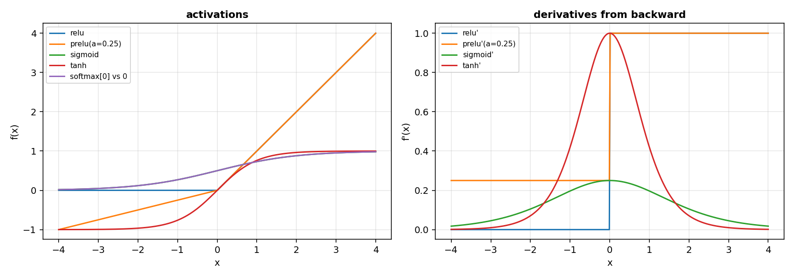

# Neural bricks: how do I check that a neural piece learns the right gradient?

A neural network learns by following a gradient. If the gradient is wrong, the network still trains, and it trains towards the wrong place. This page builds the smallest pieces of a network, one at a time: a parameter that holds its gradient, the initialisation of a weight, the activation that bends the output, the loss that measures the error, and a check that compares the gradient the code computes with the one a finite difference sees. The check is the answer to the question, and it is the reason the page exists.

The bricks work on a batch and on one sample, with the same functions. Every array is a `jax.numpy` array, so the same code runs eagerly and under `jax.jit`.

## 1. A parameter, and an update through an optimizer

A parameter is a number the network learns. It holds two arrays: the value, and the gradient of the loss with respect to that value, of the same shape and dtype. The update asks an optimizer of `dense_armor.utility.optim` for the next value.

~~~python
import jax.numpy as jnp
from dense_armor.utility.neural.params import Param
from dense_armor.utility.optim.sgd import SGD

p = Param(jnp.array([1.0, 2.0]))
p.grad = jnp.array([0.5, -0.3])
p.update(SGD(lr=0.1))
print(p.value)
~~~

~~~
[0.95 2.03]
~~~

`SGD` moves the value by `-lr * grad`: 1.0 goes to 1.0 minus 0.05, 2.0 goes to 2.0 plus 0.03. The optimizer is the object form of the package, with `step(weights, gradient)`. A different optimizer gives a different update without changing `Param`.

## 2. The initialisation of a weight

A weight matrix that starts too large or too small makes the network train badly. The initialisation sets the standard deviation of a zero-mean Gaussian so that the activations of a deep stack keep a constant variance. For a ReLU network with `fan_in` inputs, the standard deviation is `sqrt(2 / fan_in)`; for the linear case (Xavier) it is `sqrt(1 / fan_in)`.

~~~python
import jax
import jax.numpy as jnp
from dense_armor.utility.neural.init import he_normal, xavier_normal

k = jax.random.PRNGKey(0)
wh = he_normal(k, (1024, 1024))
wx = xavier_normal(k, (1024, 1024))
print(round(float(jnp.std(wh)), 4), round(float(jnp.std(wx)), 4))
~~~

~~~
0.0442 0.0312
~~~

`0.0442` is `sqrt(2/1024)` within a tenth of a percent, `0.0312` is `sqrt(1/1024)`. The two come from the same formula: the parametric slope `a` in the paper multiplies the variance by `(1 + a**2)`, and the linear case is `a = 1`.

## 3. An activation, with the gradient that flows back

An activation bends the output of a layer. ReLU keeps the positive part, zeroes the negative one, and the derivative is 1 on the positive side, 0 on the negative side. The code chooses the derivative at 0 to be 0.

~~~python
import jax.numpy as jnp
from dense_armor.utility.neural.activations import relu_forward, relu_backward

x = jnp.array([-1.0, 0.0, 1.0])
y = relu_forward(x)
print(y, relu_backward(x, y, jnp.ones_like(x)))
~~~

~~~
[0. 0. 1.] [0. 0. 1.]
~~~

The forward gives `[0, 0, 1]`, the backward gives the same values because the up-stream gradient is 1 everywhere; at `x = -1` and `x = 0` the gradient is 0.

The softmax turns a vector of logits into probabilities. On a very large number it overflows if written naively, so the code subtracts the maximum first.

~~~python
import jax.numpy as jnp
from dense_armor.utility.neural.activations import softmax_forward

print(softmax_forward(jnp.array([[1000.0, 0.0, -1000.0]])))
~~~

~~~
[[1. 0. 0.]]
~~~

`1000` is `exp(1000)` times larger than `0`; the subtraction of the maximum turns the exponent into a finite number, and the row sums to 1.

### Sigmoid

A binary classifier ends with a raw score that can be any finite number, but a decision needs a probability. A sigmoid is the simplest function that takes that score and squeezes it into the interval (0, 1) without breaking the smoothness: a small score becomes a probability near 0, a large score near 1, and 0 becomes 0.5. The same shape serves as a gate, where 0 is closed, 1 is open and 0.5 is halfway. Because the output is never exactly 0 or 1, a signal always passes a little, and because the derivative is positive everywhere, the gradient of the layers below does not vanish at the start of a training.

~~~python
import jax.numpy as jnp
from dense_armor.utility.neural.activations import Sigmoid

s = Sigmoid()
print(round(float(s.forward(jnp.array(0.0))), 4))
print(round(float(s.backward(jnp.array(1.0))), 4))
~~~

~~~
0.5
0.25
~~~

The forward at `x = 0` is `1 / (1 + exp(-0)) = 1 / 2 = 0.5`. The backward takes the upstream gradient `g = 1` and multiplies it by the derivative of the sigmoid, `s(x) * (1 - s(x))`; at `x = 0` that is `0.5 * 0.5 = 0.25`. The two numbers under the block are what the two `print` lines print.

Textbook definition, no citation.

### Tanh

A tanh has the shape of a sigmoid, shifted down by one half and stretched by two: it goes from -1 to 1 instead of from 0 to 1. The difference matters in a recurrent layer, where the hidden state is passed from one step to the next. A state centred on 0 has no preferred sign, so the sum over many steps does not drift; a state always positive drifts in one direction and saturates the gates. The derivative is largest at 0 and decays towards 0 far from it, which is why a long sequence can make the gradient small.

~~~python
import jax.numpy as jnp
from dense_armor.utility.neural.activations import Tanh

t = Tanh()
print(round(float(t.forward(jnp.array(0.0))), 4))
print(round(float(t.backward(jnp.array(1.0))), 4))
~~~

~~~
0.0
1.0
~~~

At `x = 0` the tanh is `sinh(0) / cosh(0) = 0`, and its derivative is `1 - tanh(0) ** 2 = 1 - 0 = 1`, the maximum slope. Halfway to saturation, at `x = 1`, the tanh is about `0.76` and the derivative about `0.42`: the gate is closing.

Textbook definition, no citation.

### Softmax

A classifier that has to choose among `K` classes ends with `K` scores, not with `K` probabilities. A softmax turns the scores into a distribution: it exponentiates each score, divides by the sum of the exponentials, and returns `K` numbers that are positive and sum to one. The exponential makes the largest score dominate, and the division by the sum makes the result insensitive to a constant added to every score. A language model uses the same function on the vocabulary, a mixture of experts on the experts.

~~~python
import jax.numpy as jnp
from dense_armor.utility.neural.activations import Softmax

sm = Softmax()
print([round(float(v), 4) for v in sm.forward(jnp.array([0.0, 0.0]))])
print([round(float(v), 4) for v in sm.backward(jnp.array([1.0, 0.0]))])
~~~

~~~
[0.5, 0.5]
[0.25, -0.25]
~~~

With equal scores the two exponentials are `1` and `1`, the sum is `2`, and the two probabilities are `0.5`. The backward is `y * (g - sum(g * y))`: with `g = [1, 0]` and `y = [0.5, 0.5]` the sum `g * y` is `0.5`, so the first entry is `0.5 * (1 - 0.5) = 0.25` and the second is `0.5 * (0 - 0.5) = -0.25`. The two gradients sum to 0: softmax conserves the total probability, and a step towards one class is a step away from the other.

Textbook definition, no citation.

### PRelu

A rectified linear unit lets a positive input through and blocks a negative one. A leaky version keeps a small fixed fraction of the negative part, and a parametric version makes that fraction a parameter: the network learns, layer by layer, how much of the negative side is useful. On a deep network the slope of the first layer tends to stay small and the slope of the last layer grows, because the last layer has to decide how a negative activation reaches the output.

~~~python
import jax.numpy as jnp
from dense_armor.utility.neural.activations import PRelu

p = PRelu(0.25)
print(round(float(p.forward(jnp.array(-1.0))), 4))
print(round(float(p.backward(jnp.array(1.0))), 4))
print(round(float(p.a.grad[0]), 4))
print([q.value.shape for q in p.params()])
~~~

~~~
-0.25
0.25
-1.0
[(1,)]
~~~

With slope `a = 0.25` and input `-1` the forward is `a * x = -0.25`; the backward on the negative side is `a * g = 0.25`. The same `backward` fills `a.grad = sum(x * g)` over the entries where `x < 0`, here `-1 * 1 = -1`. The last line shows the single parameter `a`, of shape `(1,)`, the one that `params()` returns and that an optimizer updates at every step.

He, K., Zhang, X., Ren, S., Sun, J. (2015). *Delving deep into rectifiers.* arXiv:1502.01852. Page 2, Eq.(1): `f(y) = y if y > 0, a * y otherwise`, and the caption of Figure 1 states that the coefficient of the negative part is not constant and is adaptively learned.

## 4. A loss, and the gradient it produces

The loss turns a prediction and a target into a number to minimise. The mean squared error is the mean of the squared differences. The gradient with respect to the prediction is `2 * (pred - target) / size`.

~~~python
import jax.numpy as jnp
from dense_armor.utility.neural.losses import mse_forward, mse_backward

p = jnp.array([1.0, 2.0])
t = jnp.array([1.0, 3.0])
print(mse_forward(p, t), mse_backward(p, t))
~~~

~~~
0.5 [ 0. -1.]
~~~

The error on the second element is `-1`, the mean of the squares is `(0 + 1) / 2 = 0.5`.

The binary cross-entropy is written in a form that does not overflow on `z = 1000` or `z = -1000`.

~~~python
import jax.numpy as jnp
from dense_armor.utility.neural.losses import bce_with_logits_forward

print(bce_with_logits_forward(jnp.array([1000.0, -1000.0]), jnp.array([1.0, 0.0])))
~~~

~~~
0.0
~~~

The prediction is exactly right (logit `1000` for target `1`, logit `-1000` for target `0`), so the loss is 0 and the code does not overflow.

### SoftmaxCrossEntropy

A classifier that outputs a distribution needs a loss that measures how far the distribution is from the truth. Softmax cross-entropy takes the logits of the last layer and the integer label of the class, and returns one number: small when the class has high probability, large when the class has low probability. The logarithm cancels the exponential of the softmax, so the loss does not overflow when a logit is large, and the gradient comes out as `softmax(logits) - onehot(label)`, the difference between what the model believed and what it should have believed.

~~~python
import jax.numpy as jnp
from dense_armor.utility.neural.losses import SoftmaxCrossEntropy

sce = SoftmaxCrossEntropy()
loss = sce.forward(jnp.array([[2.0, 0.0, 0.0]]), jnp.array([0]))
grad = sce.backward()
print(round(float(loss), 4))
print([round(float(v), 4) for v in grad[0]])
~~~

~~~
0.2395
[-0.213, 0.1065, 0.1065]
~~~

Softmax of `[2, 0, 0]` is `[0.787, 0.1065, 0.1065]`; the loss is `-log(0.787) = 0.2395`. The gradient over the batch of one is `softmax(logits) - onehot(0) = [0.787 - 1, 0.1065 - 0, 0.1065 - 0] = [-0.213, 0.1065, 0.1065]`. The first class gets a negative gradient (the update makes it more likely), the other two a positive one, and the three sum to 0.

Textbook definition, no citation.

### BCEWithLogits

A binary classifier can output a single score `z` instead of a probability, and let the loss apply the sigmoid. That is what this loss does: for label 1 it computes `-log(sigmoid(z))`, for label 0 `-log(1 - sigmoid(z))`, in a form that combines the sigmoid and the log so that neither overflows when `z` is very negative or very positive. The gradient is again the difference between what the model believed and the target, on one number.

~~~python
import jax.numpy as jnp
from dense_armor.utility.neural.losses import BCEWithLogits

b = BCEWithLogits()
loss = b.forward(jnp.array(0.0), jnp.array(1.0))
grad = b.backward()
print(round(float(loss), 4))
print(round(float(grad), 4))
~~~

~~~
0.6931
-0.5
~~~

At `z = 0` the sigmoid is `0.5`, so the loss for label 1 is `-log(0.5) = 0.6931`; the gradient is `sigmoid(z) - target = 0.5 - 1 = -0.5`. On a sample the classifier already gets right, at `z = 3` and label 1, the loss is about `0.0486` and the gradient about `-0.0474`: the correction is smaller.

Textbook definition, no citation.

### Huber

A mean squared error grows like the square of the residual, so a single outlier can pull the weights towards itself for one step and back on the next. A mean absolute error grows like the residual, so it is less sensitive to the outlier but its derivative jumps at zero and the training near the optimum is less stable. A Huber loss uses the two: quadratic near zero, where the residual is small and the gradient is smooth, linear far from zero, where the outlier should not dominate the update. The threshold `delta` decides where the two parts meet.

~~~python
import jax.numpy as jnp
from dense_armor.utility.neural.losses import Huber

h = Huber(1.0)
loss = h.forward(jnp.array([0.5, 3.0]), jnp.array([0.0, 0.0]))
grad = h.backward()
print(round(float(loss), 4))
print([round(float(v), 4) for v in grad])
~~~

~~~
1.3125
[0.25, 0.5]
~~~

The two residuals are `[0.5, 3.0]`, the threshold is `delta = 1`. The first is below the threshold, so it contributes the quadratic part `0.5 * 0.5 ** 2 = 0.125`; the second is above, so it contributes the linear part `1 * (3 - 0.5) = 2.5`. The mean is `(0.125 + 2.5) / 2 = 1.3125`. The gradient is `[0.5, 1]` divided by 2, `[0.25, 0.5]`: the first residual gets the linear part of the derivative, the second gets the constant slope `delta` of the Lipschitz part.

Chinot, G. (2019). *Robust learning and complexity dependent bounds for regularized problems.* arXiv:1902.02238. Page 4: `l(u, y) = (1/2) (y - u) ** 2` if `|u - y| <= delta`, `delta * |y - u| - delta ** 2 / 2` otherwise, with `L = delta` Lipschitz.

## 5. The gradient check

The pieces above are only useful if the gradient they compute is the true gradient. The gradient check compares the backward of the code with a central finite difference of the loss. A small error means the backward is right; a large error means it is wrong.

~~~python
import jax.numpy as jnp
from dense_armor.utility.neural.gradcheck import gradcheck

def f(x):
    return x * x

def b(x, y, g):
    return g * 2.0 * x

x = jnp.array([1.0, 2.0, -3.0])
print(round(gradcheck(f, b, x), 10))
~~~

~~~
4e-10
~~~

The largest relative error is `4e-10`, the precision of the finite difference itself. The backward is right.

~~~python
import jax.numpy as jnp
from dense_armor.utility.neural.gradcheck import gradcheck

def f(x):
    return x * x

def b_bad(x, y, g):
    return g * x

print(round(gradcheck(f, b_bad, jnp.array([1.0, 2.0, -3.0])), 4))
~~~

~~~
0.3333
~~~

The backward omits the factor 2, and the check reports it: the error is 1/3. A gradient the code gets wrong is a network that trains towards the wrong place, and the check is what catches it.

## 7. Optional: the Huber loss and the Glorot uniform initialisation

The two pieces below are optional: the rest of the page does not depend on them. The source for the Huber formula is Chinot (2019), page 4; the source for the Glorot uniform is Glorot and Bengio (2010), Eqn.(16) page 5.

The Huber loss is quadratic near the target and linear far from it, so a single outlier does not pull the gradient as hard as it would with the mean squared error. The parameter `delta` sets the threshold.

~~~python
import jax.numpy as jnp
from dense_armor.utility.neural.losses import huber_forward, huber_backward

p = jnp.array([1.0, 2.0])
t = jnp.array([1.0, 5.0])
print(huber_forward(p, t, delta=1.0), huber_backward(p, t, delta=1.0))
~~~

~~~
1.25 [ 0.  -0.5]
~~~

The first prediction is inside the quadratic region and the gradient is 0; the second is three units away with `delta = 1`, and the gradient is `-delta / n = -0.5`. The formula is the one in Chinot (2019), page 4: `(1/2)(y - u)**2` if `|u - y| <= delta`, `delta*|y - u| - delta**2/2` otherwise.

The Glorot uniform initialisation is the distribution that the same paper uses in the normalised initialisation: `W ~ U[-sqrt(6/(n_j + n_{j+1})), sqrt(6/(n_j + n_{j+1}))]`, Glorot and Bengio (2010), Eqn.(16), page 5. The scale `6/(n_j + n_{j+1})` is the one of the Gaussian case of `xavier_normal` above divided by 3, because a uniform distribution on `[-a, a]` has variance `a**2/3`.

~~~python
import jax
import jax.numpy as jnp
from dense_armor.utility.neural.init import glorot_uniform

g = glorot_uniform(jax.random.PRNGKey(0), (8, 4))
print(round(float(jnp.min(g)), 4), round(float(jnp.max(g)), 4))
~~~

~~~
-0.6714 0.6864
~~~

The bounds `-0.7071` and `+0.7071` are `sqrt(6 / (8 + 4))`; the two values printed are the minimum and the maximum of an 8x4 sample, both inside the bound. The signature `glorot_uniform(key, shape)` mirrors the one of `xavier_normal`.

## 6. The picture

The left panel is the five activations on `x` in `[-4, 4]`, the right panel the derivative of each one as the code `backward` returns it.

## Details

### References

- He, K., Zhang, X., Ren, S., Sun, J. (2015). *Delving Deep into Rectifiers: Surpassing Human-Level Performance on ImageNet Classification.* arXiv:1502.01852. Page 2, Eqn.(1): the parametric rectifier `f(y) = y` if `y > 0`, `a*y` otherwise. `a = 0` is ReLU, a small fixed `a` is Leaky ReLU. Page 4, Eqn.(10): `(1/2) n_l Var[w_l] = 1`, a zero-mean Gaussian of standard deviation `sqrt(2/n_l)`, biases zero. Page 5, Eqn.(15): `(1/2)(1 + a^2) n_l Var[w_l] = 1`, with `a = 1` the linear case "the same as [7]", the Xavier initialisation.
- Glorot, X., Bengio, Y. (2010). *Understanding the Difficulty of Training Deep Feedforward Neural Networks.* AISTATS 2010, PMLR 9:249-256. Page 5, Eqn.(16): the normalised initialisation `W ~ U[-√6/√(n_j + n_{j+1}), √6/√(n_j + n_{j+1})]`. The PDF is open on the PMLR site. Pages 5 Eqn.(4) to (7) give the forward and backward variance relations, not the initialisation; Eqn.(1), page 3, is the common heuristic `U[-1/√n, 1/√n]` that the paper compares with, not the normalised initialisation.
- Huber, P. J. (1964). *Robust Estimation of a Location Parameter.* The Annals of Mathematical Statistics 35(1), 73-101. DOI 10.1214/aoms/1177703732. The PDF is paywalled: the download returns a 1.2 kB HTML paywall page, not a PDF, so only the bibliographic metadata is verified. The formula used by the code is quoted from the open-access secondary source below, page 4.
- Chinot, G. (2019). *Robust learning and complexity dependent bounds for regularized problems.* arXiv:1902.02238. Page 4: `l(u, y) = (1/2)(y - u)**2` if `|u - y| <= delta`, `delta*|y - u| - delta**2/2` otherwise, with the Huber loss `L = delta`-Lipschitz. The paper is open on arXiv, 38 pages.
- Sigmoid, tanh, softmax, mean squared error, cross-entropy: textbook definitions, no citation.

### Choices stated explicitly

- The derivative of ReLU at `x = 0` is 0. The paper does not define it, and PyTorch uses 0; this code uses 0.
- The gradient check evaluates the finite differences with `eps = 1e-6`. The step is large enough that float32 does not lose all digits, small enough that the truncation error of the central difference stays below the tolerance of the tests (`1e-7` on a correct pair).
- The gradient check runs inside `jax.enable_x64(True)` and restores the previous setting at the end. Outside the call the global precision is unchanged.
- The Huber loss and `glorot_uniform` are optional pieces. The Huber formula is quoted from the open-access Chinot (2019), page 4, because the primary paper (Huber 1964) is paywalled. The Glorot uniform is Glorot and Bengio (2010), Eqn.(16), page 5.
- The layers (Dense, Conv, RNN) are not delivered here. They belong to a separate page of the guide, and this page stops at the pieces that the gradient check tests.

### Development diary

The pieces of this page are the ones the gradient check can test end to end. The Huber loss and `glorot_uniform` are optional, and the page states it: the first is outside this page and quoted from Chinot (2019), page 4, the second is the normalised uniform of Glorot and Bengio (2010), page 5. The layers (Dense, Conv, RNN) belong to a separate page of the guide and are not delivered here.

The first version of the gradient check divided each difference by the analytic gradient rather than by the sum of the absolute values, and a single element with a small analytic gradient made the relative error large even when the backward was right. The division by `max(|a| + |b|, 1e-12)` keeps the error at the scale of the values compared.

The five activations and the three losses were written before their classes, because the classes need the functions and the tests work on the functions. The classes cache the last `x` and `y`; calling `backward` before `forward` raises `RuntimeError` and a test exercises the guard for each class.
