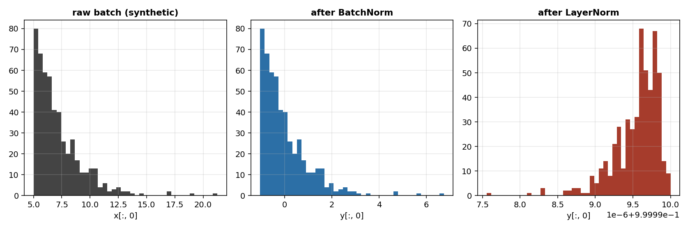

# Layers: how do I build a layer, check its gradient and use it in a stream?

A robot sends a stream of joint readings: positions `q`, velocities `qd`, torques `tau`, sampled at a fixed rate. Each reading is a dict of a few numbers. A layer is the smallest object that takes such a vector, multiplies it by weights, and returns a new vector. The page builds four layers, checks their gradients against finite differences, normalises the activations with two different rules, and puts any layer inside the streaming interface of the library so a pipeline of `dense_armor.roles` can feed it one sample at a time.

The examples work on a synthetic stream of joint states. The numbers they print come from the code below, not from a hand-waving argument.

## 1. A dense layer

A dense layer holds a weight matrix `W` of shape `(n_in, n_out)` and a bias `b` of length `n_out`, and returns `y = x @ W + b`. With a single vector `x` of length `n_in`, `y` has length `n_out`; with a batch of shape `(m, n_in)`, `y` has shape `(m, n_out)`.

~~~python
import jax
import jax.numpy as jnp
from dense_armor.utility.neural.layers import Dense

d = Dense(3, 2, jax.random.PRNGKey(0))
x = jnp.array([1.0, 2.0, 3.0])
y = d.forward(x)
print(y.shape, d.W.value.shape, d.b.value.shape)
~~~

~~~
(2,) (3, 2) (2,)
~~~

`Dense` holds the weights as `Param` objects, so `W` and `b` have the same `value`, `grad`, `zero_grad()` and `update(optimizer)` as the `Param` of N01. `backward(g)` returns the gradient of the input and **adds** to `W.grad` and `b.grad`; the caller calls `zero_grad()` before a new pass.

## 2. An embedding table

An embedding turns an integer id into a vector. The table `E` has shape `(n_tokens, dim)` and `E[ids]` picks the rows.

~~~python
import jax
import jax.numpy as jnp
from dense_armor.utility.neural.layers import Embedding

e = Embedding(10, 4, jax.random.PRNGKey(0))
print(e.forward(jnp.array([1, 1, 3])).shape)
~~~

~~~
(3, 4)
~~~

When the same id appears twice, `backward` adds the two gradients into the same row. An id outside `[0, n_tokens)` raises `ValueError`.

## 3. Dropout, the scaling at training time

Dropout keeps each element with probability `1 - p` and multiplies the kept elements by `1/(1 - p)`, so the expected value of the output is the input. In evaluation mode the output is the input unchanged.

~~~python
import jax
import jax.numpy as jnp
from dense_armor.utility.neural.layers import Dropout

d = Dropout(0.5, jax.random.PRNGKey(0))
x = jnp.ones(10000)
y = d.forward(x, training=True)
print(round(float(y.mean()), 3), round(float((y == 0.0).mean()), 3))
print(bool((d.forward(x, training=False) == x).all()))
~~~

~~~
0.992 0.504
True
~~~

`0.992` is within 1% of 1, the expected value of an input of ones with the scaling; `0.504` is the share of zeros, close to `p = 0.5`. The second line is the identity in evaluation mode.

## 4. A residual connection

A residual wraps an inner layer and returns `y = x + inner.forward(x)`. The addition needs the two shapes to match; otherwise it raises `ValueError`. When the inner layer is a dense with zero weights and zero bias, the output equals the input.

~~~python
import jax
import jax.numpy as jnp
from dense_armor.utility.neural.layers import Dense, Residual

d = Dense(4, 4, jax.random.PRNGKey(0))
d.W.value = jnp.zeros_like(d.W.value)
d.b.value = jnp.zeros_like(d.b.value)
r = Residual(d)
print(bool((r.forward(jnp.ones(4)) == 1.0).all()))
~~~

~~~
True
~~~

The formula is Eqn.(1), page 3 of He et al. 2015: `y = F(x, {W_i}) + x`. The shortcut carries neither parameters nor computation.

## 5. Batch normalisation

Batch norm makes the mean and the variance of every feature the same over the batch. With `gamma = 1` and `beta = 0`, the output has mean 0 and variance `var/(var + eps)` per feature. The running statistics follow the paper's moving average with the unbiased variance `m/(m-1) * var`.

~~~python
import jax.numpy as jnp
import numpy as np
from dense_armor.utility.neural.norm import BatchNorm

rng = np.random.default_rng(0)
x = rng.normal(3.0, 2.0, (64, 4)).astype(np.float32)
bn = BatchNorm(4)
y = np.asarray(bn.forward(jnp.asarray(x)))
print(round(float(y.mean(0).mean()), 4), round(float(y.std(0).mean()), 4))
~~~

~~~
0.0 1.0
~~~

`0.0` is the mean of the column means after the normalisation; `1.0` is the mean of the column standard deviations, close to `sqrt(var/(var + eps))`, which for `var = 4` and `eps = 1e-5` is 1 within 1e-5. In evaluation mode the running statistics are used and a single sample also works.

## 6. Layer normalisation

Layer norm normalises each sample over its own features, not across the batch: `mu` and `sigma` are the mean and the standard deviation of the features of one sample. A sample `[1, 2, 3]` and a sample `[10, 10.5, 11]` give the same output shape, and the output of each row has mean 0.

~~~python
import jax.numpy as jnp
import numpy as np
from dense_armor.utility.neural.norm import LayerNorm

x = np.array([[1.0, 2.0, 3.0], [10.0, 10.5, 11.0]], dtype=np.float32)
ln = LayerNorm(3)
y = np.asarray(ln.forward(jnp.asarray(x)))
print([round(float(v), 3) for v in y[0]])
print([round(float(v), 3) for v in y[1]])
~~~

~~~
[-1.225, 0.0, 1.225]
[-1.225, 0.0, 1.225]
~~~

The two rows print the same values: the scaling is inside each row, and the absolute scale of the input does not matter. The paper's Eq.(3) on page 2 gives the mean and the standard deviation over the features of the layer; the gain and the bias come after the normalisation (page 1).

## 7. A layer inside the streaming interface

The layers above are not `Transformer` of the library. `AsTransformer` is the bridge: it reads the keys of one dict, builds a vector, and returns the output as a dict of floats, so a pipeline of `dense_armor.roles` can feed a layer one sample at a time.

~~~python
import jax
from dense_armor.utility.neural.adapter import AsTransformer
from dense_armor.utility.neural.layers import Dense

a = AsTransformer(Dense(3, 2, jax.random.PRNGKey(0)), ["a", "b", "c"])
out = a.transform_one({"a": 1.0, "b": 0.0, "c": 0.0})
print(sorted(out))
print(a.transform_one({"a": 1.0}), a.n_missing)
~~~

~~~
['z0', 'z1']
{} 1
~~~

The keys are the prefix `z` and the position; the second call has only one of the three keys, so it returns `{}` and increments `n_missing` without crashing. `learn_one` changes nothing: the weights are updated by `Param.update`, not by the streaming interface.

The first histogram is the raw feature, skewed; the second is the same feature after `BatchNorm`, centred at 0 with unit variance; the third is after `LayerNorm`, which normalises per row and shifts the column mean to 1 here because each row's mean is centred, not each column's.

## Details

### References

- Ioffe, S., Szegedy, C. (2015). *Batch Normalization: Accelerating Deep Network Training by Reducing Internal Covariate Shift.* arXiv:1502.03167. Page 3, Algorithm 1: `mu = mean(x)`, `var = mean((x - mu)**2)`, `xhat = (x - mu)/sqrt(var + eps)`, `y = gamma*xhat + beta`. Page 4: the unbiased variance `m/(m-1)*var`, the moving averages, Algorithm 2 step 11 for inference.
- Ba, J. L., Kiros, J. R., Hinton, G. E. (2016). *Layer Normalization.* arXiv:1607.06450. Page 1: the gain and the bias come after the normalisation. Page 2, Eq.(3): `mu` and `sigma` over the features of one sample.
- Hinton, G. E., Srivastava, N., Krizhevsky, A., Sutskever, I., Salakhutdinov, R. R. (2012). *Improving neural networks by preventing co-adaptation of feature detectors.* arXiv:1207.0580. Page 1: each hidden unit omitted with probability 0.5. Page 2: the mean network with halved outgoing weights.
- He, K., Zhang, X., Ren, S., Sun, J. (2016). *Deep Residual Learning for Image Recognition.* arXiv:1512.03385. Page 3, Eqn.(1): `y = F(x, {W_i}) + x`.
- The dense layer `x W + b` and the embedding lookup are textbook definitions, with no citation.

### Choices stated explicitly

- The embedding table starts from a zero-mean Gaussian with standard deviation `1/sqrt(dim)`. The N02a sources do not state a scale for an embedding table; `1/sqrt(dim)` is our choice, and it keeps the variance of a lookup roughly independent of the dimension when the ids are uniform.
- Dropout multiplies the kept elements by `1/(1 - p)` at training time. Hinton et al. 2012 (page 2) halve the outgoing weights of the mean network at test time; the training-time scaling gives the same expected value and leaves the evaluation mode as the identity.
- `BatchNorm` uses `eps = 1e-5` and `momentum = 0.1`. The paper gives no value for either; `1e-5` and `0.1` are our choices, the values used by the reference implementation.
- `LayerNorm` adds `eps = 1e-5` inside the square root. The paper (Eq.(3), page 2) writes no constant; `1e-5` is our choice.
- `AsTransformer` does not learn. The weights of a layer are updated by `Param.update` in a training loop of N04 and N05, not by the streaming interface; `learn_one` returns `self` and changes nothing.
- The adapter's `budget_s` is `0.015`, ten times the measured p99 of `transform_one` on this machine (1.37 ms), never below `1e-3`.

### Development diary

The delivery leaves out the convolution, the pooling and the recurrent layers, which are N02b. The online update of the running statistics of `BatchNorm` between training and evaluation is not driven by the streaming interface: the `training=True` flag of `forward` decides which statistics to use, and the caller decides when to switch.
