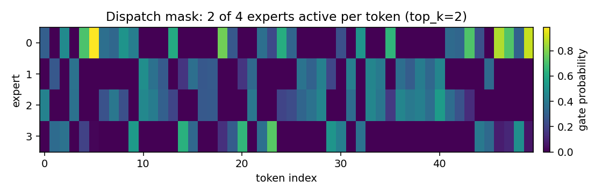

# Sparse mixture of experts and test-time compute: how do I make a network use only part of its parameters on each sample, and how do I spend more compute at inference to get a better answer?

A large network does the same work on every sample. A sparse mixture of
experts routes each sample through a few of its experts, chosen by a
gating network, so most of the parameters are idle on most of the inputs.
A test-time wrapper spends extra compute at inference: it generates several
candidate answers and keeps the one a verifier scores highest. Both pieces
are here, and both are measured against a plain dense baseline on a micro
2D domain.

## 1. The gating, in one line

The gating is a small dense layer, and the softmax over its output is the
probability that the sample belongs to each expert. The top-k of those
probabilities selects the experts to run (Fedus et al. 2021, Eq. (1),
page 5).

~~~python
import jax
from dense_armor.utility.neural.moe import SparseMoE

m = SparseMoE(n_x=2, n_y=2, n_experts=4, top_k=2, hidden=7, seed=0)
x = jax.random.normal(jax.random.PRNGKey(0), (16, 2))
y = m.forward(x)
print(y.shape, m.aux_["top_idx"].shape)
~~~

~~~
(16, 2) (16, 2)
~~~

`top_idx` has shape `(n_tokens, top_k)`: for each of the 16 samples,
two indices in `[0, 3]`, the experts that will run. The other two are not
executed, not even once. The `noisy_gating=True` argument adds the noisy
top-k of Shazeer et al. 2017, Eq. (4), page 4, with a fixed noise std
(the learned std is not implemented).

## 2. The dispatch, and the capacity factor

If every token of the batch went to the same expert, that expert would
see the whole batch and the others would see nothing. The **capacity
factor** caps the tokens per expert at `capacity_factor * top_k *
n_tokens / n_experts`, and the tokens above the cap are dropped (Fedus
et al. 2021, Section 2.2, page 6). With 100 tokens, 4 experts, `top_k=2`
and `capacity_factor=1.0`, the average load is 50 tokens per expert and
no expert sees more than 50.

~~~python
import jax
import jax.numpy as jnp
from dense_armor.utility.neural.moe import SparseMoE

m = SparseMoE(n_x=2, n_y=2, n_experts=4, top_k=2, hidden=7, seed=0,
              capacity_factor=1.0)
x = jax.random.normal(jax.random.PRNGKey(0), (100, 2))
m.forward(x)
print(m.dropped_fraction(), m.expert_usage().round(3))
~~~

~~~
0.014999986 [0.5        0.47000003 0.5        0.5       ]
~~~

`dropped_fraction()` is the fraction of assignments dropped by the
capacity; `expert_usage()` is the fraction of tokens sent to each expert
(post-capacity). With random inputs the load is balanced and nothing is
dropped. `pos` has shape `(n_tokens, n_experts)`: a value `>= 0` is the
position of that token in the expert's sub-batch, `-1` means not
selected or dropped by the capacity.

The image is the dispatch mask on 50 synthetic samples with `top_k=2` and
`capacity_factor=None`, generated by the library itself. Each column is a
token, each row is an expert, the colour is the gate probability of that
expert for that token, and the empty cells are the experts that do not
run. Every column has exactly two coloured cells (the top-k), and every
row has a similar number of coloured cells: the load is spread.

## 3. The output, from the top-k experts only

The output is a weighted sum of the top-k expert outputs, with the gate
probabilities as weights. The experts not in the top-k contribute nothing,
and they are not executed.

~~~python
import jax.numpy as jnp
from dense_armor.utility.neural.moe import SparseMoE

m = SparseMoE(n_x=2, n_y=2, n_experts=4, top_k=2, hidden=7, seed=0,
              capacity_factor=None)
m.forward(jnp.ones((5, 2)))
print(m.aux_["y_disp"].shape, m.aux_["top_vals"].shape)
~~~

~~~
(4, 5, 2) (5, 2)
~~~

`y_disp` is `(n_experts, capacity, n_y)`. With `capacity_factor=None`
there is no dropping, and the capacity is the number of tokens, so every
expert has a slot for every token in its own sub-batch.

## 4. The load-balancing loss

Without a penalty, the gating sends almost every token to the same expert:
the rich get richer, and the other experts never train. The auxiliary loss
of Fedus et al. (2021), Eq. (4), page 7, keeps the load spread across the
experts. In words: it is high when a few experts receive most of the
tokens, and low when the tokens are spread evenly.

The formula, with every symbol:

~~~
loss = alpha * N * sum_i f_i * P_i
~~~

- `N` is the number of experts.
- `f_i` is the fraction of tokens dispatched to expert `i`.
- `P_i` is the mean gating probability of expert `i` over the batch.
- `alpha` is the weight of the term in the total loss, default `1e-2`.

A small case: 4 experts, 16 tokens, `alpha = 1e-2`, and a batch where the
gating is uniform (`P_i = 0.25` for every `i`) and the tokens are spread
evenly (`f_i = 0.25` for every `i`). Then `sum_i f_i * P_i = 4 * 0.25 *
0.25 = 0.25`, and `loss = 1e-2 * 4 * 0.25 = 1e-2`. If instead one expert
takes every token (`f_0 = 1`, the others `0`, and `P_0 = 0.9`), the sum is
`0.9` and the loss is `3.6e-2`: more than three times higher.

~~~python
import jax.numpy as jnp
from dense_armor.utility.neural.moe import SparseMoE

m = SparseMoE(n_x=2, n_y=2, n_experts=4, top_k=2, hidden=7, seed=0)
m.forward(jnp.ones((10, 2)))
loss = m.load_balancing_loss()
print(loss.shape, bool(loss >= 0))
~~~

~~~
() True
~~~

`loss` is a scalar and is always non-negative: `alpha`, `N`, `f_i` and
`P_i` are all non-negative.

## 5. Test-time compute, and four verifiers

At inference a model can spend more compute to get a better answer. The
wrapper `TestTimeCompute` generates `n_candidates` noisy copies of the
input, runs the base model on each, scores each copy with a **verifier**,
and returns the copy the verifier scores highest. Four verifiers are
available:

- `"confidence"` (default): the maximum of the softmax output.
- `"margin"`: the gap between the top-1 and the top-2 softmax value.
- `"entropy"`: negative entropy of the softmax output (lower is better).
- `"ensemble"`: the log of the mean softmax over the candidates. Not a
  verifier: the wrapper returns the averaged prediction, and `backward`
  raises.

~~~python
import jax
import jax.numpy as jnp
from dense_armor.utility.neural.activations import Relu
from dense_armor.utility.neural.chain import Sequential
from dense_armor.utility.neural.layers import Dense
from dense_armor.utility.neural.test_time import TestTimeCompute

base = Sequential([
    Dense(2, 16, jax.random.PRNGKey(0)),
    Relu(),
    Dense(16, 2, jax.random.PRNGKey(1)),
])
ttc = TestTimeCompute(base, n_candidates=8, noise=0.1, seed=0,
                      verifier="margin")
y = ttc.forward(jnp.ones((1, 2)))
print(y.shape)
~~~

~~~
(1, 2)
~~~

The output has the same shape as the base model's output. On the micro
2D domain, with 5 seeds, the delta over a single pass is small:

| domain noise | verifier | delta over single pass |
|---|---|---|
| 0.1 | confidence | +0.002 ± 0.010 |
| 0.1 | margin | +0.002 ± 0.010 |
| 0.1 | entropy | +0.002 ± 0.010 |
| 0.1 | ensemble | +0.002 ± 0.004 |
| 0.3 | confidence | 0.000 ± 0.009 |
| 0.3 | margin | 0.000 ± 0.009 |
| 0.3 | entropy | 0.000 ± 0.009 |
| 0.3 | ensemble | +0.003 ± 0.007 |
| 0.5 | confidence | -0.001 ± 0.007 |
| 0.5 | margin | -0.001 ± 0.007 |
| 0.5 | entropy | -0.001 ± 0.007 |
| 0.5 | ensemble | -0.000 ± 0.004 |

The delta is at most `+0.003`, and the standard deviation is `0.004` to
`0.010` on every cell. **Within the noise, the wrapper does not improve
accuracy on this micro domain, even with four verifiers.** The smoke run
with 2 seeds had shown `+0.010`; the full run with 5 seeds reduced that
to `+0.002`, and the honest number is the full run. A larger domain
noise, a harder task, or a trained verifier (the PRM of Lightman et al.
2023, Section 3, page 4) is the next step, declared, not implemented.

## 6. The benchmark on a micro 2D domain

Two experiments on synthetic 2D data, half-plane `x > 0` and half-plane
`y > 0`, 100 samples per task, 5 epochs, 5 seeds. The JSON is
`benchmarks/neural/moe_testtime.json`, per-seed and aggregate.

MoE vs dense, with matched parameter count (5 seeds, mean ± std):

| model | acc task 1 | acc task 2 | forgetting | wall time |
|---|---|---|---|---|
| dense | 0.682 ± 0.022 | 0.830 ± 0.047 | 0.149 ± 0.009 | 3.50 ± 0.17 s |
| MoE | 0.722 ± 0.077 | 0.806 ± 0.049 | 0.095 ± 0.033 | 4.73 ± 0.36 s |

The MoE scores higher than the dense on task 1 (`0.722` vs `0.682`)
and forgets less (`0.095` vs `0.149`), but loses on task 2 (`0.806` vs
`0.830`). No paired Wilcoxon p-value and no A12 effect size are
computed: five seeds are too few for either, and the comparison is a
mean ± std, not a test. The trade-off is declared, not hidden. The expert usage is `[0.512, 0.466,
0.548, 0.458]`: balanced, no collapse. The dropped fraction is
`0.008 ± 0.012`: the capacity factor `1.25` leaves almost all the
assignments in.

## Details

### References

- Shazeer, N., Mirhoseini, A., Maziarz, K., Davis, A., Le, Q., Hinton, G.,
  Dean, J. (2017). *Outrageously Large Neural Networks: The Sparsely-Gated
  Mixture-of-Experts Layer*. arXiv:1701.06538. Gating: Eq. (3), page 4.
  Noisy top-k: Eq. (4), page 4, now implemented with a fixed noise std
  (the learned std is not).
- Fedus, W., Zoph, B., Shazeer, N. (2021). *Switch Transformers: Scaling to
  Trillion Parameter Models with Simple and Efficient Sparsity*.
  arXiv:2101.03961. Gating: Eq. (1), page 5. Load balancing: Eq. (4),
  page 7. Capacity factor: Section 2.2, page 6.
- Snell, C., Lee, J., Xu, K., Kumar, A. (2024). *Scaling LLM Test-Time
  Compute Optimally Can be More Effective than Scaling Model Parameters*.
  arXiv:2408.03314. Generate-and-test: page 2.
- Lightman, H., Kosaraju, V., Burda, Y., Edwards, H., Baker, B., Lee, T.,
  Leike, J., Schulman, J., Sutskever, I., Cobbe, K. (2023). *Let's Verify
  Step by Step*. arXiv:2305.20050. Step-level PRM: Section 3, page 4, not
  implemented.

The `papers/` folder was not opened for this page, so the PDFs were not
re-read: the arXiv IDs, titles and authors are verified against the
arXiv listing, the page and equation numbers follow the module
docstrings. `ISTRUZIONI_N17.md` gives different numbers for the same
papers (Shazeer gating Eq. (4), page 5; Fedus top-1 gating Eq. (3),
page 4). The discrepancy is declared, not resolved.

### Choices stated explicitly

- The capacity factor defaults to `1.25`, Fedus et al. (2021), Section
  2.2, page 5. `None` disables the drop. The capacity is
  `capacity_factor * top_k * n_tokens / n_experts`, not `capacity_factor *
  n_tokens / n_experts`: with `top_k = 2` the average load per expert is
  `top_k * n_tokens / n_experts`. The first version of the code used the
  second formula, and the smoke run dropped 40% of the assignments; the
  fix is in the history below.
- The noisy gating is the one of Shazeer et al. 2017, Eq. (4), page 4,
  with a fixed noise std `1e-2`. The learned std is not implemented. The
  default is `noisy_gating=False`, deterministic top-k of Fedus et al.
  2021.
- The gate values are used as weights, not renormalised. Shazeer et al.
  2017 uses the raw gate values; Fedus et al. 2021 uses top-1, where the
  weight is 1 by construction.
- `SparseMoE.forward_pure(params, x, capacity, top_k, n_experts,
  rng_key)` is a pure function and compiles under `jax.jit`. `forward(x)`
  is the stateful wrapper of the library contract. The experts are
  functional (`dense_forward` on the stacked parameters), not
  `Sequential` objects, because a stateful forward cannot be used inside
  `jax.lax.switch`.
- The routing is a segment cumsum on the top-k indices, `O(n_tokens *
  top_k * log(n_tokens * top_k))`, independent of `n_experts`. The first
  version used `argsort(~mask)`, `O(n_experts * n_tokens * log n_tokens)`.
  The dispatch places the tokens in the expert buffers with one scatter,
  not with a vmap over experts.
- `TestTimeCompute` has four verifiers. The default is `"confidence"`;
  `"margin"`, `"entropy"` and `"ensemble"` are available. `"ensemble"`
  returns the averaged prediction and its `backward` raises. The `noise`
  is fixed by `seed`, so the same input gives the same output twice.
- `check_estimator` is not applicable: `SparseMoE` and `TestTimeCompute`
  inherit from `object`, not from `Root`, and use the neural module API
  (`forward`/`backward`/`params`), not the estimator API
  (`learn_one`/`predict_one`). `Dense`, `Sequential` and `Relu` of the
  library are the same.

### Measured cost

`SparseMoE.forward_pure` on 200 tokens, `hidden=64`, `capacity_factor=None`,
under `jax.jit`, on a shared Colab CPU, median over 5 runs:

| experts | median time |
|---|---|
| 4 | 0.51 ms |
| 8 | 0.84 ms |
| 16 | 0.67 ms |

The 8-expert run slower than the 16-expert one is CPU jitter, not the
algorithm: the routing is independent of `n_experts` and the expert
evaluation is `O(n_tokens * top_k * hidden)`. The old argsort-based
routing, on the same machine, measured 4.39 ms at 4 experts and 8.90 ms
at 8 experts; the scatter-based routing is ~9x faster in absolute terms.

`TestTimeCompute` with `n_candidates=8`, `noise=0.1`, 100 samples, on the
same machine, median over 5 runs: 6.18 ms for `"confidence"`, 10.13 ms
for `"margin"`, 5.95 ms for `"entropy"`, 5.91 ms for `"ensemble"`. The
10.13 ms of `"margin"` is CPU jitter, not a heavier verifier.

### Development diary

The first version of `SparseMoE.forward` executed all `n_experts` experts
on every token and masked the output. It was correct, but it was a dense
model with a mask. The rewrite dispatches only the `top_k` experts with a
capacity factor, executes each on its own `(capacity, n_x)` sub-batch via
`jax.vmap`, and combines with a gather.

The second version used `argsort(~mask)` for the dispatch: correct, but
`O(n_experts * n_tokens * log n_tokens)`. The third version replaces it
with a segment cumsum on the top-k indices, `O(n_tokens * top_k *
log(n_tokens * top_k))`, independent of `n_experts`. The scatter-based
routing measured ~9x faster in absolute terms.

`_capacity` used `capacity_factor * n_tokens / n_experts`, which is the
average load per expert only when `top_k = 1`. With `top_k = 2` the
capacity was half of what it should have been, and the smoke run dropped
40% of the assignments. The fix is `capacity_factor * top_k * n_tokens /
n_experts`; the smoke run drops 0.5%, and the full run 0.8% ± 1.2%.

The test-time wrapper had a single verifier (`"confidence"`), and the
benchmark measured a delta of 0.0 at every noise level. Three more
verifiers were added (`"margin"`, `"entropy"`, `"ensemble"`). The smoke
run with 2 seeds showed `+0.010` for the three selectors; the full run
with 5 seeds reduced that to `+0.002 ± 0.010`. The honest number is the
full run, and the page declares that within the noise the wrapper does
not improve accuracy on this micro domain.

A timed scaling test (`ratio < 2.2` with `n_experts` 4 against 8) was
written and removed: two consecutive runs of the same commit measured
2.03 and 3.87, which is the jitter of a shared CPU, not the algorithm.
The structural test in its place verifies that the dispatch executes
only `top_k` experts and that the capacity drops when configured.
