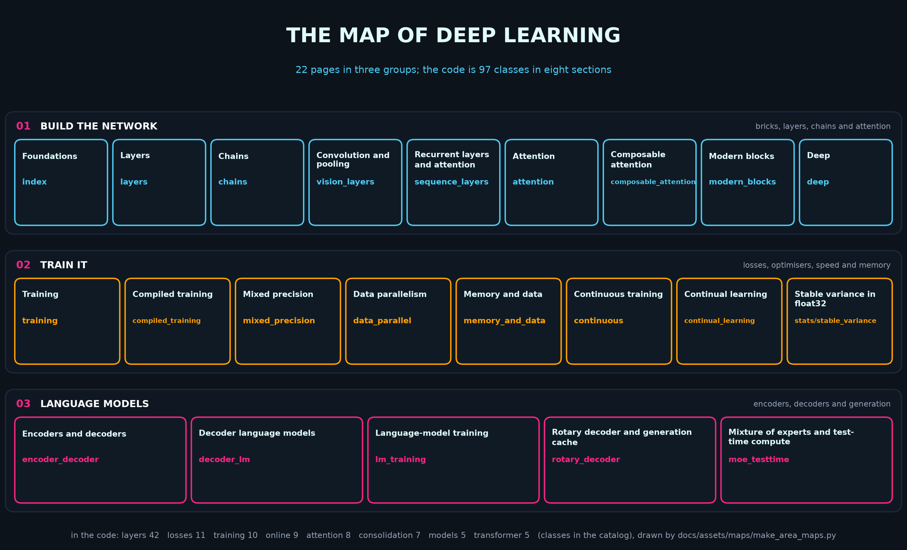

# Deep learning

A deep network is built from small pieces. Each piece, a layer, an activation or a loss, knows how to run forward and how to send the gradient back, and a training loop joins them. This page is the map of the whole tab: it tells you which page to open for each part of the work.

*The tab in three groups: build the network, train it, and language models. The line at the bottom is the code: the classes of the catalog in each of the eight sections of `dense_armor.core.deep.neural`. The figure is drawn by a script, so it follows the code and the menu.*

## 1. The three groups

| Group | The question | Where to go |
|---|---|---|
| **Build the network** | Which pieces do I put together, and does each one learn the right gradient? | [Foundations](index.md), [Layers](layers.md), [Chains](chains.md), [Convolution and pooling](vision_layers.md), [Recurrent layers and attention](sequence_layers.md), [Attention](attention.md), [Composable attention](composable_attention.md), [Modern blocks](modern_blocks.md), [Deep](deep.md) |
| **Train it** | How do I train it fast, in little memory, and keep it learning? | [Training](training.md), [Compiled training](compiled_training.md), [Mixed precision](mixed_precision.md), [Data parallelism](data_parallel.md), [Memory and data](memory_and_data.md), [Continuous training](continuous.md), [Continual learning](continual_learning.md), [Stable variance in float32](../stats/stable_variance.md) |
| **Language models** | How do I read and write text with a decoder? | [Encoders and decoders](encoder_decoder.md), [Decoder language models](decoder_lm.md), [Language-model training](lm_training.md), [Rotary decoder and generation cache](rotary_decoder.md), [Mixture of experts and test-time compute](moe_testtime.md) |

## 2. Where to start

1. [Foundations](index.md): one parameter, one activation, one loss and the gradient check, step by step.
2. [Layers](layers.md) and [Chains](chains.md): how the pieces are joined into a network.
3. [Training](training.md): the loop that updates the parameters.

A tool that learns one sample at a time, instead of a batch, is in the tab [Online learning](../online/index.md); the neural pieces follow the same [roles](../roles/index.md) idea of a short list of methods.

## Details

- The groups are a reading order of the pages. In the code the classes are in eight sections: `layers`, `losses`, `training`, `online`, `attention`, `consolidation`, `models` and `transformer`, in `dense_armor/core/deep/neural/`.
- The counts at the bottom of the figure are the classes of the catalog (`dense_armor.usable.catalog`) for each section. The script `docs/assets/maps/make_area_maps.py` stops if a page of the menu is not placed in a group.
