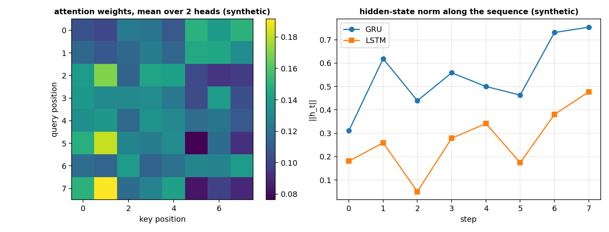

# Recurrent layers and attention: how do I keep a memory of the past samples?

A feed-forward network sees each input on its own. A recurrent network sees a sequence and keeps a hidden state from one step to the next: the output at step `t` depends on the input at step `t` and on the state the network carried from steps `0` to `t - 1`. This is the right tool for a stream of joint states sampled at a fixed rate, where the velocity of the joint at step `t` is read from the last few samples. Attention is a second way to mix the samples of a sequence, without a recurrent state: every position looks at every other position, weighted by a learned similarity. A transformer block stacks attention and a feed-forward network with residual connections.

The examples in this page use a synthetic sequence of 5 steps of width 4 (one sample per step, labelled `synthetic`), the kind of window a robot arm's sensors give after a small crop. A recurrent layer or a block takes the whole window and returns a vector per step, or a single vector with the last step or the mean.

## 1. One GRU step, by hand

The GRU of Cho et al. 2014 has a reset gate `r`, an update gate `z` and a candidate hidden state. The equations are Eqs.(5) to (8), page 3:

`r = sigmoid(W_r x + U_r h_prev)`, `z = sigmoid(W_z x + U_z h_prev)`, `h_tilde = tanh(W x + U (r * h_prev))`, `h = z * h_prev + (1 - z) * h_tilde`.

A 1-input, 1-hidden case with weights written down shows the numbers. `W_r = 1`, `U_r = 0`; `W_z = 1`, `U_z = 0`; `W = 2`, `U = 1`; all biases zero. `x_t = 1.0`, `h_prev = 0.5`.

~~~python
import jax
import jax.numpy as jnp
from dense_armor.utility.neural.recurrent import GRU

g = GRU(1, 1, jax.random.PRNGKey(0))
g.W_r.value = jnp.array([[1.0]]); g.U_r.value = jnp.array([[0.0]]); g.b_r.value = jnp.array([0.0])
g.W_z.value = jnp.array([[1.0]]); g.U_z.value = jnp.array([[0.0]]); g.b_z.value = jnp.array([0.0])
g.W.value = jnp.array([[2.0]]); g.U.value = jnp.array([[1.0]]); g.b.value = jnp.array([0.0])
y, _ = g.step(jnp.array([1.0]), jnp.array([0.5]))
print(round(float(y[0]), 4))
~~~

~~~
0.6298
~~~

The hand computation: `r = sigmoid(1) = 0.7311`, `z = sigmoid(1) = 0.7311`, `h_tilde = tanh(2 + 1 * 0.7311 * 0.5) = tanh(2.3655) = 0.9821`, `h = 0.7311 * 0.5 + 0.2689 * 0.9821 = 0.6298`. The update gate keeps three quarters of the previous state and mixes in a quarter of the candidate.

## 2. One LSTM step, by hand

The vanilla LSTM of Greff et al. 2017 (pages 1 and 2) has an input gate `i`, a forget gate `f`, an output gate `o`, a cell `c` and an output `y`. With peepholes, `i` and `f` see the previous cell `c_prev`, and `o` sees the current cell `c`.

The forward pass of page 2: `z = tanh(W_z x + R_z y_prev + b_z)`, `i = sigmoid(W_i x + R_i y_prev + p_i * c_prev + b_i)`, `f = sigmoid(W_f x + R_f y_prev + p_f * c_prev + b_f)`, `c = z * i + c_prev * f`, `o = sigmoid(W_o x + R_o y_prev + p_o * c + b_o)`, `y = tanh(c) * o`.

~~~python
import jax
import jax.numpy as jnp
from dense_armor.utility.neural.recurrent import LSTM

ls = LSTM(1, 1, jax.random.PRNGKey(0))
for n in ("W_z","W_i","W_f","W_o","R_z","R_i","R_f","R_o","b_z","b_i","b_f","b_o","p_i","p_f","p_o"):
    setattr(getattr(ls, n), "value", jnp.zeros_like(getattr(ls, n).value))
ls.W_z.value = jnp.array([[1.0]]); ls.W_i.value = jnp.array([[1.0]])
ls.W_f.value = jnp.array([[1.0]]); ls.W_o.value = jnp.array([[1.0]])
out, _ = ls.step(jnp.array([0.5]), (jnp.array([0.1]), jnp.array([0.2])))
print(round(float(out[0]), 4))
~~~

~~~
0.2429
~~~

The hand computation with `x = 0.5`, `y_prev = 0.1`, `c_prev = 0.2`, all biases and peepholes zero: `z = tanh(0.5) = 0.4621`, `i = sigmoid(0.5) = 0.6225`, `f = sigmoid(0.5) = 0.6225`, `c = 0.4621 * 0.6225 + 0.2 * 0.6225 = 0.4122`, `o = sigmoid(0.5) = 0.6225`, `y = tanh(0.4122) * 0.6225 = 0.2429`. The peephole vectors are zero by construction, so the output only depends on the four input weights.

## 3. The same code on a sequence and on one step

`forward` runs the whole sequence from a zero state, and `step` runs one sample from the state of the previous step. The two give the same numbers.

~~~python
import jax
import jax.numpy as jnp
import numpy as np
from dense_armor.utility.neural.recurrent import GRU

g = GRU(2, 3, jax.random.PRNGKey(0))
seq = jax.random.normal(jax.random.PRNGKey(1), (5, 2))
yf = g.forward(seq)
h = g.init_state()
ys = []
for t in range(5):
    yt, h = g.step(seq[t], h)
    ys.append(yt)
print(bool(np.allclose(np.asarray(jnp.stack(ys)), np.asarray(yf), atol=1e-6)))
~~~

~~~
True
~~~

`forward` is what a training loop uses, `step` is what a control loop uses: the same weights, the same code, the same output. `init_state` returns the zero state, of shape `(n_hidden,)` for a single sample and `(batch, n_hidden)` for a batch. The `LSTM` has the same interface, with a state that is the pair `(y, c)`.

## 4. Multi-head self-attention, the shapes

A multi-head self-attention of Vaswani et al. 2017 (page 5) projects the input into queries, keys and values, splits them into `n_heads` heads of size `d_model / n_heads`, runs the scaled dot-product attention on each head, concatenates the heads and projects the result. The four projection weights `W_Q`, `W_K`, `W_V`, `W_O` are learned.

~~~python
import jax
import jax.numpy as jnp
from dense_armor.utility.neural.attention import MultiHeadSelfAttention

m = MultiHeadSelfAttention(8, 2, jax.random.PRNGKey(0))
print(m.forward(jnp.ones((4, 8))).shape)
print(len(m.params()))
~~~

~~~
(4, 8)
4
~~~

A sequence of shape `(4, 8)` (4 steps, `d_model = 8`) gives the same shape back, because self-attention preserves the input dimension. The four parameters are the four projection matrices. A `d_model` that is not divisible by `n_heads` raises `ValueError`.

## 5. One attention head, by hand

The scaled dot-product attention of Eq.(1), page 4 of Vaswani et al. 2017 is `Attention(Q, K, V) = softmax(Q K^T / sqrt(d_k)) V`. With one query `[1, 0]`, two keys `[1, 0]` and `[0, 1]` (so `d_k = 2`), and values `10` and `20`, the score of the first key is `1/sqrt(2) = 0.7071` and of the second key is `0`. The softmax gives weights `0.6698` and `0.3302`, and the output is `0.6698 * 10 + 0.3302 * 20 = 13.3024`.

~~~python
import jax.numpy as jnp
import numpy as np
from dense_armor.utility.neural.attention import scaled_dot_product_attention

q = jnp.array([[1.0, 0.0]])
k = jnp.array([[1.0, 0.0], [0.0, 1.0]])
v = jnp.array([[10.0], [20.0]])
y = scaled_dot_product_attention(q, k, v)
print(round(float(y[0, 0]), 4))
~~~

~~~
13.3024
~~~

The query `[1, 0]` is closer to the first key `[1, 0]` than to the second `[0, 1]`, so the first value `10` gets a larger weight than the second `20`. The output is between the two values, closer to 10. The scaling `1/sqrt(d_k)` keeps the scores small even when the dot product grows, so the softmax stays in a region where its gradient is not negligible.

## 6. A causal cache, for a stream

With `causal = True`, the position `t` attends only to the positions up to `t`. The method `step` takes one sample, appends its keys and values to a cache of shape `(T, d_model)` and returns the output and the new cache. The output of `step` called `T` times equals the output of `forward` on the whole sequence.

~~~python
import jax
import jax.numpy as jnp
import numpy as np
from dense_armor.utility.neural.attention import MultiHeadSelfAttention

m = MultiHeadSelfAttention(8, 2, jax.random.PRNGKey(0), causal=True)
seq = jax.random.normal(jax.random.PRNGKey(1), (5, 8))
yf = m.forward(seq)
cache = m.init_cache()
ys = []
for t in range(5):
    yt, cache = m.step(seq[t], cache)
    ys.append(yt)
print(bool(np.allclose(np.asarray(jnp.stack(ys)), np.asarray(yf), atol=1e-5)))
~~~

~~~
True
~~~

The cache grows by one key-value pair per step, and the attention weights of step `t` are computed only against the keys of steps `0` to `t`. `init_cache` returns two arrays of shape `(0, d_model)`. The causal mask of the `forward` is a lower-triangular boolean matrix, and the same mask is applied inside `scaled_dot_product_attention` before the softmax (page 5 of the paper).

## The small layers of the builders

The three layers below are small: they do not have parameters, or they have a fixed table of numbers. They are the glue that the `recurrent_net` and `transformer_encoder` builders use between a recurrent layer and a dense head, and that the reader will meet again if they open those builders.

### LastStep

A recurrent layer returns one state per step; a classifier or a regressor wants one vector per sequence. A `LastStep` keeps the last state and drops the others. On a sequence `(B, T, n)` it returns `(B, n)`; the backward puts the whole upstream gradient at the last step and zeros elsewhere, because the earlier steps did not contribute to the output.

~~~python
import jax.numpy as jnp
from dense_armor.utility.neural.models import LastStep

l = LastStep()
x = jnp.array([[1.0, 2.0], [3.0, 4.0], [5.0, 6.0]])
print(l.forward(x).tolist())
print(l.backward(jnp.ones((2,))).tolist())
~~~

~~~
[5.0, 6.0]
[[0.0, 0.0], [0.0, 0.0], [1.0, 1.0]]
~~~

The three steps of the sequence are `[1, 2]`, `[3, 4]`, `[5, 6]`; the last is `[5, 6]`. The backward of `ones` puts `1` at the last step and `0` at the two before, because only the last step saw the output.

Textbook definition, no citation.

### MeanOverTime

A `MeanOverTime` averages the states over the time axis, so every step contributes to the output. It is the other common way to read a sequence: `LastStep` keeps the end, `MeanOverTime` keeps the whole. The backward spreads `g / T` over every step, so each state receives the same share of the gradient.

~~~python
import jax.numpy as jnp
from dense_armor.utility.neural.models import MeanOverTime

m = MeanOverTime()
x = jnp.array([[1.0, 2.0], [3.0, 4.0], [5.0, 6.0]])
print(m.forward(x).tolist())
~~~

~~~
[3.0, 4.0]
~~~

The three steps are `[1, 2]`, `[3, 4]`, `[5, 6]`; the mean of the first coordinates is `(1 + 3 + 5) / 3 = 3` and of the second is `(2 + 4 + 6) / 3 = 4`. The backward of `ones` would put `1 / 3` at every step, `1 / 3 * 3 = 1` in each coordinate.

Textbook definition, no citation.

### AddPositions

An attention layer sees a set of vectors, not an ordered sequence: without something that tells the layer where a token is, two permutations of the same tokens give the same output. A fixed sinusoidal table, added to the input before the attention, breaks that symmetry. A learned table would work too, with one advantage (no `max_len` fixed in advance) and one disadvantage (no extrapolation to longer sequences); the fixed table is the choice of Vaswani et al. (2017), page 6.

~~~python
import jax.numpy as jnp
from dense_armor.utility.neural.models import AddPositions

a = AddPositions(4)
x = jnp.zeros((4, 2))
y = a.forward(x)
print([round(float(v), 4) for v in y[0]])
print([round(float(v), 4) for v in y[1]])
print([round(float(v), 4) for v in y[2]])
~~~

~~~
[0.0, 1.0]
[0.8415, 0.5403]
[0.9093, -0.4161]
~~~

The input is all zeros, so the output is the sinusoidal table alone. The first row is the position `0`, where `sin(0) = 0` and `cos(0) = 1`. The second row is the position `1`, where `sin(1) = 0.8415` and `cos(1) = 0.5403`. The third row is the position `2`, where `sin(2) = 0.9093` and `cos(2) = -0.4161`. With `AddPositions(4)` on a two-channel input, the first channel holds the sines at frequencies `0` and `1` and the second channel holds the cosines at the same frequencies.

Vaswani, A., Shazeer, N., Parmar, N., Uszkoreit, J., Jones, L., Gomez, A. N., Kaiser, L., Polosukhin, I. (2017). *Attention Is All You Need.* arXiv:1706.03762. Page 6, the sinusoidal positional encoding.

## 7. A transformer encoder, from the sequence to a label

A transformer encoder of Vaswani et al. 2017 stacks a dense projection, a positional encoding, `depth` transformer blocks and a mean over the time axis, followed by a dense head. The `transformer_encoder` builder returns a `Sequential`.

~~~python
import jax
import jax.numpy as jnp
from dense_armor.utility.neural.models import transformer_encoder

m = transformer_encoder(4, 8, 2, 16, 1, 3, jax.random.PRNGKey(0), 16)
print(m.forward(jnp.ones((5, 4))).shape)
~~~

~~~
(3,)
~~~

A sequence of shape `(5, 4)` (5 steps, 4 features) gives a single vector of shape `(3,)`. The `MeanOverTime` collapses the time axis, and the final `Dense(8, 3)` gives the three outputs.

## 8. A recurrent network, from the sequence to a label

A recurrent network of `n_layers` LSTM, GRU or RNN layers, followed by `LastStep` and a dense head, is the second classic form. The `recurrent_net` builder returns a `Sequential`.

~~~python
import jax
import jax.numpy as jnp
from dense_armor.utility.neural.models import recurrent_net

m = recurrent_net(3, 4, 2, jax.random.PRNGKey(0))
print(m.forward(jnp.ones((5, 3))).shape)
print(len(m.params()))
~~~

~~~
(2,)
17
~~~

A sequence of shape `(5, 3)` gives a vector of shape `(2,)`. The 17 parameters are the 15 of the LSTM (four weight matrices `W`, four recurrent matrices `R`, four biases `b`, three peepholes `p`) plus two of the final `Dense(4, 2)`. With `cell="gru"` the count is 11, with `cell="rnn"` it is 5: the three cells have 9, 9, 3 parameters respectively, plus the two of the head.

The left panel is the attention weights of a `MultiHeadSelfAttention` with `d_model = 4` and 2 heads on a synthetic sequence of 8 steps, averaged over the heads. The right panel is the norm of the hidden state of a GRU and of an LSTM along the same sequence; the GRU ends at `0.7536` and the LSTM at `0.4770`, with a different shape because the two cells carry different amounts of information.

## Details

### References

- Cho, K., van Merriënboer, B., Gulcehre, C., Bahdanau, D., Bougares, F., Schwenk, H., Bengio, Y. (2014). *Learning Phrase Representations using RNN Encoder-Decoder for Statistical Machine Translation.* arXiv:1406.1078. Page 3, Eqs.(5) to (8), the reset gate, the update gate, the candidate and the hidden state.
- Greff, K., Srivastava, R. K., Koutník, J., Steunebrink, B. R., Schmidhuber, J. (2017). *LSTM: A Search Space Odyssey.* arXiv:1503.04069. Page 1, the vanilla LSTM block and the peephole connections; page 2, the forward formulas and the deltas of the backpropagation through time.
- Vaswani, A., Shazeer, N., Parmar, N., Uszkoreit, J., Jones, L., Gomez, A. N., Kaiser, Ł., Polosukhin, I. (2017). *Attention Is All You Need.* arXiv:1706.03762. Page 3, `LayerNorm(x + Sublayer(x))`; page 4, Eq.(1); page 5, the multi-head attention, the masking and Eq.(2); page 6, the sinusoidal positional encoding.
- He, K., Zhang, X., Ren, S., Sun, J. (2016). *Deep Residual Learning for Image Recognition.* arXiv:1512.03385. Page 2, Figure 2; page 3, Eqn.(1), for the residual connection of a transformer block.

The Elman layer, the last-step and mean-over-time selections and the synthetic tasks are textbook definitions and carry no citation.

### Choices stated explicitly

- A `GRU` adds a bias to each of the three pre-activations. The paper (page 3) writes no bias; the bias starts at zeros. This is our choice.
- The three recurrent layers initialise the input and the recurrent weights with `xavier_normal`, and the biases at zeros. The sources are silent on the initialisation; the reason is that the variance of the input and of the hidden state should be the same order of magnitude. This is our choice.
- The `LSTM` follows the vanilla block of Greff et al. 2017 (pages 1 and 2) with the peepholes on by default. `peepholes = False` removes the three peephole vectors, as the paper mentions on page 1.
- The `TransformerBlock` applies the dropout on the output of each sub-layer before the addition, as page 8 of the paper does. The default of the block is `dropout = 0.0` (no dropout), because this page runs on synthetic data and the dropout is only useful at scale.
- A `MultiHeadSelfAttention` with `causal = True` builds a lower-triangular mask and passes it to `scaled_dot_product_attention`, which sets the masked positions to `-inf` before the softmax (page 5). The `step` method uses the cache of the past and no mask, since the future is not there yet.
- The `recurrent_net` and the `transformer_encoder` split the key with one `jax.random.split` per layer with weights. The `AddPositions` has no weights and does not consume a key.

### Development diary

The cross-attention and the gate between two signals are not part of the library. The learned positional encodings, the bidirectional layers and the transposed convolutions are in [Deep](deep.md). An `AsTransformer` around a `recurrent_net` or a `transformer_encoder` is not provided; the two builders return a `Sequential` and are not wrapped in a library role.
