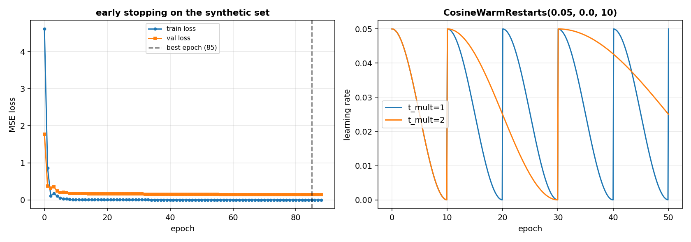

# Training: how do I train a network on a dataset I already have, and stop it before it memorises?

A network of `Dense`, `Residual` and `Sequential` is a function with a set of weights. Training the network means: take a dataset of inputs and labels, feed a batch of inputs, compute the loss, backpropagate, and update the weights by a small step. Repeat for a number of epochs. As the training progresses, the learning rate should go down (slowly at first, then faster, then up again); the weights should shrink slightly to prevent memorisation; and the training should stop before the network starts to fit the noise of the training set instead of the pattern.

This page builds the four pieces: the **schedules** of the learning rate, the **mini-batch generator** that turns a dataset into a sequence of index arrays, the **trainer** that runs the loop with weight decay and early stopping, and a **figure** that shows the train and validation loss along the epochs. The page works on a synthetic dataset: 40 samples of two features, the label being `x0 + 0.5 x1`, labelled `synthetic` in the figure. Real robot data has the same structure, one row per sample.

## 1. Three learning-rate schedules

A schedule is a function of the epoch (which can be fractional, because the trainer reads it at each batch) that returns a learning rate. The `ConstantLR` keeps the same rate. The `StepLR` drops by a factor every `step` epochs. The `CosineWarmRestarts` drops along a cosine and restarts every `t0` epochs.

~~~python
from dense_armor.utility.neural.schedules import (
    ConstantLR, StepLR, CosineWarmRestarts,
)
print(ConstantLR(0.1)(5.0))
print(StepLR(0.1, 10, 0.5)(25.0))
c = CosineWarmRestarts(0.05, 0.0, 5)
print(round(c(0.0), 4), round(c(2.5), 4), round(c(5.0), 4))
~~~

~~~
0.1
0.025
0.05 0.025 0.05
~~~

`ConstantLR(0.1)` returns `0.1` at any epoch. `StepLR(0.1, 10, 0.5)` at epoch 25 returns `0.1 * 0.5 ** floor(25/10) = 0.1 * 0.5**2 = 0.025`. `CosineWarmRestarts(0.05, 0.0, 5)` starts at `0.05`, drops to `0.025` at the midpoint of the first run (epoch 2.5), and goes back to `0.05` at epoch 5 (the restart). Within the run `i`, `lr = lr_min + (1/2)(lr_max - lr_min)(1 + cos(pi * t_cur / t_i))` (Eqn.(5), page 4 of Loshchilov and Hutter 2017), where `t_cur` is the number of epochs since the last restart and `t_i = t0 * t_mult ** i`.

## 2. Mini-batches from a dataset

A mini-batch generator takes the length `n` of the dataset and the size `batch_size` and yields arrays of indices. With a `jax.random` key the order is a permutation, so every epoch sees a different order; without a key the order is `0, 1, ..., n-1`.

~~~python
from dense_armor.utility.neural.batching import minibatches
print([b.tolist() for b in minibatches(10, 3)])
print([len(b) for b in minibatches(10, 3, drop_last=True)])
~~~

~~~
[[0, 1, 2], [3, 4, 5], [6, 7, 8], [9]]
[3, 3, 3]
~~~

Without `drop_last`, the last batch is `[9]`, shorter than the others. With `drop_last=True`, the last batch is not yielded, and the three full batches remain. `batch_size` larger than `n` gives a single batch with all the indices.

## 3. The trainer

A `Trainer` wraps a model (any object with `forward`, `backward` and `params()`) and a loss (any object with `forward(pred, target)` and `backward()`), and runs `fit(X, y, epochs, batch_size, key)` over the dataset. For each epoch, the trainer splits the data into mini-batches, computes the loss of each batch, backpropagates, and updates every `Param`. The history of the training is in `history_`: a dict with the `train_loss` and `lr` of each epoch.

~~~python
import jax
import numpy as np
from dense_armor.utility.neural.trainer import Trainer
from dense_armor.utility.neural.models import mlp
from dense_armor.utility.neural.losses import MSE
from dense_armor.utility.optim import SGD

rng = np.random.default_rng(0)
X = rng.normal(0.0, 1.0, (40, 2)).astype(np.float32)
y = (X[:, 0:1] + 0.5 * X[:, 1:2]).astype(np.float32)
m = mlp([2, 8, 1], jax.random.PRNGKey(0))
t = Trainer(m, MSE(), SGD(0.05))
t.fit(X, y, epochs=5, batch_size=10, key=jax.random.PRNGKey(1))
print(len(t.history_["train_loss"]))
print(round(t.history_["train_loss"][0], 4), round(t.history_["train_loss"][-1], 4))
print(round(t.history_["lr"][0], 4))
~~~

~~~
5
7.5319 0.1299
0.05
~~~

The history has 5 entries, one per epoch. The loss drops from `7.5319` in the first epoch to `0.1299` in the last. The learning rate of the first batch of the first epoch is `0.05`, the default of `SGD`. The `Trainer` copies the optimizer for each `Param`, because the object form of `SGD` and `Adam` holds the state of one array, and every `Param` needs its own copy.

## 4. Weight decay: L2 and decoupled

Weight decay shrinks the weights slightly at each step, to prevent them from growing too large and memorising the training set. There are two forms. **L2** adds `weight_decay * value` to the gradient, before the update: the shrinkage is part of the gradient, and the optimizer treats it as one of its terms (Algorithm 1, line 6, page 3 of Loshchilov and Hutter 2019). **Decoupled** subtracts `eta_t * weight_decay * value` from the weights directly, after the update (Algorithm 1, line 9, and Algorithm 2, line 12, of the same paper). For standard SGD with learning rate `alpha`, the two forms are equivalent when the L2 coefficient is `lambda / alpha` for a decoupled decay `lambda` (Proposition 1, page 2).

~~~python
import jax
import numpy as np
from dense_armor.utility.neural.trainer import Trainer
from dense_armor.utility.neural.models import mlp
from dense_armor.utility.neural.losses import MSE
from dense_armor.utility.optim import SGD

rng = np.random.default_rng(0)
X = rng.normal(0.0, 1.0, (20, 2)).astype(np.float32)
y = rng.normal(0.0, 1.0, (20, 1)).astype(np.float32)

ml = mlp([2, 4, 1], jax.random.PRNGKey(0))
tl = Trainer(ml, MSE(), SGD(0.1), weight_decay=1.0, decay="l2")
tl.fit(X, y, epochs=3, batch_size=20, key=jax.random.PRNGKey(0), shuffle=False)

md = mlp([2, 4, 1], jax.random.PRNGKey(0))
td = Trainer(md, MSE(), SGD(0.1), weight_decay=0.1, decay="decoupled")
td.fit(X, y, epochs=3, batch_size=20, key=jax.random.PRNGKey(0), shuffle=False)

d = max(float(np.max(np.abs(np.asarray(a.value) - np.asarray(b.value))))
        for a, b in zip(ml.params(), md.params()))
print(f"{d:.2e}")
~~~

~~~
5.96e-08
~~~

The two trainers leave the weights equal within `5.96e-08`, because with `alpha = 0.1` and `lambda = 0.1` the L2 coefficient `lambda / alpha = 1.0` is the one the first trainer uses. The equivalence holds for standard SGD; with `Adam` it does not, and the two forms leave different weights. The weight decay applies only to the `Param` whose `value` has two or more dimensions, so the biases, the gains and the offsets are not shrunk.

## 5. Early stopping

With a validation set and a `patience`, the trainer stops at the end of the epoch after which the validation loss has not improved by `min_delta` for `patience` consecutive epochs. The weights are restored to those of the best epoch, so the final model is the one that generalised best, not the last one.

~~~python
import jax
import numpy as np
from dense_armor.utility.neural.trainer import Trainer
from dense_armor.utility.neural.models import mlp
from dense_armor.utility.neural.losses import MSE
from dense_armor.utility.optim import Adam

rng = np.random.default_rng(0)
X = rng.normal(0.0, 1.0, (40, 2)).astype(np.float32)
y = rng.normal(0.0, 1.0, (40, 1)).astype(np.float32)
Xv = rng.normal(0.0, 1.0, (20, 2)).astype(np.float32)
yv = rng.normal(0.0, 1.0, (20, 1)).astype(np.float32)

m = mlp([2, 16, 16, 1], jax.random.PRNGKey(0))
t = Trainer(m, MSE(), Adam(0.01))
t.fit(X, y, epochs=100, batch_size=10, key=jax.random.PRNGKey(0),
      X_val=Xv, y_val=yv, patience=5)
print(t.stopped_epoch_, t.best_epoch_)
print(abs(t.evaluate(Xv, yv) - t.history_["val_loss"][t.best_epoch_]) < 1e-5)
~~~

~~~
8 3
True
~~~

The training stops at epoch 8, the best epoch is 3, and the `evaluate` on the validation set after the fit equals the `val_loss` recorded at the best epoch (within `1e-5`). Without `patience`, the same run does all 100 epochs and the weights stay as the last epoch left them. `patience` without a validation set, `patience < 1`, `epochs < 1` and `X` and `y` of different lengths raise `ValueError`.

## 6. Evaluate and predict

The trainer also provides `evaluate(X, y)`, which computes the loss of the whole set with `training=False`, and `predict(X)`, which returns the output of the model with `training=False`.

~~~python
import jax
import jax.numpy as jnp
from dense_armor.utility.neural.trainer import Trainer
from dense_armor.utility.neural.models import mlp
from dense_armor.utility.neural.losses import MSE
from dense_armor.utility.optim import SGD

X = jnp.ones((4, 2))
y = jnp.zeros((4, 1))
m = mlp([2, 4, 1], jax.random.PRNGKey(0))
t = Trainer(m, MSE(), SGD(0.01))
t.fit(X, y, epochs=2, batch_size=2, key=jax.random.PRNGKey(0))
print(t.predict(X).shape)
print(round(t.evaluate(X, y), 4) >= 0.0)
~~~

~~~
(4, 1)
True
~~~

`predict` returns the same shape as the model's output, `evaluate` returns a float that is non-negative (MSE). The two calls use `training=False`, so `Dropout` and `BatchNorm` are in evaluation mode.

The left panel is the train and validation loss of `mlp([2, 16, 16, 1])` trained with `Adam` on the synthetic set, with early stopping at the best epoch (a vertical dashed line). The right panel is the learning rate of `CosineWarmRestarts(0.05, 0.0, 10)` with `t_mult=1` and `t_mult=2`: the first restarts every 10 epochs, the second doubles the period at each restart.

## Details

### References

- Loshchilov, I., Hutter, F. (2017). *SGDR: Stochastic Gradient Descent with Warm Restarts.* arXiv:1608.03983. Page 4, Eqn.(5), the cosine annealing within a run; page 2, Figure 1, the schedules with `t_mult = 1` and `t_mult = 2`.
- Loshchilov, I., Hutter, F. (2019). *Decoupled Weight Decay Regularization.* arXiv:1711.05101. Page 2, Eqn.(1), the weight decay and Proposition 1, the equivalence with L2 regularisation for standard SGD (`lambda' = lambda / alpha`); page 3, Algorithm 1, line 6 for the gradient with the L2 term and line 9 for the decoupled decay, Algorithm 2, line 12 for Adam.

The mini-batch loop, the shuffling by a permutation, the step schedule, the early-stopping rule and the two-moons set are textbook definitions and carry no citation.

### Choices stated explicitly

- One `copy.deepcopy` of the optimizer for each `Param`. The object form of `SGD` and `Adam` holds the state of one array (the first moment, the second moment, the step counter of `Adam`), so a single instance cannot serve two `Param` of different shape. Each copy sees only its own `Param`.
- The default schedule is `ConstantLR(optimizer.lr)`, with the learning rate of the optimizer prototype. A user who passes a different schedule overrides the default.
- The weight decay applies only to the `Param` whose `value` has two or more dimensions, so the biases, the gains and the offsets are not shrunk. This is the convention of the reference frameworks and the one the paper mentions for its own experiments.
- The early-stopping rule is the textbook one: the training stops when the validation loss has not improved by `min_delta` for `patience` consecutive epochs, and the weights of the best epoch are restored. The paper is silent on the exact rule; this is our choice.
- The `Trainer` uses `minibatches` with a new `jax.random.split` for the shuffle at each epoch. With `shuffle=False`, no key is passed and the order is `0, 1, ..., n-1`.
- The `lr` of the history is the learning rate of the first batch of the epoch. The learning rate is set on every `optimizer` copy at every batch, and the schedule is evaluated at the fractional epoch `epoch + b / n_batches`.

### Development diary

The delivery leaves out the online training with `learn_one`, the checkpoints and the latency budget (see [Continuous training](continuous.md)), the gradient clipping, the mixed precision and the early-stopping rule with a moving average of the validation loss. The `Trainer` is a single class, not a hierarchy: an `EarlyStopping` callback would be a separate abstraction, out of scope for this page.
