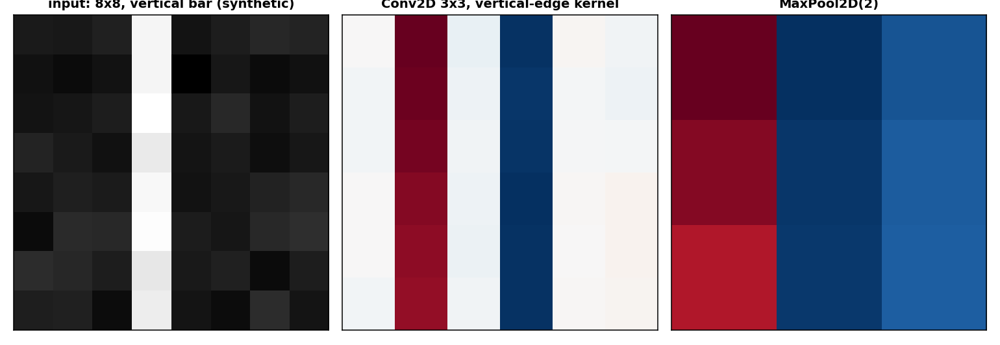

# Convolution and pooling: how do I look for a pattern in an image and shrink it?

A convolution is a small window that slides over a signal and returns, at each position, the sum of the products between the window's weights and the signal. The same window is used at every position, so a convolution detects the same pattern wherever it appears: a vertical edge, a horizontal edge, a peak. Pooling is a second small window that reduces the number of positions, keeping the strongest response (max pooling) or the average (average pooling). A vision network stacks these two operations.

The examples in this page use a synthetic 8 by 8 image with a vertical bar, labelled `synthetic`, made by a function of the figure script. The image is the kind of grid a camera on a robot arm gives after a small crop: 8 by 8 pixels, one channel.

## 1. The size of the output, by hand

A one-dimensional convolution with input length `i`, kernel length `k`, padding `p` (zeros on each side) and stride `s` produces an output of length `o = floor((i + 2p - k) / s) + 1`. This is Relationship 6, page 15 of Dumoulin and Visin 2018. The formula is one line and covers every case: padding, stride, kernel length.

~~~python
def conv_out(i, k, p, s):
    return (i + 2 * p - k) // s + 1

for i, k, p, s in [(5, 3, 0, 1), (5, 3, 1, 1), (5, 3, 0, 2), (6, 3, 1, 2)]:
    print(f"i={i} k={k} p={p} s={s} -> {conv_out(i, k, p, s)}")
~~~

~~~
i=5 k=3 p=0 s=1 -> 3
i=5 k=3 p=1 s=1 -> 5
i=5 k=3 p=0 s=2 -> 2
i=6 k=3 p=1 s=2 -> 3
~~~

With no padding the output shrinks by `k - 1`; one column of padding on each side keeps the input length (`5 -> 5`); stride 2 halves it; the last case with padding 1 and stride 2 gives the same `3` as the first, because the padding compensates the stride. The library applies this formula to every axis and raises `ValueError` if the result is below 1 (the kernel is larger than the padded input).

## 2. One Conv2D, on an integer grid

A `Conv2D` holds a weight of shape `(k, k, c_in, c_out)` and a bias of shape `(c_out,)`, and computes the cross-correlation of the input with the weight. With `c_in = c_out = 1` and a weight of ones, the output at every position is the sum of the 3 by 3 block of the input.

~~~python
import jax
import jax.numpy as jnp
from dense_armor.utility.neural.conv import Conv2D

c = Conv2D(1, 1, 3, jax.random.PRNGKey(0))
c.W.value = jnp.ones_like(c.W.value)
c.b.value = jnp.zeros_like(c.b.value)
x = jnp.arange(1.0, 26.0).reshape(5, 5, 1)
y = c.forward(x)
print(y.shape)
print(y[0, 0, 0], y[2, 2, 0])
~~~

~~~
(3, 3, 1)
63.0 171.0
~~~

The output has shape `(3, 3, 1)`: the 5 by 5 input with a 3 by 3 kernel at stride 1 gives `3 = 5 - 3 + 1` (Relationship 6). The top-left output is the sum of `1 + 2 + 3 + 6 + 7 + 8 + 11 + 12 + 13 = 63`, the nine integers of the first 3 by 3 block. The bottom-right output is the sum of the last nine integers `11 + 12 + 13 + 16 + 17 + 18 + 21 + 22 + 23 = 171`. The bias is zero, so the output is exactly the sum.

## 3. MaxPool2D, the strongest response

A `MaxPool2D(2)` divides the image into 2 by 2 blocks with no overlap and returns the maximum of each block. It keeps the shape of the detection (a vertical edge that gave a large value in the convolution gives a large value in the pooling) and cuts the number of positions by 4.

~~~python
import jax.numpy as jnp
import numpy as np
from dense_armor.utility.neural.conv import MaxPool2D

p = MaxPool2D(2)
x = jnp.arange(16.0).reshape(4, 4, 1)
y = p.forward(x)
print(np.asarray(y).reshape(2, 2).tolist())
~~~

~~~
[[5.0, 7.0], [13.0, 15.0]]
~~~

The four maxima `5, 7, 13, 15` are the bottom-right corners of the four 2 by 2 blocks: the maximum of `[0, 1, 4, 5]` is 5, of `[2, 3, 6, 7]` is 7, and so on. The output size follows Relationship 7, page 18 of the same reference, `o = floor((i - k) / s) + 1`, with no padding, valid for any type of pooling.

### MaxPool1D

A `MaxPool1D` slides a window along the length of a sequence, channel by channel, and keeps the maximum of each window. It is the one-dimensional version of the pooling above: on a sensor stream it keeps the strongest response of each window and discards the position of the weaker ones. The output length follows Relationship 7, page 18 of Dumoulin and Visin (2016), `o = floor((i - k) / s) + 1`, the same formula as the 2-D case.

~~~python
import jax.numpy as jnp
from dense_armor.utility.neural.conv import MaxPool1D

p = MaxPool1D(2)
x = jnp.array([[1.0], [3.0], [2.0], [4.0]])
print(p.forward(x).reshape(-1).tolist())
print(p.backward(jnp.ones((2, 1))).reshape(-1).tolist())
~~~

~~~
[3.0, 4.0]
[0.0, 1.0, 0.0, 1.0]
~~~

The two windows are `[1, 3]` and `[2, 4]`; the maxima are `3` and `4`. The backward of `ones` puts the gradient at the position of the maximum: `[0, 1, 0, 1]`, the two positions that won.

Dumoulin, V., Visin, F. (2016). *A guide to convolution arithmetic for deep learning.* arXiv:1603.07285. Page 18, Relationship 7.

### AvgPool1D

An `AvgPool1D` computes the same windows of `MaxPool1D` but returns the mean, not the maximum. On a sensor stream where noise is symmetric around the true value, the mean of a window is a smoother estimate than the maximum, and the gradient of the backward spreads over every position of the window instead of concentrating on one. The output length is the same of `MaxPool1D`, Relationship 7, page 18 of Dumoulin and Visin (2016).

~~~python
import jax.numpy as jnp
from dense_armor.utility.neural.conv import AvgPool1D

p = AvgPool1D(2)
x = jnp.array([[1.0], [3.0], [2.0], [4.0]])
print(p.forward(x).reshape(-1).tolist())
print(p.backward(jnp.ones((2, 1))).reshape(-1).tolist())
~~~

~~~
[2.0, 3.0]
[0.5, 0.5, 0.5, 0.5]
~~~

The two windows are `[1, 3]` and `[2, 4]`; the means are `(1 + 3) / 2 = 2` and `(2 + 4) / 2 = 3`. The backward of `ones` spreads `1 / k = 1/2` over every position of each window: every entry is `0.5`.

Dumoulin, V., Visin, F. (2016). *A guide to convolution arithmetic for deep learning.* arXiv:1603.07285. Page 18, Relationship 7.

### AvgPool2D

An `AvgPool2D` is the same idea in two dimensions: 2 by 2 windows with no overlap, the mean of each window in place of the maximum. On an image, the result is a blurred, smaller version of the input; the backward spreads the gradient uniformly over every position of each window. On an `(H, W, c)` input with no padding the output size is `(H - k) // s + 1` on both axes, again Relationship 7, page 18 of Dumoulin and Visin (2016).

~~~python
import jax.numpy as jnp
from dense_armor.utility.neural.conv import AvgPool2D

p = AvgPool2D(2)
x = jnp.array([[[1.0], [2.0]], [[3.0], [4.0]]])
print(p.forward(x).reshape(-1).tolist())
print(p.backward(jnp.ones((1, 1, 1))).reshape(-1).tolist())
~~~

~~~
[2.5]
[0.25, 0.25, 0.25, 0.25]
~~~

The single window is the whole `2 x 2` input, `[1, 2, 3, 4]`; its mean is `(1 + 2 + 3 + 4) / 4 = 2.5`. The backward of `ones` spreads `1 / (k * k) = 1/4 = 0.25` over every position, so all four entries are `0.25`.

Dumoulin, V., Visin, F. (2016). *A guide to convolution arithmetic for deep learning.* arXiv:1603.07285. Page 18, Relationship 7.

## 4. Flatten, from the image to a vector

A `Flatten` merges every axis after the first (the batch axis, when there is one) into a single axis, and its `backward` restores the shape. It is the last step of a vision network before the dense head.

~~~python
import jax.numpy as jnp
from dense_armor.utility.neural.conv import Flatten

f = Flatten()
print(f.forward(jnp.ones((2, 3, 4))).shape)
print(f.forward(jnp.ones((3, 4))).shape)
~~~

~~~
(2, 12)
(3, 4)
~~~

A batch of shape `(2, 3, 4)` becomes `(2, 12)`, the two images of the batch flatten to 12 values each. An input without the batch axis, `(3, 4)`, keeps the shape, since the flatten only merges axes after the first.

## 5. A small CNN, from the image to a label

A CNN is a chain: a `Conv2D`, an activation, a `MaxPool2D`, then a `Flatten` and a `Dense`. The `cnn` function builds it from the input shape and the list of channels.

~~~python
import jax
import jax.numpy as jnp
from dense_armor.utility.neural.models import cnn

m = cnn((8, 8, 1), [4], 2, jax.random.PRNGKey(0))
print(len(m.params()))
print(m.forward(jnp.ones((8, 8, 1))).shape)
print(m.forward(jnp.ones((4, 8, 8, 1))).shape)
~~~

~~~
4
(2,)
(4, 2)
~~~

The chain has 4 parameters (a `Conv2D` with `W` and `b`, and a `Dense` with `W` and `b`), no parameters for the activation and the pooling. A single image `(8, 8, 1)` gives `(2,)`, a batch of 4 gives `(4, 2)`. The `cnn` builder wraps the chain in a small class that adds and removes the batch axis around the chain, so the same `Sequential` works on a batch and on a single image without changing the internals.

## 6. A causal Conv1D, for a stream

A causal `Conv1D` predicts the step `t` from the steps up to `t`. The library pads the left side with `kernel - 1` zeros and applies the window that ends at `t`, so the output at position `t` depends on the input at positions `t - kernel + 1` to `t`. The `step` method applies the same window to a single sample and a buffer of the last `kernel - 1` samples.

~~~python
import jax
import jax.numpy as jnp
from dense_armor.utility.neural.conv import Conv1D

c = Conv1D(1, 1, 3, jax.random.PRNGKey(0), causal=True)
seq = jnp.arange(6.0).reshape(6, 1)
yf = c.forward(seq)
buf = c.init_buffer()
ys = []
for t in range(6):
    yt, buf = c.step(seq[t], buf)
    ys.append(yt)
print(yf.shape)
~~~

~~~
(6, 1)
~~~

The forward pass `yf` and the six steps in `ys` have the same shape and the same values: the causal convolution is the same code whether the sequence is given as a whole or one sample at a time with a buffer of the past. `step` returns `(y_t, new_buffer)` and `init_buffer` returns the initial zeros.

## 7. The same code on a batch and on one sample

A convolution works on a batch and on a single sample with the same `forward` and `backward`. A single sample is the matching row of the batch.

~~~python
import jax
import jax.numpy as jnp
import numpy as np
from dense_armor.utility.neural.conv import Conv2D

c = Conv2D(1, 2, 3, jax.random.PRNGKey(0))
xb = jax.random.normal(jax.random.PRNGKey(1), (4, 5, 5, 1))
yb = c.forward(xb)
y1 = c.forward(xb[0])
print(np.allclose(np.asarray(y1), np.asarray(yb[0])))
~~~

~~~
True
~~~

The output of the first sample of the batch equals the output of the single sample, so the same code serves the classic mode (a batch) and the online mode (one sample at a time). The weights see no difference.

The left panel is the input, a synthetic 8 by 8 image with a vertical bar and a small Gaussian noise. The middle panel is the output of a `Conv2D` whose 3 by 3 kernel is a vertical-edge detector; the two columns of the bar light up. The right panel is the `MaxPool2D(2)` on it, which halves the resolution and keeps the two brightest positions.

## Details

### References

- Dumoulin, V., Visin, F. (2018). *A guide to convolution arithmetic for deep learning.* arXiv:1603.07285. Page 13, Relationships 1 and 2; page 15, Relationships 5 and 6, `o = floor((i + 2p - k) / s) + 1`; page 18, Relationship 7 for pooling.
- He, K., Zhang, X., Ren, S., Sun, J. (2015). *Delving Deep into Rectifiers.* arXiv:1502.01852. Page 3, `n = k**2 c` for a convolutional layer; page 4, Eqn.(10), the fan-in of the initialisation.

The cross-correlation of a convolution, the max and the average, the flatten and the causal padding are textbook definitions and carry no citation.

### Choices stated explicitly

- The initialisation of a `Conv2D` is the He initialisation on the fan-in `k * k * c_in` of a convolutional layer (Eqn.(10), page 4 of He et al. 2015). `he_normal` (see [Layers](layers.md)) takes the fan-in from `shape[0]`, so `Conv2D` calls it on the shape `(k * k * c_in, c_out)` and reshapes the result.
- The padding of a `cnn` is `kernel // 2` for every layer, so the pooling is what reduces the spatial size. A side that the pooling would reduce below 1 raises `ValueError`.
- The `cnn` builder wraps the chain in a small class that adds and removes the batch axis around the chain, so the `Sequential` sees always a 4-dimensional input and `Flatten` works for both a single image and a batch.
- A `MaxPool2D` sends the gradient to the first position of the maximum in each window. With a tie (two equal maxima) the first position wins. This is the convention of the reference frameworks.
- A causal `Conv1D` has `stride = 1` and `padding = 0`; the layer pads on the left with `kernel - 1` zeros. A `stride` different from 1 or a `padding` different from 0 with `causal=True` raises `ValueError`.

### Development diary

The transposed convolutions and the depthwise one (the grouped case with one channel per group) are in [Deep](deep.md). Dilated convolutions, convolutions with a configurable number of groups and adaptive pooling are not part of the library. The `cnn` builder has one convolutional layer per channel, no residual connection between the blocks; a residual CNN would be a `Sequential` of `Residual` around the chain, which the library already supports.
