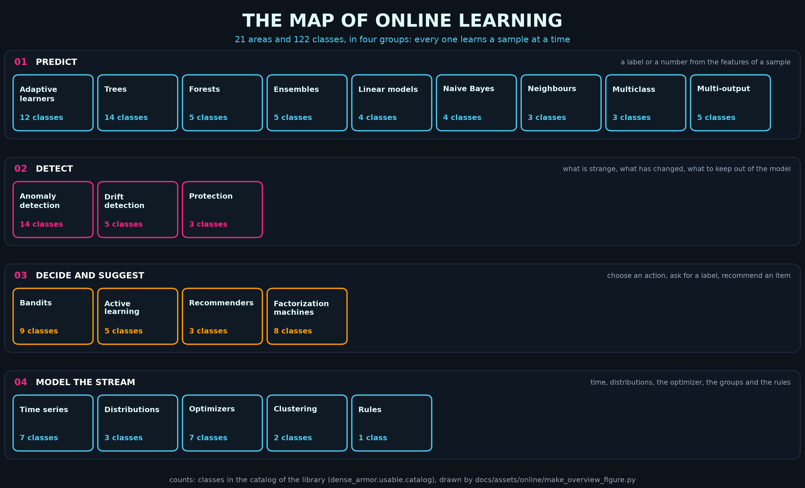

# Online learning

An online tool learns from one sample at a time, while the data arrives. There is no separate training phase: the tool is always ready to answer, and every new sample makes it a little better. This page is the map of the whole area. Each box of the figure is a section of this tab, and the pages below tell you which one to open.

*The area in four groups. Predict, detect, decide and suggest, and model the stream. The number in each box is the count of classes of that area in the catalog of the library; the figure is drawn by a script, so it follows the code.*

## 1. The four groups

| Group | The question | Where to go |
|---|---|---|
| **Predict** | Given the features of a sample, what is its label or its number? | [Adaptive learners](../learn/index.md), [Trees](../tree/index.md), [Forests](../forest/index.md), [Ensembles](../ensemble/index.md), [Linear models](../linear/glm.md), [Naive Bayes](../bayes/index.md), [Neighbours](../neighbors/index.md), [Multiclass](../multiclass/index.md), [Multi-output](../multioutput/index.md) |
| **Detect** | What is strange, what has changed, what must stay out of the model? | [Anomaly detection](../anomaly/index.md), [Drift detection](../drift/index.md), [Protection](../protect/index.md) |
| **Decide and suggest** | Which action to take, which label to ask for, which item to recommend? | [Bandits](../bandit/index.md), [Active learning](../active/index.md), [Recommenders](../reco/index.md), [Factorization machines](../facto/index.md) |
| **Model the stream** | How do the numbers move in time, and how are they distributed? | [Time series](../timeseries/index.md), [Distributions](../proba/index.md), [Optimizers](../optim/index.md), [Clustering](../cluster/index.md), [Rules](../rules/index.md) |

All the tools of the four groups follow the same [roles](../roles/index.md): `learn_one` to show a sample, and one question to ask afterwards (`predict_one`, `score_one`, `transform_one`, `update`). A tool of one group can be swapped for another of the same role without changing the code around it.

## 2. Around the learners

The same tab holds the sections that feed and judge the learners:

- [Streams](../stream/index.md) and [datasets](../stream/datasets.md): where the samples come from.
- [Statistics](../stats/index.md) and [Preprocessing](../preprocessing/index.md): the numbers that a stream is summarised with, and how to scale it.
- [Metrics and evaluation](../metrics/index.md): how to measure a model while it learns.
- [Vision](../vision/index.md): frames, features and motion.
- [Fit, the whole dataset at once](../fit.md): the offline entry point of every online tool.

## 3. Where to start

1. [The first learned model, in five lines](../index.md#the-first-learned-model-in-five-lines): the smallest example.
2. [The first protected model, in five lines](../index.md#the-first-protected-model-in-five-lines): the same model with a shield against corrupted samples.
3. [Roles](../roles/index.md): the short list of methods that every tool follows, and how to write a new one.

## Details

- The groups are a reading order, not a hierarchy of the code: in the library every area is a folder of `dense_armor/core/online/`.
- The counts are the classes of the catalog (`dense_armor.usable.catalog`) for each folder of `dense_armor/core/online/`. The script `docs/assets/online/make_overview_figure.py` stops if a folder is not placed in a group, so a new area cannot be forgotten.
