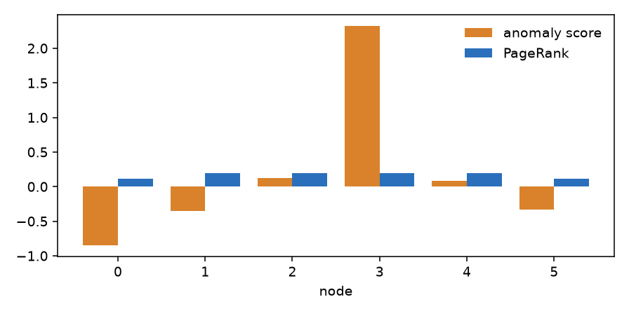

# Which node is wrong?

You have a graph and one number on each node, and one number is not right. This page ranks the nodes by how central they are, follows a walk from one node, and then scores each node by how far its value is from what its neighbours say.

## 1. How central is a node?

`page_rank(graph)` gives each node a share of 1, larger for a node that many others point to. It wraps `networkx.pagerank`, with the edge weights, and `alpha` is the damping, between 0 and 1.

```python
from dense_armor.core.graph import Graph, page_rank

g = Graph(6, [(0, i, 1.0) for i in range(1, 6)])
print({k: round(v, 4) for k, v in page_rank(g).items()})
```

```text
{0: 0.473, 1: 0.1054, 2: 0.1054, 3: 0.1054, 4: 0.1054, 5: 0.1054}
```

The graph is a star with node 0 at the centre. The centre holds almost half of the share and the five leaves hold the same, smaller share each.

## 2. A walk that starts at one node

`random_walk_restart(graph, seed)` is PageRank where, at every step, the walk goes back to `seed` with probability `1 - alpha`. The result says how close each node is to the seed. An unknown seed raises `ValueError`.

```python
from dense_armor.core.graph import Graph, random_walk_restart

g = Graph(6, [(i, i + 1, 1.0) for i in range(5)])
print({k: round(v, 4) for k, v in random_walk_restart(g, 0).items()})
```

```text
{0: 0.2864, 1: 0.3209, 2: 0.1823, 3: 0.108, 4: 0.0719, 5: 0.0305}
```

On a path the share falls with the distance from node 0. Node 1 has a little more than the seed itself, because it has two neighbours that send the walk back and forth.

## 3. A score for each node

`graph_anomaly_score(graph, signal)` takes a signal with one value per node. For each node it compares the value with the heat-kernel smoothing of the signal, `r = x - exp(-tau L) x`: a node that follows its neighbours has a small `r`, a node that does not has a large one. The score of node `i` is `zscore(|r|)` plus its PageRank.

```python
import numpy as np
from dense_armor.core.graph import Graph, graph_anomaly_score

g = Graph(6, [(i, i + 1, 1.0) for i in range(5)])
x = np.array([0.1, -0.1, 0.0, 6.0, 0.1, -0.1])
s = graph_anomaly_score(g, x)
print({k: round(v, 3) for k, v in s.items()}, max(s, key=s.get))
```

```text
{0: -0.852, 1: -0.352, 2: 0.122, 3: 2.326, 4: 0.087, 5: -0.331} 3
```

Node 3 holds 6.0 while the others hold values near 0, and it has the highest score. The Fourier magnitude of the signal is not used: it is a frequency and says nothing about which node is wrong.



*The score of each node of the path above and its PageRank. The score follows the spike; PageRank only follows the shape of the graph.*

If the signal is the same on every node, the residual is zero up to rounding, and the score of each node is its PageRank.

## 4. When the graph itself changes

The graph is not always fixed: edges appear and disappear, weights move. `structural_change(before, after)` compares two graphs on the same nodes and says what changed. The idea of following the weights and the topology of a graph over time is the one of Jenkins and others (2024, Section VI).

```python
from dense_armor.core.graph import Graph, structural_change

a = Graph(4, [(0, 1, 1.0), (1, 2, 2.0), (2, 3, 1.0)])
b = Graph(4, [(0, 1, 1.0), (1, 2, 3.0), (1, 3, 1.0)])
c = structural_change(a, b)
print(c["added"], c["removed"], c["reweighted"])
print(round(c["topology_change"], 4), round(c["weight_change"], 4))
```

```text
[(1, 3)] [(2, 3)] [(1, 2, 2.0, 3.0)]
0.5 0.5222
```

The edge `(1, 3)` was added, `(2, 3)` was removed, and the weight of `(1, 2)` went from 2 to 3. `topology_change` is the share of edges that are not in both graphs (the Jaccard distance: 0 for the same edges, 1 for edges with nothing in common), and `weight_change` is the size of the weight differences against the larger of the two weight sizes. Both are 0 for equal graphs. `tol` hides a weight that moved by no more than that. Graphs with a different number of nodes raise `ValueError`.

## 5. A walk that follows the dependencies

The score of the previous section looks at the values on the nodes. When the nodes are services that call each other, a failure in one service makes the services that call it look bad as well, and the loudest one is often a victim and not the cause. `root_cause_walk` starts from the observed anomaly and runs backward along the calls, so that a caller collects the score of the services it calls. It is the iterative random walk with restart of Khan and Farea (2026, arXiv:2608.08073), in its basic form and in the enhanced form of their Algorithm 1.

```python
import numpy as np
from dense_armor.core.graph import root_cause_walk

w = np.zeros((4, 4))
w[0, 1], w[0, 2], w[1, 3], w[2, 3] = 0.6, 0.4, 1.0, 1.0
s = [0.12, 0.41, 0.22, 0.25]
basic = root_cause_walk(w, s, alpha=0.3, enhanced=False)
better = root_cause_walk(w, s, resilience=0.3, beta=1.0, alpha=0.3, rho=0.5, q=2.0)
print(basic.round(3).tolist())
print(better.round(3).tolist())
```

```text
[0.143, 0.176, 0.118, 0.075]
[0.255, 0.332, 0.258, 0.282]
```

`w[i, j]` is the traffic from service `i` to service `j`: service 0 calls 1 and 2, and both call 3. The anomaly `s` is loudest at service 1, a victim, while the service that fails is 3. The two lines are the score of each service from the basic walk and from the enhanced one. In the basic walk the root cause, service 3, is the last of the four (0.075). The enhanced walk moves score towards the services that look like sources: service 3 rises to 0.282, second after service 1 (0.332). On a graph this small the loudest victim still comes first; the point is the shift of score towards the source, which matters when the root cause is quiet and far from the loudest symptoms.

`alpha` is the restart probability. In the enhanced walk, `resilience` and `beta` make a node that is already anomalous propagate more, `rho` adds backward edges, `q` sharpens the restart towards the most suspicious nodes, and `outer` repeats the refinement of the belief. The weights can be a dense or sparse matrix, or a `Graph`, which is read as symmetric.

## Details

The score `zscore(|r|) + page_rank` is a choice of this module. The papers describe the heat kernel and PageRank, none of them defines a score per node. The two parts have different scales: the z-score has unit spread and PageRank sums to 1, so on a large graph the residual dominates. A different residual, for example the deviation from the median of the neighbours, would be another choice. A signal of the wrong length raises a NumPy error, and a negative `tau` is not refused.
