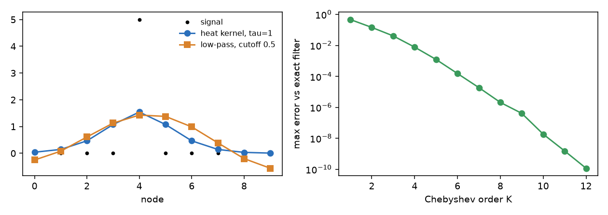

# Filters

A filter on a graph keeps the slow patterns of a signal and weakens the fast ones. This page starts from a spike on a path of ten nodes, smooths it in two ways, and then does the same without eigenvectors.

## 1. Smoothing with heat

Put a spike of 5 on node 4 of a path. `heat_kernel(L, tau)` is the matrix `exp(-tau L)`: it lets the spike flow to its neighbours as heat does, and `tau` says for how long.

```python
import numpy as np
from dense_armor.core.graph import Graph, heat_kernel

g = Graph(10, [(i, i + 1, 1.0) for i in range(9)])
r = np.zeros(10)
r[4] = 5.0
y = heat_kernel(g.laplacian, 1.0) @ r
print(y.round(3).tolist(), round(float(y.sum()), 4))
```

```text
[0.041, 0.145, 0.466, 1.076, 1.543, 1.076, 0.466, 0.144, 0.034, 0.008] 5.0
```

The spike spreads over its neighbours and the total stays 5: heat is not lost. A longer `tau` spreads it more. The matrix is dense, `n` by `n`.

## 2. Keeping the low frequencies

`low_pass(L, cutoff)` keeps the patterns of the frequencies up to `cutoff` and removes all the others, as in `U g(Lambda) U^T` with `g = 1` below the cut-off and 0 above (Liu and others 2024, Section 2).

```python
import numpy as np
from dense_armor.core.graph import Graph, low_pass

g = Graph(10, [(i, i + 1, 1.0) for i in range(9)])
r = np.zeros(10)
r[4] = 5.0
print((low_pass(g.laplacian, 0.5) @ r).round(3).tolist())
```

```text
[-0.25, 0.08, 0.611, 1.13, 1.429, 1.38, 0.988, 0.389, -0.198, -0.559]
```

The result has negative values at the two ends even though the input has none: cutting the spectrum sharply makes the signal ring. The sharp cut-off is a choice of this module; the papers describe the general filter and not a low-pass shape. The heat kernel, whose weight falls smoothly, does not ring.



*Left: the spike (dots), the heat kernel (smooth, positive) and the low-pass filter (rings at the ends). Right: the largest error of the Chebyshev filter of the next section against the exact filter, at each order.*

## 3. The same filter without eigenvectors

`apply_filter(x, L, g)` filters with any function `g` of the eigenvalues, but it finds the eigenvectors each time. For a big graph that costs `n^3`. A polynomial of `L` gives almost the same filter with only products of `L` by a vector.

`chebyshev_coefficients(g, lmax, order)` fits the function `g` on the range `[0, lmax]` with Chebyshev polynomials. `chebyshev_filter(x, L, c, lmax)` applies them with the recurrence `T_k = 2 A T_(k-1) - T_(k-2)` and `A = (2 / lmax) L - I`, which moves the spectrum of `L` into `[-1, 1]` (Liu and others 2024, Section 3.1).

```python
import numpy as np
from dense_armor.core.graph import Graph, apply_filter, chebyshev_coefficients, chebyshev_filter

g = Graph(10, [(i, i + 1, 1.0) for i in range(9)])
r = np.zeros(10)
r[4] = 5.0
f = lambda lam: np.exp(-lam)
ye = apply_filter(r, g.laplacian, f)
for k in (2, 4, 8, 20):
    yc = chebyshev_filter(r, g.laplacian, chebyshev_coefficients(f, 4.0, k), 4.0)
    print(k, float(np.abs(yc - ye).max()))
```

```text
2 0.14503891278255218
4 0.007731605056688309
8 2.078349342737873e-06
20 5.995204332975845e-15
```

The error falls by orders of magnitude at each step, down to the rounding of the machine at order 20. `lmax` must not be below the largest eigenvalue of `L`: for a graph with degrees `d` it is at most twice the largest degree, so 4.0 holds for this path. A `lmax` that is too small sends the spectrum outside `[-1, 1]` and the recurrence grows without bound. A `lmax` or an `order` out of range raises `ValueError`.

## 4. The same filters as objects

`SpectralFilter` and `ChebyshevFilter` hold a graph and a filter, so that you build them once and apply them to many signals. `SpectralFilter` finds the basis once. `SpectralFilter.heat(g, tau)` and `SpectralFilter.low_pass(g, cutoff)` are the two filters of the first sections. `ChebyshevFilter(g, response, lmax, order)` computes its coefficients once and never needs the eigenvectors; `lmax` is required.

```python
import numpy as np
from dense_armor.core.graph import ChebyshevFilter, Graph, SpectralFilter

g = Graph(10, [(i, i + 1, 1.0) for i in range(9)])
r = np.zeros(10)
r[4] = 5.0
heat = SpectralFilter.heat(g, 1.0)
cheb = ChebyshevFilter(g, lambda w: np.exp(-w), lmax=4.0, order=20)
print(heat.apply(r).round(3).tolist())
print(float(np.abs(cheb.apply(r) - heat.apply(r)).max()) < 1e-10)
```

```text
[0.041, 0.145, 0.466, 1.076, 1.543, 1.076, 0.466, 0.144, 0.034, 0.008]
True
```

The two give the same smoothed signal, the first with the exact heat kernel and the second with a polynomial of order 20. A `response` that does not return one value per node raises `ValueError`.

## 5. Wavelets: a signal at several scales

A filter keeps or removes frequencies. A **wavelet** looks at the signal around each node at a chosen distance, so it finds changes that are local. `SpectralWavelet` builds a scaling function, which keeps the slow part of the signal, and wavelets at the scales you give, which keep the part around that scale. The construction is the one of Liu and others (2024, Section 3.1): the Chebyshev polynomial of order `k` becomes `(1 - T_k(lambda - 1)) / 2`, the even orders give the wavelets and the odd ones give the scaling function.

```python
import numpy as np
from dense_armor.core.graph import Graph, SpectralWavelet

g = Graph(8, [(i, (i + 1) % 8, 1.0) for i in range(8)])
w = SpectralWavelet(g, a=[1.0], b=[1.0], scales=[1.0, 2.0])
x = np.arange(8.0)
print(w.scaling(x).shape, w.wavelets(x).shape)
```

`a` holds the coefficients of the wavelet and `b` the coefficients of the scaling function, as many of each as there are terms, and `scales` the scale of each wavelet. `w.scaling(x)` gives one value for each node, and `w.wavelets(x)` gives one row for each scale. A wavelet is exactly 0 for the frequencies of the graph that, multiplied by the scale, leave `[0, 2]`: a larger scale squeezes the wavelet towards the low frequencies. `w.frame_sum()` is `h^2 + sum_j g_j^2` for each frequency, and the wavelets keep the energy of the signal where it is 1.

The paper learns the coefficients with a neural network. Here you give them, and the properties that the construction guarantees are tested: the wavelet is 0 at frequency 0, the scaling function is 1 there, and the first terms are `(2 - lambda) / 2` and `lambda (2 - lambda)`.

## Details

`apply_filter` and `low_pass` call `numpy.linalg.eigh` at every call, so use them when the graph is small or the filter is applied once. The Chebyshev filter takes a dense or a sparse `L` and handles one signal of shape `(n,)`. The heat kernel was checked against PyGSP `Heat` with `scale = tau * lmax`.
