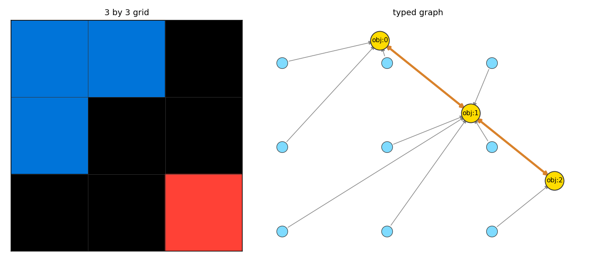

# Typed grid graph

## What it is

A grid is a rectangle of cells. A graph is a set of nodes and a set of edges.
`build_grid_graph` turns a grid into a graph with two kinds of nodes and two
kinds of edges, so that a program can ask questions about the grid without
walking the cells again.

- A **cell node** is one cell of the grid. It holds its row, its column and
  its colour.
- An **object node** is one connected group of cells of the same colour. It
  holds the colour of the object, its area, its bounding box, its cells,
  whether it touches the border of the grid and whether it has a hole.
- A **`belongs_to`** edge joins a cell to the object it belongs to.
- An **`adjacent_to`** edge joins two objects whose cells touch by an edge.

Why use it: with a `TypedGraph` you check a property of the grid once, as a
**constraint** attached to the edges, and then ask `validate()` for the list of
edges that break it. The check is written in one place, not inside every loop
that walks the grid.

The example on this page is a 3 by 3 grid with two coloured shapes and a
background.

## 1. Build the graph

`build_grid_graph(grid)` returns a `TypedGraph`. With a 3 by 3 grid it makes
12 nodes: 9 cells and 3 objects. The three objects are the two shapes and the
background, which is also an object (the empty cells of colour 0).

~~~python
from dense_armor.core.graph import Grid, build_grid_graph

g = Grid.from_list([
    [1, 1, 0],
    [1, 0, 0],
    [0, 0, 2],
])
t = build_grid_graph(g)
print(t.graph.number_of_nodes(), t.graph.number_of_edges())
~~~

~~~text
12 13
~~~

`t.graph` is a NetworkX graph, so `number_of_nodes()` and `number_of_edges()`
work on it. Twelve nodes are the nine cells plus the three objects; thirteen
edges are the nine `belongs_to` (one per cell) plus the four `adjacent_to`
(two pairs of touching objects, counted in both directions).

## 2. Read the state of an object

Each node of a `TypedGraph` is a dictionary with two keys: `type`, the kind of
node, and `state`, the fields of the node. `state` is a plain dict, so
`["color"]` reads one field.

~~~python
from dense_armor.core.graph import Grid, build_grid_graph

g = Grid.from_list([[1, 1, 0], [1, 0, 0], [0, 0, 2]])
t = build_grid_graph(g)
for n, d in t.graph.nodes(data=True):
    if d["type"] != "object":
        continue
    s = d["state"]
    print(n, s["color"], s["area"], s["bbox"], s["has_hole"])
~~~

~~~text
obj:0 1 3 (0, 0, 2, 2) False
obj:1 0 5 (0, 0, 3, 3) False
obj:2 2 1 (2, 2, 3, 3) False
~~~

The first object is the shape of colour 1: three cells, bounding box from
row 0 to row 2 (exclusive) and from column 0 to column 2 (exclusive), no
hole. The second object is the background: five cells, the whole 3 by 3 grid
as bounding box. The third is the single cell of colour 2 in the bottom
right. Every object has `has_hole=False`: none of them surrounds a region of
empty cells completely, on this grid.

## 3. Check the constraints

A `TypedGraph` carries a `Constraint` on each edge. `validate()` walks every
edge and returns the ones whose constraint answers `False`. On a graph built
from a clean grid, the list is empty.

~~~python
from dense_armor.core.graph import Grid, build_grid_graph

g = Grid.from_list([
    [1, 1, 0],
    [1, 0, 0],
    [0, 0, 2],
])
t = build_grid_graph(g)
print(t.validate())
~~~

~~~text
[]
~~~

The two constraints of `build_grid_graph` are: **the cell is in the object,
and the colour of the cell is the colour of the object** (on `belongs_to`
edges), and **the two objects share at least one cell boundary** (on
`adjacent_to` edges). Both are checked on the values at the two ends of the
edge; a constraint never reads a third node.

## 4. Break a constraint

If a value of an object is changed with `update` and the change is wrong,
`validate()` lists the edges that now break the constraint. Here the first
cell is removed from the first object, and the `belongs_to` edge of that cell
is listed.

~~~python
from dense_armor.core.graph import Grid, build_grid_graph

g = Grid.from_list([[1, 1, 0], [1, 0, 0], [0, 0, 2]])
t = build_grid_graph(g)
cells = list(t.graph.nodes["obj:0"]["state"]["cells"])
t.update("obj:0", cells=tuple(cells[1:]))
print(t.validate())
~~~

~~~text
[('cell:0,0', 'obj:0', 'belongs_to')]
~~~

`update(name, **values)` changes the fields of one node, with the same type
check as `add_node`: the new value of `cells` must be a tuple, as the schema
says. The cell `cell:0,0` is no longer in `obj:0`, so the constraint on the
`belongs_to` edge that joins them answers `False`.

## 5. The graph and the grid

The same graph, drawn next to the grid it comes from. On the right: the
twelve nodes, the nine `belongs_to` edges as thin lines, the four
`adjacent_to` edges as thicker lines between the object nodes.

*Left: the grid of this page. Right: the graph that `build_grid_graph`
builds from it. `c:` is a cell node, `o:` is an object node.*

## Details

`build_grid_graph` is a function, not a method of `Grid`: it takes a `Grid` and
returns a new `TypedGraph`. The `TypedGraph` does not keep a reference to the
`Grid`, so changing the graph does not change the grid. Two `build_grid_graph`
calls on two equal grids return two graphs with the same nodes, edges and
states; the node names are strings (`"cell:r,c"`, `"obj:i"`) and do not depend
on the order of iteration.

The object index in `"obj:i"` is the position of the object in the list
returned by `extract_objects`, which walks the grid row by row, so the
numbering is deterministic. `by_color=False` merges cells of different colours
into the same object; the `color` field of the object node is then the value
`extract_objects` gives (which is `None`), and `build_grid_graph` stores `-1`
in its place, because the schema says the field is an `int`.

The two constraints read only the state of the two ends of the edge. The
`belongs_to` constraint checks `(row, col) in cells` and, when the object has
a colour that is not the background marker, that the colours match. The
`adjacent_to` constraint calls `_share_cell_boundary(a, b)`: a cell of `a`
has a 4-neighbour in `b`. A constraint that fails is not an error: `validate()`
returns the list of failing edges. To turn the list into an error, call
`t.validate(raise_on_violation=True)`, which raises `ConstraintViolation`; the
page [Types, rules and actions](typed.md) covers that form.

### References

`build_grid_graph` has no paper behind it: it is the bridge between the grid
of the ARC-AGI benchmark (Chollet, "On the Measure of Intelligence",
arXiv:1911.01547, Section 2) and the `TypedGraph` of Dense-Armor. The
`TypedGraph` and `Constraint` classes are described in
[Types, rules and actions](typed.md); the page here shows the graph that
`build_grid_graph` builds on top of them.

The idea of validating an action on the subgraph it touches, rather than on
the whole graph, is the one of G-SPEC (Vijay and Ethiraj 2025,
arXiv:2512.20275, Section 3.2). `validate()` here walks every edge, because
it is called on the whole graph; a validation that follows the size of a
change is in `apply_action`, on the same classes.

### Choices stated explicitly

- **The background is an object.** Every cell of the grid belongs to exactly
  one object; the background is the object of colour 0. On the 3 by 3 grid of
  this page, the background is `obj:1`, five cells. A user who wants the
  shapes only filters on `color != 0` after `extract_objects`; in the graph,
  the object node has `color=0`.
- **`by_color=False` uses `-1` for "no colour".** The schema says `color` is
  an `int`, and `extract_objects` gives `None` for a multi-coloured object.
  `build_grid_graph` stores `-1` in the graph, and the `belongs_to`
  constraint treats `-1` as "the object has no single colour", so the colour
  check is skipped for that object.
- **Two `adjacent_to` edges, not one.** The edge is added in both directions
  (`i → j` and `j → i`), because `validate()` walks every edge and there is
  no way to look at the edge once. This doubles the count of `adjacent_to`
  edges in the graph.
- **The graph is a new object, not a view.** `build_grid_graph` reads the
  grid once and builds a fresh `TypedGraph`; there is no live link between
  the two. A user who changes the graph does not change the grid, and a user
  who changes the grid must build the graph again.
