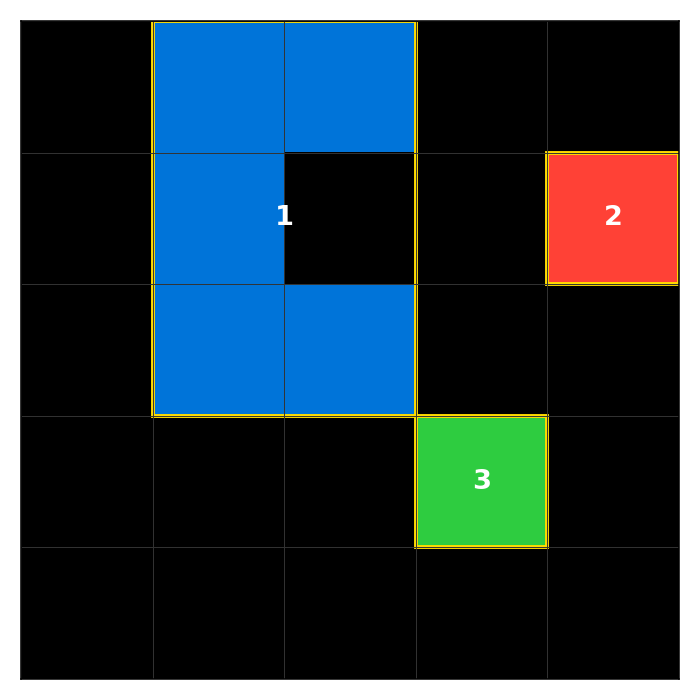
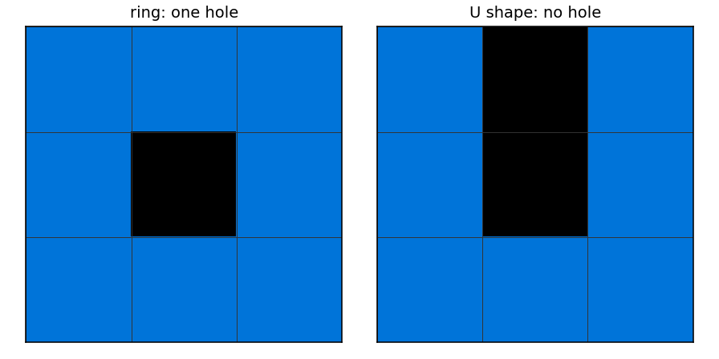

# Grids and objects

## What it is

`Grid` and `ArcObject` are the two things you need to start on a task of the
ARC-AGI benchmark: the cells, and the groups of cells a person would see as
one shape.

- A **grid** is a rectangle of cells, each cell one of ten colours, given as a
  number from 0 to 9.
- An **object** is a group of cells of the same colour that are connected.
- A **bounding box** (`bbox`) is the smallest rectangle that contains every
  cell of the object.
- A **hole** is a region of empty cells surrounded by an object.

Why use it: every task shows a grid going in and a grid going out and asks for
the rule. To talk about the rule you need to say which cells belong to the
same shape.

The example on this page is a 5 by 5 grid with three coloured shapes.

## 1. Build a grid

`Grid.from_list` takes a list of rows of integers between 0 and 9 and returns
a grid. The grid is immutable: two equal grids can be used as dictionary keys.

~~~python
from dense_armor.core.graph import Grid

g = Grid.from_list([
    [0, 1, 1, 0, 0],
    [0, 1, 0, 0, 2],
    [0, 1, 1, 0, 0],
    [0, 0, 0, 3, 0],
    [0, 0, 0, 0, 0],
])
print(g.shape(), g.at(1, 4), g.colors())
~~~

~~~text
(5, 5) 2 {0, 1, 2, 3}
~~~

`shape()` is the pair `(height, width)`, `at(row, col)` is the colour of one
cell, `colors()` is the set of colours that appear in the grid. A grid that is
empty, not a rectangle, or contains a number outside 0 to 9 raises
`ValueError`.

## 2. Find the objects

`extract_objects` walks the grid cell by cell, groups cells that are connected
and of the same colour, and returns one object per group. The default
connectivity is 4: two cells belong to the same object only if they share an
edge.

~~~python
from dense_armor.core.graph import Grid, extract_objects

g = Grid.from_list([
    [0, 1, 1, 0, 0],
    [0, 1, 0, 0, 2],
    [0, 1, 1, 0, 0],
    [0, 0, 0, 3, 0],
    [0, 0, 0, 0, 0],
])
objs = extract_objects(g)
for o in objs:
    print(o.color, o.area, o.bbox)
~~~

~~~text
0 18 (0, 0, 5, 5)
1 5 (0, 1, 3, 3)
2 1 (1, 4, 2, 5)
3 1 (3, 3, 4, 4)
~~~

The grid has four objects, not three. The first is the background: 18 cells
of colour 0, the empty part of the grid. Colours 1, 2 and 3 are the shapes a
person would look at. `extract_objects(g, by_color=False)` joins every
neighbouring cell regardless of colour and returns one single object with
`color=None`.

*The grid of this page. The yellow boxes are the bounding boxes of the three
foreground objects. The number inside is the colour of the object.*

## 3. Read the properties of one object

`ArcObject` is a `dataclass` with three fields: `cells`, `color`, `bbox`. The
`bbox` is `(r0, c0, r1, c1)`, with `r1` and `c1` exclusive.

~~~python
from dense_armor.core.graph import Grid, extract_objects

g = Grid.from_list([
    [0, 1, 1, 0, 0],
    [0, 1, 0, 0, 2],
    [0, 1, 1, 0, 0],
    [0, 0, 0, 3, 0],
    [0, 0, 0, 0, 0],
])
o = [x for x in extract_objects(g) if x.color == 1][0]
print(sorted(o.cells))
print(o.bbox, o.area, o.bbox_area(), o.is_rectangular())
~~~

~~~text
[(0, 1), (0, 2), (1, 1), (2, 1), (2, 2)]
(0, 1, 3, 3) 5 6 False
~~~

`area` is the number of cells. `bbox_area()` is the area of the bounding box
(3 × 2 = 6). `is_rectangular()` is `False` because the object does not fill
its bounding box. `touches_border(g.shape())` is `True` because the object has
a cell in row 0.

## 4. Holes

`holes(grid)` returns one frozenset of cells per region of empty cells
completely surrounded by the object. A region that opens on the border of the
bounding box is not a hole.

~~~python
from dense_armor.core.graph import Grid, extract_objects

ring = Grid.from_list([[1, 1, 1], [1, 0, 1], [1, 1, 1]])
u = Grid.from_list([[1, 0, 1], [1, 0, 1], [1, 1, 1]])
print(extract_objects(ring)[0].holes(ring))
print(extract_objects(u)[0].holes(u))
~~~

~~~text
[frozenset({(1, 1)})]
[]
~~~

The ring has one hole, the single cell in the middle. The `U` shape has a
column of empty cells that opens at the top of the bounding box, so it is not
a hole.

*Left: the ring, one hole in the middle. Right: the U shape, no hole: the
empty column opens on the top edge of the bounding box.*

## 5. Relations between objects

Five functions answer questions about two objects: `adjacent`, `inside`,
`same_shape`, `same_color`, `distance`.

~~~python
from dense_armor.core.graph import Grid, extract_objects
from dense_armor.core.graph.relations import adjacent, inside, same_shape, same_color, distance

la = extract_objects(Grid.from_list([[1, 0], [1, 1]]))[0]
lb = extract_objects(Grid.from_list([[0, 0, 1], [0, 0, 1], [0, 0, 1]]))[0]
lc = extract_objects(Grid.from_list([[0, 0, 0], [0, 1, 0]]))[0]
print(same_shape(la, lc), same_color(la, lb))
print(adjacent(la, lc), inside(la, lb), distance(la, lb))
~~~

~~~text
False False
True True 0
~~~

`same_shape` compares the two cell masks once each object is moved to the
top-left corner, so two objects with the same shape but different positions
count as the same shape. `inside` tests the bounding boxes, not the cells: an
object can sit in a hole of another and still be `inside`. `distance` is the
smallest Chebyshev distance between a cell of one object and a cell of the
other.

## Details

The `Grid` class is a frozen dataclass with one field, `cells`, a tuple of
tuples of integers. `from_list` and `to_list` convert to and from the list
format. The class has no method that changes the grid in place; `crop`, `pad`,
`fill`, `recolor`, `shift`, `upscale`, `downscale`, `rot90`, `rot180`,
`rot270`, `hmirror`, `vmirror`, `dmirror` all return a new grid.

`ArcObject` is a frozen dataclass with `cells: frozenset[tuple[int, int]]`,
`color: int | None`, `bbox: tuple[int, int, int, int]`. `extract_objects`
gives `color=None` when `by_color=False`; every other case gives the colour of
the cells in the object.

`holes` finds the connected components of non-object cells inside the bbox
using 4-connectivity, and discards the components that touch the bbox border.
A single cell surrounded by the object is a hole of size 1.

The five functions of `relations.py` are pure: `adjacent` uses 4-connectivity,
`inside` is a containment test on the bounding boxes (an object is not inside
itself), `same_shape` normalises each object to the top-left corner,
`same_color` compares the two colours and returns `False` if either is
`None`, `distance` is the minimum Chebyshev distance between cells.

### References

The `Grid` and `ArcObject` classes have no paper behind them: the format is
the one of the ARC-AGI benchmark, described in Chollet, "On the Measure of
Intelligence", arXiv:1911.01547, Section 2. The ten colours and their
assignment to the numbers 0 to 9 are from the same benchmark.

The palette used in the figures is the one of the benchmark's web display,
`fchollet/ARC-AGI`, `apps/css/common.css`. The ten colours, from 0 to 9:
`#000000`, `#0074D9`, `#FF4136`, `#2ECC40`, `#FFDC00`, `#AAAAAA`, `#F012BE`,
`#FF851B`, `#7FDBFF`, `#870C25`. The library does not ship a palette; the
figure script `docs/assets/ontology/arc_figures.py` defines it.

### Choices stated explicitly

- **Holes exclude the bbox border.** A region of empty cells that opens on the
  edge of the bounding box is not a hole. The code and the docstring of
  `holes` say so; the figure shows it with the `U` shape.
- **`inside` tests bounding boxes, not cells.** An object can be `inside`
  another even if it sits in a hole, and two objects with the same bounding
  box count as `inside` each other (unless they are the same object).
- **`distance` is Chebyshev.** The other common choice (Euclidean) gives
  fractional values; Chebyshev gives the number of steps a king needs to walk
  between the two closest cells. ARC asks for integer answers, so Chebyshev
  is the natural choice here.
- **`extract_objects` includes the background by default.** Every cell of the
  grid belongs to exactly one object; the background is the object of colour
  0. A user who wants the shapes only filters on `color != 0`.
- **No palette in the library.** The figure uses the ten colours of the
  benchmark's web display; the library itself does not assign colours, only
  numbers 0 to 9.

### Relation export

The five functions of `relations.py` are exported from
`dense_armor/core/graph/__init__.py` only after the merge of the fix that
adds them to `__all__`. Until then, import them from
`dense_armor.core.graph.relations`. The guide on this page uses the second
form; after the merge it is equivalent to `from dense_armor.core.graph import
adjacent, inside, same_shape, same_color, distance`.
