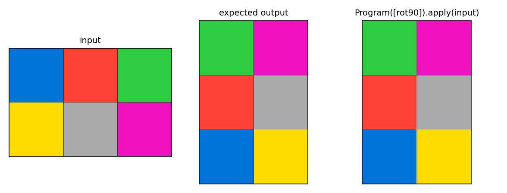

# Program search

## What it is

A task of the ARC-AGI benchmark gives a few `(input, output)` pairs and asks
for the rule. One way to answer is to **search** for a program that matches
all the pairs, then apply that program to the test input.

The library ships three functions and one for the submission:

- `explore` does a breadth-first search over short programs, keeping a beam of
  the best candidates at every depth.
- `refine` takes one program and tries local changes (add, remove or replace a
  step), keeping the ones that improve the verification score.
- `solve` combines the two: `explore` first, then `refine` on every candidate
  in the beam.
- `to_submission` fills the test outputs with the program's predictions.

Why use it: a program that is a list of pure functions is easy to score, and
the score (`Program.verify`) is the same number a search needs to compare
candidates. The pieces are separate, so you can use only the search, only the
refinement, or both.

The example on this page is a task whose rule is `rot90`, with one training
pair and one test input.

## 1. Explore

`explore(primitives, pairs, max_depth, beam_width)` builds programs by
composing the given primitives up to `max_depth`, and keeps the
`beam_width` candidates of every depth with the highest verification score.

~~~python
from dense_armor.core.graph import Grid, explore, hmirror, rot90

g_in = Grid.from_list([[1, 2, 3], [4, 5, 6]])
pairs = [(g_in, rot90(g_in))]
for p in explore([rot90, hmirror], pairs, max_depth=2, beam_width=3):
    print(repr(p), p.verify(pairs))
~~~

~~~text
Program(rot90) 1.0
Program() 0.0
Program(hmirror) 0.0
~~~

Three programs come out: `rot90` solves the pair, the empty program and
`hmirror` do not. The candidates of every depth end up in the same pool, so a
short program that solves the task wins over a longer one that only gets
close. On ties, the shorter program comes first.

## 2. Refine

`refine(program, primitives, pairs, iterations, seed)` starts from one
program and tries `iterations` random mutations. Each mutation is an add, a
remove or a replace of one step; a candidate is kept only if its verification
score is strictly greater than the current best.

~~~python
from dense_armor.core.graph import Grid, Program, hmirror, refine, rot90

g_in = Grid.from_list([[1, 2, 3], [4, 5, 6]])
pairs = [(g_in, rot90(g_in))]
start = Program([hmirror])
best = refine(start, [rot90, hmirror], pairs, iterations=20, seed=0)
print(repr(start), start.verify(pairs))
print(repr(best), best.verify(pairs))
~~~

~~~text
Program(hmirror) 0.0
Program(rot90) 1.0
~~~

The starting program solves nothing, `refine` reaches `rot90` and stops there
because no neighbour improves a score of 1.0. The seed fixes the sequence of
mutations, so the same call gives the same result.

*Left: the input of the training pair. Middle: the expected output. Right:
the output of `Program([rot90])`, which `solve` finds on this task.*

## 3. Solve

`solve(task, primitives, ...)` reads the `"train"` list, calls `explore`, and
then calls `refine` on every candidate of the beam. Each candidate gets its
own seed (`seed + i`), so they explore different neighbourhoods. The best of
the refined programs is returned.

~~~python
from dense_armor.core.graph import hmirror, rot90, solve

task = {"train": [{"input": [[1, 2, 3], [4, 5, 6]],
                   "output": [[3, 6], [2, 5], [1, 4]]}],
        "test": [{"input": [[7, 8], [9, 1]]}]}
program = solve(task, [rot90, hmirror], max_depth=2, beam_width=3,
                refine_iterations=10, seed=0)
print(repr(program))
~~~

~~~text
Program(rot90)
~~~

The task is a Python dict with the format of the benchmark: `"train"` is a
list of `{"input": ..., "output": ...}`, `"test"` is a list of `{"input":
...}`. `solve` sees only the training pairs. The test inputs are not part of
the search; they are used only by `to_submission`.

## 4. Submit

`to_submission(program, task)` keeps the `"train"` list as it is and fills
each `"test"` entry with the program's output.

~~~python
from dense_armor.core.graph import hmirror, rot90, solve, to_submission

task = {"train": [{"input": [[1, 2, 3], [4, 5, 6]],
                   "output": [[3, 6], [2, 5], [1, 4]]}],
        "test": [{"input": [[7, 8], [9, 1]]}]}
program = solve(task, [rot90, hmirror], max_depth=2, beam_width=3,
                refine_iterations=10, seed=0)
sub = to_submission(program, task)
print(sub["train"] == task["train"])
print(sub["test"][0]["output"])
~~~

~~~text
True
[[8, 1], [7, 9]]
~~~

The result is a dict in the same format as the input, with the `"output"` of
each test entry filled. `to_submission` does not check that the program is
correct on the training pairs; that is the caller's job, with
`program.verify(pairs)`.

## Details

`explore` is a breadth-first search with a beam. The candidates are the
compositions of the primitives up to `max_depth`; after each depth, the
`beam_width` best are kept, and the beam of every depth is collected into a
single pool at the end. The pool is sorted by `(-verify, len(steps))`: highest
score first, shorter program on a tie. This is why `Program()` (the empty
program) can come out: it is the only candidate of depth 0, and it stays in
the pool even if a longer program solves the task.

`refine` is a hill climb with three mutations: add a random step at a random
position, remove a random step, or replace a random step. It uses a
`random.Random(seed)` so a call is reproducible. It accepts a candidate only
if the score is strictly greater: a plateau of equal scores is not climbed.
The return value's score is never below the starting program's.

`solve` first runs `explore` with the given `max_depth` and `beam_width`, then
runs `refine` on each candidate of the beam with `seed + i`. The best program
by `(verify, -len(steps))` is returned. If the training list is empty, `solve`
returns the empty program; the same for the search finding no candidates.

`to_submission` reads only the `"test"` list and writes only the `"output"` of
each entry. The `"train"` list is copied unchanged. The test inputs are not
inspected by `solve`.

The four functions are pure: they read their arguments and return a value.
`solve` and `refine` use a seeded random source; the same `seed` gives the
same result. `explore` and `to_submission` are deterministic.

### References

The **refinement loop** is the theme of the ARC Prize 2025 report (Chollet
and others, arXiv:2601.10904, page 1: a per-task iterative program
optimization loop guided by a feedback signal). Page 5 separates two phases:
an exploration phase that generates candidate solutions, and a verification
phase that analyses them and produces a feedback signal. `explore` implements
the first phase, `Program.verify` implements the second, and `refine` is the
iteration between them.

The **preference for shorter programs** on a tie is the arc-dsl writeup
(Hodel, "The ARC-DSL", Section 2.3): a shorter program is less likely to
overfit the training pairs. `_score` and the final sort of `explore` use this
preference.

The **format of the task** and the **format of the submission** are the ones
of the ARC-AGI benchmark (Chollet, "On the Measure of Intelligence",
arXiv:1911.01547, Section 2). `solve` and `to_submission` do not depend on
the benchmark's data; they take a plain Python dict.

### Choices stated explicitly

- **The empty program is a candidate.** `explore` starts from `Program([])`
  and keeps it in the pool. A user who wants only non-empty programs
  filters on `len(p.steps) > 0` after the call. The empty program is the
  only candidate at depth 0, and it is how the search represents "do
  nothing", which is a legitimate rule for some tasks.
- **Ties are broken by shorter programs.** `_score` returns `(verify,
  -len(steps))`, and the final sort of `explore` uses the same pair. The
  reason is the arc-dsl writeup's note on shorter programs and overfitting.
- **`refine` accepts only strict improvements.** A neighbour with the same
  score is not adopted. A user who wants to cross plateaus writes their own
  loop, or calls `refine` from a different seed.
- **One seed per candidate in `solve`.** Candidate `i` uses `seed + i`, so
  the candidates refine in different directions. This is a choice of this
  implementation, not a requirement of the report.
- **`solve` refines the beam, not the full space.** The number of refined
  programs is `beam_width`, not the number of candidates of every depth.
  A larger `beam_width` refines more programs and takes more time.
