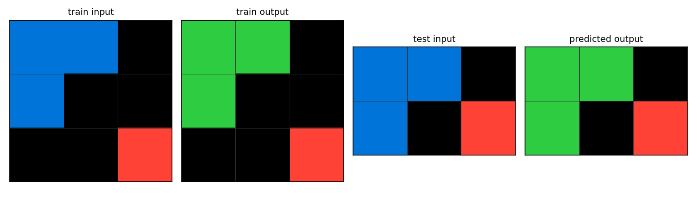

# Rule synthesis

## What it is

Some tasks of the ARC-AGI benchmark repeat the same change on the objects of
a grid: **recolour every object of colour 1 to colour 3**, or **move every
object that touches the border one cell down**. A program of transformations
does not say "every object"; it says "this grid". A rule says "every object
that matches this predicate".

The library ships one function for this: `synthesize(task)`. It reads the
training pairs, compares input and output object by object, and returns a
short list of rules. A rule is a pair `(selector, effector)`.

- A **selector** is a list of predicates on `ArcObject`. An empty list
  selects every object. `has_color(1)`, `is_largest`, `is_smallest`,
  `area_gt(2)` are examples.
- An **effector** is a change applied to the objects the selector matches:
  `recolour`, `delete`, `translate`, `fill_holes`, `fill_bg`, and the
  global changes `rot90`, `hmirror`, `upscale`, etc.
- A **rule list** is a list of rules, applied to the grid in order.

Why use it: a rule on objects generalises better than a program that acts on
the whole grid. A program `rot90` says "the whole grid turns"; a rule
`has_color(1) -> recolour(3)` says "every shape of colour 1 becomes colour 3",
which is the right rule even if the grid has a shape of colour 2 that does
not change.

The example on this page is a task whose rule is **recolour every object of
colour 1 to colour 3**.

## 1. Compare two grids

`diff_graphs(grid_in, grid_out)` matches the objects of the two grids, and
returns four things: `matched` (pairs `(i, j)` of objects that are the same
object in the two grids), `created` (objects of the output with no
correspondent in the input), `deleted` (objects of the input with no
correspondent in the output), and the two Level 2 node sets. The matching is
a Linear Assignment Problem on a cost matrix of shapes, colours and
positions.

~~~python
from dense_armor.core.graph import Grid, extract_objects
from dense_armor.core.graph.graph_diff import diff_graphs

g_in = Grid.from_list([[1, 1, 0], [1, 0, 0], [0, 0, 2]])
g_out = Grid.from_list([[3, 3, 0], [3, 0, 0], [0, 0, 2]])
for tag, g in (("in", g_in), ("out", g_out)):
    for o in extract_objects(g):
        print(tag, o.color, o.area, o.bbox)
print(diff_graphs(g_in, g_out)["matched"])
~~~

~~~text
in 1 3 (0, 0, 2, 2)
in 0 5 (0, 0, 3, 3)
in 2 1 (2, 2, 3, 3)
out 3 3 (0, 0, 2, 2)
out 0 5 (0, 0, 3, 3)
out 2 1 (2, 2, 3, 3)
[(0, 0), (1, 1), (2, 2)]
~~~

The input has three objects: a shape of colour 1 (3 cells), the background
of colour 0 (5 cells), and a single cell of colour 2. The output has the
same three objects, with the first one recoloured. The matching pairs them
in the obvious way: object 0 with object 0, object 1 with object 1, object 2
with object 2. Nothing created, nothing deleted.

*Left: the training pair. Right: the test input and the output that
`synthesize` predicts.*

## 2. Synthesise the rules

`synthesize(task)` takes the whole task and returns the shortest list of
rules that reproduces every training output exactly. If no such list exists,
it returns `None`.

~~~python
from dense_armor.core.graph import synthesize

task = {"train": [{"input": [[1, 1, 0], [1, 0, 0], [0, 0, 2]],
                   "output": [[3, 3, 0], [3, 0, 0], [0, 0, 2]]}],
        "test": [{"input": [[1, 1, 0], [1, 0, 2]]}]}
rules = synthesize(task)
print(len(rules), rules[0].selector, rules[0].effector.kind.value)
~~~

~~~text
1 (Predicate(kind=<PredicateType.HAS_COLOR: 'has_color'>, arg=1),) recolor
~~~

One rule, with a single predicate `has_color(1)` and the effector `recolor`.
The rule says "every object of colour 1 is recoloured". The target colour is
in `rules[0].effector.to_color`, which is 3.

## 3. Render the rules on a grid

`render(grid, rules, L2)` applies a list of rules to a grid. The third
argument is the Level 2 node set of the grid, computed by `level2_nodes`; the
rules that act on Level 2 nodes need it, the others ignore it.

~~~python
from dense_armor.core.graph import Grid, extract_objects, render, synthesize
from dense_armor.core.graph.graph_diff import level2_nodes

task = {"train": [{"input": [[1, 1, 0], [1, 0, 0], [0, 0, 2]],
                   "output": [[3, 3, 0], [3, 0, 0], [0, 0, 2]]}],
        "test": [{"input": [[1, 1, 0], [1, 0, 2]]}]}
g = Grid.from_list(task["train"][0]["input"])
L2 = level2_nodes(g, extract_objects(g))
print(render(g, synthesize(task), L2).to_list())
~~~

~~~text
[[3, 3, 0], [3, 0, 0], [0, 0, 2]]
~~~

The input is the same of step 1; the output is the training output, because
the rule says "recolour colour 1 to colour 3". A different grid goes through
the same rule and produces a different output that follows the same rule.

## 4. Write the submission

`apply_to_test(rules, task)` keeps the `"train"` list as it is and fills
each `"test"` entry with the output of `render` on the test input.

~~~python
from dense_armor.core.graph import apply_to_test, synthesize

task = {"train": [{"input": [[1, 1, 0], [1, 0, 0], [0, 0, 2]],
                   "output": [[3, 3, 0], [3, 0, 0], [0, 0, 2]]}],
        "test": [{"input": [[1, 1, 0], [1, 0, 2]]}]}
sub = apply_to_test(synthesize(task), task)
print(sub["test"][0]["output"])
~~~

~~~text
[[3, 3, 0], [3, 0, 2]]
~~~

The test input has an object of colour 1 (the three cells top-left), an
object of colour 2 (one cell), and background. The rule recolours the first
object from 1 to 3, and leaves the second alone.

## Details

`synthesize` has three stages. First, `extract_positives` compares the
objects of every training pair and finds, for each effector, the objects the
effector was applied to. Second, `synthesize_selector_global` finds a
predicate list of at most three atoms that selects exactly those objects and
no others, on every training pair. Third, `synthesize` chooses the shortest
combination of rules (by Minimum Description Length) that reproduces every
training output exactly.

`diff_graphs` uses a Linear Assignment Problem (LAP) on a cost matrix that
combines shape, area, holes, centroid distance and colour. The cost of an
unmatched object is `TAU_NULL`, a constant larger than any real pair; the
matrix is square, with one row and one column added per object of each
grid. The matching is the `scipy.optimize.linear_sum_assignment` solution.

`level2_nodes` produces the four kinds of Level 2 nodes: `background` (one
node with the colour of the background), `frame` (one node per object that
touches all four borders of the grid), `alignment_group` (one node per group
of at least two objects with the same row or column of the centroid), and
`cavity` (one node per hole of an object). A rule whose effector is
`fill_l2` reads one of these nodes.

`render` applies the rules in order. Global effectors (`rot90`, `hmirror`,
`upscale`, `downscale`, `dmirror`, `vmirror`, `rot180`, `rot270`) are
applied first, on the whole grid. Object effectors are applied one at a
time on the result: the grid is rebuilt after each rule, and the objects are
re-extracted, so a later rule sees the effect of an earlier one.

`apply_to_test` does not check that the rules solve the training pairs; a
user who wants to check calls `render` on every training pair, as step 3
does.

The `Predicate` and `Effector` classes are the two halves of a rule. A
`Predicate` is a `(kind, arg)` pair, where `kind` is one of ten predicate
types (`has_color`, `area_gt`, `is_largest`, `is_smallest`, `has_hole`,
`is_rectangular`, `is_square`, `touches_border`, `area_lt`, `rank`). An
`Effector` is a `(kind, ...)` tuple with more fields: `recolor` has a
`to_color`, `translate` has a `dr` and `dc`, `clone` has a `source_idx`, and
so on.

### References

The Minimum Description Length (MDL) criterion for choosing between
programs is the one of DreamCoder (Ellis and others, arXiv:2006.08381,
Section 3): a program that is shorter to describe is more likely to be the
right one. `synthesize` chooses the combination of rules with the smallest
total `mdl_bits()`, which is the MDL of the rule set.

The rule list as a sequence of `(selector, effector)` pairs, and the
preference for short selectors, is the style of the arc-dsl writeup (Hodel,
"The ARC-DSL", Section 2.3): a rule that applies to many objects with few
predicates generalises better.

The idea of a global effector (rotate the whole grid) and an object effector
(recolour one object) as two separate kinds is the one of Joffe and
Eliasmith (2025), arXiv:2511.08747, Table 1: the operations `IDENTITY`,
`EXTRACT`, `RECOLOUR`, `RECENTRE`, `RESHAPE`, `MOVE`, `GRAVITY`, `GROW`,
`FILL`, `HOLLOW`, `GENERATE` are object-level; here the same distinction is
used in `EffectorType`.

### Choices stated explicitly

- **`TAU_NULL` is 1000.0.** The cost of a real pair is bounded by the sum
  of the weights (shape 10, area 5, holes 5, centroid 1, colour 3), which
  is below 100. `TAU_NULL = 1000` is well above any real pair, so the LAP
  never chooses a "null" match when a real one is available. A user who
  changes the weights of `_pair_cost` must keep them below `TAU_NULL`.
- **The L2 nodes are a dict, not part of the `TypedGraph`.** The four
  kinds of Level 2 nodes (`background`, `frame`, `alignment_group`,
  `cavity`) are not in the `TypedGraph` schema, because they are not
  needed by the typed-graph machinery (they have no constraints). They are
  a plain dict returned by `level2_nodes`, and `render` reads them by name.
- **`synthesize` chooses the shortest rule list.** When several lists
  reproduce the training outputs, the one with the smallest sum of
  `mdl_bits()` wins. On ties, the shorter list wins.
- **`synthesize` does not go beyond three predicates.** The selectors in
  `synthesize_selector_global` are lists of at most three atoms. A rule
  with four or more predicates is not considered, even if it would be the
  only one to separate the positives from the negatives.
- **`render` re-extracts the objects after each rule.** This is why a later
  rule can see the effect of an earlier one. It also means the order of the
  rules matters: `recolour(1, 3)` then `recolour(3, 5)` gives a different
  grid from `recolour(3, 5)` then `recolour(1, 3)`.
- **The `Predicate` and `Effector` classes are not exported from the
  package.** The two classes are in `rule_synthesis.py`, and only `Rule`,
  `synthesize`, `render` are in the package `__all__`. A user who wants to
  build a rule by hand imports `Predicate` and `Effector` from
  `dense_armor.core.graph.rule_synthesis`.
