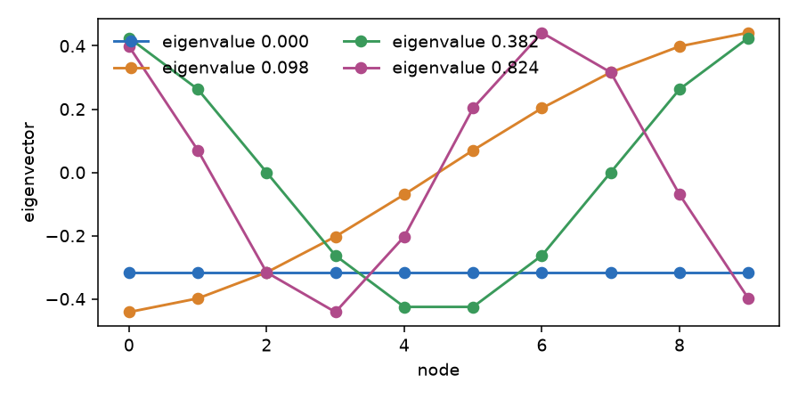

# Graph and spectrum

A signal on a graph can change slowly from node to node or fast. The spectrum of the graph tells you which is which. This page builds a graph, finds its frequencies and moves a signal into them and back.

## 1. A graph and its Laplacian

`Graph(n, edges)` is a weighted graph with nodes `0 .. n-1` and edges `(i, j, w)`. Its Laplacian `L = D - W` has the degree of each node on the diagonal and minus the weight of each edge off it (Niresi and others 2024, Eq. 1).

```python
from dense_armor.core.graph import Graph

g = Graph(4, [(0, 1, 1.0), (1, 2, 1.0), (2, 3, 1.0)])
print(g.n_nodes, g.n_edges, g.degrees.tolist())
print(g.laplacian.toarray().astype(int).tolist())
```

```text
4 3 [1.0, 2.0, 2.0, 1.0]
[[1, -1, 0, 0], [-1, 2, -1, 0], [0, -1, 2, -1], [0, 0, -1, 1]]
```

The graph is a path of four nodes. The two ends have one neighbour, so their degree is 1; the two middle nodes have two. A bad node index, a self-loop, a repeated pair or a weight that is not positive and finite raises `ValueError`. `g.normalized_laplacian` is `I - D^(-1/2) W D^(-1/2)`; a node with no edge has a row and a column of zeros, the convention of NetworkX.

## 2. The frequencies of the graph

The eigenvalues of `L` are the frequencies and its eigenvectors are the patterns that go with them. `eigendecomposition(L)` returns both, the eigenvalues in ascending order.

```python
from dense_armor.core.graph import Graph, eigendecomposition, fiedler_vector

g = Graph(4, [(0, 1, 1.0), (1, 2, 1.0), (2, 3, 1.0)])
w, U = eigendecomposition(g.laplacian)
print(abs(w).round(4).tolist())
print(fiedler_vector(g.laplacian).round(4).tolist())
```

```text
[0.0, 0.5858, 2.0, 3.4142]
[0.6533, 0.2706, -0.2706, -0.6533]
```

The first eigenvalue is 0 and goes with a constant pattern: no change from node to node. The larger the eigenvalue, the faster the pattern changes along the edges. The second eigenvector is the Fiedler vector: it has one sign change, and it splits the path in the middle.



*The four lowest patterns of a path of ten nodes. The eigenvalue 0 is a flat line; each next one crosses zero once more.*

The decomposition is dense (`numpy.linalg.eigh`): time grows as `n^3` and memory as `n^2`. For a large graph use [the Chebyshev filter](filters.md), which does not need it. On a graph that is not connected the second eigenvalue is 0 and its eigenvector is not unique.

## 3. A signal in frequencies, and back

`gft(x, U)` writes the signal `x` as a sum of the patterns: it gives `U^T x` (Liu and others 2024, Section 2). `igft` goes back.

```python
import numpy as np
from dense_armor.core.graph import Graph, eigendecomposition, gft, igft

g = Graph(4, [(0, 1, 1.0), (1, 2, 1.0), (2, 3, 1.0)])
w, U = eigendecomposition(g.laplacian)
x = np.array([1.0, 2.0, 3.0, 4.0])
xh = gft(x, U)
print(xh.round(4).tolist(), np.allclose(igft(xh, U), x), round(float(x @ x), 4), round(float(xh @ xh), 4))
```

```text
[-5.0, -2.2304, 0.0, 0.1585] True 30.0 30.0
```

The signal rises by one at every node, so it sits almost entirely in the first two frequencies. The sign of each number depends on the sign of its eigenvector, which is arbitrary; `fix_sign(U)` makes it fixed. The transform keeps the energy (30 and 30, the Parseval relation) and `igft` returns the signal.

## 4. A signal that knows its graph

`GraphSignal(signal, graph)` joins a `Signal` with one channel per node to the graph. `values` is the array of the channels in the order of `signal.names`; a signal with a different number of channels raises `ValueError`.

```python
from dense_armor.core.graph import Graph, GraphSignal
from dense_armor.roles import Signal

g = Graph(3, [(0, 1, 1.0), (1, 2, 1.0)])
s = Signal([1.0, 2.0, 4.0], names=["a", "b", "c"], units=["", "", ""])
gs = GraphSignal(s, g)
print(gs.n_nodes, gs.values.tolist(), gs.to_signal() is s)
```

```text
3 [1.0, 2.0, 4.0] True
```

## Details

The library has no function that builds a graph from data: the edges are yours. `to_networkx()` and `to_pygsp()` hand the same weights to those libraries. `fix_sign` flips each column so that its first entry above 1e-9 is positive. The tests compare `gft` with PyGSP on the absolute value, because the two libraries do not choose the same sign. The paper of the transform (Liu and others 2024, Section 2) takes the eigenvectors of the normalised Laplacian, whose eigenvalues lie in `[0, 2]`; `gft` accepts the eigenvectors of any symmetric Laplacian, so `eigendecomposition(g.normalized_laplacian)` gives the paper's basis and `eigendecomposition(g.laplacian)` the combinatorial one used on this page. `g.laplacian` is a CSR sparse matrix, so `g.laplacian[0, 0]` works.
