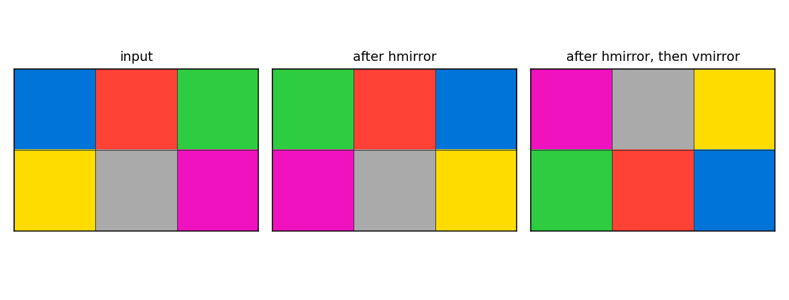

# Transformations

## What it is

A transformation takes a grid and returns a new grid. The library ships
eleven pure transformations that change the whole grid at once, and a
`Program` that composes them.

- A **transformation** is a function `Grid -> Grid`. It does not touch the
  input: the output is a new grid.
- A **program** is an ordered list of transformations. `Program.apply(g)`
  runs them one after the other.
- **Verification** (`Program.verify(pairs)`) checks a program against a
  list of `(input, output)` pairs and returns the fraction it solves. It is
  the number a search uses to choose between candidates.

Why use it: a program that is a list of small pure functions is easy to
compose, compare and verify. The eleven transformations of this page are the
building blocks a search over ARC-AGI tasks combines.

The example on this page is a 2 by 3 grid on which `rot90`, `hmirror` and a
composition of `hmirror` and `vmirror` are applied.

## 1. One transformation

Each transformation takes a grid and returns a new grid. `rot90` turns the
grid a quarter turn counter-clockwise.

~~~python
from dense_armor.core.graph import Grid, rot90

g = Grid.from_list([
    [1, 2, 3],
    [4, 5, 6],
])
out = rot90(g)
print(g.shape(), out.shape())
print(out.to_list())
~~~

~~~text
(2, 3) (3, 2)
[[3, 6], [2, 5], [1, 4]]
~~~

The input has shape 2 rows by 3 columns, the output 3 by 2. The colour of
`(0, 0)` in the input (which is 1) lands in `(2, 0)` of the output: the
rotation is counter-clockwise, so the top-left corner goes to the
bottom-left.

## 2. Compose them with Program

`Program(steps)` is a list of transformations. `apply(g)` runs them in order.

~~~python
from dense_armor.core.graph import Grid, Program, hmirror, vmirror

g = Grid.from_list([
    [1, 2, 3],
    [4, 5, 6],
])
p = Program([hmirror, vmirror])
print(p.apply(g).to_list())
~~~

~~~text
[[6, 5, 4], [3, 2, 1]]
~~~

`hmirror` reverses each row, `vmirror` reverses the rows. The two together
are a 180-degree rotation of the grid: every cell moves to the opposite
corner. `Program.apply` calls the first step, then the second on the result,
and so on. The object is immutable: a step that tries to change its input
would not work; every step returns a new grid.

*The grid of this page, then `hmirror(g)`, then `vmirror(hmirror(g))`. The
first step reverses each row, the second reverses the rows.*

## 3. Verify a program against pairs

`verify(pairs)` takes a list of `(input, output)` pairs and returns the
fraction the program solves.

~~~python
from dense_armor.core.graph import Grid, Program, hmirror, rot90

g = Grid.from_list([
    [1, 2, 3],
    [4, 5, 6],
])
pairs = [(g, rot90(g))]
print(Program([rot90]).verify(pairs))
print(Program([hmirror]).verify(pairs))
~~~

~~~text
1.0
0.0
~~~

The first program solves the pair: `rot90(g)` is the expected output. The
second does not: `hmirror(g)` is a different grid. `verify` returns a number
between 0.0 and 1.0; an empty list gives 0.0.

## 4. A step that fails

If a step raises `ValueError` or `IndexError` on a pair, that pair counts as
not solved. This is on purpose: a composition of primitives may not be
defined for every grid, and a search should treat a failure as a wrong answer,
not as an error.

~~~python
from dense_armor.core.graph import Grid, Program

def broken(g):
    raise ValueError("boom")

g = Grid.from_list([[1, 2], [3, 4]])
print(Program([broken]).verify([(g, g)]))
~~~

~~~text
0.0
~~~

A program with a step that raises gives 0.0 on every pair, because every pair
hits the exception. The exception does not propagate out of `verify`.

## 5. The full menu

The eleven grid transformations are: `rot90`, `rot180`, `rot270`, `hmirror`,
`vmirror`, `dmirror`, `fill`, `recolor`, `shift`, `upscale`, `downscale`.
`dmirror` is the transpose. `fill(g, color, mask=None)` writes one colour on
a set of cells or on the whole grid. `recolor(g, from_color, to_color)`
replaces one colour with another. `shift(g, dr, dc, fill_color=0)` moves the
grid by `(dr, dc)`. `upscale(g, k)` and `downscale(g, k)` scale by an integer
factor.

Six more primitives act on the objects of a grid, not on the grid as a whole:
`fill_objects`, `recolor_objects`, `move_objects`, `delete_objects`,
`crop_to_object`, `apply_per_object`. They take a predicate on `ArcObject` and
apply a change to the objects that match. The page [Grids and
objects](grids.md) explains what an object is. These six are not exported from
`dense_armor.core.graph`; import them from `dense_armor.core.graph.dsl`:

~~~python
from dense_armor.core.graph import Grid
from dense_armor.core.graph.dsl import fill_objects

g = Grid.from_list([
    [1, 0, 2],
    [0, 0, 2],
])
out = fill_objects(g, 5, lambda o: o.color == 2)
print(out.to_list())
~~~

~~~text
[[1, 0, 5], [0, 0, 5]]
~~~

The predicate `lambda o: o.color == 2` selects the object of colour 2, and
`fill_objects` paints it with colour 5. A `None` predicate selects every
foreground object (every object whose colour is not 0).

`default_primitives()` returns the twenty-one primitives used as the default
menu by the search: the eleven grid transformations (with fixed parameters,
e.g. `lambda g: upscale(g, 2)`), the six object primitives (with fixed
predicates), and a few more, each named. Import it from
`dense_armor.core.graph.dsl`:

~~~python
from dense_armor.core.graph.dsl import default_primitives

prims = default_primitives()
print(len(prims), [p.__name__ for p in prims[:5]])
~~~

~~~text
21 ['rot90', 'rot180', 'rot270', 'hmirror', 'vmirror']
~~~

The name of each primitive is readable with `__name__`. This is how the
`Program.__repr__` shows the steps of a program: by their names, not by
their code.

## Details

`dsl.py` is a module of pure functions. Every function takes a `Grid` and
returns a new `Grid`; the input is never changed. `rot90`, `rot180`,
`rot270`, `dmirror`, `hmirror` and `vmirror` have no parameters. `fill`,
`recolor`, `shift`, `upscale`, `downscale` have one or more parameters, and
the six object primitives take a `Predicate` (a function `ArcObject -> bool`)
plus one or more parameters.

`Program` is a small class with three methods: `apply`, `verify`, and the
standard `__eq__`, `__hash__`, `__repr__`. `apply` runs the steps in order;
`verify` calls `apply` on each pair and counts the ones that match the
expected output; `__repr__` shows the step names as `Program(rot90,
hmirror)`.

`verify` catches `ValueError` and `IndexError` from a step and treats the
pair as not solved. It does not catch other exceptions: a bug in a
transformation is still a bug, and `verify` does not hide it.

The module has no dependency beyond `Grid` and `ArcObject`. The primitives
use list comprehensions over `g.at(r, c)`; there is no NumPy inside the
functions, so a transformation is easy to read and to test one cell at a
time.

### References

The eleven grid transformations follow the arc-dsl writeup (Hodel,
"The ARC-DSL", Section 2.3) for the names and the meaning. The writeup uses
plain data structures; this module uses `Grid` and `ArcObject` so the
results stay immutable and hashable.

The `Program` and `verify` design follows the idea of a program as a
sequence of pure functions (Section 3.2.3 of Joffe and Eliasmith 2025,
arXiv:2511.08747, for the answer deduction, where the program is a set of
rules; here the program is a sequence of transformations and the rules are
the transformations themselves). The verification score is the feedback
signal of the refinement loop described in ARC Prize 2025, arXiv:2601.10904,
page 5.

### Choices stated explicitly

- **Counter-clockwise is `rot90`.** The name follows the arc-dsl writeup,
  where `rot90` is a quarter-turn counter-clockwise. `rot270` is the
  clockwise quarter-turn.
- **`verify` counts a step that raises as not solved.** The docstring of
  `verify` says so. A program with a step that raises on every pair gives
  0.0, not an exception.
- **Only the eleven grid transformations are in the public `__all__`.**
  The six object primitives and `default_primitives` are in
  `dsl.py` but not re-exported from `dense_armor.core.graph`. The guide on
  this page shows the import from `dense_armor.core.graph.dsl` for them. A
  follow-up change may add them to the package `__all__` the same way the
  five relations were added.
