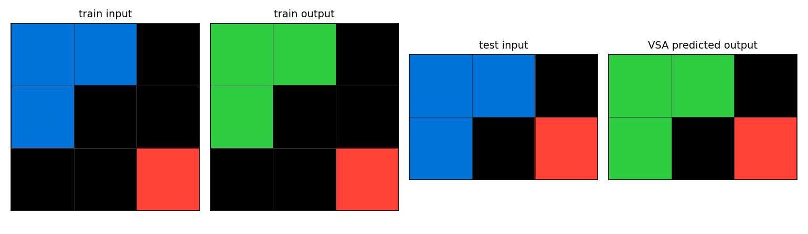

# Vector Symbolic Algebras

## What it is

A Vector Symbolic Algebra (VSA) is a way to represent structured data as
high-dimensional vectors, with operations that compose and decompose the
vectors. Two ideas are used on this page:

- **HRR** (Holographic Reduced Representations): an object is a vector, two
  objects compose with `bind`, decompose with `unbind`, and several objects
  sit together in `bundle`.
- **SSP** (Spatial Semantic Pointers): a point of a 2D plane is encoded as a
  vector, and the similarity of two SSPs is high when the two points are
  close.

A **VSA solver** uses the two to solve a task of the ARC-AGI benchmark: the
objects of a grid are encoded as vectors, a rule on objects becomes an
operation on vectors, and the rule is found by comparing the vectors of the
input and output objects.

Why use it: a rule on vectors is independent of the cell positions, and
similarity is a cheap comparison. The two properties are what the paper of
this page (Joffe and Eliasmith 2025, arXiv:2511.08747) uses to search over
the space of rules.

The example on this page is the task "recolour every object of colour 1 to
colour 3", solved by the VSA solver of this library.

## 1. HRR: bind, unbind, bundle

`bind(a, b)` combines two vectors into one. `unbind(c, a)` recovers `b` from
`c = bind(a, b)`, up to noise. `bundle(a, b, c)` puts several vectors
together; the result is similar to each of the inputs, and the order of the
inputs does not matter.

~~~python
import numpy as np
from dense_armor.core.graph import bind, bundle, random_unit_vector, similarity, unbind

rng = np.random.default_rng(0)
a = random_unit_vector(rng, 256)
b = random_unit_vector(rng, 256)
print(f"{similarity(unbind(bind(a, b), a), b):.4f}")
print(f"{similarity(bind(a, a), a):.4f}")
print(f"{similarity(bundle(a, b), a):.4f}")
~~~

~~~text
0.7221
0.0153
0.7210
~~~

`bind` is not its own inverse (the same vector bound twice is close to
orthogonal to the original: 0.0153), so `unbind` recovers the original only
approximately (0.7221). `bundle` keeps a memory of its inputs (0.7210 for
each), which is how a set of objects is stored as one vector. The numbers are
noisy on purpose: a VSA is a distributed representation, not a lookup table.

## 2. SSP: encode a point

`SSPSpace(n, length_scale, seed)` encodes a point `(x, y)` as a vector. Two
points that are close in the plane give vectors with high similarity; points
far apart give vectors that are nearly orthogonal.

~~~python
import numpy as np
from dense_armor.core.graph import SSPSpace, similarity

ssp = SSPSpace(n=1024, length_scale=0.25, seed=0)
p00 = ssp.encode(np.array([0.0, 0.0]))
p05 = ssp.encode(np.array([0.5, 0.5]))
p10 = ssp.encode(np.array([10.0, 0.0]))
print(f"{similarity(p00, p00):.4f}")
print(f"{similarity(p00, p05):.4f}")
print(f"{similarity(p00, p10):.4f}")
~~~

~~~text
1.0000
0.0162
-0.0149
~~~

A point is similar to itself (1.0). Two points half a unit apart have a
similarity of 0.016, indistinguishable from noise with this `length_scale`:
the kernel is narrow. Two points ten units apart are uncorrelated (-0.015).
The `length_scale` is the width of the kernel; it is a parameter of the
encoding, not a fixed constant.

## 3. Encode an object

`ObjectEncoder` encodes an object of a grid as a single vector, which combines
three properties: the colour, the centre and the shape.

~~~python
from dense_armor.core.graph import ObjectEncoder

enc = ObjectEncoder(n=1024)
cells = [(0, 0), (0, 1), (1, 0)]
sp = enc.encode_object(cells, colour=2, grid_h=3, grid_w=3)
print(len(sp))
print(enc.decode_colour(sp))
~~~

~~~text
1024
2
~~~

The encoded vector has `n` components (1024 in this example). The colour of
the object can be recovered: `decode_colour(sp)` returns `2`. The same works
for every colour of the grid (0 to 9), from `0` to `9`.

## 4. Six object hypotheses

A grid can be cut into objects in more than one way. `perceive(grid,
hypothesis, encoder)` returns the objects under one of six hypotheses: 8- or
4-connected cells of the same colour, vertical or horizontal runs, all cells
of the same colour, or every non-zero cell as its own object.

~~~python
from dense_armor.core.graph import Grid, ObjectEncoder, ObjectHypothesis, perceive

g = Grid.from_list([[1, 1, 0], [1, 0, 0], [0, 0, 2]])
enc = ObjectEncoder(n=1024)
for hyp in ObjectHypothesis:
    print(hyp.value, len(perceive(g, hyp, enc)))
~~~

~~~text
8-connected 3
4-connected 3
vertical 6
horizontal 6
colour 3
pixel 4
~~~

On this grid, `8-connected` and `4-connected` find the same three objects
(the shape of colour 1, the background, the shape of colour 2).
`vertical` and `horizontal` cut the background into stripes, so they find
six. `colour` merges cells of the same colour regardless of position, so it
finds three. `pixel` ignores the background, so it finds four.

## 5. Eleven operations

`execute_action(cells, colour, op_type, params, grid, encoder)` applies one
of eleven operations (recolour, delete, translate, ...) to one object and
returns the resulting object, encoded as a vector.

~~~python
from dense_armor.core.graph import Grid, ObjectEncoder, ObjectHypothesis, OperationParams, OperationType, execute_action, perceive

g = Grid.from_list([[1, 1, 0], [1, 0, 0], [0, 0, 2]])
enc = ObjectEncoder(n=1024)
o = [x for x in perceive(g, ObjectHypothesis.FOUR_CONNECTED, enc)
     if x.colour == 1][0]
r = execute_action(o.cells, o.colour, OperationType.RECOLOUR,
                   OperationParams(colour=7), g, enc)
print(sorted(r[0].cells), r[0].colour)
~~~

~~~text
[(0, 0), (0, 1), (1, 0)] 7
~~~

The cells are the same, the colour is 7. The eleven operations of this
library are `IDENTITY`, `EXTRACT`, `RECOLOUR`, `RECENTRE`, `RESHAPE`,
`MOVE`, `GRAVITY`, `GROW`, `FILL`, `HOLLOW`, `GENERATE`.

## 6. Solve

`vsa_solve(task, encoder)` runs the whole solver: it chooses an object
hypothesis, finds an action set that maps every input object to its
corresponding output object, and stores one rule per action. `vsa_apply`
applies the rules to a test grid.

~~~python
from dense_armor.core.graph import Grid, ObjectEncoder, vsa_apply, vsa_solve

enc = ObjectEncoder(n=1024)
task = {"train": [{"input": [[1, 1, 0], [1, 0, 0], [0, 0, 2]],
                   "output": [[3, 3, 0], [3, 0, 0], [0, 0, 2]]}],
        "test": [{"input": [[1, 1, 0], [1, 0, 2]]}]}
program = vsa_solve(task, enc)
print(program.hypothesis.value, len(program.rules))
pred = vsa_apply(program, Grid.from_list(task["test"][0]["input"]), enc)
print(pred.to_list())
~~~

~~~text
8-connected 2
[[3, 3, 0], [3, 0, 2]]
~~~

The solver picks `8-connected` as the object hypothesis, finds two rules
(a recolour and an identity), and applies them to the test input. The test
input has a shape of colour 1 in the top-left; the rule recolours it to 3
and leaves the rest alone.

*Left: the training pair. Right: the test input and the output that
`vsa_solve` predicts.*

## Details

`vsa.py` implements the two primitives, HRR and SSP. The HRR operations are
`bind` (circular convolution via FFT), `unbind` (circular correlation),
`bundle` (normalised sum), `invert` (reverse and roll), `similarity` (dot
product of unit-length vectors) and `random_unit_vector`. The `SSPSpace`
class implements equation 4 of the paper: `φ(x) = F⁻¹ {exp(i Θᵀ x / l)}`, with
a random phase matrix `Θ` and a length scale `l`.

`vsa_objects.py` implements `ObjectEncoder`, which encodes an object as the
bundle of three bindings: `COLOUR * colour_SP`, `CENTRE * centre_SSP`,
`SHAPE * shape_SSP`, with three fixed random role vectors. The three
properties are encoded in three subspaces and read back with `unbind` and a
similarity comparison.

`vsa_hypotheses.py` implements the six object hypotheses of Table 3 of the
paper (8-connected, 4-connected, vertical, horizontal, colour, pixel) and the
`perceive` function. `vsa_operations.py` implements the eleven operations of
Table 1 (IDENTITY, EXTRACT, RECOLOUR, RECENTRE, RESHAPE, MOVE, GRAVITY, GROW,
FILL, HOLLOW, GENERATE). `vsa_abduction.py` implements Algorithm 1 of the
paper (demonstration abduction): it ranks the object hypotheses with a VSA
heuristic, tries each in order, and for each finds the minimum set of actions
that covers the training pairs. `vsa_solver.py` implements Algorithm 2 (rule
learning) with a prototype per action, and Algorithm 3 (answer deduction).

The `N_DIMENSIONS = 4096`, `LENGTH_SCALE = 0.25`, `MAX_GRID_SIZE = 30` and
`SEED = 0` of `vsa.py` are the constants of the paper. A user who instantiates
`SSPSpace` or `ObjectEncoder` with a different `n` or `length_scale` gets a
different encoding, and the solver may work differently.

### References

Joffe, I., Eliasmith, C. (2025), "Vector Symbolic Algebras for the
Abstraction and Reasoning Corpus", arXiv:2511.08747. The sections used are
§2.1.1 (HRR), §2.1.2, equation 4 (SSP), §3.1.1 (object encoding), §3.2.1,
Algorithm 1 (demonstration abduction), §3.2.2 (rule learning), Algorithm 2,
§3.2.3, Algorithm 3 (answer deduction), Table 1 (eleven operations), Table 2
(grid size hypotheses), Table 3 (six object hypotheses).

The paper reports, on its Table 4, page 17: 57.5% demonstration accuracy and
12.7% query accuracy on ARC-AGI-1 training, which is 10.8% task accuracy on
the training split. The solver of this library is a variant of the paper: it
keeps the encodings, the six object hypotheses, the eleven operations, the
demonstration abduction and the answer deduction, but the rule learning uses
a prototype per action instead of the NN predictor of §3.2.2. The
prototype is the zero-parameter limit of the paper's initialisation; without
the NN, the solver does not reach the 10.8% of the paper.

### Choices stated explicitly

- **The `length_scale` is 0.25.** This is the value of the paper. With
  this value the kernel is narrow: two points half a unit apart have a
  similarity of 0.016. The `decode_centre` method relies on the kernel to
  be wider, and does not work with this value. See Limits.
- **The rule learning uses a prototype, not a NN.** The paper uses a
  single-layer `Dense` predictor for the condition and one for each
  parameter, initialised with the outcome-weighted superposition of
  positive objects and trained with SGD. This library uses the initial
  superposition directly, as the prototype of the rule, and a fixed
  threshold of 0.3 on the cosine similarity to decide when the rule
  applies. The prototype is the zero-parameter limit of the paper; the
  threshold is a choice of this implementation.
- **The Level 2 nodes are not part of the `TypedGraph`.** The four kinds
  (`background`, `frame`, `alignment_group`, `cavity`) are computed
  separately, by `level2_nodes`. The VSA solver does not use them.
- **The eleven operations work on cells, not on vectors.** Each operation
  computes a new set of cells from the input cells and the parameters; the
  resulting object is then re-encoded as a vector. This keeps the output
  grid real, cell by cell, and the encoding is used only to score the
  candidates.

### Limits

- **`decode_centre` and `decode_shape` do not work with the default
  `length_scale`.** The kernel is narrow (similarity 0.016 between two
  points half a unit apart), so `argmax` on the similarity does not find
  the centre of an object. The paper uses an NN for the centre
  (§3.2.2), not `argmax`. This implementation is missing that NN. The VSA
  solver does not call these two methods during solving; they are
  available for a user who wants to inspect the encoding, but the result
  is not accurate.
- **The rule learning is a prototype, not a NN.** The threshold of 0.3
  is a choice, not the paper's. Without the NN, the solver does not reach
  the paper's 10.8% task accuracy on ARC-AGI-1 training.
- **Property selection is not implemented.** The paper (§3.2.2) selects
  which object properties (`colour`, `centre`, `shape`) are relevant to
  each rule with a leave-one-out cross-validation on the demonstrations.
  This implementation does not have that step.
- **The action cost is a reading of the paper's prose.** The paper says
  the minimum hitting set is "minimal cost according to some function f",
  and the function "penalises each additional operation and parameter";
  the formula is not given. This implementation uses one point per distinct
  operation plus one point per distinct `(operation, parameter)` pair.
- **GRAVITY and GROW are executable but never proposed by abduction.**
  The abduction's candidate generation (`_candidate_actions`) does not
  propose them; they are available for a user who builds a program by
  hand.
- **GENERATE constructs only rectangles**, and is always available as a
  candidate. A rule that needs a non-rectangular generated object is not
  expressible.
- **Multiple rules can match the same object.** The paper restricts the
  program to one rule per operation; this implementation does not.
- **The comparison between objects is not in Table 1.** The paper itself
  (§5.2) declares that the solver cannot conceptualise many-to-one or
  many-to-many mappings, multi-coloured objects, chained operations on the
  same object, and high-level object properties. A task that needs any of
  these is not solved.
