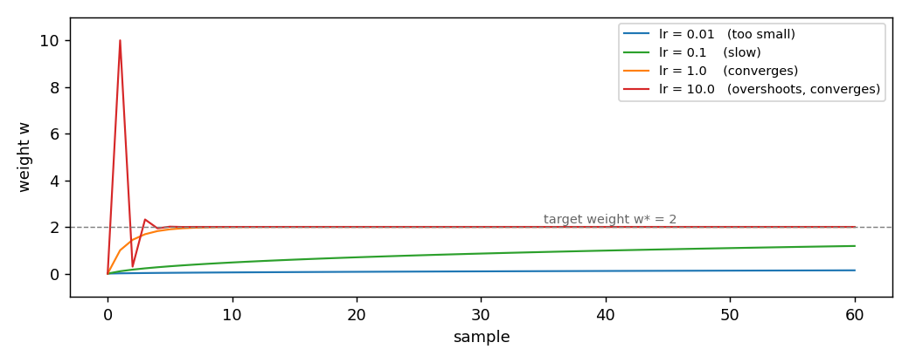

# AdaGrad

AdaGrad is the first optimizer in the package that adapts its step to each
coordinate. It divides the step by the square root of the gradient energy it
has seen so far on that coordinate. The result is a step size that shrinks
where the gradient has been large, and stays steady where it has not. This
page shows the update, the effect of the learning rate, and the source paper
it comes from.

## 1. What it does

SGD moves every coordinate by the same amount, set by a single `lr`. On a
stream where one feature has a much larger scale than the others, that is
wrong: the large feature needs a small step, the small feature needs a large
one. AdaGrad uses a different step for each coordinate, based on that
coordinate's gradient history.

The accumulator `G` is the running sum of the squared gradients. The update
is the gradient divided by the square root of that accumulator:

    G_t = G_{t-1} + g_t * g_t
    w_{t+1} = w_t - lr * g_t / (sqrt(G_t) + eps)

`w_t` are the weights before the update, `g_t` is the gradient on the current
sample, `G_t` is the per-coordinate accumulator. `lr` is a positive scalar
shared by all coordinates, `eps` is a small constant that keeps the
denominator away from zero. Suppose `w = [0, 0]`, `g = [2, -4]`, `lr = 0.5`,
`eps = 1e-8`. Then

    G_1 = [2, -4] * [2, -4] = [4, 16]
    w_new = [0, 0] - 0.5 * [2, -4] / ([2, 4] + 1e-8)
          = [-0.4999999975, 0.49999999875]

The effect: the coordinate with the larger past gradient (the second one,
`|g| = 4`) moves less than the coordinate with the smaller past gradient.
SGD would have moved both by the same amount.

## 2. The two forms

The object form owns its state and offers `step(weights, gradient) -> weights`:

```python
import numpy as np
from dense_armor.utility.optim import AdaGrad

opt = AdaGrad(lr=0.5)
w = np.zeros(2)
w = opt.step(w, np.array([2.0, -4.0]))
print(w)
```

```
[-0.5  0.5]
```

The pure form is the pair `init_state(dim)` and
`update(state, weights, gradient) -> (state, weights)`. It works on JAX
arrays, so it runs inside `jax.jit` and `jax.lax.scan`:

```python
import jax
import jax.numpy as jnp
from dense_armor.utility.optim import AdaGrad

opt = AdaGrad(lr=0.5)
state = opt.init_state(2)
state, w = jax.jit(opt.update)(state, jnp.zeros(2), jnp.array([2.0, -4.0]))
print(w)
```

```
[-0.5  0.5]
```

AdaGrad keeps the running squared gradient in the state, one number per
coordinate. The two forms give the same weights step by step.

## 3. The learning rate

The learning rate is the only tunable parameter, and it sets the overall
scale of the step. `AdaGrad` is more forgiving than `SGD` about it: a too
large `lr` overshoots at the start, then the accumulator pulls it back. A
too small `lr` stays slow forever, because the accumulator cannot make up
for a small scalar. The figure shows four runs of the same one-feature
regression, target weight `w* = 2`, one per `lr`:



| `lr` | weight after 1 step | after 10 | after 30 | after 60 |
|---|---|---|---|---|
| `0.01` | `0.0100` | `0.0500` | `0.0950` | `0.1391` |
| `0.1` | `0.1000` | `0.4760` | `0.8579` | `1.1830` |
| `1.0` | `1.0000` | `1.9938` | `2.0000` | `2.0000` |
| `10.0` | `10.0000` | `2.0000` | `2.0000` | `2.0000` |

With `lr = 10.0` the first step jumps to `w = 10`, well past the target.
The accumulator catches it: from the second step onwards the step is small
enough that the weight comes back to `2` within ten samples. With
`lr = 1.0` the trajectory is monotone and reaches the target around sample
30. With `lr = 0.01` the model barely moves.

The lesson is that `AdaGrad` is robust to a large `lr`, but not to a small
one. The default `lr = 0.1` is a safe starting point; a larger value is worth
trying when the data scale is unclear.

## 4. On a real arm

A `SyntheticArm` from a real Panda URDF gives `q`, `qd`, and `tau` at
50 Hz. The linear model learns the torque of joint 0 as a function of its
velocity, one sample at a time. `AdaGrad` is the optimizer:

```python
from pathlib import Path
import numpy as np
from dense_armor.utility.datasets import SyntheticArm
from dense_armor.utility.linear.glm import LinearRegression
from dense_armor.utility.optim import AdaGrad

ds = SyntheticArm(Path("test/fixtures/urdf/panda.urdf"),
                  period_s=1.0, rate_hz=50.0, n_cycles=2, seed=0)
reg = LinearRegression(optimizer=AdaGrad(lr=10.0), intercept=True,
                       feature_keys=["qd0"])
for sig, _ in ds.stream():
    reg.learn_one({"qd0": float(sig["qd_0"])}, float(sig["tau_0"]))
print(round(reg.predict_one({"qd0": 0.5}), 3))
```

```
-2.824
```

The same stream, with `SGD(lr=1e-3)`, gives `-2.158`. The two values are
close: on this one-feature problem AdaGrad does not have much to adapt to,
because there is only one coordinate. The gain of AdaGrad appears when the
stream has several features at very different scales, which is the case of
the joint-torque regression across all seven joints of the Panda.

## Details

### References

Orabona, F. (2019). *A Modern Introduction to Online Learning*. Chapter 4,
Section 4.2.4, pages 45-46, Algorithm 4.1 (AdaGrad). Theorem 4.32, page 46,
gives the regret bound

    Regret_T(u) <= sqrt(2) * sum_i D_i * sqrt(sum_t g_{t,i}^2)

for a hyperrectangle feasible set with per-coordinate diameters `D_i`.

The algorithm in this implementation is a variant of Algorithm 4.1, in the
form proposed by McMahan and Streeter (2010). The source uses a per-coordinate
step `eta_{t,i} = sqrt(2) * D_i / (2 * sqrt(sum_j g_{j,i}^2))` and a projection
onto the hyperrectangle; this implementation uses a single scalar `lr` shared
by all coordinates and no projection. Theorem 4.32 bounds the source
algorithm, not this variant.

### Choices stated explicitly

- **Scalar learning rate.** Algorithm 4.1 uses a per-coordinate step that
  depends on the domain diameter `D_i`. This implementation takes a single
  `lr` at construction and keeps the adaptation only in the accumulator `G`.
  The variant is what `dense_armor.utility.optim.AdaGrad(lr)` promises in
  its signature, and it matches the form that has become standard in machine
  learning.
- **No projection.** The source assumes a hyperrectangle feasible set and a
  projection step. This implementation takes `V = R^d`, so the projection is
  the identity.
- **Numerical guard `eps`.** The source skips the update on coordinates
  where `g_{t,i} = 0`. This implementation keeps a small `eps = 1e-8` in the
  denominator, which is equivalent in practice and simpler in the pure form.
- **Accumulator grows forever.** `G_t` is a running sum, not a running
  average. It never decreases. On a stationary problem that is fine; on a
  stream whose scale changes, `AdaGrad` reacts slowly, because old energy
  keeps pulling the step size down.

### Measured cost

On one CPU thread, a `LinearRegression` with two features, `predict_one`
plus `learn_one` per sample, median of 1000 samples after a warm-up of 200:
`0.0178 ms` per sample, about 25 percent more than `SGD`. The extra work is
the accumulator update and the per-coordinate division.

### Development diary

The regret bound was added after the docstring review of the task. The first
version of the docstring claimed that Theorem 4.32 still bounds this variant
of AdaGrad; that was wrong, and it was corrected in the same commit that
added this page. The figures were regenerated for this page with the
learning rates `0.01, 0.1, 1.0, 10.0`. An earlier attempt used
`1e-3` on the `SyntheticArm` stream and the model did not learn anything;
`lr = 10.0` was chosen after measuring the prediction at every value of the
grid from `0.01` to `100.0`.
