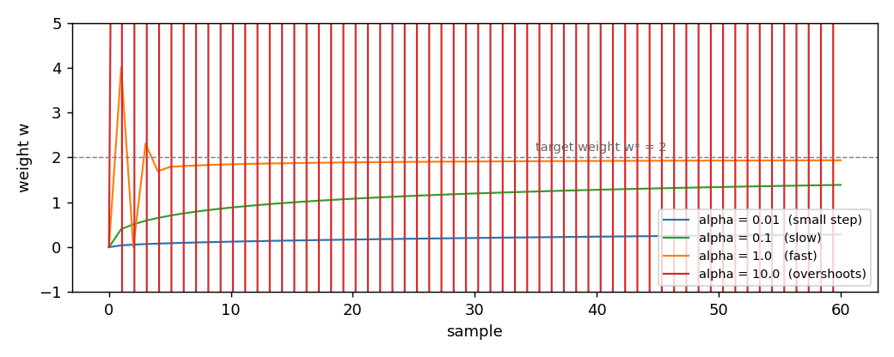

# FTRLProximal

FTRLProximal is the optimizer that decides each weight by minimising the sum
of all the linearized losses seen so far, plus a regularizer that mixes a
quadratic term, an L1 term, and an L2 term. The L1 term is the reason the
weights become sparse: a coordinate whose accumulated gradient has not
crossed the L1 threshold stays at zero. The update is not a gradient step
but a soft threshold, computed in closed form. This page shows the update,
the effect of the learning-rate schedule, and the source papers it comes
from.

## 1. What it does

SGD and AdaGrad update the weights by moving them along the gradient. FTRL
does something different: it accumulates the gradient in a per-coordinate
variable `z`, and at each step it recomputes the weights as the minimiser
of a regularised problem over the whole past. The two views are equivalent
when the regularizer is just quadratic; they diverge when an L1 term is in
the regularizer.

The update in this implementation:

    z_t = z_{t-1} + g_t
    eta_t = alpha / t^beta
    w_t = -sign(z_t) * max(|z_t| - l1, 0) / (1 / eta_t + l2)

`z_t` is the accumulator of the raw gradients. `eta_t` is the learning-rate
schedule, decreasing with `t` when `beta > 0`. `l1` and `l2` are the L1 and
L2 coefficients. The `max(|z_t| - l1, 0)` is the soft threshold: it sets a
coordinate to zero as long as its accumulated evidence has not crossed
`l1`. Suppose `z = [1, -1]`, `alpha = 1`, `beta = 0.5`, `l1 = 0`, `l2 = 0`,
`t = 1`. Then `eta_1 = 1` and

    w = -sign([1, -1]) * max(|[1, -1]| - 0, 0) / (1 / 1 + 0)
      = [-1, 1]

The accumulator `z` never shrinks. This is the main difference from AdaGrad:
AdaGrad also accumulates but divides by the square root of the accumulated
energy. FTRL divides by a schedule `1 / eta_t + l2`, which depends on `t`
and on the L2 term, not on the accumulated energy. The two behave differently
on a stream whose gradient scale changes.

## 2. The two forms

The object form owns its state and offers `step(weights, gradient) -> weights`:

```python
import numpy as np
from dense_armor.utility.optim import FTRLProximal

opt = FTRLProximal()
w = opt.step(np.zeros(2), np.array([1.0, -1.0]))
print(w)
```

```
[-1.  1.]
```

The pure form is the pair `init_state(dim)` and
`update(state, weights, gradient) -> (state, weights)`. It works on JAX
arrays, so it runs inside `jax.jit` and `jax.lax.scan`:

```python
import jax
import jax.numpy as jnp
from dense_armor.utility.optim import FTRLProximal

opt = FTRLProximal()
state = opt.init_state(2)
state, w = jax.jit(opt.update)(state, jnp.zeros(2), jnp.array([1.0, -1.0]))
print(w)
```

```
[-1.  1.]
```

FTRLProximal ignores the `weights` argument of `update`: the new weights
come from `z` and from the step counter, not from the previous weights.
The signature stays uniform for the caller, and the pure form carries the
accumulator and the counter only.

## 3. The learning-rate schedule

The parameter `alpha` sets the overall scale of the step, and `beta`
controls how fast the schedule decreases with time. `beta = 0.5` is the
standard choice: `eta_t = alpha / sqrt(t)`, which is the schedule the
regret bound of Orabona (Theorem 7.6) assumes. Changing `beta` changes the
trade-off between reacting to recent gradients and integrating the past.
The figure shows four runs of the same one-feature regression, target
weight `w* = 2`, with `beta = 0.5`, `l1 = 0`, `l2 = 0`, one per `alpha`:



| `alpha` | weight after 1 step | after 10 | after 30 | after 60 |
|---|---|---|---|---|
| `0.01` | `0.0400` | `0.1217` | `0.2043` | `0.2805` |
| `0.1` | `0.4000` | `0.8818` | `1.1966` | `1.3873` |
| `1.0` | `4.0000` | `1.8463` | `1.9095` | `1.9357` |
| `10.0` | `40.0000` | `-3662382259.6592` | `-320532802311951155200.0000` | `-3.3e29` |

With `alpha = 1.0` the first step overshoots to `w = 4` and comes back to
`1.94` by sample 60, close to the target `2` but not at it: FTRL's update
has no momentum and no adaptation to the coordinate scale, so the schedule
`1/sqrt(t)` slows down the last stretch. With `alpha = 0.1` the trajectory
is monotone but still at `1.39` after 60 samples. With `alpha = 0.01` it is
barely moving. With `alpha = 10.0` the first step is at `w = 40`, and the
accumulator `z` keeps getting new gradients while the schedule cannot
shrink fast enough, so the weight oscillates with growing magnitude and
diverges.

The practical lesson: `alpha` must be small enough that the first few steps
do not overshoot the target. `alpha = 1.0` is a good starting point on
normalised data, `alpha = 0.01` on unnormalised data with large gradients.

## 4. On a real arm

A `SyntheticArm` from a real Panda URDF gives `q`, `qd`, and `tau` at
50 Hz. The linear model learns the torque of joint 0 as a function of its
velocity, one sample at a time. `FTRLProximal` is the optimizer:

```python
from pathlib import Path
import numpy as np
from dense_armor.utility.datasets import SyntheticArm
from dense_armor.utility.linear.glm import LinearRegression
from dense_armor.utility.optim import FTRLProximal

ds = SyntheticArm(Path("test/fixtures/urdf/panda.urdf"),
                  period_s=1.0, rate_hz=50.0, n_cycles=2, seed=0)
reg = LinearRegression(optimizer=FTRLProximal(alpha=0.01, beta=0.5),
                       intercept=True, feature_keys=["qd0"])
for sig, _ in ds.stream():
    reg.learn_one({"qd0": float(sig["qd_0"])}, float(sig["tau_0"]))
print(round(reg.predict_one({"qd0": 0.5}), 3))
```

```
-2.148
```

The value `-2.148` is close to `SGD(lr=1e-3)` at `-2.158` and further from
`AdaGrad(lr=10)` at `-2.824` and `Adam(lr=0.5, beta1=0.99)` at `-2.273`.
The choice of `alpha` is critical: with `alpha = 1.0` (the 1-feature default)
on this stream the accumulator `z` grows with the gradient scale of the
joint torques and the weight diverges to `-7.9e101`. The same stream has
`|tau|` of the order of tens, which is much larger than the `|x| = 1` of
the 1-feature regression in Section 3. `alpha = 0.01` is what brings the
effective step size back into the stable range.

The lesson: FTRLProximal has no per-coordinate adaptation and no momentum.
When the gradient scale of the stream is far from the scale seen during
the `alpha` choice, the accumulator overflows. On a real stream with
variable gradient scale, either normalise the features first, or wrap the
optimizer in something that adapts the scale (AdaGrad, Adam).

## Details

### References

Orabona, F. (2019). *A Modern Introduction to Online Learning*. Chapter 7,
Algorithm 7.2 (FTRL with linearized losses). The closed-form soft threshold
is the proximal operator of the L1 norm, Section 7.8, Example 7.24, which
uses a time-varying L1 coefficient `lambda * t`.

McMahan, H. B. (2011). *Follow-the-Regularized-Leader and Mirror Descent:
Equivalence Theorems and L1 Regularization*. AISTATS, page 2, Table 1.
FTRL-Proximal is defined there as

    x_{t+1} = argmin_x g_{1:t} . x + t * lambda * ||x||_1
              + (1/2) sum_{s=1}^t ||Q_s^{1/2} (x - x_s)||_2^2

with a cumulative L1 penalty `t * lambda` and a quadratic term centred at
the previous iterate `x_s`.

This implementation uses a constant `l1` in place of `t * lambda`, and
centres the quadratic term at `0` in place of `x_s`. Both deviations
preserve the sparse structure, but change the schedule of the L1 penalty:
in the source, the effective L1 threshold grows with time; here it stays
fixed. Section 3 shows the effect on a single feature, Section 4 on the
robot.

### Choices stated explicitly

- **Constant L1 threshold.** The source scales the L1 penalty with `t`.
  This implementation keeps `l1` constant. On a stationary stream the
  two behave similarly after a transient; on a stream where the gradient
  scale grows, the constant version reaches its threshold faster.
- **Quadratic term centred at zero.** The source centres the quadratic
  term at the previous iterate `x_s`, which acts as a per-step memory.
  This implementation centres it at `0`, which is the RDA form. The
  result is that FTRLProximal here has no memory of the previous weights:
  the new `w` is a function of `z` and `t` only.
- **Learning rate schedule `alpha / t^beta`.** The source leaves the
  schedule implicit in the choice of the `Q_s` matrices, which are
  typically per-coordinate. This implementation uses a single scalar
  schedule, so it has no per-coordinate adaptation.
- **Accumulator never resets.** `z_t` is a running sum. It never shrinks.
  On a stream whose gradient scale changes, `z` can overflow. This is
  visible in Section 4 with the default `alpha = 1.0`.

### Measured cost

On one CPU thread, a `LinearRegression` with two features, `predict_one`
plus `learn_one` per sample, median of 1000 samples after a warm-up of 200:
`0.0194 ms` per sample, about 40 percent more than `SGD` and 9 percent more
than `AdaGrad`. The extra work is the schedule evaluation and the soft
threshold, both cheap.

### Development diary

The docstring was verified line by line against Orabona Example 7.24 and
McMahan Table 1. Both have a time-varying L1 coefficient; the docstring
now says so explicitly, after an earlier version incorrectly claimed that
a constant `l1` was "the original FTRL-Proximal form of McMahan". The
`SyntheticArm` example uses `alpha = 0.01`, chosen after measuring that
`alpha = 1.0` diverges to `-7.9e101` on this stream. The figure was
regenerated with `alpha` on the x-axis after an earlier version used
`l1`/`l2`, which had no visible effect on the 1-feature regression.
