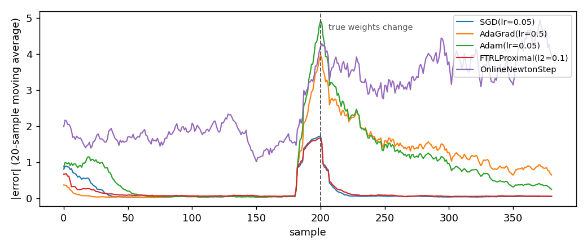

# Online optimizers

When a model learns, it changes its numbers a little after every example. An optimizer is the rule that decides how big each change is. This page compares the five rules in the library and helps you choose one.

An optimizer is the algorithm that decides how much to change the weights of
a linear model on each new sample. It is the only place where the learning
rate lives. It is also what separates the five methods in
`dense_armor.utility.optim`. This page starts from the gradient rule. It ends
with the choice of optimizer for a stream of robot joint readings.

## 1. What an optimizer does

A linear model predicts a target with a weighted sum of its inputs. On each
sample the model compares the prediction with the target. The comparison gives
an error. The optimizer takes that error and turns it into a change of the
weights. Same model, same stream, different optimizer: a different fit, and a
different reaction when the stream changes.

The simplest rule is gradient descent. The model computes a gradient `g` of
its loss with respect to the weights `w`. The optimizer moves the weights in
the direction opposite to the gradient. It moves them by an amount
proportional to a scalar `lr`, the learning rate:

    w_{t+1} = w_t - lr * g_t

`w_t` are the weights before the update. `g_t` is the gradient of the loss on
the current sample. `lr` is a positive scalar. Suppose `w = [0, 0]`,
`g = [2, -4]`, and `lr = 0.5`. Then

    w_new = [0, 0] - 0.5 * [2, -4] = [-1, 2]

Every optimizer in this package refines this single rule. The refinement
decides how far to move on each coordinate. To do that, it uses the history of
the gradients seen so far. `SGD` is the rule above, with no refinement. The
other four add a memory.

## 2. The two forms

Every optimizer is exposed twice. The object form owns its state. It offers
`step(weights, gradient) -> weights`:

```python
import numpy as np
from dense_armor.utility.optim import SGD

opt = SGD(lr=0.1)
w = np.zeros(2)
w = opt.step(w, np.array([1.0, 0.5]))
print(w)
```

```
[-0.1  -0.05]
```

The pure form is a pair: `init_state(dim)` and
`update(state, weights, gradient) -> (state, weights)`. It works on JAX
arrays. It takes the state as an argument. It returns a new state instead of
writing to the object. So it runs inside `jax.jit` and `jax.lax.scan`:

```python
import jax
import jax.numpy as jnp
from dense_armor.utility.optim import SGD

opt = SGD(lr=0.1)
state = opt.init_state(2)
w = jnp.zeros(2)
state, w = jax.jit(opt.update)(state, w, jnp.array([1.0, 0.5]))
print(w)
```

```
[-0.1  -0.05]
```

The two forms share the same hyper-parameters and the same arithmetic. A
stream run inside `jax.lax.scan` gives the same weights as the same stream run
one `step` at a time. The models in `dense_armor.utility.linear` use the pure
form. The tests use the object form.

## 3. The five optimizers

`SGD` moves every coordinate by the same amount. The four others adapt the
step to the gradient history of each coordinate.

- **`SGD(lr)`** follows the raw gradient. It is the reference against which
  the others are measured. Choose it when the data has no strong
  per-coordinate scale difference.
- **`AdaGrad(lr, eps)`** accumulates the squared gradient per coordinate. It
  divides the step by the square root of that accumulator. A coordinate with
  a large past gradient moves less. It is the first choice when some features
  are rarely informative. This is a variant of Algorithm 4.1 of Orabona
  (2019): the source uses a per-coordinate step size that depends on the
  diameter along each coordinate `D_i`; here a single scalar `lr` is shared
  by all coordinates.
- **`Adam(lr, beta1, beta2, eps)`** keeps a running mean and a running
  variance of the gradient. Both are bias-corrected. It behaves like AdaGrad
  on sparse gradients and like a momentum method on dense ones.
- **`FTRLProximal(alpha, beta, l1, l2)`** minimises a regularised version of
  the accumulated losses. It does not follow the current gradient directly.
  The L1 term sets to zero every weight whose accumulated evidence has not
  crossed `l1`. That makes the weights sparse. The source of the soft
  threshold is Example 7.24 of Orabona (2019), which uses a time-varying L1
  coefficient `lambda * t`. The FTRL-Proximal of McMahan (2011), page 2,
  Table 1, also uses a cumulative L1 penalty `t * lambda`; this
  implementation keeps `l1` constant, which changes the schedule of the
  L1 penalty.
- **`OnlineNewtonStep(gamma, eps, D)`** keeps a running approximation of the
  Hessian. It uses the inverse of that approximation as a preconditioner. The
  update follows Figure 3 (page 10 of the manuscript) of Hazan, Agarwal and
  Kale (2007); Orabona (2019), Algorithm 7.6 (Section 7.10), states the
  algorithm in argmin form. Hazan et al. give a logarithmic regret on
  exp-concave losses on a bounded set; `OnlineNewtonStep.from_bounds` builds
  the optimizer with their constants and the projection. On a generic squared loss there
  is no guarantee, and the table below shows a case where the method does not
  converge.

## 4. On a real arm

A `SyntheticArm` from a real Panda URDF gives `q`, `qd`, and `tau` at 50 Hz.
The linear model learns the torque of joint 0 as a function of its velocity.
It learns one sample at a time. `SGD` is the optimizer:

```python
from pathlib import Path
import numpy as np
from dense_armor.utility.datasets import SyntheticArm
from dense_armor.utility.linear.glm import LinearRegression
from dense_armor.utility.optim import SGD

ds = SyntheticArm(Path("test/fixtures/urdf/panda.urdf"),
                  period_s=1.0, rate_hz=50.0, n_cycles=2, seed=0)
reg = LinearRegression(optimizer=SGD(lr=1e-3), intercept=True,
                       feature_keys=["qd0"])
for sig, _ in ds.stream():
    reg.learn_one({"qd0": float(sig["qd_0"])}, float(sig["tau_0"]))
print(round(reg.predict_one({"qd0": 0.5}), 3))
```

```
-2.158
```

The stream carries a friction term on joint 0. `SGD` absorbs part of that term
into the single weight. The prediction at a velocity of 0.5 rad/s is the
torque the model expects at that velocity. Swap `SGD` for any of the other
four. The same three lines run unchanged. The optimizer is the only moving
part.

## 5. Which one on a stream with a sudden change

The same two-feature regression, 400 samples, one `LinearRegression` per
optimizer. The true weights are `[1, -2]` on the first 200 samples and
`[-1, 3]` on the last 200. The stream changes suddenly at the midpoint. The
table reports the mean absolute error on the first 200 samples, the mean
absolute error on the last 100 (the first 100 after the change are excluded
as transient), and the median per-sample latency of `predict_one` plus
`learn_one` on one CPU thread.

```
learner                             MAE pre   MAE post   median us
--------------------------------------------------------------------
SGD(lr=0.05)                         0.1624     0.0401        13.1
AdaGrad(lr=0.5)                      0.0773     0.9610        17.0
Adam(lr=0.05)                        0.2772     0.5705        24.1
FTRLProximal(l2=0.1)                 0.1479     0.0536        19.4
OnlineNewtonStep                     1.7168     3.9491        23.8
```



`SGD` and `FTRLProximal` follow the change. `AdaGrad` and `Adam` are slower to
forget the pre-change fit, because their per-coordinate memory was tuned on
the old weights. `OnlineNewtonStep` does not converge on this stream at all.
The squared loss is not exp-concave, and the paper gives no guarantee outside
that class. The table comes from `test/linear/test_comparison_table.py`,
which prints it at every run.

## Details

### References

Orabona, F. (2019). *A Modern Introduction to Online Learning*. `SGD` is
Chapter 2, Algorithm 2.1, with regret Theorem 2.13. `AdaGrad` is Chapter 4,
Algorithm 4.1, pages 45-46, with regret Theorem 4.32; this implementation
uses a scalar learning rate in place of the source's per-coordinate `D_i`,
and Theorem 4.32 does not apply to it. `FTRLProximal`
is Chapter 7, Algorithm 7.2; the soft threshold is the proximal operator of
the L1 norm, Section 7.8, Example 7.24. The constant `l1` form is from
McMahan, H. B. (2011), *Follow-the-Regularized-Leader and Mirror Descent*,
AISTATS, Section 3.1. `OnlineNewtonStep` is Figure 3 (page 10 of the 2008 manuscript) of
Hazan, E., Agarwal, A., Kale, S. (2007), *Logarithmic regret algorithms for
online convex optimization*, Machine Learning 69, and Algorithm 7.6 (Section
7.10, page 122) of Orabona (2019). `Adam` is Kingma, D. P. and Ba, J. (2014),
arXiv:1412.6980, Algorithm 1.

### Choices stated explicitly

- **`__eq__` compares only the public hyper-parameters.** Two optimizers are
  equal when their learning rate and decay coefficients match. The internal
  accumulators (`_G`, `_m`, `_v`, `_z`, `_A_inv`) are not part of the
  identity. Two freshly built optimizers of the same class should compare
  equal before any sample is seen.
- **`FTRLProximal` ignores the `weights` argument of `update`.** The FTRL
  iterate is a function of the accumulated gradient and the step counter
  alone. The weights from the previous step enter only through the
  regulariser, which is part of the state. The signature stays uniform for
  the caller.
- **`OnlineNewtonStep` has no convergence test on the squared loss.** The
  paper's regret bound covers exp-concave losses. On a generic convex loss
  the method can stall. The table above shows a case where it does.

### Measured cost

On one CPU thread, `dense_armor.utility.linear.LinearRegression` with two
features, `predict_one` plus `learn_one` per sample, median of 1000 samples
after a warm-up of 200:

| Optimizer | median per sample |
|---|---|
| `SGD` | `0.0139 ms` |
| `AdaGrad` | `0.0178 ms` |
| `Adam` | `0.0245 ms` |
| `FTRLProximal` | `0.0194 ms` |
| `OnlineNewtonStep` | `0.0247 ms` |

The cost of every optimizer is dominated by the model's own arithmetic, the
matrix-vector product and the outer product, not by the state update. Pick
the optimizer that fits the data. Do not pick by latency unless the loop runs
above 10 kHz.

### Development diary

The page was written after the optimizers and the linear models were in
place. Every number on it was measured against the code that ships. The
convergence figure is generated by `docs/assets/optim/make_figure.py`, which
runs the same 400-sample stream as the table.
