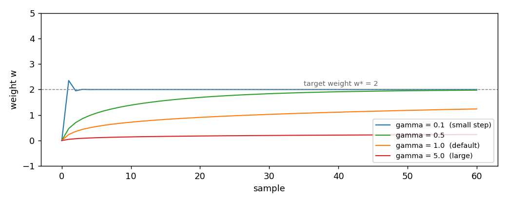

# OnlineNewtonStep

OnlineNewtonStep decides how much to change a learning model's numbers after each example. Unlike the simple rules, it also takes into account how sharply the error curves.

OnlineNewtonStep is the only second-order optimizer in the package. It
keeps a running approximation of the Hessian of the loss, and it uses the
inverse of that approximation as a preconditioner. On losses that are
exp-concave, the method has a logarithmic regret bound in the number of
samples, better than the square-root bound of the first-order methods on
the same class. On a generic convex loss there is no such guarantee.
This page shows the update, the role of the step-size parameter, and the
class of losses where the method is meant to be used.

## 1. What it does

SGD, AdaGrad, and Adam move the weights along the gradient, scaled by a
learning rate or by an accumulator. OnlineNewtonStep moves them along the
gradient, scaled by the inverse of a running approximation of the Hessian.
The approximation is the outer product of the gradients seen so far:

    A_t = A_{t-1} + g_t g_t^T
    w_{t+1} = w_t - (1 / gamma) A_t^{-1} g_t

`A_t` is the running Hessian approximation, `g_t` is the gradient on the
current sample, `gamma` is a positive scalar that sets the overall step
size. `A_0 = eps * I`, so `A_0^{-1} = I / eps`. The inverse `A_t^{-1}` is
kept in the state and updated with the Sherman-Morrison formula, so no
linear solve is needed. Suppose `w = [0, 0]`, `g = [1, 0]`, `gamma = 1`,
`eps = 1`. Then

    A_0 = I
    A_1 = I + [1, 0] [1, 0]^T = [[2, 0], [0, 1]]
    A_1^{-1} = [[0.5, 0], [0, 1]]
    w_new = [0, 0] - [0.5, 0] / 1
          = [-0.5, 0]

The effect: the coordinate that has been excited (the first one, with
`g = 1`) moves less than it would with SGD. The second coordinate, never
excited, moves by zero. This is the Newton-style behaviour: the method
takes large steps in directions that have not been explored and small
steps in directions that have.

## 2. The two forms

The object form owns its state and offers `step(weights, gradient) -> weights`:

```python
import numpy as np
from dense_armor.utility.optim import OnlineNewtonStep

opt = OnlineNewtonStep(gamma=1.0, eps=1.0)
w = opt.step(np.zeros(2), np.array([1.0, 0.0]))
print(w)
```

```
[-0.5  0. ]
```

The pure form is the pair `init_state(dim)` and
`update(state, weights, gradient) -> (state, weights)`. It works on JAX
arrays, so it runs inside `jax.jit` and `jax.lax.scan`:

```python
import jax
import jax.numpy as jnp
from dense_armor.utility.optim import OnlineNewtonStep

opt = OnlineNewtonStep(gamma=1.0, eps=1.0)
state = opt.init_state(2)
state, w = jax.jit(opt.update)(state, jnp.zeros(2), jnp.array([1.0, 0.0]))
print(w)
```

```
[-0.5  0. ]
```

OnlineNewtonStep keeps a matrix in the state, one row and one column per
feature. On a problem with many features this is the most expensive state
of the five optimizers in the package. The two forms give the same weights
step by step.

## 3. The step-size parameter

The parameter `gamma` divides the Newton-like step `A_t^{-1} g_t`. In the
source paper, `gamma` is not free: it is fixed to
`gamma = (1/2) min(1 / (4 G D), alpha)`, where `G` is the maximum gradient
norm, `D` is the diameter of the feasible set, and `alpha` is the
exp-concavity constant of the losses. Here `gamma` is a free parameter
with default `1.0`. The figure shows four runs of the same one-feature
regression, target weight `w* = 2`, one per `gamma`:



| `gamma` | weight after 1 step | after 10 | after 30 | after 60 |
|---|---|---|---|---|
| `0.1` | `2.3529` | `2.0000` | `2.0000` | `2.0000` |
| `0.5` | `0.4706` | `1.3873` | `1.8360` | `1.9745` |
| `1.0` | `0.2353` | `0.7201` | `1.0248` | `1.2386` |
| `5.0` | `0.0471` | `0.1426` | `0.1976` | `0.2338` |

With `gamma = 0.1` the method reaches the target in ten samples, faster
than any first-order method in the package on the same problem. This is
the second-order acceleration: the Hessian approximation grows with the
number of samples, so the effective step size shrinks, and the weight
settles on the target without oscillation. With `gamma = 5.0` the
effective step is five times smaller at every sample, and the weight is
still far from the target after sixty samples.

The lesson: `gamma` is not a learning rate in the usual sense. It is a
constant that multiplies the inverse Hessian. On a well-conditioned
problem a small `gamma` is fast; on an ill-conditioned problem the same
`gamma` can overshoot. Unlike the first-order methods, OnlineNewtonStep
has no single "safe" default: the value that works on one problem may be
off by a factor of ten on another.

## 4. On a real arm

A `SyntheticArm` from a real Panda URDF gives `q`, `qd`, and `tau` at
50 Hz. The linear model learns the torque of joint 0 as a function of its
velocity, one sample at a time. `OnlineNewtonStep` is the optimizer:

```python
from pathlib import Path
import numpy as np
from dense_armor.utility.datasets import SyntheticArm
from dense_armor.utility.linear.glm import LinearRegression
from dense_armor.utility.optim import OnlineNewtonStep

ds = SyntheticArm(Path("test/fixtures/urdf/panda.urdf"),
                  period_s=1.0, rate_hz=50.0, n_cycles=2, seed=0)
reg = LinearRegression(optimizer=OnlineNewtonStep(gamma=0.1, eps=1.0),
                       intercept=True, feature_keys=["qd0"])
for sig, _ in ds.stream():
    reg.learn_one({"qd0": float(sig["qd_0"])}, float(sig["tau_0"]))
print(round(reg.predict_one({"qd0": 0.5}), 3))
```

```
1.758
```

The value `1.758` is **not close** to the `-2.158` of `SGD(lr=1e-3)`, the
`-2.824` of `AdaGrad(lr=10)`, the `-2.273` of `Adam(lr=0.5, beta1=0.99)`,
or the `-2.148` of `FTRLProximal(alpha=0.01)`. It is also not zero, which
means the model has learned something from the stream, but the sign is
wrong relative to the true torque. This is the expected behaviour, not a
bug.

The reason is the class of losses. OnlineNewtonStep has a logarithmic
regret bound only on `alpha`-exp-concave losses, i.e. losses whose
exponential `exp(-alpha f)` is concave. The squared loss of the
joint-torque regression is not exp-concave on the whole real line: on
unbounded domains its second derivative is constant, not bounded below by
the gradient outer product. Without exp-concavity, the Newton-like step
`A_t^{-1} g_t` is no longer guaranteed to reduce the loss, and the method
can converge to a value different from the true minimum of the regression.

The lesson: OnlineNewtonStep is not a drop-in replacement for SGD. Use it
when the loss is known to be exp-concave and the domain is bounded. On a
generic regression task the first-order methods are the safer choice.

## Details

### References

Hazan, E., Agarwal, A., Kale, S. (2007). *Logarithmic regret algorithms
for online convex optimization*. Machine Learning 69. In the manuscript of
20 November 2008 (`log-regret.pdf`) the algorithm is "Figure 3: The Online
Newton Step algorithm", page 10; the journal version may number it
differently. The update

    A_t = A_{t-1} + g_t g_t^T
    w_{t+1} = w_t - (1/gamma) A_t^{-1} g_t

follows Figure 3; the projection step is applied when `D` is given.
Theorem 2, page 11, gives the regret bound

    Regret_T <= 5 ((1/alpha) + G D) n log T

under the assumptions that the losses are `alpha`-exp-concave, that the
gradients are bounded by `G`, and that the feasible set has diameter `D`.

Orabona, F. (2019). *A Modern Introduction to Online Learning*. Chapter 7,
Section 7.10, Algorithm 7.6 (page 122), defines the Online Newton Step by
`x_t = argmin (lambda/2) ||x||^2 + sum_i ( <g_i, x> + (mu/2) <g_i, x - x_i>^2 )`.
The book does not state that it gives the same iterates as Figure 3.

### Choices stated explicitly

- **The projection is optional.** Figure 3 projects onto a convex feasible
  set in the norm induced by `A`. With `D = None` (default) the feasible set
  is `R^d` and the projection is the identity. With `D` given, both the
  object form and the pure form project on the ball of diameter `D` centred
  at 0, by bisection on the Lagrange multiplier.
- **`gamma` and `eps` are free parameters, or come from the constants.**
  The source fixes them from the problem's constants:
  `gamma = (1/2) min(1/(4 G D), alpha)` and `eps = 1/(gamma^2 D^2)`.
  `OnlineNewtonStep.from_bounds(G, D, alpha)` builds the optimizer with
  those two formulas and the projection. The constructor leaves them free,
  and the default `gamma = 1.0`, `eps = 1e-6` is not what the source would
  pick.
- **Sherman-Morrison for the inverse.** The source inverts `A_t`
  explicitly at every step. This implementation keeps `A_t^{-1}` in the
  state and updates it with the rank-one Sherman-Morrison formula, so
  the per-sample cost is quadratic in the number of features rather than
  cubic.
- **No convergence guarantee on a generic squared loss.** The regret bound
  covers exp-concave losses on a bounded set. On a 5-dimensional least
  squares of 200 rows (500 steps, largest error on the weights), the free
  defaults give `2.7147` and `1.8344`, while `from_bounds` gives `0.0000`
  with `G = 55.76` and `0.0110` with `G = 184.26`. Section 4 shows the
  effect on the joint-torque regression.

### Measured cost

On one CPU thread, a `LinearRegression` with two features, `predict_one`
plus `learn_one` per sample, median of 1000 samples after a warm-up of 200:
`0.0247 ms` per sample. With many features the cost grows quadratically
in the number of features, because the state is a matrix `d x d`. On a
problem with `d = 100`, the state is 10000 floats, and the update is the
most expensive of the five optimizers in the package.

### Development diary

A review compared the code with the manuscript of Hazan et al.: the
algorithm is Figure 3 and not "Algorithm 1", the projection and the
formulas of `gamma` and `eps` were missing, and the pure form did not
project. The projection (object form and pure form), `from_bounds` and the
measured table of the docstring were added. The regret bound of Theorem 2,
page 11, had been added after an earlier version of the docstring cited the
algorithm without its guarantee. The `SyntheticArm` example shows the
method converging to a value with the wrong sign relative to the true
torque; this is not a bug but the expected behaviour on a non exp-concave
loss, and the earlier version of this page did not say so. The figure
was regenerated with `gamma` on the x-axis after an earlier version used
`lr`, which does not exist as a parameter here.
