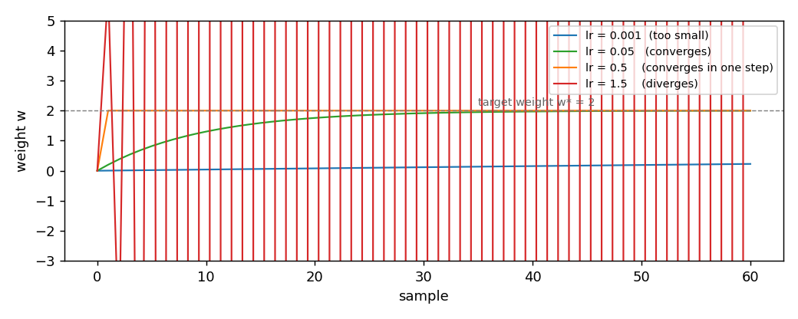

# SGD

**In plain words:** SGD is the simplest rule for changing a learning model's numbers after each example: it moves them a little in the direction that reduces the error. The other rules in this section are built on it.

SGD is the simplest online optimizer in the package. It follows the raw
gradient, with no memory of the past. Every other optimizer on this page
is built on top of it. This page shows the update, the effect of the
learning rate, and the regret bound that the source gives.

## 1. What it does

A linear model computes a gradient `g` of its loss with respect to the
weights `w`. SGD moves the weights opposite to that gradient, by an amount
proportional to a scalar `lr`, the learning rate:

    w_{t+1} = w_t - lr * g_t

`w_t` are the weights before the update. `g_t` is the gradient on the
current sample. `lr` is a positive scalar. Suppose `w = [0, 0]`,
`g = [2, -4]`, and `lr = 0.5`. Then

    w_new = [0, 0] - 0.5 * [2, -4] = [-1, 2]

That is the whole algorithm. There is no momentum, no adaptive step, no
regulariser. SGD is the reference against which the other four methods are
measured.

## 2. The two forms

The object form owns its state and offers `step(weights, gradient) ->
weights`:

```python
import numpy as np
from dense_armor.utility.optim import SGD

opt = SGD(lr=0.1)
w = np.zeros(2)
w = opt.step(w, np.array([1.0, 0.5]))
print(w)
```

```
[-0.1  -0.05]
```

The pure form is the pair `init_state(dim)` and
`update(state, weights, gradient) -> (state, weights)`. It works on JAX
arrays, so it runs inside `jax.jit` and `jax.lax.scan`:

```python
import jax
import jax.numpy as jnp
from dense_armor.utility.optim import SGD

opt = SGD(lr=0.1)
state = opt.init_state(2)
state, w = jax.jit(opt.update)(state, jnp.zeros(2), jnp.array([1.0, 0.5]))
print(w)
```

```
[-0.1  -0.05]
```

SGD keeps no state: `init_state` returns an empty dictionary. The two
forms give the same weights step by step.

## 3. The learning rate

The learning rate is the only hyper-parameter of SGD, and the only choice
the caller makes. A small `lr` learns slowly but never overshoots. A large
`lr` reacts fast and can oscillate or diverge. The figure shows four runs
of the same one-feature regression, target weight `w* = 2`, one per `lr`:



| `lr` | weight after 1 step | after 10 | after 30 | after 60 |
|---|---|---|---|---|
| `0.001` | `0.0040` | `0.0396` | `0.1166` | `0.2264` |
| `0.05` | `0.2000` | `1.3026` | `1.9152` | `1.9964` |
| `0.5` | `2.0000` | `2.0000` | `2.0000` | `2.0000` |
| `1.5` | `6.0000` | `-2046.0000` | `-2147483646.0000` | `-2.3e18` |

With `lr = 0.5` the weight jumps to the target in a single step, because
for a one-feature quadratic the update `w -= lr * 2 * (w - w*)` reaches
`w*` exactly when `lr = 0.5`. With `lr = 1.5` the sign of the error flips
every step and the magnitude grows without bound. The safe region for
`lr` depends on the curvature of the loss, which the caller usually does
not know in advance. A common recipe is to start with a small `lr` and
increase it until the loss stops decreasing.

## 4. On a real arm

A `SyntheticArm` from a real Panda URDF gives `q`, `qd`, and `tau` at
50 Hz. The linear model learns the torque of joint 0 as a function of its
velocity, one sample at a time. `SGD` is the optimizer:

```python
from pathlib import Path
import numpy as np
from dense_armor.utility.datasets import SyntheticArm
from dense_armor.utility.linear.glm import LinearRegression
from dense_armor.utility.optim import SGD

ds = SyntheticArm(Path("test/fixtures/urdf/panda.urdf"),
                  period_s=1.0, rate_hz=50.0, n_cycles=2, seed=0)
reg = LinearRegression(optimizer=SGD(lr=1e-3), intercept=True,
                       feature_keys=["qd0"])
for sig, _ in ds.stream():
    reg.learn_one({"qd0": float(sig["qd_0"])}, float(sig["tau_0"]))
print(round(reg.predict_one({"qd0": 0.5}), 3))
```

```
-2.158
```

The stream carries a friction term on joint 0. The single weight absorbs
part of it, and the prediction at a velocity of 0.5 rad/s is the torque
the model expects at that velocity. A larger `lr` follows the friction
faster but also amplifies the sensor noise. A smaller `lr` is smoother
but lags behind a change of the friction. The trade-off is the same as in
the figure above, at the scale of the robot.

## Details

### References

Orabona, F. (2019). *A Modern Introduction to Online Learning*. Chapter 2,
Algorithm 2.1 (Online Gradient Descent) with a constant step size.
Theorem 2.13 gives the regret bound

    Regret_T(u) <= D^2 / (2 eta_T) + (1/2) sum_{t=1}^T eta_t ||g_t||^2

for a non-increasing step size `eta_t`, with `D` the diameter of the
feasible set and `g_t` the subgradient of the loss on the current sample.
The SGD update is the special case `V = R^d` of the projection step in
Algorithm 2.1, so the bound applies with the diameter replaced by the
distance between the initial weights and the competitor `u`.

### Choices stated explicitly

- **Constant learning rate.** The paper's Algorithm 2.1 allows any
  non-increasing sequence `eta_t`. SGD takes a single `lr` at
  construction and keeps it constant. This is the form the caller asked
  for and the one that fits the `LinearRegression` interface.
- **No projection.** The paper assumes a closed convex feasible set `V`
  and a projection step. SGD takes `V = R^d`, so the projection is the
  identity and the update is a plain gradient step.
- **Numerical guard on `lr`.** The constructor rejects `lr <= 0`. The
  paper does not state this, but a non-positive step size would either
  freeze the weights or reverse the gradient direction.

### Measured cost

On one CPU thread, a `LinearRegression` with two features, `predict_one`
plus `learn_one` per sample, median of 1000 samples after a warm-up of
200: `0.0139 ms` per sample. The cost is dominated by the model's own
arithmetic, not by SGD itself.

### Development diary

The regret bound was added to this page after the docstring review. The
first version of the page quoted only the chapter number, without the
theorem; the instruction for the task says the bound must be quoted with
its assumptions, so the bound and the diameter assumption are now
explicit. The four-rate figure was regenerated for this page; an earlier
version used `lr = 0.01, 0.1, 1.0, 10.0` and the two middle curves were
indistinguishable at the resolution of the plot.
