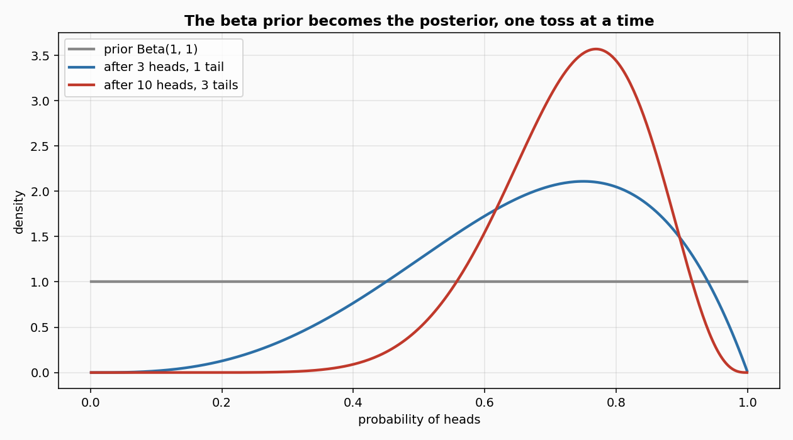
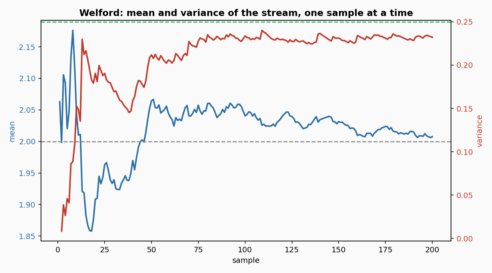
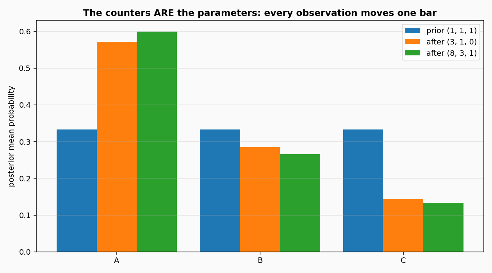

# Distributions

Three small probability distributions that update themselves one observation at a time. A beta that learns the bias of a coin, a Gaussian that learns the mean and the spread of a signal, a multinomial that learns how often each category shows up. Each one can also *forget* a single observation it saw before.

## 1. What they are

Imagine flipping a coin and wanting to know, after every toss, how biased it is. You start with no idea, so you assume every bias is equally likely. The first toss comes up heads, and your belief shifts slightly toward heads. After ten heads and three tails, your belief has settled around a value near 0.77. This is what the beta distribution does, and the update is a single addition to a counter.

The same idea in three flavours:

- **Beta**: the parameter is a probability between 0 and 1, like the bias of a coin or the chance that a fault fires this cycle.
- **Gaussian**: the parameter is a real number with an unknown mean and variance, like the residual of a joint that drifts a little as the robot warms up.
- **Multinomial**: the parameter is a distribution over K categories, like the choice among three contact states, or the words an agent emits.

Each class keeps only the sufficient statistics, not the observations. The beta keeps two numbers, the Gaussian keeps three, the multinomial keeps K. Memory does not grow with the stream.

## 2. How they work

The three are *conjugate* to the likelihood they are paired with, which means the posterior has the same functional form as the prior, and updating it is a small edit of the parameters. Bishop, *Pattern Recognition and Machine Learning*, section 2.1 for the beta, section 2.2 for the Dirichlet, section 2.3 for the Gaussian.

The beta density is Bishop eq. 2.13:

    Beta(mu | a, b) = Gamma(a + b) / (Gamma(a) Gamma(b)) * mu^(a-1) (1-mu)^(b-1)

The mean and the variance are eq. 2.15 and 2.16:

    E[mu]   = a / (a + b)
    var[mu] = a b / ((a + b)^2 (a + b + 1))

An observation of 1 increments `a`, an observation of 0 increments `b`. `revert` does the reverse. The state is the pair `(a, b)`.

The Dirichlet density is Bishop eq. 2.38, with the normalising constant alpha_0 = sum of the counters (eq. 2.39):

    Dir(mu | alpha) = (Gamma(alpha_0) / prod_k Gamma(alpha_k)) prod_k mu_k^(alpha_k - 1)

An observation of category k increments `alpha[k]`. The posterior mean is `alpha[k] / alpha_0`, the posterior mode is `(alpha[k] - 1) / (alpha_0 - K)`. The state is the counter vector.

The Gaussian is updated by Welford's algorithm (Welford 1962). The state is `(n, mean, m2)`, where `m2` is the sum of squared deviations from the running mean. The variance is `m2 / (n - 1)` and the update is one division and one multiplication per sample. The `pdf` and the `cdf` use eq. 2.42 and the error function.

## 3. Smallest example

```python
from dense_armor.utility.proba import Beta, Gaussian, Multinomial

d = Beta(1.0, 1.0)
for x in [1, 1, 1, 0]:
    d.update(x)
print(f"beta mean {d.mean():.4f}, variance {d.variance():.4f}")

g = Gaussian()
for v in [1.0, 2.0, 3.0, 4.0, 5.0]:
    g.update(v)
print(f"gaussian mean {g.mean():.4f}, variance {g.variance():.4f}")

m = Multinomial(alpha=1.0, n_categories=3)
for k in [0, 0, 1, 2]:
    m.update(k)
print([round(float(p), 4) for p in m.mean()])
```

```
beta mean 0.6667, variance 0.0317
gaussian mean 3.0000, variance 2.5000
[0.4286, 0.2857, 0.2857]
```

The beta saw three heads and one tail, so its mean is 4/6. The Gaussian saw the numbers 1 to 5, so its mean is 3 and its sample variance is 2.5. The multinomial saw A twice, B once and C once, over four observations, so its posterior mean is `(3, 2, 2) / 7`.

## 4. The update, seen



The gray curve is the prior: every bias between 0 and 1 is equally likely before any toss. The blue curve is the belief after three heads and one tail, still wide. The red curve is the belief after ten heads and three tails: narrower, centred near 0.77. Each new toss moves the curve a little, and the width shrinks at a rate of `1 / sqrt(n)`.



Two hundred samples drawn from a Gaussian with mean 2.0 and variance 0.25. The blue line is the running mean, the red line the running variance. After 200 samples the running variance is 0.21 against a true 0.25: the estimate approaches the true value and has not yet settled at it. The variance is `m2 / (n - 1)`, the unbiased estimate; the `pdf` uses `m2 / n`, the maximum-likelihood one, once at least one observation has been seen. Before any observation the density falls back on the `var` passed to the constructor, so an empty `Gaussian(var=2.0)` still returns a meaningful density.



The three bars are the posterior mean for three categories, under three different observation histories. The prior `(1, 1, 1)` gives three equal bars. After observing `(3, 1, 0)`, the first bar rises. After `(8, 3, 1)`, it rises further. There is no separate 'training step': observing a category is one addition to one counter, and the mean is the counter divided by its sum.

## 5. Update and revert

The two methods `update` and `revert` are exact inverses. On the same observation `x` with the same weight `w`, the state before `update` equals the state after `update().revert()` up to floating point. This is what makes the distributions usable inside a sliding window: when an old observation leaves the window, its contribution is subtracted from the state, with no re-computation.

For the Gaussian, `revert` is the Welford update run backwards; for the beta and the multinomial, it is a subtraction on the counter. The three classes reject a `revert` that would leave a counter or a count non-positive, with a `ValueError`.

## float32

`Gaussian(dtype=numpy.float32)` keeps the state in float32 and applies
the shifted-data algorithm with ``K = x[0]`` (Healy 2022, Algorithm 2)
online: TwoSum on ``s1 = sum(y)`` and ``s2 = sum(y**2)``, two-term
variance. Relative error of the variance against the float64 reference
on N(1e3, 0.01), 100,000 samples, seed 0: 2.1e-8. On a constant stream
at 1e10 and 1e38 the variance is exactly 0.0. With this mode ``revert``
raises ``NotImplementedError`` (the shifted compensated sums have no
exact inverse) and ``w`` must be 1. A spread above the float32 maximum
(about 3.4e38) makes ``y*y`` overflow: ``variance()`` and ``_var_biased()``
return ``nan`` and print a numpy ``RuntimeWarning`` on the overflow. The
default float64 path does not overflow on that range.

Cost, median of 7 runs of one update over 20,000 samples, one CPU
thread: default 0.000347 ms (IQR 0.000008), float32 0.003227 ms (IQR 0.000059). The claim that the float32 path is at
most as slow as the default is not met: on a scalar loop the numpy
float32 arithmetic is slower than the Python float64 arithmetic. The
float32 speed is in `learn_many` and in jitted array code, not in a
scalar loop.

## Details

### References

- Bishop, C. M. (2006). Pattern Recognition and Machine Learning. Springer. Section 2.1 (beta), section 2.2 (Dirichlet), section 2.3 (Gaussian). Eqs. 2.13, 2.15, 2.16, 2.38, 2.39, 2.42.
- Welford, B. P. (1962). Note on a method for calculating corrected sums of squares and products. Technometrics 4(3), 419-420.
- Murphy, K. P. (2007). Conjugate Bayesian analysis of the Gaussian distribution. Technical report.

### Choices stated explicitly

- **Gaussian variance.** The `variance()` method returns the unbiased `m2 / (n - 1)`, matching numpy's `ddof=1`. The `pdf` uses the maximum-likelihood `m2 / n` once at least one sample has been seen; before the first sample it uses the `var` passed to the constructor. On a single sample with no spread the MLE is zero and `pdf` returns `0.0` through the same guard that protects against a degenerate variance. The two numbers differ by `n / (n - 1)`, and the choice is stated in each method's docstring.
- **Multinomial mode.** The posterior mode `(alpha - 1) / (alpha_0 - K)` is defined only when every counter is > 1. The method raises `ValueError` otherwise, instead of returning a degenerate value.
- **Beta mode.** Same: defined only when both `a` and `b` are > 1. `ValueError` otherwise.
- **Weight.** `update(x, w=1.0)` and `revert(x, w=1.0)` accept a positive weight, so one call can count as several observations. `w <= 0` raises `ValueError`.
- **Sample.** `sample(rng)` takes a numpy `Generator` and returns one draw from the current posterior.

### Measured cost

p99 of one `update` plus one `mean`/`pdf` call over 3000 samples, one CPU thread: below 0.01 ms for all three. The state is a small fixed-size tuple: two scalars for the beta, three for the Gaussian, K counters for the multinomial. Memory does not grow with the stream.

### Pure form

All three have a pure `init_state()` / `step(state, v) -> (state, output)` form. The state is a tuple of scalars, so the whole update can run inside `jax.lax.scan` and passes `check_step_is_pure` and `check_step_is_jittable`.

### Development diary

The beta and the multinomial ship without a `cdf`, because no closed form exists in terms of elementary functions and a numerical integral would be slower than calling scipy. The Gaussian `cdf` uses the error function `math.erf`, which is exact to floating point. The `mode` of both the beta and the multinomial raises on a degenerate prior, deliberately: a mode that is not unique is not a mode.
