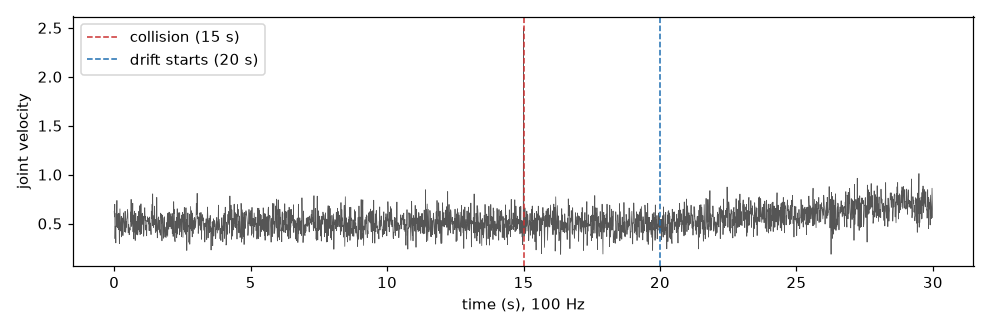

# Protection

## The map of protection

Click a page to open it, or the job on the left (or the button at the top) to go back to the [map of the library](../index.md#the-library-folder-by-folder).

<object type="image/svg+xml" data="../assets/maps/protect.svg" style="width:100%"></object>

When a reading looks wrong, what should you do with it? This section explains the cases (a single glitch, a real change, a slow drift) and which tool handles each.

Once a sample looks wrong, what do you do with it?

There are three honest answers, and they are not the same:

- It is a **spike** — an isolated impulse, one sample that got corrupted. Replace it
  with the local baseline and move on.
- It is a **regime change** — the signal has genuinely moved to a new level. Pass it
  through, unchanged. The robot is doing something different now.
- It is a **slow drift** — neither a spike nor a level change, but a sustained movement
  of the average. The CUSUM on [Drift detection](../drift/index.md) is the right tool.

An anomaly detector cannot tell these apart. From a single sample's point of view, a
spike and the first sample of a regime change look identical: both are far from the
recent window. Only the *run* of deviating samples, and what happens after the run,
distinguishes them.

## The signal

Same 100 Hz joint velocity throughout the batch: a collision spike at 15 s and a slow
gear drift from 20 s.

The spike is one sample; the drift is a run. The Arbiter decides which is which.

## Pages

- **[Arbiter](arbiter.md)** — labels each point clean, spike or regime change, and
  routes it to the correct corrector. Both a batch version (`classify_segments` +
  `route_and_correct`) and a streaming version (`StreamingArbiter`) with bounded delay.
  Also wired into `Orca(use_arbiter=True)`.
- **[Shields](shields.md)** — a shield is a tool that cleans: you give it a series of numbers or a model, and you
  get back a cleaned series or a protected answer.

Online (they keep a state and learn the stream):

- **[Orca](orca.md)** — protects a whole model: it cleans the input before the model sees it, runs the model, and
  checks that the model's answer is not broken either.
- **[Adaptive engine](engine.md)** — follows a signal that drifts slowly, keeps updating what it considers normal
  and pulls the signal gently toward it, so that a slow drift is not mistaken for a glitch.

Offline (a pure function of a whole series, with no state):

- **[Armor](armor.md)** — cleans one series of numbers: it finds the readings that are obviously broken and
  replaces them with sensible values.
- **[Hybrid engine](hybrid_engine.md)** — the part inside Armor that decides, reading by reading, whether a value
  is genuine or broken, and what to put in place of a broken one.
