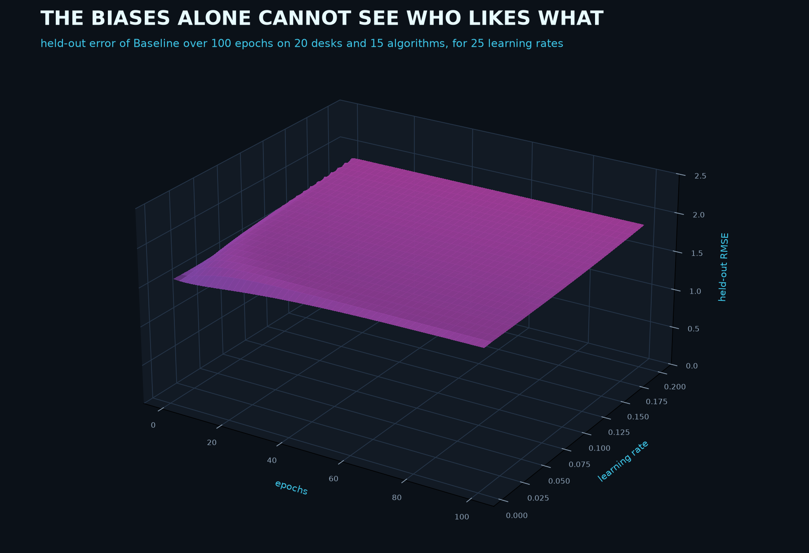
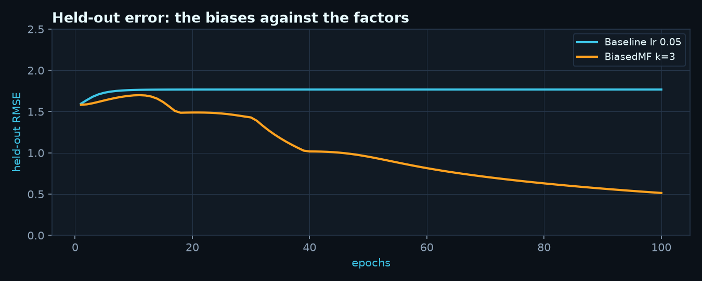

# Baseline: the mean plus a bias for each user and each item

[← Recommenders](index.md)

A bank has 20 desks and 15 execution algorithms, and each desk has rated the fills of some algorithms with a score. The simplest guess for a missing score is the average score, a little higher for a desk that rates everything high and a little higher for an algorithm that everybody likes. It does not know which desk likes which algorithm. A robot that rates a few gains for each task can start from the same guess.



## 1. A first example: predict the scores that no desk has given yet

The scores come from a hidden structure: each desk and each algorithm has three hidden traits, and the score is 3.5 plus the product of the traits and a small noise. The model sees 180 of the 300 pairs, 100 passes, and is judged on the 120 pairs it has never seen. The number is the root mean squared error (RMSE); a model that predicted the average would have an error near the spread of the scores, about 1.6.

```python
import numpy as np
from dense_armor.core.online.reco import Baseline

rng = np.random.default_rng(0)
P = rng.normal(size=(20, 3))
Q = rng.normal(size=(15, 3))
R = 3.5 + P @ Q.T + rng.normal(0, 0.1, size=(20, 15))
pairs = [(u, i) for u in range(20) for i in range(15)]
rng.shuffle(pairs)
cut = int(0.6 * len(pairs))
train, test = pairs[:cut], pairs[cut:]
model = Baseline(lr=0.05, l2=0.02, seed=0)
for _ in range(100):
    for u, i in train:
        model.learn_one(u, i, float(R[u, i]))
err = [(model.predict_one(u, i) - R[u, i]) ** 2 for u, i in test]
print(round(float(np.sqrt(np.mean(err))), 3))
```

```
1.885
```

The error is larger than the spread of the scores themselves (about 1.6): knowing that a desk rates high and that an algorithm is popular says almost nothing about the score of this pair, because the score is made by the match between the traits of the two. `model.predict_one(u, i)` is the average plus the bias of the desk `u` plus the bias of the algorithm `i`.



Over 5 hidden worlds, the median held-out RMSE reads 1.597, 1.762, 1.768 and 1.768 after 1, 10, 50 and 100 passes for a learning rate of 0.05, and 1.587, 1.593, 1.716 and 1.749 for 0.005: the baseline does not improve, and a learning rate of 0.2 ends at 1.876. The biased matrix factorization of the next page, in the same figure, reaches 0.514.

| class or function | what it does |
|---|---|
| `Baseline` | predicts the running mean plus a bias for the user and a bias for the item |

## 2. What it does

The simplest recommender predicts a global mean plus a per-user and a per-item bias: `y_hat(u, i) = mu + b_u + b_i`, where `mu` is the running mean of the ratings seen so far, `b_u` the bias of the user and `b_i` the bias of the item. A rating updates the two biases one step of SGD with L2. It captures the level of a rating and the systematic deviation of a user or of an item, without any interaction.

**Source:** Koren, Y., Bell, R., Volinsky, C. (2009). Matrix Factorization Techniques for Recommender Systems. IEEE Computer 42(8). Section "Adding biases", page 4, and the SGD update, page 4. Paterek, A. (2007). Improving Regularized SVD. In Netflix Prize workshop, KDD Cup and Workshop 2007. Section 3.3, eq. (2), page 2.

## 3. The parameters

| Parameter | Meaning | Default |
|---|---|---|
| `lr` | learning rate | 0.01 |
| `l2` | L2 strength | 0.0 |
| `seed` | seed of the initialiser | 0 |
| `init_scale` | standard deviation of the initial biases | 0.01 |

`budget_s` is 0.0002 s and `memory_class` is `O(n_users + n_items)`. The methods are `learn_one(user, item, rating)`, `predict_one(user, item)` and `rank(user, items, top_k)` (see [Top-k recommendations](rank.md)). `fit` raises `TypeError` and says to use `learn_one(user, item, rating)`. `mutate` and `set_params` change `lr` and `l2` after the check of the constructor: a value that does not pass raises `ValueError` and changes nothing. Before pull request 483, `fit` failed with "learn_one() missing 1 required positional argument", `mutate` changed nothing and `set_params` accepted any value.

## 4. The same on the paper's toy example

### The baseline, on the toy example

The simplest recommender predicts a global mean plus a per-user and a per-item bias:

    y_hat(u, i) = mu + b_u + b_i

where `mu` is the running mean of the ratings seen so far, `b_u` the bias of the user and
`b_i` the bias of the item. A rating updates the two biases one step of SGD with L2.

```python
from dense_armor.core.online.reco import Baseline

b = Baseline(lr=0.05, l2=0.0, seed=0)
for _ in range(200):
    for u in range(5):
        for i in range(5):
            _ = b.learn_one(u, i, 3.5 + 0.3 * (u - i))
round(b.predict_one(0, 0), 2)
```

```
3.5
```

The baseline captures the level of a rating (the mean) and the systematic deviation of a
user or of an item, without any interaction. It is the model of Koren (2009, Section
"Adding biases", page 4), with the SGD update of the same page.

## 5. The same on a robot

A robot controller has the same problem with its tasks and its gains: each task has a hidden preference for a gain, and the score is how well the run tracks. The code is the same, with 12 tasks and 10 gains.

```python
import numpy as np
from dense_armor.core.online.reco import Baseline

rng = np.random.default_rng(1)
P = rng.normal(size=(12, 3))
Q = rng.normal(size=(10, 3))
R = 3.5 + P @ Q.T + rng.normal(0, 0.1, size=(12, 10))
pairs = [(u, i) for u in range(12) for i in range(10)]
rng.shuffle(pairs)
cut = int(0.6 * len(pairs))
train, test = pairs[:cut], pairs[cut:]
model = Baseline(lr=0.05, l2=0.02, seed=0)
for _ in range(100):
    for u, i in train:
        model.learn_one(u, i, float(R[u, i]))
err = [(model.predict_one(u, i) - R[u, i]) ** 2 for u, i in test]
print(round(float(np.sqrt(np.mean(err))), 3))
```

```
1.617
```

The structure is the same as in the bank, so the baseline is again far from the scores.

## API reference

::: dense_armor.core.online.reco.reco.Baseline

---

## Details

### Choices

- **The figures** are drawn with the library by `docs/assets/reco/make_reco_style_figures.py`: 20 desks, 15 algorithms, rank 3, noise 0.1, 60 % of the pairs given to the model, the error on the other 40 %, median over 5 seeds. `l2` is 0.02 in the figures.
- **The Baseline is worse than the average:** its held-out RMSE of 1.768 is above the 1.6 or so of a model that predicts the average of the scores, because each bias is fitted to the few ratings of one desk or one algorithm.
