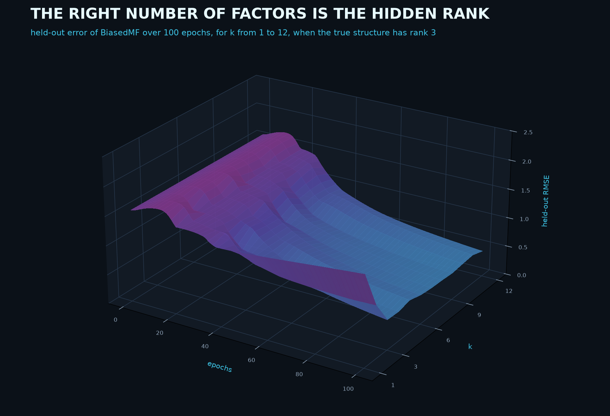
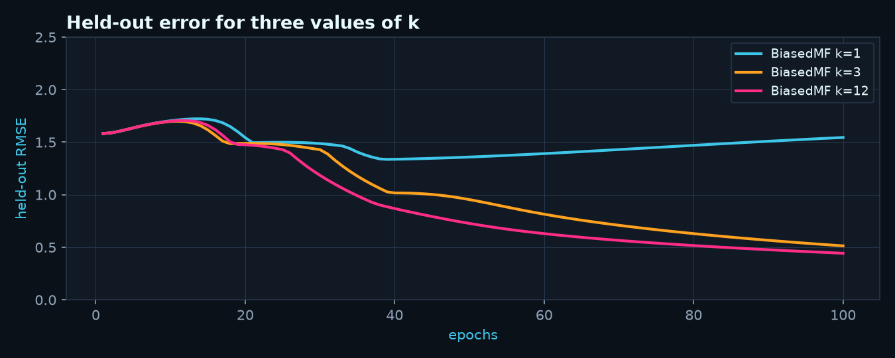

# Biased matrix factorization: biases and a short vector for each user and item

[← Recommenders](index.md)

The same bank, with a better guess. Each desk and each algorithm gets a short vector of numbers (its hidden traits), and the score of a pair is the average plus the two biases plus the match of the two vectors. A desk that likes illiquid names and an algorithm that is good on illiquid names get a high score, whatever each is worth alone. A robot that learns which gain suits which task does the same.



## 1. A first example: the same 120 scores that the baseline missed

The same bank and the same split as on the first page, with `k = 3` factors, which is the true rank of the hidden structure.

```python
import numpy as np
from dense_armor.core.online.reco import BiasedMF

rng = np.random.default_rng(0)
P = rng.normal(size=(20, 3))
Q = rng.normal(size=(15, 3))
R = 3.5 + P @ Q.T + rng.normal(0, 0.1, size=(20, 15))
pairs = [(u, i) for u in range(20) for i in range(15)]
rng.shuffle(pairs)
cut = int(0.6 * len(pairs))
train, test = pairs[:cut], pairs[cut:]
model = BiasedMF(k=3, lr=0.02, l2=0.001, seed=0)
for _ in range(100):
    for u, i in train:
        model.learn_one(u, i, float(R[u, i]))
err = [(model.predict_one(u, i) - R[u, i]) ** 2 for u, i in test]
print(round(float(np.sqrt(np.mean(err))), 3))
```

```
0.353
```

The error falls far under the spread of the scores: with the traits the model predicts the pairs it has never seen. After each rating the model updates the average, the two biases and the two vectors by one step of gradient descent, with the old vector of the desk used for the algorithm's step.



Over 5 hidden worlds, the median held-out RMSE reads 1.583, 1.697, 0.954 and 0.514 after 1, 10, 50 and 100 passes for `k = 3`, 1.583, 1.704, 1.359 and 1.545 for `k = 1`, and 1.583, 1.7, 0.727 and 0.443 for `k = 12`. A single factor is not enough and the error stays high; three is the true rank and works; twelve factors learn faster here.

| class or function | what it does |
|---|---|
| `BiasedMF` | predicts mean + user bias + item bias + the dot product of two vectors of `k` factors |

## 2. What it does

The prediction is `y_hat = mu + b_u + b_i + <p_u, q_i>` with `p_u, q_i` in `R^k`. A rating `r` updates `mu` (running mean), the two biases and the two latent vectors one step of SGD with L2 on every parameter. The last two updates use the old `p_u` and `q_i` (the `q_i` update must not see the new `p_u`), which is the standard ordering of SGD on the two vectors of a single rating. This is the "Improved regularized SVD" of Paterek (2007, eq. (2), page 2) written with the notation and the baseline of Koren (2009).

**Source:** Paterek, A. (2007). Improving Regularized SVD. eq. (2), page 2. Koren, Y., Bell, R., Volinsky, C. (2009). Matrix Factorization Techniques for Recommender Systems. Section "Adding biases", page 4, and the SGD update, page 4.

## 3. The parameters

| Parameter | Meaning | Default |
|---|---|---|
| `k` | number of latent factors, strictly positive | 8 |
| `lr` | learning rate | 0.01 |
| `l2` | L2 strength on every parameter | 0.05 |
| `seed` | seed of the initialiser | 0 |
| `init_scale` | standard deviation of the latent vectors | 0.01 |

`BiasedMF` raises `ValueError` if `k < 1`, `lr <= 0` or `l2 < 0`. `budget_s` is 0.01 s and `memory_class` is `O((n_users + n_items) * k)`. `fit` raises `TypeError` and says to use `learn_one(user, item, rating)`. `mutate` and `set_params` change `lr` and `l2` after the check of the constructor: a value that does not pass raises `ValueError` and changes nothing. Before pull request 483, `fit` failed with "learn_one() missing 1 required positional argument", `mutate` changed nothing and `set_params` accepted any value.

## 4. The same on the paper's toy example

### Biased matrix factorization, on the toy example

The `BiasedMF` adds a latent factor vector per user and per item on top of the biases:

    y_hat(u, i) = mu + b_u + b_i + <p_u, q_i>

A rating updates `mu` (running mean), `b_u`, `b_i`, `p_u` and `q_i` one step of SGD.

```python
import numpy as np
from dense_armor.core.online.reco import BiasedMF

rng = np.random.default_rng(0)
P = rng.normal(size=(10, 3))
Q = rng.normal(size=(8, 3))
mu = 3.5
m = BiasedMF(k=3, lr=0.02, l2=0.001, seed=0)
for _ in range(60):
    for u in range(10):
        for i in range(8):
            r = mu + float(P[u] @ Q[i]) + float(rng.normal(0, 0.01))
            _ = m.learn_one(u, i, r)
round(m.predict_one(0, 0), 2)
```

```
3.79
```

This is the "Improved regularized SVD" of Paterek (2007, eq. (2), page 2), with the SGD and
the bias update of Koren (2009, page 4).

## 5. The same on a robot

A robot controller has the same problem with its tasks and its gains: each task has a hidden preference for a gain, and the score is how well the run tracks. The code is the same, with 12 tasks and 10 gains.

```python
import numpy as np
from dense_armor.core.online.reco import BiasedMF

rng = np.random.default_rng(1)
P = rng.normal(size=(12, 3))
Q = rng.normal(size=(10, 3))
R = 3.5 + P @ Q.T + rng.normal(0, 0.1, size=(12, 10))
pairs = [(u, i) for u in range(12) for i in range(10)]
rng.shuffle(pairs)
cut = int(0.6 * len(pairs))
train, test = pairs[:cut], pairs[cut:]
model = BiasedMF(k=3, lr=0.02, l2=0.001, seed=0)
for _ in range(100):
    for u, i in train:
        model.learn_one(u, i, float(R[u, i]))
err = [(model.predict_one(u, i) - R[u, i]) ** 2 for u, i in test]
print(round(float(np.sqrt(np.mean(err))), 3))
```

```
1.336
```

The factors find part of the match between a task and a gain: the error is lower than the 1.617 of the baseline on the same data. With only 72 ratings of 120 pairs and 100 passes it does not go as low as in the bank.

## API reference

::: dense_armor.core.online.reco.reco.BiasedMF

---

## Details

### Choices

- **The figures** are drawn by `docs/assets/reco/make_reco_style_figures.py` with `lr` 0.02 and `l2` 0.001, median over 5 seeds.
- **The recovery of a planted matrix** (the figure that was on the old page) is on the index, in the section of the numbers.
