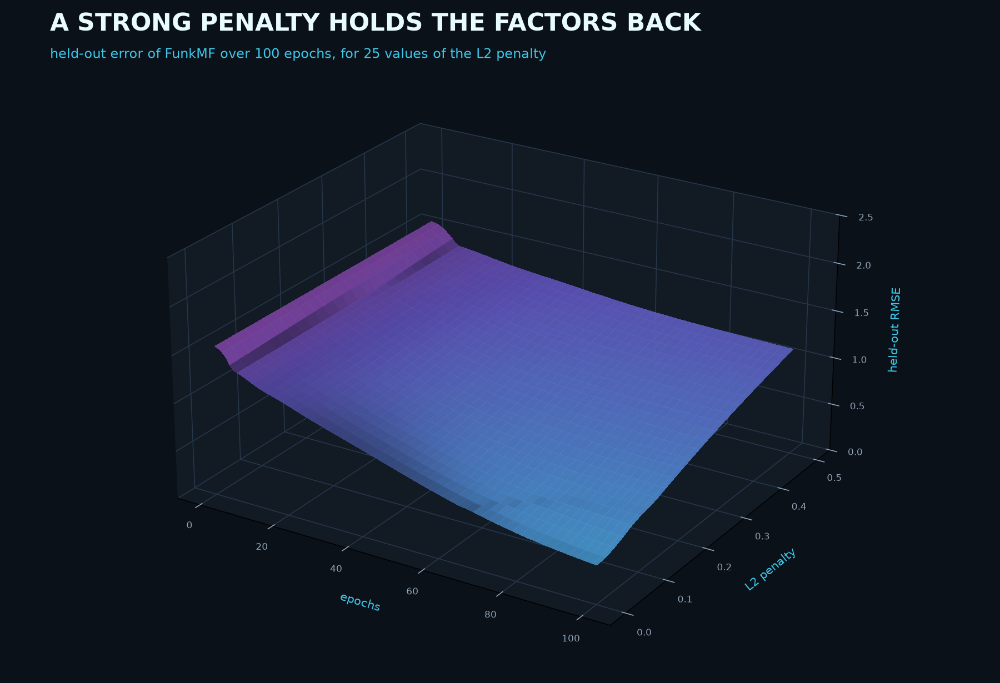
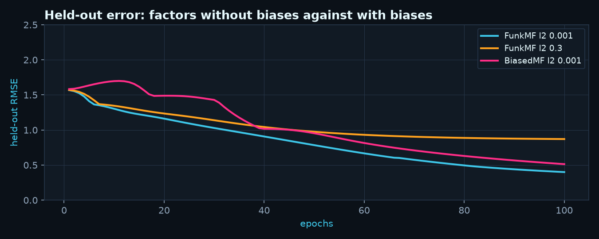

# Plain matrix factorization: only the vectors, no biases

[← Recommenders](index.md)

The same bank, with a model that forgets about the character of the desks and the fame of the algorithms. It keeps only the short vector of each desk and of each algorithm, and the score is the average plus the match of the two vectors. A robot that has no reason to think that a task is easy or a gain is popular can use it too.



## 1. A first example: the hidden traits, without the biases

The same bank and split as on the first pages. The L2 penalty is 0.3 and the vectors start at a standard deviation of 0.3, a choice of the example.

```python
import numpy as np
from dense_armor.core.online.reco import FunkMF

rng = np.random.default_rng(0)
P = rng.normal(size=(20, 3))
Q = rng.normal(size=(15, 3))
R = 3.5 + P @ Q.T + rng.normal(0, 0.1, size=(20, 15))
pairs = [(u, i) for u in range(20) for i in range(15)]
rng.shuffle(pairs)
cut = int(0.6 * len(pairs))
train, test = pairs[:cut], pairs[cut:]
model = FunkMF(k=3, lr=0.02, l2=0.3, init_scale=0.3, seed=0)
for _ in range(100):
    for u, i in train:
        model.learn_one(u, i, float(R[u, i]))
err = [(model.predict_one(u, i) - R[u, i]) ** 2 for u, i in test]
print(round(float(np.sqrt(np.mean(err))), 3))
```

```
1.159
```

The model predicts the unseen pairs far better than the baseline, and the figure compares it with the biased version. On this seed and these settings, the error after 100 passes is higher than the 0.514 that the biased model reaches in the median over 5 hidden worlds.



Over 5 hidden worlds, the median held-out RMSE reads 1.569, 1.303, 0.785 and 0.4 after 1, 10, 50 and 100 passes with an L2 penalty of 0, 1.57, 1.317, 0.784 and 0.567 with 0.104, and 1.572, 1.367, 1.196 and 1.122 with 0.5. On this clean data a larger penalty only holds the vectors back, and the best value of the figure is 0.

| class or function | what it does |
|---|---|
| `FunkMF` | predicts mean + the dot product of two vectors of `k` factors |

## 2. What it does

The model keeps the same factor model without the biases: `y_hat(u, i) = mu + <p_u, q_i>`. This is eq. (1) of Paterek (2007), page 2, with the mean added so that the prediction is on the same scale as the ratings (Paterek's formula has no mean and no bias; the mean is a choice of the library, documented in the class docstring).

**Source:** Paterek, A. (2007). Improving Regularized SVD. eq. (1), page 2.

## 3. The parameters

| Parameter | Meaning | Default |
|---|---|---|
| `k` | number of latent factors, strictly positive | 8 |
| `lr` | learning rate | 0.01 |
| `l2` | L2 strength on the latent vectors | 0.05 |
| `seed` | seed of the initialiser | 0 |
| `init_scale` | standard deviation of the latent vectors | 0.01 |

`FunkMF` raises `ValueError` if `k < 1`, `lr <= 0` or `l2 < 0`. `budget_s` is 0.002 s and `memory_class` is `O((n_users + n_items) * k)`. `fit` raises `TypeError` and says to use `learn_one(user, item, rating)`. `mutate` and `set_params` change `lr` and `l2` after the check of the constructor: a value that does not pass raises `ValueError` and changes nothing. Before pull request 483, `fit` failed with "learn_one() missing 1 required positional argument", `mutate` changed nothing and `set_params` accepted any value.

## 4. The same on the paper's toy example

### Plain matrix factorization, on the toy example

`FunkMF` keeps the same factor model without the biases:

    y_hat(u, i) = mu + <p_u, q_i>

```python
import numpy as np
from dense_armor.core.online.reco import FunkMF

rng = np.random.default_rng(0)
P = rng.normal(size=(10, 3))
Q = rng.normal(size=(8, 3))
mu = 3.5
m = FunkMF(k=3, lr=0.02, l2=0.001, seed=0)
for _ in range(60):
    for u in range(10):
        for i in range(8):
            r = mu + float(P[u] @ Q[i]) + float(rng.normal(0, 0.01))
            _ = m.learn_one(u, i, r)
round(m.predict_one(0, 0), 2)
```

```
3.03
```

This is eq. (1) of Paterek (2007), page 2, with the mean added so the prediction is on the
same scale as the ratings (Paterek's formula has no mean and no bias; the mean is my choice,
documented in the class docstring).

## 5. The same on a robot

A robot controller has the same problem with its tasks and its gains: each task has a hidden preference for a gain, and the score is how well the run tracks. The code is the same, with 12 tasks and 10 gains.

```python
import numpy as np
from dense_armor.core.online.reco import FunkMF

rng = np.random.default_rng(1)
P = rng.normal(size=(12, 3))
Q = rng.normal(size=(10, 3))
R = 3.5 + P @ Q.T + rng.normal(0, 0.1, size=(12, 10))
pairs = [(u, i) for u in range(12) for i in range(10)]
rng.shuffle(pairs)
cut = int(0.6 * len(pairs))
train, test = pairs[:cut], pairs[cut:]
model = FunkMF(k=3, lr=0.02, l2=0.3, init_scale=0.3, seed=0)
for _ in range(100):
    for u, i in train:
        model.learn_one(u, i, float(R[u, i]))
err = [(model.predict_one(u, i) - R[u, i]) ** 2 for u, i in test]
print(round(float(np.sqrt(np.mean(err))), 3))
```

```
0.739
```

Again the vectors learn the match, with the settings of the first example.

## API reference

::: dense_armor.core.online.reco.reco.FunkMF

---

## Details

### Choices

- **The figures** are drawn by `docs/assets/reco/make_reco_style_figures.py` with `lr` 0.02, `init_scale` 0.3 and `k = 3`, median over 5 seeds.
- **A single run can differ from the median:** on seed 0 with the penalty 0.001 and 200 passes, the held-out RMSE of this model rises from 1.558 at 10 passes to 2.351 at 200, while the biased model on the same split falls to 0.24. The median over 5 worlds at 100 passes does not show it. This page does not state the cause.
