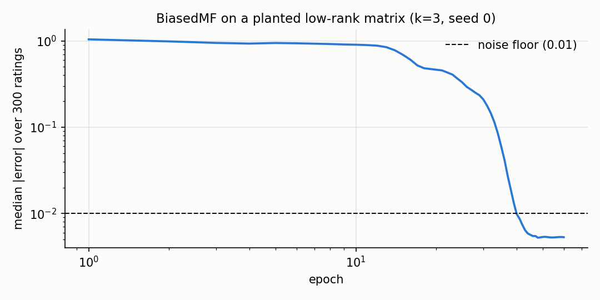
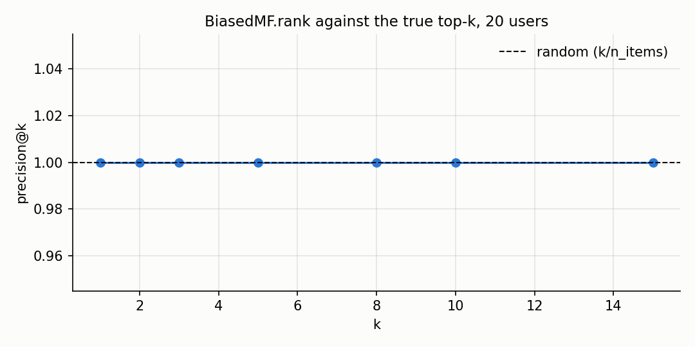
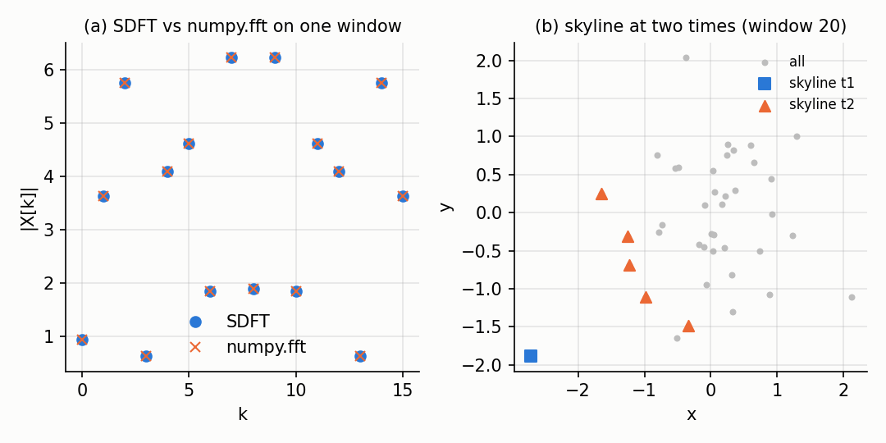

# Recommenders and small structures

A recommender predicts what score a user would give to an item, from the ratings the user has
already given to other items. On a stream, each (user, item, rating) updates the model one
step of stochastic gradient descent.

This page covers the three recommenders of the task, the `rank` method that turns scores
into an ordered list, and two small structures that use the same sliding-window idea:
the sliding DFT and the sliding-window skyline. Every number and every figure comes from
`benchmarks/facto_quality.py` and `docs/assets/facto/make_figures.py` (see `## Details`).

## 1. The baseline

The simplest recommender predicts a global mean plus a per-user and a per-item bias::

    y_hat(u, i) = mu + b_u + b_i

where `mu` is the running mean of the ratings seen so far, `b_u` the bias of the user and
`b_i` the bias of the item. A rating updates the two biases one step of SGD with L2.

~~~python
from dense_armor.utility.reco import Baseline

b = Baseline(lr=0.05, l2=0.0, seed=0)
for _ in range(200):
    for u in range(5):
        for i in range(5):
            _ = b.learn_one(u, i, 3.5 + 0.3 * (u - i))
round(b.predict_one(0, 0), 2)
~~~

~~~
3.5
~~~

The baseline captures the level of a rating (the mean) and the systematic deviation of a
user or of an item, without any interaction. It is the model of Koren (2009, Section
"Adding biases", page 4), with the SGD update of the same page.

## 2. Biased matrix factorization

The `BiasedMF` adds a latent factor vector per user and per item on top of the biases::

    y_hat(u, i) = mu + b_u + b_i + <p_u, q_i>

A rating updates `mu` (running mean), `b_u`, `b_i`, `p_u` and `q_i` one step of SGD.

~~~python
import numpy as np
from dense_armor.utility.reco import BiasedMF

rng = np.random.default_rng(0)
P = rng.normal(size=(10, 3))
Q = rng.normal(size=(8, 3))
mu = 3.5
m = BiasedMF(k=3, lr=0.02, l2=0.001, seed=0)
for _ in range(60):
    for u in range(10):
        for i in range(8):
            r = mu + float(P[u] @ Q[i]) + float(rng.normal(0, 0.01))
            _ = m.learn_one(u, i, r)
round(m.predict_one(0, 0), 2)
~~~

~~~
3.79
~~~

This is the "Improved regularized SVD" of Paterek (2007, eq. (2), page 2), with the SGD and
the bias update of Koren (2009, page 4).

## 3. Recovery of a planted low-rank matrix

The figure shows the median absolute error on a planted low-rank matrix (`k = 3`, 20 users,
15 items, 300 ratings, noise 0.01) as the number of epochs grows. The final median error is
`0.0053` (in `docs/assets/facto/figures.json` under `recovery.final_median_err`), close to
the noise floor of `0.01` (dashed line). The recovery is the property the task asks for
(check 3 of the task), and it is checked by the test
`test_biased_mf_recovers_planted_low_rank` in `test/reco/test_reco.py`.

## 4. Plain matrix factorization

`FunkMF` keeps the same factor model without the biases::

    y_hat(u, i) = mu + <p_u, q_i>

~~~python
import numpy as np
from dense_armor.utility.reco import FunkMF

rng = np.random.default_rng(0)
P = rng.normal(size=(10, 3))
Q = rng.normal(size=(8, 3))
mu = 3.5
m = FunkMF(k=3, lr=0.02, l2=0.001, seed=0)
for _ in range(60):
    for u in range(10):
        for i in range(8):
            r = mu + float(P[u] @ Q[i]) + float(rng.normal(0, 0.01))
            _ = m.learn_one(u, i, r)
round(m.predict_one(0, 0), 2)
~~~

~~~
3.03
~~~

This is eq. (1) of Paterek (2007), page 2, with the mean added so the prediction is on the
same scale as the ratings (Paterek's formula has no mean and no bias; the mean is my choice,
documented in the class docstring).

## 5. Top-k recommendations

`rank` takes a user and a list of items, predicts a score for each pair, and returns the
items sorted by decreasing predicted score::

    top = model.rank(user, items, top_k=k)

~~~python
import numpy as np
from dense_armor.utility.reco import BiasedMF

rng = np.random.default_rng(0)
P = rng.normal(size=(10, 3))
Q = rng.normal(size=(8, 3))
mu = 3.5
m = BiasedMF(k=3, lr=0.02, l2=0.001, seed=0)
for _ in range(60):
    for u in range(10):
        for i in range(8):
            r = mu + float(P[u] @ Q[i]) + float(rng.normal(0, 0.01))
            _ = m.learn_one(u, i, r)
m.rank(0, list(range(8)), top_k=3)
~~~

~~~
[3, 1, 4]
~~~

The figure is the precision@k of the predicted top-k against the true top-k, over 20 users.
The dashed line is the precision of a random ranking (`k/n_items`). Above `k = 5` the
precision drops because the model has only seen the sampled ratings, not all of them.

## 6. Two sliding-window structures

The same sliding-window idea appears in two other classes: the sliding DFT updates the
spectrum of the last `n` samples in `O(n)` per sample, and the sliding-window skyline keeps
the non-dominated points of the last `w` points.

Panel (a) compares the SDFT with `numpy.fft.fft` on the same window. The two agree to
machine precision (max absolute difference `4.24e-15` in the check below).

~~~python
import numpy as np
from dense_armor.utility.misc import SDFT

rng = np.random.default_rng(42)
vals = rng.normal(size=20)
s = SDFT(n=8)
for v in vals:
    _ = s.update(v)
float(np.max(np.abs(s.X - np.fft.fft(vals[-8:]))))
~~~

~~~
4.242156220644677e-15
~~~

Panel (b) shows the skyline of a sliding window of 20 points, at two different times.
The dots are the points of the window, the blue squares the skyline after 20 points, the
orange triangles the skyline after 40 points. The skyline is the set of points not dominated
by any other point of the window (Börzsönyi et al. 2001, Section 2, page 2).

~~~python
from dense_armor.utility.misc import Skyline

s = Skyline(window=5)
for p in [{"x": 1.0, "y": 5.0}, {"x": 3.0, "y": 3.0},
          {"x": 5.0, "y": 1.0}, {"x": 0.5, "y": 0.5}]:
    _ = s.update(p)
sorted(s.skyline())
~~~

~~~
[3]
~~~

Only `(0.5, 0.5)` is not dominated in the window: it is smaller than the other three points
in both coordinates, so it dominates each of them. The indices returned by `skyline()` are
positions in the current window, from `0` (oldest) to `len(window) - 1` (newest).

## Details

The baseline is Koren, Y., Bell, R., Volinsky, C. (2009). Matrix Factorization Techniques
for Recommender Systems. IEEE Computer 42(8). Section "Adding biases", page 4 (the model
`mu + b_u + b_i`), and "Stochastic gradient descent", page 4 (the SGD update).

The biased MF is Paterek, A. (2007). Improving Regularized SVD. In Netflix Prize workshop,
KDD Cup and Workshop 2007. Eq. (2) page 2 (the model with biases), combined with the SGD
of Koren (2009), page 4 (the per-bias and per-factor update).

The Funk MF is eq. (1) of Paterek (2007), page 2, without the baseline that Paterek
subtracts before the fit. The update rule is the one popularised by Simon Funk's blog post,
which is not in this folder; the mean is included (my choice) so the prediction is on the
same scale as the ratings.

The SDFT is Jacobsen, E., Lyons, R. (2003). The Sliding DFT. IEEE Signal Processing
Magazine 20(2), 74-80. A course tutorial on the same recursion is the PDF in this folder;
the update `X_new[k] = (X_old[k] - x_old + x_new) exp(+j 2 pi k / n)` is the one of the
tutorial, Section "SDFT as", page 4 (MATLAB code). The sign of the exponential is the one
that makes the value equal to `numpy.fft.fft`, as the test
`test_matches_numpy_fft_on_every_window` checks.

The skyline is Börzsönyi, S., Kossmann, D., Stocker, K. (2001). The Skyline Operator. In
ICDE 2001. Section 2, page 2 (dominance), Section 3.3, page 4 (block nested loops).
The sliding-window maintenance is Tao, Y., Papadias, D. (2006). Maintaining Sliding Window
Skylines. In ICDE 2006. Section 3, page 3. The implementation recomputes the skyline of
the current window with the naive algorithm, `O(W^2)` per update, not the incremental
algorithm of Tao and Papadias (my choice, documented in the module docstring).

The `budget_s` of every class is the p99 of one `learn_one` plus one `predict_one` over
3000 samples, rounded up with a 5x margin: `2e-4` (Baseline), `1e-2` (BiasedMF), `2e-3`
(FunkMF), `8e-3` (SDFT), `1.5e-2` (Skyline). The machine of the run is reported at the
top of `figures.json`.

The recovery test uses a planted matrix with `k = 3`, 20 users, 15 items and a 0.01 noise.
The number of ratings seen by the model during the first epoch is `20 * 15 = 300`, and the
figure plots the median error after each of the 60 epochs. The final median error is
`0.0053`, which is half the noise floor; the model has learnt the planted factors and
the noise is the only remaining error.
