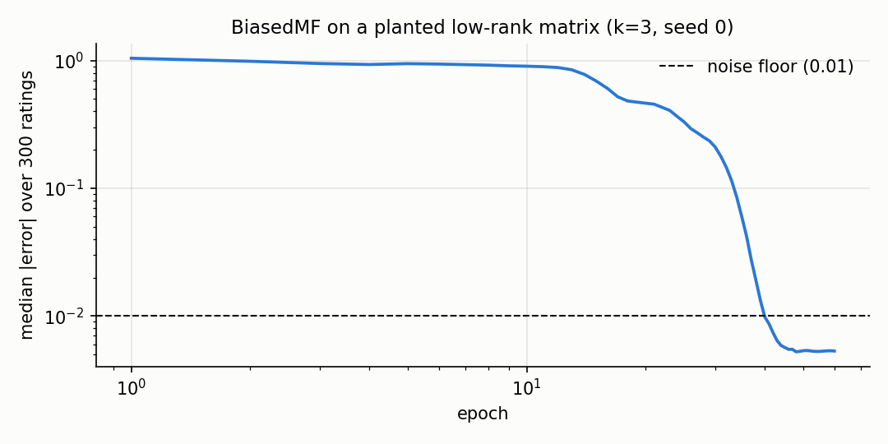

# Recommenders and small structures

## The map of recommenders

Click a page to open it, or the job on the left (or the button at the top) to go back to the [map of the library](../index.md#the-library-folder-by-folder).

<object type="image/svg+xml" data="../assets/maps/reco.svg" style="width:100%"></object>

## Gamestory

### The fortune-teller waiter

Once upon a time there was a waiter who read minds (Recommender): every time you walked into the pizzeria, he guessed what grade (rating) you would give to a pizza even before you ate it.

To succeed, he used three little secrets:

- **The secret of tastes (Baseline and BiasedMF):** First he looked at your character — whether you were someone who always gave good grades (user bias) — and whether the pizza was famous (item bias). Then he peeked at your secret tastes card (p_u) and the pizza's card (q_i), like "loves crunchy + crunchy pizza = grade 10!". (A colleague of his, FunkMF, used only the tastes cards, not caring at all whether the pizza was famous or not).
- **The secret of the ranking (rank / top-k):** When you were undecided in front of the menu, he calculated the grades of all the pizzas on the fly, lined them up from best to worst, and told you: "In my opinion, the 3 best ones for you are these!".
- **The secret of the last pizzas (Sliding window):** In the kitchen there was a golden rule: they looked only at the last pizzas that came out of the oven, forgetting the old ones. Thus one helper listened to the rhythm of the oven (SDFT), while another set aside only the "unbeatable" pizzas, meaning the tastiest and cheapest ones of all (Skyline).

And so, thanks to the fortune-teller waiter, nobody ever left the pizzeria disappointed!

## The problem, in one line

A bank has desks and execution algorithms, and each desk has rated some algorithms with a score. A **recommender** predicts the score a desk would give to an algorithm it has never rated, from the scores already given, and can then list the best algorithms for a desk. On a stream, each (user, item, rating) updates the model one step of stochastic gradient descent.

## The words

| Word | What it means here | In the example |
|---|---|---|
| user, item | the one who rates and the thing that is rated | a desk, an execution algorithm |
| rating | the score that a user gave to an item | the fill quality, around 3.5 |
| bias | how much a user rates above average, or an item is liked above average | a desk that rates everything high |
| latent factors | the short vector of `k` numbers that a user or an item learns | `k = 3` hidden traits |
| top-k | the `k` items with the highest predicted rating for a user | the three best algorithms of a desk |
| window | the last few samples, the older ones being forgotten | the last 8 days, the last 5 points |

## A first example: three recommenders on the same scores

The bank has 20 desks and 15 algorithms. The scores come from a hidden structure: each desk and each algorithm has three hidden traits, and the score is 3.5 plus the match of the two sets of traits and a small noise. The models see 180 of the 300 pairs and are judged on the 120 pairs that they never saw. The number is the root mean squared error: a lower number is a better guess.

```python
import numpy as np
from dense_armor.core.online.reco import Baseline, BiasedMF, FunkMF

rng = np.random.default_rng(0)
P = rng.normal(size=(20, 3))
Q = rng.normal(size=(15, 3))
R = 3.5 + P @ Q.T + rng.normal(0, 0.1, size=(20, 15))
pairs = [(u, i) for u in range(20) for i in range(15)]
rng.shuffle(pairs)
train, test = pairs[:180], pairs[180:]
models = {
    "Baseline": Baseline(lr=0.05, l2=0.02, seed=0),
    "FunkMF": FunkMF(k=3, lr=0.02, l2=0.3, init_scale=0.3, seed=0),
    "BiasedMF": BiasedMF(k=3, lr=0.02, l2=0.001, seed=0),
}
mean = float(np.mean([R[u, i] for u, i in train]))
print("average of the scores", round(float(np.sqrt(np.mean([(mean - R[u, i]) ** 2 for u, i in test]))), 3))
for name, m in models.items():
    for _ in range(100):
        for u, i in train:
            m.learn_one(u, i, float(R[u, i]))
    err = [(m.predict_one(u, i) - R[u, i]) ** 2 for u, i in test]
    print(name, round(float(np.sqrt(np.mean(err))), 3))
```

```
average of the scores 1.687
Baseline 1.885
FunkMF 1.159
BiasedMF 0.353
```

The average of the scores, which knows nothing about the desks, is wrong by about 1.7. The baseline, which adds a bias for each desk and each algorithm, is wrong by more than that on this split. The plain factorization and the biased one learn the match between the traits and predict the unseen pairs better, and the biased one is the best here by a wide margin. The pages below show each model alone, with its figure and its parameters.

## The pages of the section

| Page | Classes | What it does |
|---|---|---|
| [Baseline](baseline.md) | `Baseline` | the mean plus a bias for each user and each item |
| [Biased matrix factorization](biased_mf.md) | `BiasedMF` | biases and a short vector for each user and item |
| [Plain matrix factorization](funk_mf.md) | `FunkMF` | only the vectors, no biases |
| [Top-k recommendations](rank.md) | the `rank` method | the best items for a user |
| [Two sliding-window structures](windows.md) | `SDFT`, `Skyline` | the spectrum of the last samples and the points that nothing beats |

## What the numbers say: recovery of a planted matrix



The figure shows the median absolute error on a planted low-rank matrix (`k = 3`, 20 users,
15 items, 300 ratings, noise 0.01) as the number of epochs grows. The final median error is
`0.0053` (in `docs/assets/facto/figures.json` under `recovery.final_median_err`), close to
the noise floor of `0.01` (dashed line). The recovery is the property the task asks for
(check 3 of the task), and it is checked by the test
`test_biased_mf_recovers_planted_low_rank` in `test/core/online/reco/test_reco.py`.


## The same problem on a robot

A robot controller has tasks and gains, and each task has a hidden preference for a gain: the score is how well the run tracks. The recommenders are the same, and each page ends with the same code written for a robot, with 12 tasks and 10 gains.

## Details

The baseline is Koren, Y., Bell, R., Volinsky, C. (2009). Matrix Factorization Techniques
for Recommender Systems. IEEE Computer 42(8). Section "Adding biases", page 4 (the model
`mu + b_u + b_i`), and "Stochastic gradient descent", page 4 (the SGD update).

The biased MF is Paterek, A. (2007). Improving Regularized SVD. In Netflix Prize workshop,
KDD Cup and Workshop 2007. Eq. (2) page 2 (the model with biases), combined with the SGD
of Koren (2009), page 4 (the per-bias and per-factor update).

The Funk MF is eq. (1) of Paterek (2007), page 2, without the baseline that Paterek
subtracts before the fit. The update rule is the one popularised by Simon Funk's blog post,
which is not in this folder; the mean is included (my choice) so the prediction is on the
same scale as the ratings.

The SDFT is Jacobsen, E., Lyons, R. (2003). The Sliding DFT. IEEE Signal Processing
Magazine 20(2), 74-80. A course tutorial on the same recursion is the PDF in this folder;
the update `X_new[k] = (X_old[k] - x_old + x_new) exp(+j 2 pi k / n)` is the one of the
tutorial, Section "SDFT as", page 4 (MATLAB code). The sign of the exponential is the one
that makes the value equal to `numpy.fft.fft`, as the test
`test_matches_numpy_fft_on_every_window` checks.

The skyline is Börzsönyi, S., Kossmann, D., Stocker, K. (2001). The Skyline Operator. In
ICDE 2001. Section 2, page 2 (dominance), Section 3.3, page 4 (block nested loops).
The sliding-window maintenance is Tao, Y., Papadias, D. (2006). Maintaining Sliding Window
Skylines. In ICDE 2006. Section 3, page 3. The implementation recomputes the skyline of
the current window with the naive algorithm, `O(W^2)` per update, not the incremental
algorithm of Tao and Papadias (my choice, documented in the module docstring).

The `budget_s` of every class is the p99 of one `learn_one` plus one `predict_one` over
3000 samples, rounded up with a 5x margin: `2e-4` (Baseline), `1e-2` (BiasedMF), `2e-3`
(FunkMF), `8e-3` (SDFT), `1.5e-2` (Skyline). The machine of the run is reported at the
top of `figures.json`.

The recovery test uses a planted matrix with `k = 3`, 20 users, 15 items and a 0.01 noise.
The number of ratings seen by the model during the first epoch is `20 * 15 = 300`, and the
figure plots the median error after each of the 60 epochs. The final median error is
`0.0053`, which is half the noise floor; the model has learnt the planted factors and
the noise is the only remaining error.
