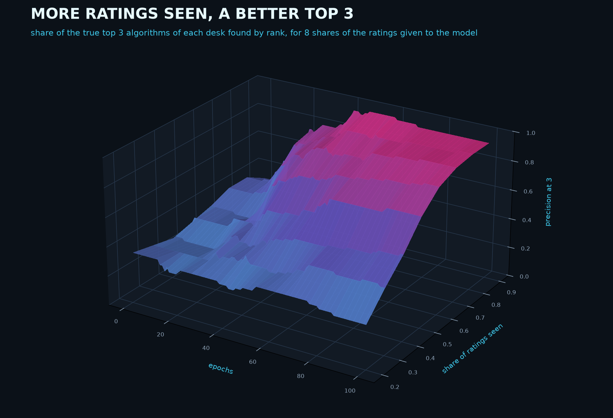
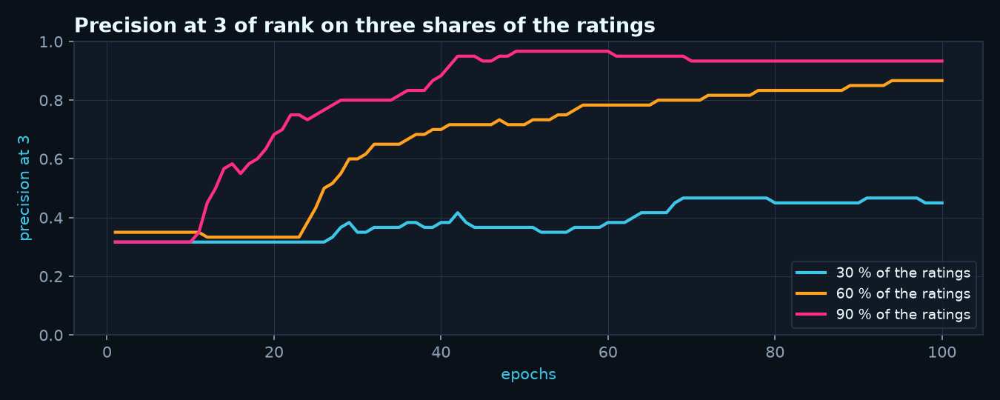
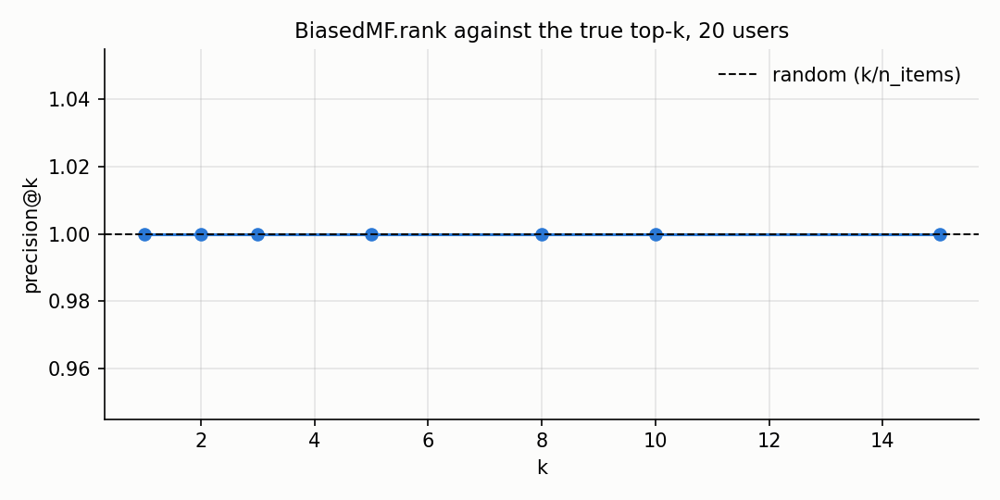

# Top-k recommendations: the best items for a user

[← Recommenders](index.md)

A desk does not want 15 scores, it wants the three best execution algorithms. Once a model can predict the score of any pair, `rank` computes the score of every algorithm for the desk, sorts them from best to worst and keeps the first three. A robot that must choose the three most promising gains for a task does the same.



## 1. A first example: the three best algorithms of a desk

The same bank and the same biased model as on the second page. For the desk 0, the true best three are the algorithms with the highest hidden score; `rank` gives the three that the model predicts.

```python
import numpy as np
from dense_armor.core.online.reco import BiasedMF

rng = np.random.default_rng(0)
P = rng.normal(size=(20, 3))
Q = rng.normal(size=(15, 3))
R = 3.5 + P @ Q.T + rng.normal(0, 0.1, size=(20, 15))
pairs = [(u, i) for u in range(20) for i in range(15)]
rng.shuffle(pairs)
cut = int(0.6 * len(pairs))
train, test = pairs[:cut], pairs[cut:]
model = BiasedMF(k=3, lr=0.02, l2=0.001, seed=0)
for _ in range(100):
    for u, i in train:
        model.learn_one(u, i, float(R[u, i]))
true = [int(i) for i in np.argsort(-R[0])[:3]]
print(true, model.rank(0, list(range(R.shape[1])), top_k=3))
```

```
[9, 4, 0] [4, 9, 0]
```

The first list is the true top 3 of the desk, the second is what `rank` returns, best first: the model finds all three algorithms, with the first two swapped. `model.rank(user, items, top_k=3)` takes a user and a list of items, predicts a score for each pair and returns the items sorted by decreasing predicted score; with `top_k=None` it keeps them all. It is a method of every recommender of the library, so the baseline and the plain factorization have it too.



Over 5 hidden worlds, the median share of the true top 3 that `rank` finds, over all the desks, reads 0.317, 0.317, 0.967 and 0.933 after 1, 10, 50 and 100 passes when the model has seen 90 % of the ratings, 0.35, 0.35, 0.717 and 0.867 with 60 %, and 0.35, 0.35, 0.317 and 0.3 with 20 %. With a fifth of the ratings the model cannot find the best three, and the precision never rises.

| class or function | what it does |
|---|---|
| `BiasedMF.rank` | the items sorted by decreasing predicted rating, the best first |
| `Baseline.rank, FunkMF.rank` | the same method on the other two recommenders |

## 2. What it does

`rank` takes a user and a list of items, predicts a score for each pair, and returns the items sorted by decreasing predicted score, keeping only the first `top_k` if it is given. It does not learn anything.

**Source:** The method has no reference in its docstring: it is a sort of the predictions of the model, and the models are those of Koren et al. (2009) and Paterek (2007) cited on the other pages.

## 3. The parameters

| Parameter | Meaning | Default |
|---|---|---|
| `user` | the user | none |
| `items` | the items to rank | none |
| `top_k` | keep only the first `top_k`; `None` keeps all | none |

`rank` returns the items sorted by decreasing predicted rating. `fit` raises `TypeError` and says to use `learn_one(user, item, rating)`. `mutate` and `set_params` change `lr` and `l2` after the check of the constructor: a value that does not pass raises `ValueError` and changes nothing. Before pull request 483, `fit` failed with "learn_one() missing 1 required positional argument", `mutate` changed nothing and `set_params` accepted any value.

## 4. The same on the paper's toy example

### Top-k recommendations, on the toy example

`rank` takes a user and a list of items, predicts a score for each pair, and returns the
items sorted by decreasing predicted score:

    top = model.rank(user, items, top_k=k)

```python
import numpy as np
from dense_armor.core.online.reco import BiasedMF

rng = np.random.default_rng(0)
P = rng.normal(size=(10, 3))
Q = rng.normal(size=(8, 3))
mu = 3.5
m = BiasedMF(k=3, lr=0.02, l2=0.001, seed=0)
for _ in range(60):
    for u in range(10):
        for i in range(8):
            r = mu + float(P[u] @ Q[i]) + float(rng.normal(0, 0.01))
            _ = m.learn_one(u, i, r)
m.rank(0, list(range(8)), top_k=3)
```

```
[3, 1, 4]
```



The figure is the precision@k of the predicted top-k against the true top-k, over 20 users.
The dashed line is the precision of a random ranking (`k/n_items`). Above `k = 5` the
precision drops because the model has only seen the sampled ratings, not all of them.

## 5. The same on a robot

A robot controller has the same problem with its tasks and its gains: each task has a hidden preference for a gain, and the score is how well the run tracks. The code is the same, with 12 tasks and 10 gains.

```python
import numpy as np
from dense_armor.core.online.reco import BiasedMF

rng = np.random.default_rng(1)
P = rng.normal(size=(12, 3))
Q = rng.normal(size=(10, 3))
R = 3.5 + P @ Q.T + rng.normal(0, 0.1, size=(12, 10))
pairs = [(u, i) for u in range(12) for i in range(10)]
rng.shuffle(pairs)
cut = int(0.6 * len(pairs))
train, test = pairs[:cut], pairs[cut:]
model = BiasedMF(k=3, lr=0.02, l2=0.001, seed=0)
for _ in range(100):
    for u, i in train:
        model.learn_one(u, i, float(R[u, i]))
true = [int(i) for i in np.argsort(-R[0])[:3]]
print(true, model.rank(0, list(range(R.shape[1])), top_k=3))
```

```
[4, 5, 8] [4, 5, 3]
```

The first list is the true top 3 gains of the task 0 and the second is what `rank` returns: two of the three are found.

## API reference

::: dense_armor.core.online.reco.reco.BiasedMF.rank

---

## Details

### Choices

- **The figures** are drawn by `docs/assets/reco/make_reco_style_figures.py`: the share of the true top 3 of each desk that `rank` finds, median over 5 seeds, `BiasedMF` with `k = 3`, `lr` 0.02 and `l2` 0.001.
