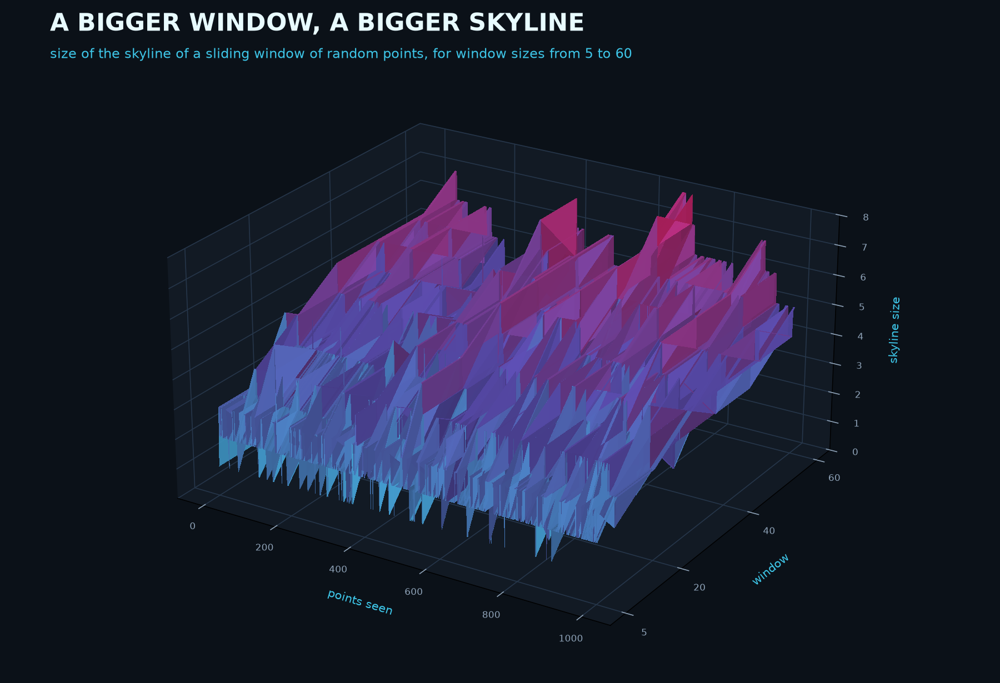
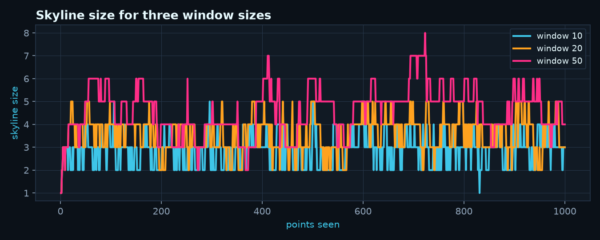
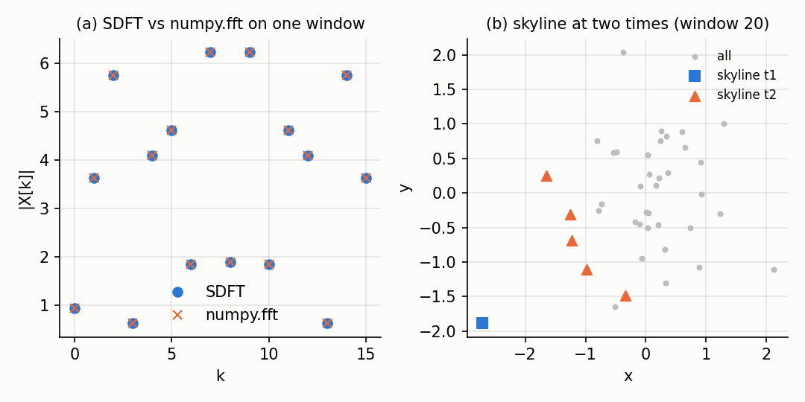

# Two sliding-window structures: the spectrum and the skyline

[← Recommenders](index.md)

Two other classes that live on this page look at the last few points only and forget the old ones: the sliding DFT tells the rhythm of the last few samples, and the skyline keeps the points that nothing else beats. A desk can use the first on a series of volumes and the second on the cost and the risk of its algorithms. A robot can use them on a joint signal and on the cost and the error of its gains.



## 1. A first example: the rhythm of the volume and the algorithms nobody beats

The first block feeds a series of daily volumes with a rhythm of four days to the sliding DFT of the last eight days and finds the strongest frequency. The second block keeps the last five (cost, risk) pairs of five algorithms and prints the positions of the ones that no other beats on both.

```python
import numpy as np
from dense_armor.core.signals.stats.sdft import SDFT
from dense_armor.core.signals.stats.skyline import Skyline

volume = [10 + 3 * np.sin(2 * np.pi * t / 4) for t in range(20)]
s = SDFT(n=8)
for v in volume:
    _ = s.update(v)
print(int(np.argmax(np.abs(s.X[1:5]))) + 1)
algos = Skyline(window=5)
for cost, risk in [(1.0, 5.0), (3.0, 3.0), (5.0, 1.0), (4.0, 4.0), (6.0, 6.0)]:
    _ = algos.update({"cost": cost, "risk": risk})
print(sorted(algos.skyline()))
```

```
2
[0, 1, 2]
```

The first number is the frequency of the strongest component of the last eight days: the volume repeats every four days, which is two cycles in eight days, and the answer is 2. The sliding DFT updates the spectrum of the window in `O(n)` per sample, without recomputing it from scratch. The second line lists the positions, in the current window of five, of the algorithms that are not beaten by another on both cost and risk (smaller is better): the first three, which trade cost against risk, and neither of the last two, which are beaten by the second one.



The surface is the size of the skyline of random points, which grows with the window: the median size after the window is full is 2.25 points for a window of 5, 3.56 for 20 and 4.81 for 60. The skyline stays small even when the window is large, because few points are not beaten by any other.

| class or function | what it does |
|---|---|
| `SDFT` | the spectrum of the last `n` samples, updated in `O(n)` per sample |
| `Skyline` | the non-dominated points of the last `w` points |

## 2. What it does

The sliding DFT updates the spectrum of the last `n` samples in `O(n)` per sample, with the recursion of Jacobsen and Lyons. The sliding-window skyline keeps the points of the last `w` points that no other point dominates; the implementation recomputes the skyline of the window with the naive algorithm, `O(W^2)` per update, which is a choice of the library, not the incremental algorithm of Tao and Papadias.

**Source:** Jacobsen, E., Lyons, R. (2003). The Sliding DFT. IEEE Signal Processing Magazine 20(2), 74-80. Börzsönyi, S., Kossmann, D., Stocker, K. (2001). The Skyline Operator. In ICDE 2001. Section 2, page 2 (dominance), Section 3.3, page 4 (block nested loops). Tao, Y., Papadias, D. (2006). Maintaining Sliding Window Skylines. In ICDE 2006. Section 3, page 3.

## 3. The parameters

| Parameter | Meaning | Default |
|---|---|---|
| `SDFT(n)` | the length of the window, in samples | none |
| `Skyline(window)` | the number of points that the window keeps | none |

`budget_s` is 0.008 s for the `SDFT` and 0.015 s for the `Skyline`. Neither has a `learn_one`: `fit` says so, and the data go in with `update`.

## 4. The same on the paper's toy example

### The two structures, on the toy examples

The same sliding-window idea appears in two other classes: the sliding DFT updates the
spectrum of the last `n` samples in `O(n)` per sample, and the sliding-window skyline keeps
the non-dominated points of the last `w` points.



Panel (a) compares the SDFT with `numpy.fft.fft` on the same window. The two agree to
about 2e-07 (the check below prints the max absolute difference, with one digit). This is the default dtype of the library, float32; with `set_default_dtype("float64")` the same check prints 4e-15.

```python
import numpy as np
from dense_armor.core.signals.stats.sdft import SDFT

rng = np.random.default_rng(42)
vals = rng.normal(size=20)
s = SDFT(n=8)
for v in vals:
    _ = s.update(v)
print(f'{np.max(np.abs(s.X - np.fft.fft(vals[-8:]))):.0e}')
```

```
2e-07
```

Panel (b) shows the skyline of a sliding window of 20 points, at two different times.
The dots are the points of the window, the blue squares the skyline after 20 points, the
orange triangles the skyline after 40 points. The skyline is the set of points not dominated
by any other point of the window (Börzsönyi et al. 2001, Section 2, page 2).

```python
from dense_armor.core.signals.stats.skyline import Skyline

s = Skyline(window=5)
for p in [{"x": 1.0, "y": 5.0}, {"x": 3.0, "y": 3.0},
          {"x": 5.0, "y": 1.0}, {"x": 0.5, "y": 0.5}]:
    _ = s.update(p)
sorted(s.skyline())
```

```
[3]
```

Only `(0.5, 0.5)` is not dominated in the window: it is smaller than the other three points
in both coordinates, so it dominates each of them. The indices returned by `skyline()` are
positions in the current window, from `0` (oldest) to `len(window) - 1` (newest).

## 5. The same on a robot

A robot has a joint signal and several gains. The code is the same, with the names of the robot.

```python
import numpy as np
from dense_armor.core.signals.stats.sdft import SDFT
from dense_armor.core.signals.stats.skyline import Skyline

speed = [0.5 * np.sin(2 * np.pi * t / 8) for t in range(40)]
s = SDFT(n=16)
for v in speed:
    _ = s.update(v)
print(int(np.argmax(np.abs(s.X[1:8]))) + 1)
gains = Skyline(window=5)
for err, energy in [(0.9, 0.2), (0.4, 0.5), (0.1, 0.9), (0.5, 0.6), (0.8, 0.8)]:
    _ = gains.update({"err": err, "energy": energy})
print(sorted(gains.skyline()))
```

```
2
[0, 1, 2]
```

The joint speed repeats every 8 samples, which is two cycles in 16, and the answer is 2; the gains that no other beats on error and energy are the first three.

## API reference

::: dense_armor.core.signals.stats.sdft.SDFT

::: dense_armor.core.signals.stats.skyline.Skyline

---

## Details

### Choices

- **The figures** are drawn by `docs/assets/reco/make_reco_style_figures.py`: random points in the unit square, the size of the skyline at each step, median over 5 seeds. The old figure of the SDFT against `numpy.fft` and of the skyline at two times is kept in the section of the toy examples.
