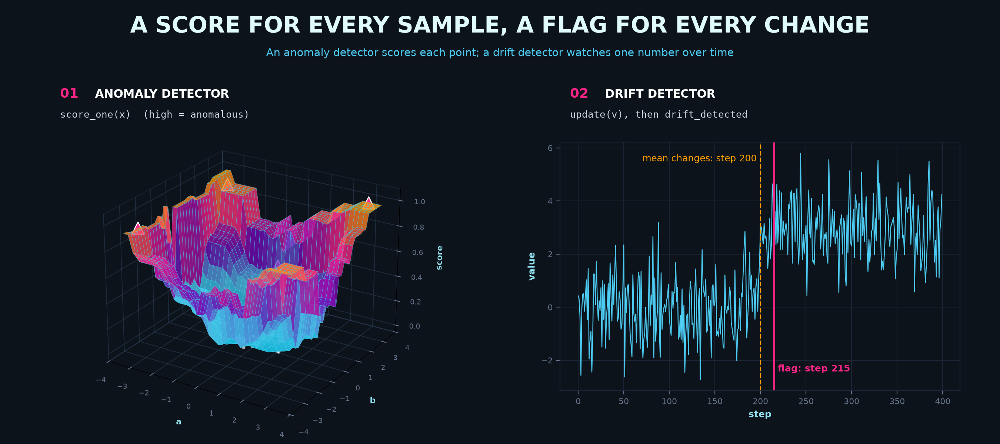

# Anomaly and drift detectors

Two roles watch a stream instead of predicting from it. An anomaly detector says how unusual one sample is. A drift detector says whether a number has started to behave differently. Neither needs labels.



*Left: the score of `HalfSpaceTrees` over the plane, with ordinary points in white and four far points in pink. Right: the mean of a stream moves at step 200 and `PageHinkley` flags it at step 215.*

## 1. A score for every sample

`learn_one(x)` shows a sample to the detector, and `score_one(x)` returns a number. By the contract of the role a high score means anomalous.

```python
import numpy as np
from dense_armor.core.online.anomaly.hst import HalfSpaceTrees

rng = np.random.default_rng(1)
hst = HalfSpaceTrees(seed=0)
for _ in range(300):
    hst.learn_one({"a": float(rng.normal()), "b": float(rng.normal())})
print(round(hst.score_one({"a": 0.0, "b": 0.0}), 4), round(hst.score_one({"a": 6.0, "b": 6.0}), 4))
```

```
0.0311 0.9398
```

The point at the centre of the data scores low and the point far away scores high. A detector whose score goes the other way must set `score_is_inverted = True`, and the tools below refuse it.

## 2. A flag when a number changes

A drift detector reads one number at a time with `update(v)`. `drift_detected` is true only on the step where the change is found, and `warning_detected` is the earlier alert, for the detectors that have one.

```python
import numpy as np
from dense_armor.core.online.drift.page_hinkley import PageHinkley

rng = np.random.default_rng(2)
ph = PageHinkley()
flags = []
for i in range(400):
    ph.update(float(rng.normal(0 if i < 200 else 3, 1)))
    if ph.drift_detected:
        flags.append(i)
print(flags[:3])
```

```
[218, 249, 291]
```

The mean of the stream moves at step 200 and the detector flags it a few steps later. `update_many` feeds a list of numbers.

## 3. From a score to a decision

`AnomalyGate` wraps a detector and adds `classify(score)`, which says whether a score is anomalous. The threshold is the `threshold` argument, or the `threshold` attribute of the detector when the argument is `None`.

```python
from dense_armor.roles import AnomalyGate
from dense_armor.core.online.anomaly.filters import HampelScorer

gate = AnomalyGate(HampelScorer(radius=5, n_sigmas=3.0, feature="v"))
for v in (1.0, 1.1, 0.9, 1.0, 1.05, 0.95, 1.0):
    gate.learn_one({"v": v})
print(gate.classify(gate.score_one({"v": 1.0})), gate.classify(gate.score_one({"v": 9.0})))
```

```
False True
```

A detector that has no `threshold` and no argument is refused with `ValueError`: a default of `0.0` would call anomalous every positive score. With `protect=True` the detector does not learn from the samples that the gate classifies as anomalous.

## 4. Protect a model from the bad samples

`Protected(model, detector, fallback)` asks the detector about each sample first. A flagged sample is not learned, and the answer is the fallback, or the last answer made on a sample that was not flagged.

The detector decides in this order: an `AnomalyGate` flags when its `classify` is true; a drift detector flags when it reports a drift after it has seen the value of `feature`; a detector with `score_one` and a `threshold` attribute flags when the score is above the threshold; a detector with only `score_one` never flags. By default `Protected` only reads the detector, so whoever builds it trains it. With `train_detector=True`, `learn_one` also trains the detector on the samples that are not flagged.

A complete example with a robot stream is in [Streaming](../stream/index.md), and the six anomaly detectors of the library are in [Anomaly detection](../anomaly/index.md).

## Details

- `AnomalyDetector` has `learn_one`, `score_one`, `learn_many`, `score_many`. `DriftDetector` has `update`, `update_many`, `drift_detected`, `warning_detected`.
- The only detector with an inverted score is `ChauvenetScorer`, whose test rejects when the score is small.
- The files are `dense_armor/roles/anomaly_detector.py`, `dense_armor/roles/drift_detector.py` and `dense_armor/roles/protection.py`.
