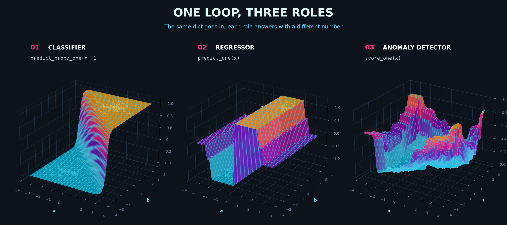
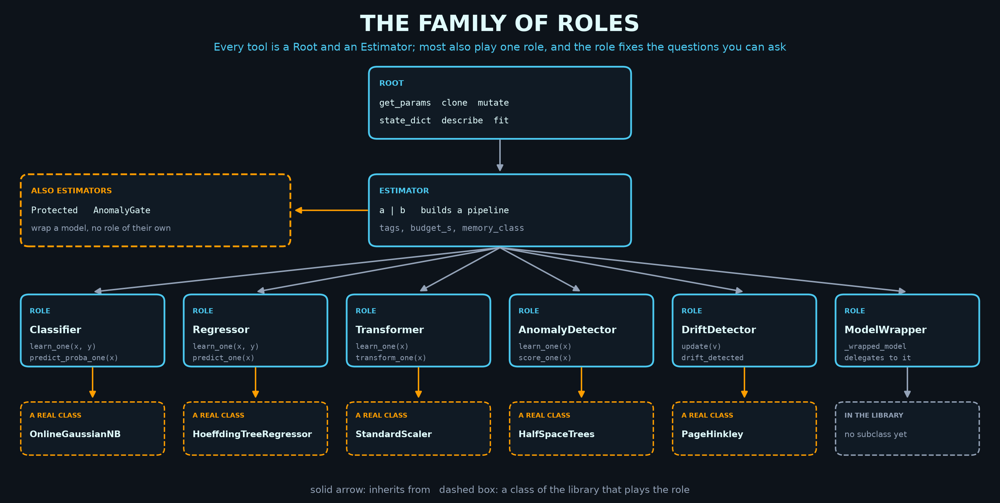

# Roles

A role is the short list of methods that a kind of learning tool must have. A classifier learns from one labelled sample and answers with probabilities; an anomaly detector learns from one sample and answers with a score. Almost every tool of Dense-Armor plays one of these roles, so you can swap a tool for another of the same role without touching the code around it.



*The same stream of points `(a, b)` trains a classifier, a regressor and an anomaly detector. Each surface is the answer of the real model over the plane; the dots are new points. The regressor is a tree, so its surface is made of steps.*

## 1. One loop for every tool

Every role works on a dict that holds one sample, and on one sample at a time. Here a classifier and an anomaly detector read the same stream:

```python
import numpy as np
from dense_armor.core.online.learn.online_classifiers import OnlineGaussianNB
from dense_armor.core.online.anomaly.hst import HalfSpaceTrees

rng = np.random.default_rng(0)
nb, hst = OnlineGaussianNB(), HalfSpaceTrees(seed=0)
for _ in range(300):
    a = float(rng.normal())
    nb.learn_one({"a": a}, int(a > 0))
    hst.learn_one({"a": a})
print(nb.predict_one({"a": 1.0}), round(hst.score_one({"a": 0.0}), 3), round(hst.score_one({"a": 6.0}), 3))
```

```
1 0.212 0.897
```

`learn_one` is the same call for both; what changes is the question you ask afterwards: `predict_one` returns a label, `score_one` returns a number where a high value means anomalous.

## 2. The six roles

| Role | It learns from | It answers with | Page |
|---|---|---|---|
| `Classifier` | `learn_one(x, y)` | `predict_proba_one(x)` and `predict_one(x)` | [Classifiers and regressors](supervised.md) |
| `Regressor` | `learn_one(x, y)` | `predict_one(x, return_std=False)` | [Classifiers and regressors](supervised.md) |
| `Transformer` | `learn_one(x)` | `transform_one(x)`, a new dict | [Transformers](transformers.md) |
| `AnomalyDetector` | `learn_one(x)` | `score_one(x)`, high means anomalous | [Anomaly and drift detectors](detectors.md) |
| `DriftDetector` | `update(v)` | `drift_detected`, `warning_detected` | [Anomaly and drift detectors](detectors.md) |
| `ModelWrapper` | the wrapped model | what the wrapped model answers | [Pipelines and wrappers](pipelines.md) |



*The roles as a family tree. Every role inherits from `Estimator`, which inherits from `Root`. Under each role is a class of the library that plays it; `ModelWrapper` has no subclass in the library yet. `Protected` and `AnomalyGate` are estimators that wrap a model without a role of their own.*

All of them inherit from [`Root`](base.md), which gives every tool the same way to read its parameters, clone itself, save its state and describe itself.

## 3. Where to go next

1. [The base: `Root`](base.md): parameters, `clone`, `mutate`, `state_dict`, the clock, `describe`.
2. [Classifiers and regressors](supervised.md): learn, predict, probabilities and uncertainty.
3. [Transformers](transformers.md): join transformers with `+` and `*`.
4. [Anomaly and drift detectors](detectors.md): a score, a flag, and a gate that turns one into the other.
5. [Pipelines and wrappers](pipelines.md): chain steps with `|`.
6. [Write and check a new estimator](new_estimator.md): the contract and `check_estimator`.

The robot layer (signals, real-time budgets, safety, physical units) is in [Robot layer](../api/robot_roles.md); the optional links to other libraries are in [Bridges](../bridges/index.md).

## Details

- The design follows the parameter, clone and inspect contract of a general-purpose machine-learning library (Buitinck et al., [arXiv:1309.0238](https://arxiv.org/abs/1309.0238)) and the one-sample-at-a-time interface of an online-learning library (Montiel et al., [arXiv:2012.04740](https://arxiv.org/abs/2012.04740)).
- The code is in `dense_armor/roles/`, one file per role. If the optional online-learning library is installed, the role classes are registered as virtual subclasses of its base classes, so the two libraries share pipelines and evaluators.
- The figures of the pages of this section are generated by `docs/assets/roles/make_figures.py`, and the family tree above by `docs/assets/roles/make_family_figure.py`.
