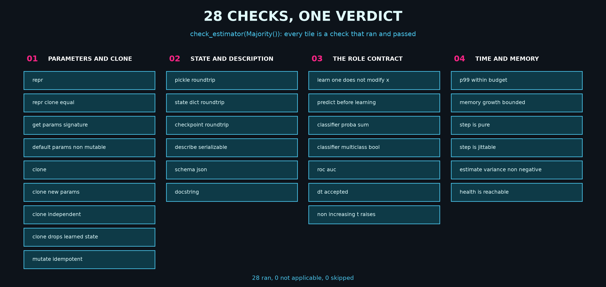

# Write and check a new estimator

To add a tool to Dense-Armor you pick a role, write its methods, and let `check_estimator` tell you whether you respect the contract.



*The 28 checks that `check_estimator` ran on the `Majority` classifier of this page, in four groups. A failing check would stop the run with the name of the check.*

## 1. Write the tool

Subclass a role, store every constructor argument unchanged, and keep what the tool learns in attributes whose name ends with an underscore. A docstring is required.

```python
from dense_armor.roles import Classifier


class Majority(Classifier):
    """Predict the label seen most often so far."""

    def __init__(self, prior=1.0):
        self.prior = prior
        self.counts_ = {}

    def learn_one(self, x, y, t=None):
        self.counts_[y] = self.counts_.get(y, 0) + 1
        return self

    def predict_proba_one(self, x, t=None):
        n = sum(self.counts_.values())
        return {c: v / n for c, v in self.counts_.items()} if n else {}


m = Majority()
for y in "aab":
    m.learn_one({}, y)
print(m.predict_one({}), m.predict_proba_one({}))
```

```
a {'a': 0.6666666666666666, 'b': 0.3333333333333333}
```

`predict_one` comes from the role: it takes the largest probability. The tool answers `{}` before it has learned, as the contract asks.

## 2. Check it

`check_estimator` runs every check that applies to the role of the tool. It returns what ran, and it raises `AssertionError` if one fails.

```python
from dense_armor.roles import Classifier
from dense_armor.checks import check_estimator


class Majority(Classifier):
    """Predict the label seen most often so far."""

    def __init__(self, prior=1.0):
        self.prior = prior
        self.counts_ = {}

    def learn_one(self, x, y, t=None):
        self.counts_[y] = self.counts_.get(y, 0) + 1
        return self

    def predict_proba_one(self, x, t=None):
        n = sum(self.counts_.values())
        return {c: v / n for c, v in self.counts_.items()} if n else {}


r = check_estimator(Majority())
print(len(r["run"]), r["not_applicable"], r["skipped"])
print(*r["run"], sep="\n")
```

```
28 [] []
check_repr
check_repr_clone_equal
check_clone
check_clone_new_params
check_clone_independent
check_get_params_signature
check_default_params_non_mutable
check_mutate_idempotent
check_pickle_roundtrip
check_docstring
check_describe_serializable
check_state_dict_roundtrip
check_learn_one_does_not_modify_x
check_clone_drops_learned_state
check_predict_before_learning
check_classifier_proba_sum
check_classifier_multiclass_bool
check_roc_auc
check_dt_accepted
check_non_increasing_t_raises
check_step_is_pure
check_step_is_jittable
check_p99_within_budget
check_memory_growth_bounded
check_estimate_variance_non_negative
check_schema_json
check_health_is_reachable
check_checkpoint_roundtrip
```

The checks cover the parameters, `clone`, `mutate`, `pickle`, `state_dict`, the docstring, that `learn_one` does not modify the sample, that a classifier answers nothing before it has learned, that its probabilities add up to one, and that a time that does not increase raises an error.

## 3. When a check fails

A tool without a docstring fails `check_docstring`, and the message names the check.

```python
from dense_armor.roles import Classifier
from dense_armor.checks import check_estimator


class NoDoc(Classifier):
    def __init__(self):
        self.counts_ = {}

    def learn_one(self, x, y, t=None):
        return self


try:
    check_estimator(NoDoc())
except AssertionError as e:
    print(e)
```

```
NoDoc failed check_estimator:
  - check_docstring: NoDoc has no docstring
```

A check that raises `AttributeError` or `NotImplementedError` is reported as not applicable, and it counts as a failure unless you list it in `allow_not_applicable` with the reason, written down. A tool can also declare checks to skip with `_unit_test_skips`.

## Details

- The checks are in `dense_armor/checks/check_estimator.py`. The robot checks are in `dense_armor/checks/robot.py` and are described in the [Robot layer](../api/robot_roles.md).
- The parameters of the checks come from `_unit_test_params`, which yields the constructor arguments to try; it is empty by default.
