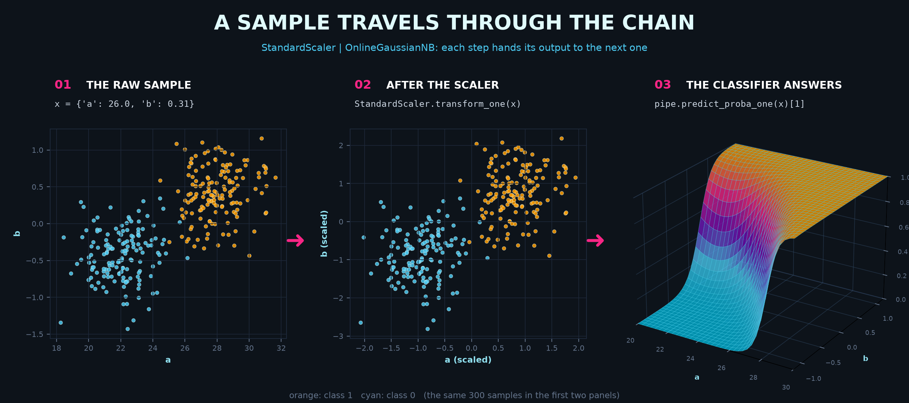

# Pipelines and wrappers

A pipeline runs several tools one after the other on the same sample: the transformers prepare it, the last tool learns from it. You build one with `|`.



*The same 300 samples seen at each step of the chain. The scaler brings the two features to the same scale; the classifier then answers with a probability surface over the raw plane.*

## 1. Build a pipeline

`a | b` is a pipeline of `a` then `b`. When you call `learn_one`, each transformer first transforms the sample and then learns from it, and the last step receives the result.

```python
import numpy as np
from dense_armor.core.signals.preprocessing.scale import StandardScaler
from dense_armor.core.online.learn.online_classifiers import OnlineGaussianNB

rng = np.random.default_rng(0)
pipe = StandardScaler() | OnlineGaussianNB()
for _ in range(300):
    k = int(rng.integers(2))
    pipe.learn_one({"a": float(rng.normal(3.0 * k, 0.5))}, k)
print(repr(pipe))
print(pipe.predict_one({"a": 0.1}), pipe.predict_one({"a": 3.0}))
```

```
StandardScaler(StandardScaler) | OnlineGaussianNB(OnlineGaussianNB)
0 1
```

The pipeline answers `predict_one` as the last step does, after sending the sample through the transformers.

## 2. The role of a pipeline

A pipeline plays the role of its last step. When the last step is a classifier the pipeline is a classifier too, so it goes anywhere a classifier goes.

```python
from dense_armor.roles import Classifier, Transformer
from dense_armor.core.signals.preprocessing.scale import StandardScaler
from dense_armor.core.online.learn.online_classifiers import OnlineGaussianNB

pipe = StandardScaler() | OnlineGaussianNB()
print(isinstance(pipe, Classifier), isinstance(pipe, Transformer))
print([name for name, _ in pipe.steps])
```

```
True False
['StandardScaler', 'OnlineGaussianNB']
```

`steps` is the list of the names and the tools.

## 3. The budget of a pipeline

A tool can declare `budget_s`, the time in seconds that one `learn_one` may take, and `memory_class`, how its memory grows. A pipeline adds the budgets of its steps (a transformer counts twice, because it transforms and learns) and takes the largest memory class. If one step declares nothing, the pipeline declares nothing.

```python
from dense_armor.core.signals.preprocessing.scale import StandardScaler
from dense_armor.core.online.anomaly.hst import HalfSpaceTrees

pipe = StandardScaler() | HalfSpaceTrees(seed=0)
print(round(pipe.budget_s, 3), pipe.memory_class)
```

```
0.102 O(1)
```

## 4. Wrap a model

`ModelWrapper` is the role of a tool that holds another tool and delegates to it. A wrapper defines `_wrapped_model`, and it takes `_supervised` and `_multiclass` from the tool that it wraps, so it fits where the wrapped tool fits.

## Details

- `a | b` needs `b` to have `learn_one`. A pipeline can be extended: `(a | b) | c`.
- The pipeline classes are in `dense_armor/roles/estimator.py`; `ModelWrapper` is in `dense_armor/roles/wrapper.py`.
