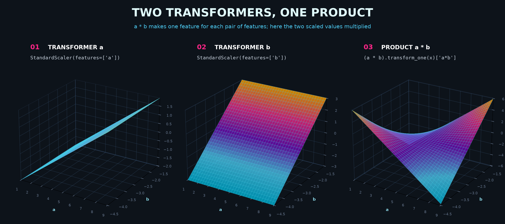

# Transformers

A transformer turns the dict of a sample into another dict: it rescales a value, builds a new feature, drops a column. It learns without labels, from the samples alone.



*Two `StandardScaler` objects, one for `a` and one for `b`, and the feature `a*b` of their product. The product is not a plane: it bends where one of the two values changes sign.*

## 1. Learn, then transform

`learn_one(x)` updates what the transformer knows and `transform_one(x)` returns the new dict.

```python
from dense_armor.core.signals.preprocessing.scale import StandardScaler

s = StandardScaler()
for v in (1.0, 2.0, 3.0, 4.0):
    s.learn_one({"v": v})
print(s.transform_one({"v": 2.5}), s.transform_many([{"v": 1.0}, {"v": 4.0}]))
```

```
{'v': 0.0} [{'v': -1.1618950366973877}, {'v': 1.1618950366973877}]
```

The value `2.5` is the mean of the four samples, so it becomes `0.0`. `transform_many` takes a list of dicts.

## 2. Join two transformers with `+`

`a + b` is a transformer whose output holds the features of `a` and the features of `b`. When both give the same name, the one on the right wins.

```python
from dense_armor.roles import Transformer


class Shift(Transformer):
    """Add a constant to the value of v."""

    def __init__(self, name, by):
        self.name = name
        self.by = by

    def transform_one(self, x, t=None):
        return {self.name: x["v"] + self.by}


u = Shift("a", 1.0) + Shift("b", 2.0)
print(u.transform_one({"v": 0.0}))
```

```
{'a': 1.0, 'b': 2.0}
```

## 3. Multiply two transformers with `*`

`a * b` makes one feature for each pair of features of `a` and `b`, named `ka*kb`, whose value is the product.

```python
from dense_armor.roles import Transformer


class Shift(Transformer):
    """Add a constant to the value of v."""

    def __init__(self, name, by):
        self.name = name
        self.by = by

    def transform_one(self, x, t=None):
        return {self.name: x["v"] + self.by}


p = Shift("a", 1.0) * Shift("b", 2.0)
print(p.transform_one({"v": 1.0}))
```

```
{'a*b': 6.0}
```

## 4. Chain the operators

The result of `+` and of `*` is a transformer too, so the operators chain: `(a + b) + c`, `(a * b) * c`, `a + (b * c)`.

```python
from dense_armor.roles import Transformer


class Shift(Transformer):
    """Add a constant to the value of v."""

    def __init__(self, name, by):
        self.name = name
        self.by = by

    def transform_one(self, x, t=None):
        return {self.name: x["v"] + self.by}


t3 = (Shift("a", 1.0) + Shift("b", 2.0)) + Shift("c", 3.0)
print(t3.transform_one({"v": 0.0}))
```

```
{'a': 1.0, 'b': 2.0, 'c': 3.0}
```

Learning goes to both parts: `learn_one` of a union or a product calls `learn_one` of `a` and of `b`.

## Details

- `TransformerSupervised` is a transformer whose `learn_one(x, y)` also reads the label.
- A union or a product adds the `budget_s` of its two parts, and takes the larger `memory_class`; see [Pipelines](pipelines.md).
- `Transformer` has the methods `learn_one`, `transform_one`, `learn_many`, `transform_many`. The file is `dense_armor/roles/transformer.py`.
