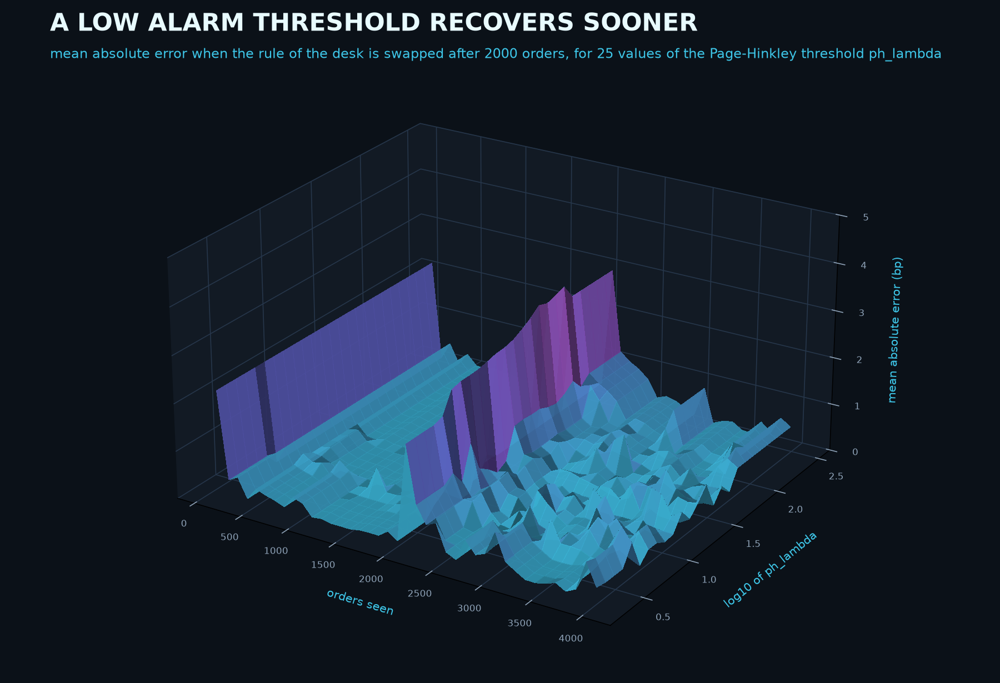

# When the world changes: a rule that is dropped

[← Rules](index.md)

A desk has learned that the slippage is high for a large order. One day the market changes and the rule reverses: now it is the small orders that slip. A model that keeps its old rules is wrong on every order until it is retrained. `AMRulesRegressor` watches the absolute error of each rule with the Page-Hinkley test, which signals when the average of a signal rises. When it signals, the rule is removed and the default rule learns again. A robot whose payload changes does the same with the torque of a joint.



## 1. A first example: the rule of the desk is swapped

The slippage is 5 when the size is above 0, for 2000 orders; then it is 5 when the size is not above 0. The printed list is the mean absolute error of the model over the 100 orders before the swap, the 100 right after, the 100 orders ending at 2500, and the last 300.

```python
import numpy as np
from dense_armor.core.online.rules import AMRulesRegressor

rng = np.random.default_rng(0)
model = AMRulesRegressor(n_min=100, seed=0)
err = []
for t in range(4000):
    size = float(rng.uniform(-1.0, 1.0))
    row = {"size": size, "spread": float(rng.uniform(-1.0, 1.0)), "vol": float(rng.uniform(-1.0, 1.0))}
    up = size > 0.0 if t < 2000 else size <= 0.0
    y = 5.0 * up + 0.1 * float(rng.normal())
    err.append(abs(model.predict_one(row) - y))
    model.learn_one(row, y)
print([round(float(np.mean(err[a:b])), 2) for a, b in ((1900, 2000), (2000, 2100), (2400, 2500), (3700, 4000))])
```

```
[0.68, 3.07, 0.22, 0.14]
```

The error is 0.68 in the 100 orders before the swap, 3.07 in the 100 right after (the model is wrong on almost every order), 0.22 at 2500 orders and 0.14 in the last 300: the rules that were wrong are removed and new ones are learned.


Over 3 streams, the median mean absolute error in the blocks of 100 orders ending at 1900, 2100, 2500 and 4000 orders reads 0.267, 2.181, 0.184 and 0.351 for a Page-Hinkley threshold `ph_lambda` of 2, 0.361, 3.098, 0.212 and 0.164 for 37.2, and 0.361, 2.999, 0.818 and 0.567 for 300. A low threshold recovers sooner, because it drops the wrong rule after fewer wrong orders, and a high one is slow: 300 is still at 0.818 at 2500 orders. A low threshold also ends a little higher, 0.351 against 0.164, because it can drop a good rule.

| class or function | what it does |
|---|---|
| `AMRulesRegressor` | a list of rules; each rule watches its own error and is dropped when it rises |
| `ph_lambda`, `ph_phi` | the threshold and the tolerance of the Page-Hinkley test |

## 2. What it does

A rule keeps a running record of its own absolute error and watches it with the Page-Hinkley test, which signals when the average of a signal rises. When it signals, the rule is removed and the default rule starts covering that region again.

**Source:** Duarte, Gama, Bifet (2016), Algorithms 1 and 2, Sections 3.1 to 3.5.

## 3. The parameters of the change

| Parameter | Meaning | Default |
|---|---|---|
| `ph_lambda` | threshold of the Page-Hinkley test, in the unit of the absolute error of the target | 35.0 |
| `ph_phi` | magnitude of the changes that the test allows | 0.005 |
| `alpha` | fading factor of the error that chooses the prediction strategy | 0.99 |

## 4. The older example: the targets are swapped

The next figure swaps the targets after the model has learned the step: the target is now 5 when `a` is not positive.


The error over the first 100 samples after the swap is 2.93 and over the last 300 of 2000 it is 0.17; the Page-Hinkley test removed 7 rules on the way. The recovery is not smooth: the curve shows bumps while new rules replace the removed ones.

## 5. The same on a robot

A robot predicts the torque of a joint from its speed, its load and its temperature. After 2000 samples a payload is added and the rule reverses.

```python
import numpy as np
from dense_armor.core.online.rules import AMRulesRegressor

rng = np.random.default_rng(1)
model = AMRulesRegressor(n_min=100, seed=0)
err = []
for t in range(4000):
    speed = float(rng.uniform(-1.0, 1.0))
    row = {"speed": speed, "load": float(rng.uniform(-1.0, 1.0)), "temp": float(rng.uniform(-1.0, 1.0))}
    up = speed > 0.0 if t < 2000 else speed <= 0.0
    y = 5.0 * up + 0.1 * float(rng.normal())
    err.append(abs(model.predict_one(row) - y))
    model.learn_one(row, y)
print([round(float(np.mean(err[a:b])), 2) for a, b in ((1900, 2000), (2000, 2100), (2400, 2500), (3700, 4000))])
```

```
[0.08, 3.02, 0.08, 0.14]
```

The error is 0.08 before the payload, 3.02 right after, 0.08 at 2500 samples and 0.14 at the end: it rises as soon as the payload changes and goes down again once the old rules are dropped.

## API reference

::: dense_armor.core.online.rules.amrules.AMRulesRegressor

---

## Details

### Choices

- **The figures** are drawn with the library by `docs/assets/rules/make_rules_style_figures.py`: 4000 orders, the rule swapped after 2000, `n_min` = 100, `ph_lambda` on the figure, the error averaged over blocks of 100 orders, median over 3 seeds. The value 37.2 is the one of the grid of 25 values that is nearest to 35.
- **The older figure** of the page of the section, with its numbers, is kept in section 4.
