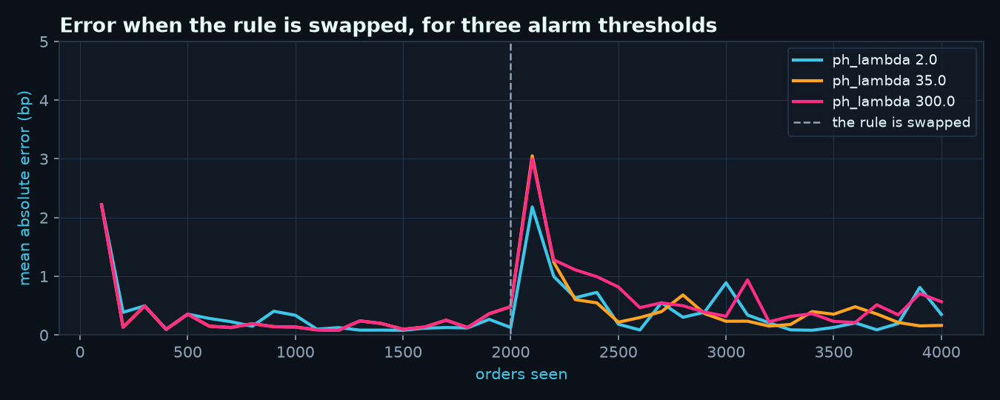
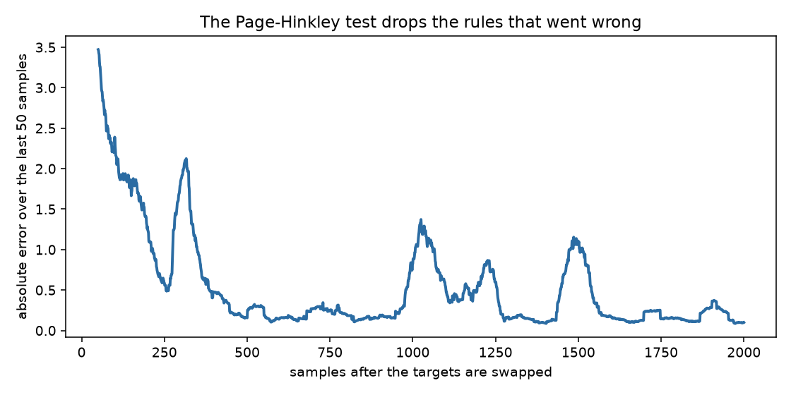

# When the world changes: the alarm that removes a rule

[← Rules](index.md)

A rule that starts to fail is removed, and the default rule learns again.


## 1. The alarm

At the order 1500 the slippage rule is swapped: it is 5 when the size is not above 0.

```python
import numpy as np
from dense_armor.core.online.rules import AMRulesRegressor

r = np.random.default_rng(0)
m = AMRulesRegressor(n_min=100, seed=0)
for t in range(2600):
    s = float(r.uniform(-1, 1))
    m.learn_one({"size": s, "spread": float(r.uniform(-1, 1))}, 5.0 * ((s > 0) == (t < 1500)))
    if t in (1499, 1599, 2599):
        print(t + 1, len(m.rules_), m.n_removed_)
```

```
1500 2 0
1600 1 1
2600 2 1
```

At the order 1500 the list has 2 rules and none has been removed. At the order 1600, 1 rule has been removed and 1 is left. At the order 2600 there are 2 rules and 1 has been removed.

Every rule watches its own absolute error on the orders it covers. The Page-Hinkley test adds up, order after order, the gap between the error and the mean error so far, minus a tolerance `phi`; it keeps the lowest value reached by the sum. When the sum is more than `lambda` above that lowest value, the error has been rising for too long to be chance, and the rule is removed (the paper, Section 3.4).

## 2. The threshold

The threshold `ph_lambda` is the size of the rise that the test accepts.

```python
import numpy as np
from dense_armor.core.online.rules import AMRulesRegressor

for lam in (0.5, 35.0, 1e9):
    r = np.random.default_rng(0)
    m = AMRulesRegressor(n_min=100, ph_lambda=lam, seed=0)
    for t in range(2600):
        s = float(r.uniform(-1, 1))
        m.learn_one({"size": s, "spread": float(r.uniform(-1, 1))}, 5.0 * ((s > 0) == (t < 1500)))
    print(lam, m.n_removed_)
```

```
0.5 9
35.0 1
1000000000.0 0
```

With `ph_lambda` = 0.5, 9 rules are removed; with 35, 1; with 1e9, none. A larger `lambda` gives fewer false alarms and may delay the detection of a change (the paper, Section 3.4).

## 3. After the alarm

The order that rings the alarm is not learned by any rule. The orders that the removed rule used to cover are learned by the default rule.

```python
import numpy as np
from dense_armor.core.online.rules import AMRulesRegressor

r = np.random.default_rng(0)
m = AMRulesRegressor(n_min=100, max_rules=1, seed=0)
for _ in range(150):
    s = float(r.uniform(-1, 1))
    m.learn_one({"size": s, "spread": float(r.uniform(-1, 1))}, 5.0 * (s > 0) + 0.1 * float(r.normal()))
x = {"size": 0.5, "spread": 0.0}
print(len(m.explain_one(x)))
for _ in range(500):
    if not m.rules_:
        break
    m.learn_one({"size": float(r.uniform(0.1, 1)), "spread": float(r.uniform(-1, 1))}, 0.0)
print(len(m.explain_one(x)), round(m.predict_one(x), 2))
```

```
1
0 0.15
```

Before the alarm one rule covers the order. After it, none does, and the default rule answers.

## 4. What the threshold does to the error



Mean absolute error, in basis points, in the block of 100 orders that ends at the order shown (the rule is swapped after 2000 orders; median of 3 streams):

| `ph_lambda` | 1900 | 2100 | 2500 | 4000 |
|---|---|---|---|---|
| 2 | 0.267 | 2.181 | 0.184 | 0.351 |
| 37.2 | 0.361 | 3.098 | 0.212 | 0.164 |
| 300 | 0.361 | 2.999 | 0.818 | 0.567 |

## 5. The parameters

| Parameter | Meaning | Default |
|---|---|---|
| `ph_lambda` | threshold of the Page-Hinkley test, in the unit of the absolute error of the target | 35.0 |
| `ph_phi` | magnitude of the changes that the test allows | 0.005 |
| `alpha` | fading factor of the error that chooses the prediction strategy | 0.99 |

**Source:** Duarte, Gama, Bifet (2016), Algorithms 1 and 2, Sections 3.1 to 3.5.

## 6. The older example: the targets are swapped

The next figure swaps the targets after the model has learned the step: the target is now 5 when `a` is not positive.



The error over the first 100 samples after the swap is 2.93 and over the last 300 of 2000 it is 0.17; the Page-Hinkley test removed 7 rules on the way. The recovery is not smooth: the curve shows bumps while new rules replace the removed ones.

## 7. The same on a robot

The rule of the torque is swapped at the sample 1500.

```python
import numpy as np
from dense_armor.core.online.rules import AMRulesRegressor

r = np.random.default_rng(1)
m = AMRulesRegressor(n_min=100, seed=0)
for t in range(2600):
    v = float(r.uniform(-1, 1))
    m.learn_one({"speed": v, "load": float(r.uniform(-1, 1))}, 5.0 * ((v > 0) == (t < 1500)))
    if t in (1499, 1599, 2599):
        print(t + 1, len(m.rules_), m.n_removed_)
```

```
1500 2 0
1600 1 2
2600 3 2
```

At the sample 1500 the list has 2 rules and none has been removed. At the sample 1600, 2 rules have been removed and 1 is left. At the sample 2600 there are 3 rules and 2 have been removed.

## API reference

::: dense_armor.core.online.rules.amrules.AMRulesRegressor

---

## Details

### Choices

- The figures are drawn by `docs/assets/rules/make_rules_style_figures.py`: 4000 orders, the rule swapped after 2000, `n_min` = 100, blocks of 100 orders, median of 3 seeds. The value 37.2 is the nearest to 35 on the grid of 25 values.
- The older figure of the page, with its numbers, is in the section 6.
