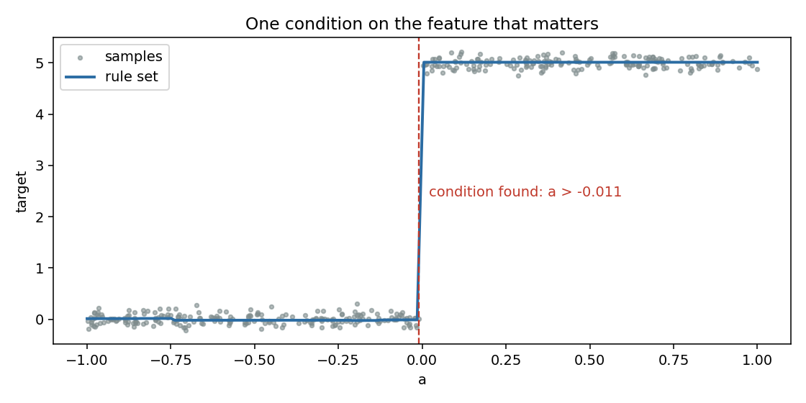
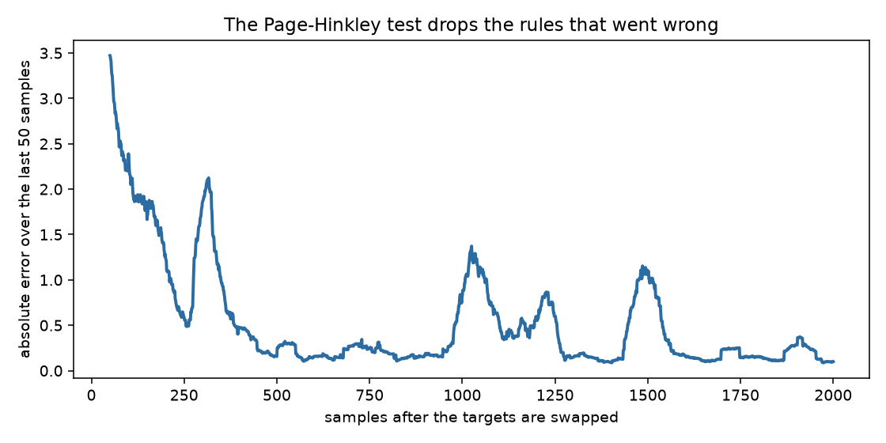

# Rules that learn a number

A rule says "if these conditions hold, the answer is about this number". A set of rules is a model you can read: each rule names the features it looks at and the range where it applies. These rules start with one rule that covers everything, split it into narrower rules as the data shows where the answer changes, and throw away a rule whose predictions start to fail.

## 1. What a rule is

Suppose an AI assistant must predict how many seconds a request will take from a few numbers about it. A rule could read: *if the prompt length is above 300 and the queue is shorter than 4, the answer is about 2.1 seconds*. The part after "if" is a list of conditions on the features; the part after "then" is a small model that predicts the target for the requests the rule covers.

`AMRulesRegressor` (Duarte, Gama and Bifet 2016) keeps such a list and learns it one sample at a time.

## 2. Learning a rule set

The model begins with a default rule that covers every sample. Each new sample updates the rules that cover it, or the default rule when none does. After 200 covered samples (`n_min`) a rule asks one question: is there a condition that splits its samples into two groups with clearly different targets? The answer comes from the *variance ratio* of the best split on each feature, compared with the second best through the Hoeffding bound. When one feature clearly wins, the rule grows a condition on it.

```python
import numpy as np
from dense_armor.utility.rules import AMRulesRegressor

rng = np.random.default_rng(0)
m = AMRulesRegressor(n_min=100, seed=0)
for _ in range(1500):
    a = float(rng.uniform(-1.0, 1.0))
    m.learn_one({"a": a, "b": float(rng.uniform(-1.0, 1.0))}, 5.0 * (a > 0.0))
print(round(m.predict_one({"a": 0.5, "b": 0.0}), 1), round(m.predict_one({"a": -0.5, "b": 0.0}), 1))
print(m.explain_one({"a": 0.5, "b": 0.0}))
```

```
5.0 0.0
[[{'feature': 'a', 'op': '>', 'value': -5.4352682762992544e-05}]]
```

The target is 5 when `a` is positive and 0 otherwise; `b` is noise. The model answers 5.0 and 0.0, and `explain_one` lists the conditions of the rules that cover a sample.



On a longer stream of the same kind (3000 samples, `n_min=100`) the condition found is `a > -0.0108`: the boundary of the step is at 0, and the rule is placed within 0.011 of it. The model holds 8 rules at the end, more than the step needs.

## 3. When the world changes

A rule keeps a running record of its own absolute error and watches it with the Page-Hinkley test, which signals when the average of a signal rises. When it signals, the rule is removed and the default rule starts covering that region again.

The next figure swaps the targets after the model has learned the step: the target is now 5 when `a` is not positive.



The error over the first 100 samples after the swap is 2.93 and over the last 300 of 2000 it is 0.17; the Page-Hinkley test removed 7 rules on the way. The recovery is not smooth: the curve shows bumps while new rules replace the removed ones.

## 4. Options

- **Ordered or unordered.** With `ordered_set=True` the first rule that covers a sample learns and predicts; by default all covering rules learn and their predictions are averaged.
- **How a rule predicts.** `prediction="mean"` uses the mean of its targets, `"perceptron"` a linear model on the standardised features, `"adaptive"` (default) the one with the lower fading mean absolute error.
- **Anomalies.** With `anomaly_threshold` set (the paper uses -0.75), a rule ignores a sample whose features are unusual for it, once it has seen `m_min` samples. The score is the mean over features, so it flags a sample that is unusual in most features, not in one of them.
- **Size.** `max_rules`, `max_literals` and `max_split_points` bound the model.

## Details

### References

- Duarte, J., Gama, J., Bifet, A. (2016). Adaptive model rules from high-speed data streams. ACM Transactions on Knowledge Discovery from Data 10(3), article 30. Algorithms 1 and 2 (pages 6 and 7 of the PDF), Sections 3.3 to 3.5 (pages 8 to 10), parameters on pages 11 and 12.

### Where the paper and the code differ

- **The expansion test.** Algorithm 2 prints `VR(Xa) - VR(Xb) > eps`; the text on page 7 compares the ratio of the two variance ratios with `1 - eps`. The ratio is implemented.
- **The delta rule.** The paper writes `w <- w + eta (y_hat - y) x`, which moves the weights up the error. The descent step with a minus sign is implemented, and the linear model converges on a plane (mean absolute error below 0.2 on `3a - 2b`).
- **Choices the paper leaves open.** `learning_rate = 0.01`; the side of a split with the smaller target variance becomes the condition, and the other side seeds the new default rule; the split statistics are a sorted list of at most 50 values per feature and rule, a sample joining the nearest value once it is full; probabilities of the anomaly score are clipped to `[1e-12, 1 - 1e-12]`; the anomaly test is off by default; `max_rules = 100` and `max_literals = 20` bound the model.

### Cost and memory

p99 of one `learn_one` plus one `predict_one` over 3000 samples with four features, measured on a desktop CPU: 0.31 ms (median 0.10 ms); `budget_s` is 0.01 s. A model has at most `max_rules` rules, each with at most `max_literals` conditions and `max_split_points` stored values per feature, so the state is constant in the length of the stream. There is no pure `init_state` / `step` form: the set of rules changes shape.

### Checks

- `check_estimator` passes with no check skipped; the tests cover every line of the module.
- The variance ratio of a hand case (targets 0, 2, 4, 6 split after the second) is 0.8, and 1.0 for a perfect split.
- Two identical features tie: the tie threshold `tau` decides the split only once `n` is large enough that the Hoeffding bound falls below it (3224 samples for the defaults, `ln(1/delta) / (2 tau^2) = 3223.6`).
