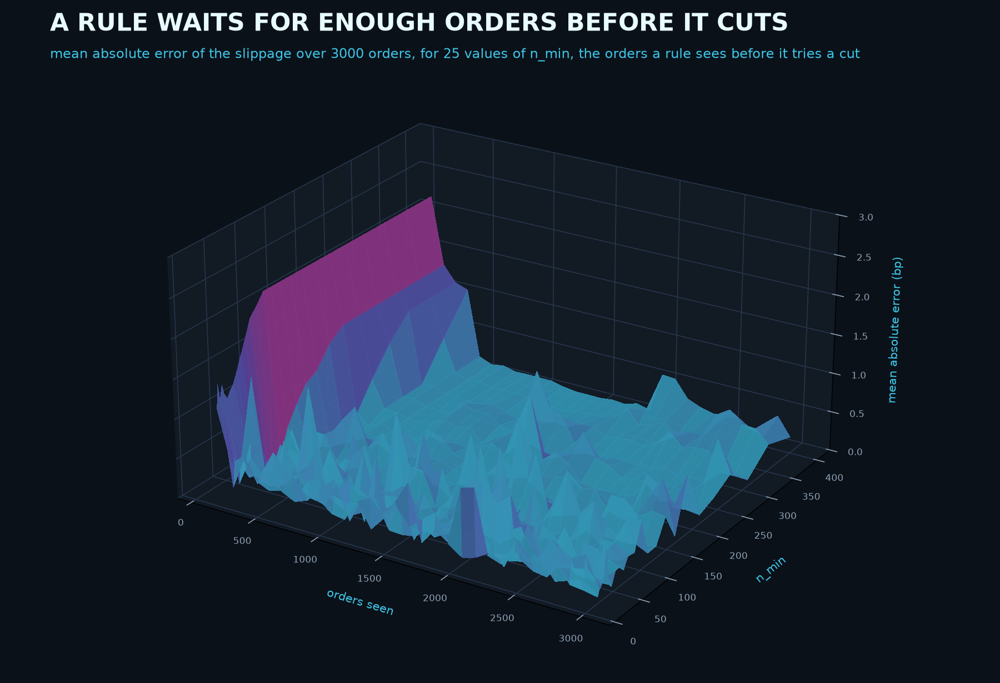

# Learn a rule set: the slippage of an order

[← Rules](index.md)

A desk wants to predict the slippage of an order, in basis points, from the size of the order, the spread and the volatility. It does not want a black box: it wants rules it can read, such as "if the size is above 0, the slippage is about 5". `AMRulesRegressor` keeps a list of such rules and learns it one order at a time. It starts with one default rule that covers every order, and after a rule has seen `n_min` orders it asks one question: is there a condition on one feature that makes the answer clearly more regular? If so, it cuts, and the rule gets a condition. A robot that predicts the torque of a joint from its speed and its load can read its rules in the same way.



## 1. A first example: the slippage of an order

The slippage is 5 basis points when the size is above 0 and 0 otherwise, with a small noise of 0.1; the spread and the volatility say nothing. The model sees 1500 orders, one at a time. After the learning, two orders of opposite size get their prediction, and `explain_one` lists the conditions of the rules that cover the first one.

```python
import numpy as np
from dense_armor.core.online.rules import AMRulesRegressor

rng = np.random.default_rng(0)
model = AMRulesRegressor(n_min=100, seed=0)
for _ in range(1500):
    size = float(rng.uniform(-1.0, 1.0))
    row = {"size": size, "spread": float(rng.uniform(-1.0, 1.0)), "vol": float(rng.uniform(-1.0, 1.0))}
    model.learn_one(row, 5.0 * (size > 0.0) + 0.1 * float(rng.normal()))
print(round(model.predict_one({"size": 0.5, "spread": 0.0, "vol": 0.0}), 1), round(model.predict_one({"size": -0.5, "spread": 0.0, "vol": 0.0}), 1))
print(model.explain_one({"size": 0.5, "spread": 0.0, "vol": 0.0}))
```

```
5.0 -0.0
[[{'feature': 'size', 'op': '>', 'value': 0.03862887620925903}]]
```

The model answers 5.0 for an order with a positive size and 0.0 for a negative one, and the rule that covers the first order reads `size > 0.0386...`: the cut is close to 0, where the slippage changes, and the spread and the volatility do not appear in it. (The `-0.0` is a zero.)


Over 3 streams, the median mean absolute error in the blocks of 100 orders ending at 100, 500, 1000 and 3000 orders reads 1.093, 0.245, 0.179 and 0.126 for `n_min` = 20, 2.217, 0.272, 0.181 and 0.614 for `n_min` = 101, and 2.217, 0.225, 0.145 and 0.209 for `n_min` = 400. A rule that waits for 100 orders or more has made no cut in the first 100 orders, so it answers with the mean of the slippage, 2.2 away on average; with `n_min` = 20 it cuts early and is at 1.1. The error of the last block for `n_min` = 101 (0.614) is above the one at 1000 orders: the rule set changes shape while the stream goes on.

| class or function | what it does |
|---|---|
| `AMRulesRegressor` | a list of rules, each with its conditions and its own prediction, learned one sample at a time |
| `learn_one`, `predict_one` | learn an order, and predict the slippage of one |
| `explain_one` | the conditions of the rules that cover an order |

## 2. What it does

Suppose an AI assistant must predict how many seconds a request will take from a few numbers about it. A rule could read: *if the prompt length is above 300 and the queue is shorter than 4, the answer is about 2.1 seconds*. The part after "if" is a list of conditions on the features; the part after "then" is a small model that predicts the target for the requests the rule covers.

`AMRulesRegressor` (Duarte, Gama and Bifet 2016) keeps such a list and learns it one sample at a time.

The model begins with a default rule that covers every sample. Each new sample updates the rules that cover it, or the default rule when none does. After 200 covered samples (`n_min`) a rule asks one question: is there a condition that splits its samples into two groups with clearly different targets? The answer comes from the *variance ratio* of the best split on each feature, compared with the second best through the Hoeffding bound. When one feature clearly wins, the rule grows a condition on it.

**Source:** Duarte, Gama, Bifet (2016), Algorithms 1 and 2, Sections 3.1 to 3.5.

## 3. The parameters of the learning

| Parameter | Meaning | Default |
|---|---|---|
| `n_min` | samples a rule sees before it tries to expand | 200 |
| `delta` | one minus the confidence of the Hoeffding bound | 1e-07 |
| `tau` | tie threshold on the bound | 0.05 |
| `seed` | seed of the generator of the initial weights | `None` |
| `feature_keys` | names of the features; `None` takes the sorted keys of the first sample | `None` |

The other parameters are on the pages [When the world changes](change.md) (`ph_lambda`, `ph_phi`) and [Options](options.md).

## 4. The same example on the toy stream

```pythonimport numpy as np
from dense_armor.core.online.rules import AMRulesRegressor

rng = np.random.default_rng(0)
m = AMRulesRegressor(n_min=100, seed=0)
for _ in range(1500):
    a = float(rng.uniform(-1.0, 1.0))
    m.learn_one({"a": a, "b": float(rng.uniform(-1.0, 1.0))}, 5.0 * (a > 0.0))
print(round(m.predict_one({"a": 0.5, "b": 0.0}), 1), round(m.predict_one({"a": -0.5, "b": 0.0}), 1))
print(m.explain_one({"a": 0.5, "b": 0.0}))
```

```
5.0 0.0
[[{'feature': 'a', 'op': '>', 'value': -5.4352682762992544e-05}]]
```

The target is 5 when `a` is positive and 0 otherwise; `b` is noise. The model answers 5.0 and 0.0, and `explain_one` lists the conditions of the rules that cover a sample.


On a longer stream of the same kind (3000 samples, `n_min=100`) the condition found is `a > -0.0108`: the boundary of the step is at 0, and the rule is placed within 0.011 of it. The model holds 8 rules at the end, more than the step needs.

## 5. The same on a robot

A robot predicts the torque of a joint, in newton-metres, from its speed, its load and its temperature. The torque is 5 when the speed is positive, and the load and the temperature say nothing.

```python
import numpy as np
from dense_armor.core.online.rules import AMRulesRegressor

rng = np.random.default_rng(1)
model = AMRulesRegressor(n_min=100, seed=0)
for _ in range(1500):
    speed = float(rng.uniform(-1.0, 1.0))
    row = {"speed": speed, "load": float(rng.uniform(-1.0, 1.0)), "temp": float(rng.uniform(-1.0, 1.0))}
    model.learn_one(row, 5.0 * (speed > 0.0) + 0.1 * float(rng.normal()))
print(round(model.predict_one({"speed": 0.5, "load": 0.0, "temp": 0.0}), 1), round(model.predict_one({"speed": -0.5, "load": 0.0, "temp": 0.0}), 1))
print(model.explain_one({"speed": 0.5, "load": 0.0, "temp": 0.0}))
```

```
5.0 -0.0
[[{'feature': 'speed', 'op': '>', 'value': -0.028839843347668648}, {'feature': 'speed', 'op': '>', 'value': 0.001479262369684875}, {'feature': 'temp', 'op': '>', 'value': -0.9462961554527283}]]
```

The rules are cut close to 0 on the speed, twice, and there is one more condition, on the temperature (`temp > -0.946`), that almost every sample satisfies: a cut that the stream did not remove and that changes nothing here.

## API reference

::: dense_armor.core.online.rules.amrules.AMRulesRegressor

---

## Details

### Choices

- **The figures** are drawn with the library by `docs/assets/rules/make_rules_style_figures.py`: orders with three features drawn between -1 and 1, the slippage 5 when the size is above 0, a noise of 0.1, the error of the prediction made before the order is learned, averaged over blocks of 100 orders, median over 3 seeds. The value 101 of `n_min` is the one of the grid of 25 values that is nearest to 100.
- **The old figure** of the step and the toy stream are kept in section 4 and on the page [When the world changes](change.md).
