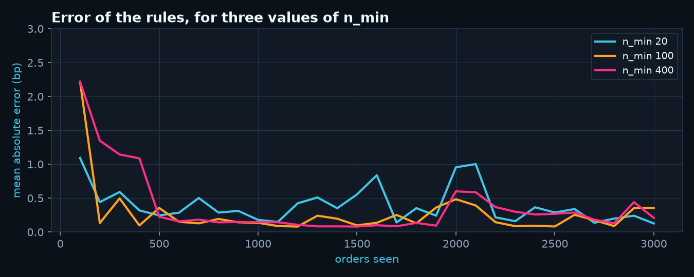
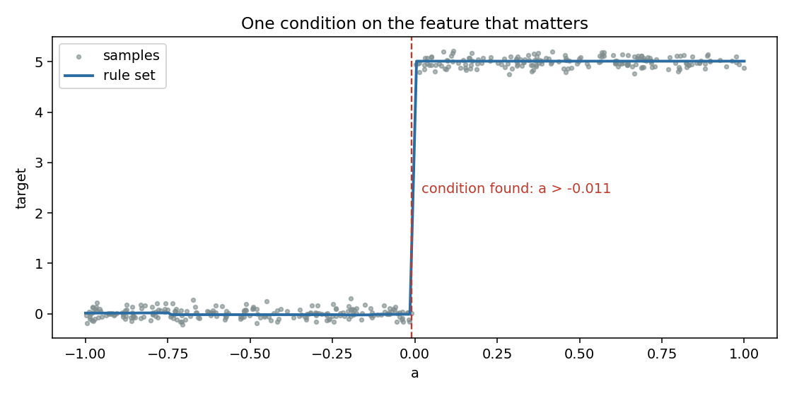

# Learn a rule set: from one rule to many

[← Rules](index.md)

The model starts with one rule and adds rules where the slippage changes.


## 1. One rule for everything

At the start there is one rule with no conditions, the default rule.

```python
import numpy as np
from dense_armor.core.online.rules import AMRulesRegressor

r = np.random.default_rng(0)
m = AMRulesRegressor(n_min=100, seed=0)
for t in range(1, 101):
    s = float(r.uniform(-1, 1))
    m.learn_one({"size": s, "spread": float(r.uniform(-1, 1))}, 5.0 * (s > 0))
    if t in (1, 99, 100):
        print(t, len(m.rules_))
print(len(m.explain_one({"size": 0.5, "spread": 0.0})), len(m.explain_one({"size": -0.5, "spread": 0.0})))
```

```
1 0
99 0
100 1
0 1
```

After 1 order and after 99 orders the list has 0 rules: the default rule answers. At the 100th order (`n_min`) the list has 1 rule. Of the two test orders, one is covered by the new rule and the other is answered by the default rule.

## 2. Waiting for `n_min` orders

A rule asks for a cut only after `n_min` orders.

```python
import numpy as np
from dense_armor.core.online.rules import AMRulesRegressor

for n in (100, 250):
    r = np.random.default_rng(0)
    m = AMRulesRegressor(n_min=n, seed=0)
    for t in range(1, 1000):
        s = float(r.uniform(-1, 1))
        m.learn_one({"size": s, "spread": float(r.uniform(-1, 1))}, 5.0 * (s > 0))
        if m.rules_:
            print(n, t)
            break
```

```
100 100
250 250
```

With `n_min` = 100 the first rule appears at the order 100, with `n_min` = 250 at the order 250. A rule that does not find a cut tries again after `n_min` more orders.

## 3. Being sure: the margin and the tie

A rule cuts only if the best feature is clearly better than the second best.

```python
import math

print(round(math.sqrt(math.log(1 / 1e-7) / (2 * 100)), 3), round(math.log(1 / 1e-7) / (2 * 0.05 ** 2), 1))
```

```
0.284 3223.6
```

`eps = sqrt(ln(1/delta) / (2n))` is the margin of the Hoeffding bound. With `delta` = 1e-7 and 100 orders it is 0.284; it falls under `tau` = 0.05 after 3223.6 orders. How much a cut is worth is the variance ratio: one minus the variance of the slippage inside the two groups, weighted, over the variance of all. The rule cuts if the best feature is clearly ahead (the ratio of the second best variance ratio to the best, plus `eps`, is below 1), or if `eps` is under `tau`: then the best is taken anyway. The side of the cut that becomes the condition is a choice of the library; the paper does not fix it.

Two identical features cannot be told apart:

```python
import numpy as np
from dense_armor.core.online.rules import AMRulesRegressor

r = np.random.default_rng(0)
m = AMRulesRegressor(n_min=100, seed=0)
for t in range(1, 4000):
    s = float(r.uniform(-1, 1))
    m.learn_one({"a": s, "b": s}, 5.0 * (s > 0))
    if m.rules_:
        print(t)
        break
```

```
3300
```

The first cut comes at the order 3300, the first multiple of `n_min` after 3223.6.

## 4. Who answers

The rules that cover an order answer, and the default rule answers if none does.

```python
import numpy as np
from dense_armor.core.online.rules import AMRulesRegressor

r = np.random.default_rng(0)
m = AMRulesRegressor(n_min=100, seed=0)
for _ in range(1500):
    s = float(r.uniform(-1, 1))
    m.learn_one({"size": s, "spread": float(r.uniform(-1, 1))}, 5.0 * (s > 0))
print(len(m.rules_), len(m.explain_one({"size": 0.5, "spread": 0.0})), len(m.explain_one({"size": -0.5, "spread": 0.0})))
```

```
2 1 1
```

After 1500 orders there are 2 rules, and each of the two test orders is covered by one of them. When several rules cover an order their answers are averaged (the paper, Section 3.3).

## 5. What `n_min` does to the error



Mean absolute error of the slippage, in basis points, in the block of 100 orders that ends at the order shown (median of 3 streams):

| `n_min` | 100 | 500 | 1000 | 3000 |
|---|---|---|---|---|
| 20 | 1.093 | 0.245 | 0.179 | 0.126 |
| 101 | 2.217 | 0.272 | 0.181 | 0.614 |
| 400 | 2.217 | 0.225 | 0.145 | 0.209 |

## 6. The parameters

| Parameter | Meaning | Default |
|---|---|---|
| `n_min` | orders a rule sees before it tries to expand | 200 |
| `delta` | one minus the confidence of the Hoeffding bound | 1e-07 |
| `tau` | tie threshold on the bound | 0.05 |
| `seed` | seed of the generator of the initial weights | `None` |
| `feature_keys` | names of the features; `None` takes the sorted keys of the first sample | `None` |

**Source:** Duarte, Gama, Bifet (2016), Algorithms 1 and 2, Sections 3.1 to 3.5.

## 7. The older example: the step

```pythonimport numpy as np
from dense_armor.core.online.rules import AMRulesRegressor

rng = np.random.default_rng(0)
m = AMRulesRegressor(n_min=100, seed=0)
for _ in range(1500):
    a = float(rng.uniform(-1.0, 1.0))
    m.learn_one({"a": a, "b": float(rng.uniform(-1.0, 1.0))}, 5.0 * (a > 0.0))
print(round(m.predict_one({"a": 0.5, "b": 0.0}), 1), round(m.predict_one({"a": -0.5, "b": 0.0}), 1))
print(m.explain_one({"a": 0.5, "b": 0.0}))
```

```
5.0 0.0
[[{'feature': 'a', 'op': '>', 'value': -5.4352682762992544e-05}]]
```

The target is 5 when `a` is positive and 0 otherwise; `b` is noise. The model answers 5.0 and 0.0, and `explain_one` lists the conditions of the rules that cover a sample.



On a longer stream of the same kind (3000 samples, `n_min=100`) the condition found is `a > -0.0108`: the boundary of the step is at 0, and the rule is placed within 0.011 of it. The model holds 8 rules at the end, more than the step needs.

## 8. The same on a robot

The rules for the torque of a joint, after 1500 samples.

```python
import numpy as np
from dense_armor.core.online.rules import AMRulesRegressor

r = np.random.default_rng(1)
m = AMRulesRegressor(n_min=100, seed=0)
for _ in range(1500):
    v = float(r.uniform(-1, 1))
    m.learn_one({"speed": v, "load": float(r.uniform(-1, 1))}, 5.0 * (v > 0))
print(len(m.rules_), len(m.explain_one({"speed": 0.5, "load": 0.0})), len(m.explain_one({"speed": -0.5, "load": 0.0})))
```

```
2 1 1
```

There are 2 rules, and each of the two test samples is covered by one.

## API reference

::: dense_armor.core.online.rules.amrules.AMRulesRegressor

---

## Details

### Choices

- The figures are drawn by `docs/assets/rules/make_rules_style_figures.py`: orders with three features between -1 and 1, slippage 5 when the size is above 0 plus a noise of 0.1, error of the prediction made before each order is learned, blocks of 100 orders, median of 3 seeds. The value 101 of `n_min` is the nearest to 100 on the grid of 25 values.
- The older text of the page, with the older toy stream, is in the section 7 and in the Details of the [index](index.md#the-text-of-the-older-page).
