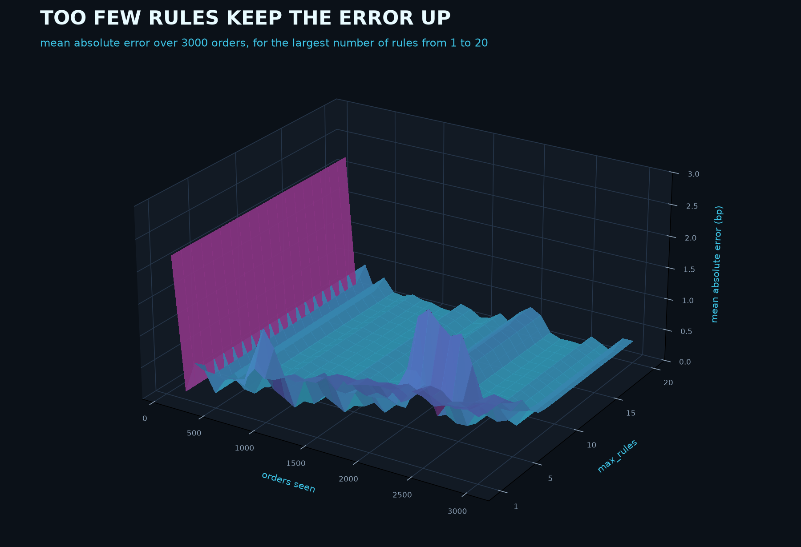
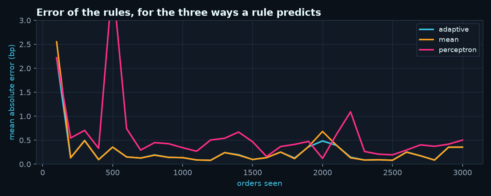

# Options: the strange orders, the number of rules, the way a rule predicts

[← Rules](index.md)

The model can ignore strange orders, keep a few rules and choose how a rule predicts.



## 1. The strange orders

With `anomaly_threshold` set, a rule ignores the orders that look strange to it. In this example we try three orders, 20 times each: one that is strange in both features, one that is strange in a single feature, and one that is normal.

```python
import numpy as np
from dense_armor.core.online.rules import AMRulesRegressor

rows = ({"size": 40.0, "spread": 50.0}, {"size": 0.5, "spread": 50.0}, {"size": 0.5, "spread": 0.2})
for x in rows:
    r = np.random.default_rng(0)
    m = AMRulesRegressor(n_min=100, anomaly_threshold=-0.75, seed=0)
    for _ in range(1500):
        s = float(r.uniform(-1, 1))
        m.learn_one({"size": s, "spread": float(r.uniform(-1, 1))}, 5.0 * (s > 0))
    for _ in range(20):
        m.learn_one(x, 5.0)
    print(m.n_anomalies_)
```

```
20
0
0
```

All 20 orders are ignored when both features are strange, none when only one is, and none when the order is normal. The score of an order is the mean, over the features, of log(P / (1 - P)), where P is the probability of the feature's value for the rule (from the Cantelli inequality). An order is ignored when its score is under the threshold, and only by a rule that has seen more than `m_min` orders (the paper, Section 3.5). An ignored order is not learned by any rule.

## 2. Few rules

`max_rules` is the largest number of rules, `max_literals` the largest number of conditions in a rule.

```python
import numpy as np
from dense_armor.core.online.rules import AMRulesRegressor

for kw in ({"max_rules": 1}, {"max_rules": 3}, {"max_literals": 1}):
    r = np.random.default_rng(0)
    m = AMRulesRegressor(n_min=100, seed=0, **kw)
    for _ in range(2000):
        s = float(r.uniform(-1, 1))
        m.learn_one({"size": s, "spread": float(r.uniform(-1, 1))}, 5.0 * (s > 0))
    print(kw, len(m.rules_))
```

```
{'max_rules': 1} 1
{'max_rules': 3} 2
{'max_literals': 1} 2
```

`max_rules` = 1 keeps 1 rule. With `max_rules` = 3 the list has 2 rules: the cap is a limit, not a target. With `max_literals` = 1 the list has 2 rules, each with at most one condition. When the list is full the default rule cannot make a new rule.

## 3. How a rule predicts

A rule answers with the mean of its targets (`mean`), with a small linear model (`perceptron`) or with the one of the two that has the smaller recent error (`adaptive`, the default). The mean absolute error over the last 1000 of 3000 orders:

```python
import numpy as np
from dense_armor.core.online.rules import AMRulesRegressor

for p in ("adaptive", "mean", "perceptron"):
    r = np.random.default_rng(0)
    m = AMRulesRegressor(n_min=100, prediction=p, seed=0)
    e = []
    for _ in range(3000):
        s = float(r.uniform(-1, 1))
        x = {"size": s, "spread": float(r.uniform(-1, 1))}
        y = 5.0 * (s > 0) + 0.1 * float(r.normal())
        e.append(abs(m.predict_one(x) - y))
        m.learn_one(x, y)
    print(p, round(float(np.mean(e[-1000:])), 3))
```

```
adaptive 0.252
mean 0.251
perceptron 0.337
```

`adaptive` and `mean` give 0.252 and 0.251, `perceptron` 0.337. When several rules cover an order the answers are averaged; with `ordered_set=True` only the first rule that covers the order answers and learns (the paper, Section 3.3).



The table shows the mean absolute error of the slippage, in basis points, over the block of 100 orders that ends at the order in the header (median of 3 streams):

| | 100 | 500 | 1000 | 3000 |
|---|---|---|---|---|
| `adaptive` | 2.217 | 0.355 | 0.136 | 0.355 |
| `mean` | 2.552 | 0.355 | 0.136 | 0.355 |
| `perceptron` | 2.218 | 3.824 | 0.344 | 0.502 |
| `max_rules` = 1 | 2.217 | 0.537 | 0.684 | 1.02 |
| `max_rules` = 5 | 2.217 | 0.355 | 0.136 | 0.834 |
| `max_rules` = 20 | 2.217 | 0.355 | 0.136 | 0.355 |

## 4. The parameters

| Parameter | Meaning | Default |
|---|---|---|
| `ordered_set` | `True` learns and predicts with the first rule that covers a sample; `False` with all of them | `False` |
| `prediction` | `"adaptive"`, `"mean"` or `"perceptron"` | `"adaptive"` |
| `learning_rate` | step of the delta rule of the linear models | 0.01 |
| `anomaly_threshold` | an order with a score under it is ignored; `None` turns the test off | `None` |
| `m_min` | orders a rule needs before it checks anomalies | 30 |
| `max_split_points` | split values kept per feature and rule | 50 |
| `max_rules` | largest number of rules | 100 |
| `max_literals` | largest number of conditions of a rule | 20 |

The constructor raises `ValueError` on a non-positive `n_min`, `learning_rate`, `ph_lambda`, `max_rules`, `max_literals` or `max_split_points`, on `delta` or `alpha` outside (0, 1), a negative `tau`, `ph_phi` or `m_min`, or an unknown `prediction`. `budget_s` is 0.01 s and `memory_class` is `O(window)`.

**Source:** Duarte, Gama, Bifet (2016), Algorithms 1 and 2, Sections 3.1 to 3.5.

## 5. The same on a robot

A small model for the torque of a joint: at most 3 rules of at most 2 conditions.

```python
import numpy as np
from dense_armor.core.online.rules import AMRulesRegressor

r = np.random.default_rng(1)
m = AMRulesRegressor(n_min=100, max_rules=3, max_literals=2, seed=0)
for _ in range(1500):
    v = float(r.uniform(-1, 1))
    m.learn_one({"speed": v, "load": float(r.uniform(-1, 1))}, 5.0 * (v > 0))
print(len(m.rules_), round(m.predict_one({"speed": 0.5, "load": 0.0}), 1), round(m.predict_one({"speed": -0.5, "load": 0.0}), 1))
```

```
2 5.0 0.0
```

There are 2 rules, and the answers are 5.0 for a positive speed and 0.0 for a negative one.

## API reference

::: dense_armor.core.online.rules.amrules.AMRulesRegressor

---

## Details

### Choices

- `ordered_set=False`, `anomaly_threshold=None` and the value 0.01 of `learning_rate` are choices of the library; the paper fixes none of them.
- The figures are drawn by `docs/assets/rules/make_rules_style_figures.py`: 3000 orders, `n_min` = 100, blocks of 100 orders, median of 3 seeds.
