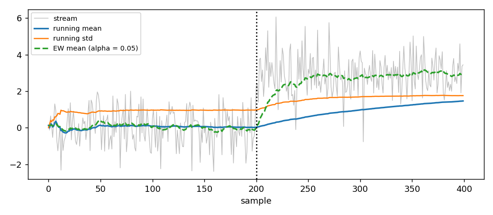

# Moments: the average and the wobble of a stream

These tools keep the average, the wobble and a few other summary numbers of a signal, updated with every new reading, without storing the readings.

## The map of moments

Click a page to open it, or the button at the top to go back to the [map of the library](../../index.md#the-library-folder-by-folder).

<object type="image/svg+xml" data="../../assets/maps/moments.svg" style="width:100%"></object>

## Gamestory

Saturday morning at the market. The young shopkeeper and his assistant have opened the best-stocked stall in the square: they sell trading card packs, action figures, and toy cars.

At the end of the day the shopkeeper wants to know how it went: how much each customer spent on average, whether prices were all similar or wildly different (someone buying a 2-euro pack and someone buying a giant 100-euro set!) and what the lowest and highest receipts were.

Keeping thousands of paper receipts would be a disaster: they would blow away in the wind! So the assistant uses the RunningMoments trick, keeping only a handful of numbers updated on a small sheet, without saving the old receipts:

- **1. What he jots down on the sheet (RunningMoments):** Every time a customer pays, the assistant updates on the fly: how many customers came by (count), the average spending (mean), how much the receipts vary from the average (var and std), whether there were more small or big purchases (skewness), whether someone suddenly made crazy purchases (kurtosis), and the smallest and biggest receipts (min and max). If a customer just stops by to ask a question without buying (NaN), the assistant adds "+1" on n_missing and doesn't ruin the average!
- **2. The trick to keep the math clean (Welford):** A careless apprentice would try to calculate the differences by squaring giant numbers, but when everyone buys toys at the exact same price (for example 90€ ± 0.10€) the math goes haywire and gives a negative number! Instead, the assistant uses a clever formula (the Welford method) that adds only the tiny difference from the current average, staying accurate to the cent.
- **3. Combining the morning and afternoon sheets (merge):** If the assistant jots down the morning sales on one sheet and his friend jots down the afternoon ones on another sheet, at the end of the day they can join them with the merge command and get the exact same result they would have gotten using a single sheet!
- **4. All toys at once (RunningMomentsVector):** Since at the stall they sell cards, action figures, and toy cars at the same time, instead of going crazy with many scattered sheets, the assistant uses a single table called RunningMomentsVector that updates the averages of all toys together on every sale.
- **5. Following the latest trends (EWStats and alpha):** What if in the afternoon a new series of super-rare cards comes out and everyone starts spending much more? A sheet that remembers the whole morning stays held back by the old low prices. So the assistant uses EWStats with the alpha rule: he gives more importance to the latest purchases and slowly forgets the morning ones, so the average updates immediately to the new trend!

In the end, what are Moments (RunningMoments, RunningMomentsVector, and EWStats)? They are super-light tools that calculate and update in real time the summary numbers of a data stream (average, variation, minimum, and maximum) one purchase at a time in fixed memory, without ever having to keep the whole pile of past receipts!

## What this is

Imagine you are watching a single joint of a robot move. You want to
know its average angle, how much it wobbles, and whether the wobble is
symmetric or one-sided. You do not want to keep every reading — the
robot runs for days. You want a handful of numbers that summarize what
has been seen *so far* and update with each new reading.

That handful of numbers is what statisticians call the **moments** of a
distribution: the mean, the variance, the skewness, the kurtosis, plus
the minimum and maximum. This module computes them online, one sample
at a time, in fixed memory.

The figure shows the standard situation. A stream of 400 samples is
drawn from a Gaussian distribution whose mean shifts from 0 to 3 at
sample 200. The grey trace is the raw stream; the blue line is the
running mean that the module computes; the red line is the running
standard deviation. The dashed orange line is the exponentially
weighted mean, which responds more quickly to the shift.

## The three pages

1. [RunningMoments](running_moments.md): the first example with card payments, the first statistic, which value is read, missing readings, timestamps, why the obvious formula fails and a hand case.
2. [Merging and many channels](merge_and_vector.md): joining two halves of a stream, all the joints of a robot at once, merging many channels and a stream from a robot.
3. [EWStats](ewstats.md): following a drift with a forgetting factor, the surface of the mean for many factors and a hand case.
