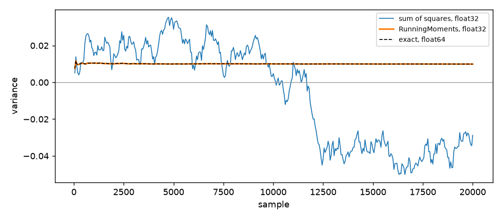

# RunningMoments: mean, wobble, skew and tails

[← Moments](index.md)

`RunningMoments` reads one value at a time and keeps the mean, the variance, the skewness, the kurtosis, the smallest and the largest value, in fixed memory.

## A first example: the payments of a card terminal

A payment processor sees card payments one at a time and wants the number of payments, the average, the spread and the smallest and the largest, without storing them. Five hundred payments around 12 euros, then three authorisation requests that were declined and carry no amount (`NaN`):

```python
import numpy as np
from dense_armor.core.signals.stats.moments import RunningMoments

rng = np.random.default_rng(0)
m = RunningMoments()
for _ in range(500):
    m.learn_one({"x": float(rng.gamma(4.0, 3.0))})
for _ in range(3):
    m.learn_one({"x": float("nan")})
print(m.count, round(m.mean, 2), round(m.std, 2), round(m.min, 2), round(m.max, 2), m.n_missing)
```

```
500 11.55 5.65 1.29 36.15 3
```

The three declined requests are not counted: `count` is 500 and `n_missing` is 3, and they do not change the average. The average payment is 11.55 euros, the standard deviation 5.65, the smallest payment 1.29 and the largest 36.15, all from a handful of numbers that were updated one payment at a time. The steps below take the same tool apart, one piece at a time.


The figure follows the four numbers while the payments arrive. The payments are drawn from a gamma distribution whose exact mean is 12, standard deviation 6, skewness 1 and kurtosis 1.5 (dashed lines). The first payments move the numbers a lot; after a few hundred they settle near the exact values.

## 1. The first statistic

`RunningMoments` reads one value per call, from a dict, and updates its summary.

```python
from dense_armor.core.signals.stats.moments import RunningMoments

m = RunningMoments()
for v in [1.0, 2.0, 3.0, 4.0, 5.0]:
    m.learn_one({"x": v})
print(m.mean, m.var)
```

```
3.0 2.5
```

After the five samples, `m.mean` is `3.0` and `m.var` is `2.5`. The dict `{"x": v}` is one sample. The full set of properties reads:

- `m.count`: number of samples seen;
- `m.mean`: arithmetic mean;
- `m.var`: sample variance, with $n - 1$ in the denominator;
- `m.std`: square root of `var`;
- `m.skewness`: third standardized moment;
- `m.kurtosis`: fourth standardized moment minus 3;
- `m.min`, `m.max`, `m.ptp`: smallest, largest, and their difference;
- `m.n_missing`: number of samples skipped because of `NaN`.

For these five samples, `m.std` is `1.5811`, `m.min` is `1.0`, `m.max` is `5.0` and `m.ptp` is `4.0`.

## 2. Which value is read

A sample often carries more than one number. The argument `feature` says which key to read.

```python
from dense_armor.core.signals.stats.moments import RunningMoments

m = RunningMoments(feature="temperature")
m.learn_one({"temperature": 21.4, "humidity": 0.6})
print(m.mean, m.count)
```

```
21.4 1
```

Only `temperature` was read; `humidity` was ignored. Without `feature`, the estimator reads the key that comes first in alphabetical order, so a dict with the keys `a` and `b` is read at `a`. A `RunningMoments` follows one value; to follow many at once see [RunningMomentsVector](merge_and_vector.md).

## 3. A missing reading

`NaN` is allowed and means "this sensor missed a reading".

```python
from dense_armor.core.signals.stats.moments import RunningMoments

m = RunningMoments()
for v in [1.0, float("nan"), 3.0]:
    m.learn_one({"x": v})
print(m.count, m.n_missing, m.mean)
```

```
2 1 2.0
```

Two valid samples, one skipped, mean of the valid samples `2.0`. The skipped sample is counted in `n_missing` and the running summary is left untouched, so a robot with an intermittent sensor does not see its average poisoned by a missing value.

## 4. Timestamps

The argument `t` of `learn_one` is the time of the sample, in seconds.

```python
from dense_armor.core.signals.stats.moments import RunningMoments

m = RunningMoments()
for i in range(100):
    m.learn_one({"x": 1.0}, t=i * 0.01)
print(round(m.dt, 4), round(m.rate, 1))
```

```
0.01 100.0
```

When the timestamps arrive at a fixed rate, the estimator exposes the median interval between two samples, `dt`, and its reciprocal, `rate`. Here `dt` is 10 milliseconds and `rate` is 100 samples per second. The caller never has to know the sample rate in advance.

## 5. Why the obvious formula fails

The mean and the variance of a set of numbers $x_1, \dots, x_n$ are

$$
\text{mean} = \frac{1}{n}\sum_{i=1}^{n} x_i
$$

$$
\text{var} = \frac{1}{n-1}\sum_{i=1}^{n} (x_i - \text{mean})^2
$$

There is an algebraic identity that rewrites the variance in terms of the raw sum of squares:

$$
\text{var} = \frac{1}{n-1}\left(\sum_{i=1}^{n} x_i^2 - n\,\text{mean}^2\right)
$$

The temptation is to keep two running sums, $\sum x$ and $\sum x^2$, and compute the variance from them. This is a trap. When the mean is large compared to the wobble (a joint holding $90^\circ \pm 0.1^\circ$), the two numbers inside the parenthesis are nearly equal and their difference is dominated by rounding error. In extreme cases the computed variance comes out **negative**.



The figure shows it on 20000 readings of $90 \pm 0.1$ in float32. The exact variance is $0.0099$ (dashed). The sum-of-squares formula wanders and ends at $-0.03$, a variance below zero; `RunningMoments` with `dtype=np.float32` ends at $0.00991035$, the same as the exact value in float64 to the digits shown.

Welford (1962) gives the fix. Instead of the raw sum of squares, keep the *centered* second moment

$$
M_2 = \sum_{i=1}^{n} (x_i - \text{mean})^2
$$

and update it incrementally. Each new sample adds a small correction that never involves cancellation. The same technique extends to the third and fourth moments, $M_3$ and $M_4$, using the formulas of Pébay (2008). Each new sample $x$ first updates the count and the mean:

$$
\begin{aligned}
n &\leftarrow n + 1 \\\
\delta &= x - \text{mean} \\\
\delta_n &= \delta / n \\\
\text{mean} &\leftarrow \text{mean} + \delta_n
\end{aligned}
$$

and then the three moments, with the values they had before this sample:

$$
\begin{aligned}
M_4 &\leftarrow M_4 + \delta\,\delta_n^3\,(n - 1)(n^2 - 3n + 3) + 6\,\delta_n^2\,M_2 - 4\,\delta_n\,M_3 \\\
M_3 &\leftarrow M_3 + \delta\,\delta_n^2\,(n - 1)(n - 2) - 3\,\delta_n\,M_2 \\\
M_2 &\leftarrow M_2 + \delta\,\delta_n\,(n - 1)
\end{aligned}
$$

Every symbol is a number already kept in memory: $n$ is the sample count, $\text{mean}$ is the running mean, $M_2$, $M_3$, $M_4$ are the second, third and fourth central moments, $\delta$ is the deviation of the new sample from the current mean, and $\delta_n = \delta / n$. This is why $M_4$ is updated first and $M_2$ last: each line needs the older values of the lines below it. The update uses only additions, subtractions, multiplications and one division. No sum of squares is ever formed, so no cancellation ever occurs.

Skewness and kurtosis are read off the central moments:

$$
\text{skew} = \frac{M_3 / n}{(M_2 / n)^{3/2}}
$$

$$
\text{kurt} = \frac{n\,M_4}{M_2^2} - 3
$$

The skewness measures the asymmetry of the distribution: zero for a symmetric stream, positive when the right tail is heavier. The kurtosis measures how much the tails stick out compared to a Gaussian: zero for a Gaussian, negative for a light-tailed stream like a uniform distribution, positive for a heavy-tailed stream.

## 6. A hand case

Take the five samples $1, 2, 3, 4, 5$. After all five, the classic formulas give:

$$
\text{mean} = 3,\quad
M_2 = 10,\quad
M_3 = 0,\quad
M_4 = 34
$$

From those,

$$
\text{var} = \frac{M_2}{n - 1} = \frac{10}{4} = 2.5
$$

$$
\text{skew} = 0
$$

$$
\text{kurt} = \frac{5 \cdot 34}{10^2} - 3 = \frac{170}{100} - 3 = 1.7 - 3 = -1.3
$$

The code produces exactly these numbers:

```python
from dense_armor.core.signals.stats.moments import RunningMoments

m = RunningMoments()
for v in [1.0, 2.0, 3.0, 4.0, 5.0]:
    m.learn_one({"x": v})
print(m.mean, m.var, m.skewness, m.kurtosis)
```

```
3.0 2.5 0.0 -1.3
```

The values agree with `numpy` and `scipy.stats` on the same data: `scipy.stats.skew` gives `0.0` and `scipy.stats.kurtosis` gives `-1.3`.

Next: [merging and many channels](merge_and_vector.md).

## Details

### References

- Welford, B. P. (1962). *Note on a method for calculating corrected sums of squares and products.* Technometrics 4(3), 419–420: the incremental update for the mean and the second central moment.
- Pébay, P. (2008). *Formulas for robust, one-pass parallel computation of covariances and arbitrary-order statistical moments.* Sandia Report SAND2008-6212: Corollary 2.2 (page 10) gives the incremental update of a single new sample, and equations 2.13 and 2.16 are the closed forms for $M_3$ and $M_4$, the formulas implemented here:

$$
M_3 \mathrel{+}= \frac{(n-1)(n-2)\,\delta^3}{n^2} - \frac{3\,M_2\,\delta}{n}
$$

$$
M_4 \mathrel{+}= \frac{(n-1)(n^2-3n+3)\,\delta^4}{n^3} + \frac{6\,M_2\,\delta^2}{n^2} - \frac{4\,M_3\,\delta}{n}
$$

### The class

`RunningMoments(feature=None, dtype=None)` is one feature with its running summary. It subclasses `dense_armor.roles.Transformer` and passes `dense_armor.checks.check_estimator`.

### Numeric results on this page

Every number quoted above was produced by running the code on this page, not estimated:

| Quantity | Value |
|---|---|
| 500 gamma payments and 3 `NaN` | `500 11.55 5.65 1.29 36.15 3` |
| `mean`, `var`, `std` of `[1..5]` | `3.0`, `2.5`, `1.5811` |
| `skewness`, `kurtosis` of `[1..5]` | `0.0`, `-1.3` |
| `[1.0, NaN, 3.0]` | count `2`, `n_missing` `1`, mean `2.0` |
| `dt` at 100 Hz | `0.01`, `rate = 100.0` |
| variance of 20000 readings of $90 \pm 0.1$, float32 | sum of squares `-0.03`, `RunningMoments` `0.00991035`, exact `0.00991035` |

The comparison against `numpy` and `scipy.stats` lives in `test/core/signals/stats/test_moments.py` (18 tests, all green).

### The figures on this page

`docs/assets/moments/moments_running.png` and `docs/assets/moments/moments_cancellation.png` are generated by `docs/assets/moments/make_moments_pages.py`. The first feeds 500 gamma payments (shape 4, scale 3) into `RunningMoments` and plots the four properties after each payment. The second feeds 20000 readings of $90 + 0.1 z$ in float32 into `RunningMoments(dtype=np.float32)` and into the two running sums $\sum x$ and $\sum x^2$ in float32, and plots the variance every 50 readings against the exact float64 variance.
