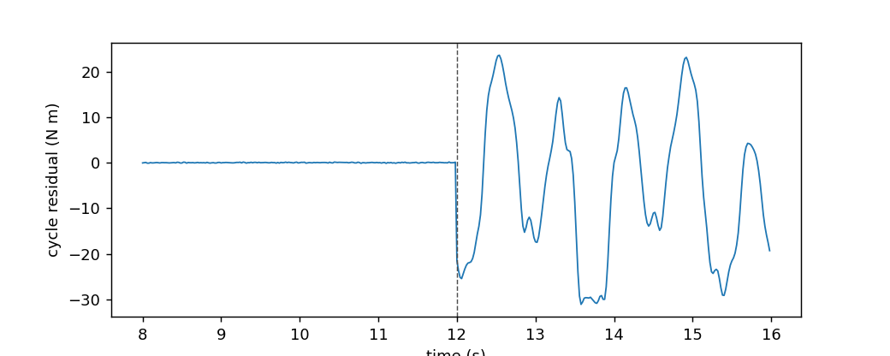

# Time series

**In plain words:** Robot signals change over time. These tools learn how a signal usually moves, so that they can predict the next value or notice when it behaves differently.

Robot signals are time series. A joint torque repeats with the task cycle, a
sensor reading has noise that changes over the day, and the next value of a
signal is the natural "normal" to compare the current one against. The four
estimators in this section learn one sample at a time and answer one of
these questions.

## 1. The four families

A **time-series estimator** is a model whose input is the recent past of a
signal and whose output is a prediction about the future, a residual, or a
smoothed reading. The four families differ in what they predict.

`OnlineAR` predicts the next value of one channel from its own last `order`
values. A joint torque that follows a periodic pattern is a sequence of AR
coefficients, and the model recovers them online. `OnlineVAR` is the same
idea for several channels at once; it predicts every channel from the recent
past of every channel, and a group-lasso penalty keeps the coefficients
sparse when only a few cross-channel relations matter.

`KalmanFilter` predicts the *state* of a system, not its next sample: a
position and a velocity, a pose and a bias. The state evolves with a linear
model, the measurement says what the sensors saw, and the filter combines the
two with the correct weights. Two adaptive variants (`VBAdaptiveKalman`,
`InnovationAdaptiveKalman`) update the noise covariances from the data
themselves when the noise changes.

`CycleResidual` predicts the value of a repetitive motion at the current
phase: it finds the period of the signal, keeps a median template of the last
cycles, and returns the difference between the current sample and the
template. When the motion repeats, the residual is small; when something
breaks the pattern, the residual jumps.

## 2. Which one on which stream

| stream | what changes | estimator | page |
|---|---|---|---|
| one channel with memory (a torque, a temperature) | the recent past predicts the next value | `OnlineAR` | [ar.md](ar.md) |
| several channels with cross-dependence (joint positions, sensor bank) | some channels predict others | `OnlineVAR` | [ar.md](ar.md) |
| a physical state with a model (position, velocity, bias) | the state is hidden, measurements are noisy | `KalmanFilter` | [kalman.md](kalman.md) |
| the same, and the sensor noise itself changes | the noise covariance is not known | `VBAdaptiveKalman`, `InnovationAdaptiveKalman` | [kalman.md](kalman.md) |
| a repeating motion (a pick-and-place cycle, a rotating joint) | the cycle is the normal | `CycleResidual` | [cycle.md](cycle.md) |

## 3. The shared shape

Every estimator in this section learns one sample at a time from a dict, the
same way as the rest of the library. `OnlineAR` with `order=1` learns the
coefficient of a first-order autoregression from a stream:

```python
import numpy as np
from dense_armor.utility.timeseries import OnlineAR

rng = np.random.default_rng(0)
x = 0.0
ar = OnlineAR(order=1, lam=1.0)
for _ in range(300):
    x = 0.8 * x + 0.3 * rng.normal()
    ar.learn_one({"x": float(x)})
print(round(float(ar._w[0]), 4))
```

```
0.811
```

The true coefficient is `0.8`, the learned one is `0.81` after 300 samples.
With `lam = 1.0` the update is ordinary recursive least squares; with a
smaller `lam` older samples weight less, so the coefficient follows a
changing signal. The same interface (`learn_one`, `predict_one`,
`transform_one`) is shared by every class in the section.

## 4. On a real arm

A `SyntheticArm` from a real Panda URDF gives `q`, `qd`, and `tau` at 50 Hz.
The arm repeats its motion every second, and a payload of 5 kg appears on
the last link at `t = 12 s`. `CycleResidual` learns the period and the
template of the joint-1 torque in the healthy part, then measures how far
every new sample sits from the template:

```python
from pathlib import Path
from dense_armor.utility.datasets import SyntheticArm
from dense_armor.utility.timeseries import CycleResidual

ds = SyntheticArm(
    Path("test/fixtures/urdf/panda.urdf"),
    period_s=1.0, rate_hz=50.0, n_cycles=16,
    fault_at_s=12.0, fault="payload", payload_mass=5.0, seed=0,
)
cr = CycleResidual(period=200, n_cycles=2)
res = []
for sig, _ in ds.stream():
    out = cr.transform_one({"x": float(sig["tau_1"])})
    res.append(out["residual"])
```



Before the fault the residual is around `0.05 N m`; after the fault it is
around `12.7 N m`, a factor of `266`. A control loop that watches this
residual sees the change at once, without knowing the payload model.

## 5. Numbers

The suite runs on a desktop CPU. The default (`pytest -m "not slow"`) is
fast: 26 tests in about 5 seconds. The two cycle tests are marked slow
because the JAX compilation of `SyntheticArm` costs about 45 seconds on the
first call; with them the full suite is 28 tests in about 50 seconds.

| estimator | per-sample | memory class |
|---|---|---|
| `OnlineAR(order=1)` | < 1 ms | `O(1)` |
| `OnlineVAR(order=1)` | < 1 ms | `O(1)` |
| `KalmanFilter` | < 1 ms | `O(1)` |
| `VBAdaptiveKalman` | 5 iterations, < 1 ms | `O(1)` |
| `InnovationAdaptiveKalman` | window of 50, < 1 ms | `O(window)` |
| `CycleResidual(period=200, n_cycles=2)` | < 1 ms | `O(window)` |

## Details

### References

Zaman, B., Lopez Ramos, L. M., Romero, D., Beferull-Lozano, B. (2019).
*Online topology identification from vector autoregressive time series*.
arXiv:1904.01864 - the TIRSO algorithm used by `OnlineVAR`.

Mbalawata, I. S., Sarkka, S., Vihola, M., Haario, H. (2013). *Adaptive
Metropolis algorithm using variational Bayesian adaptive Kalman filter*.
arXiv:1308.5875 - the VB-AKF update of `VBAdaptiveKalman`.

Popescu, M., Mronga, D., Kumar, S., Kirchner, F. (2026). *Residual-based
adaptive Kalman filtering for legged robot state estimation*.
arXiv:2608.02316 - the innovation and residual adaptation of
`InnovationAdaptiveKalman`.

### Choices stated explicitly

- **One sample at a time, dict inputs.** Every class in this section
  follows the same interface as the rest of the library: `learn_one(x)`
  takes a dict and returns the estimator, `predict_one(x)` returns the
  prediction, `transform_one(x)` returns the residual or the innovation.
- **The four families are independent.** `OnlineAR`/`OnlineVAR` predict
  samples, `KalmanFilter` and its variants predict states, `CycleResidual`
  predicts a repeating value. They do not share a base class beyond
  `Transformer`.
- **The examples use `SyntheticArm` for the arm**, never a hand-written
  stream. The stream carries the standard joint-state channels at the
  standard rate.

### Measured cost

Per-sample latency is `budget_s = 1e-3 s` for every class, measured on the
author machine as the p99 of `learn_one`. The cost is dominated by numpy
or JAX arithmetic, never by the model state itself. `CycleResidual` is the
only one with a `memory_class` of `O(window)`: the raw buffer is capped at
`n_cycles * period + 2 * max_period` samples.

### Development diary

This section was promoted from the `benchmarks/anomaly_streaming.py` script
that used a cycle residual on the CASPER dataset, the review of the
`task13-timeseries` branch, and the four papers listed above. The first
delivery had a bug in `OnlineVAR._init` (a `delta * I` term not in the
paper, eq. 21a) and a `CycleResidual` buffer that grew without bound; both
were fixed in the same review round, and the test that catches the first one
runs 400 samples of an AR(1) stream instead of the 50 the original test used.
